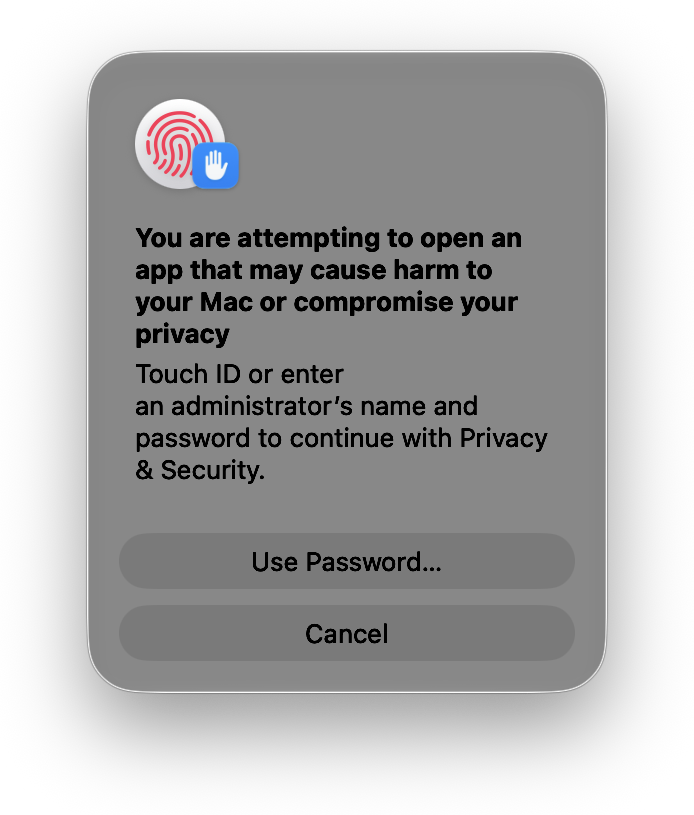

<!-- languages:start -->

<b>🌐 Language · Idioma · Langue · Sprache · Язык · 语言 · 言語 · 언어 · भाषा · لغة</b>

 

<table>
  <tr>
    <td align="center"><a href="../../README.md">English</a></td>
    <td align="center"><b>العربية</b></td>
    <td align="center"><a href="README.bn.md">বাংলা</a></td>
    <td align="center"><a href="README.zh-Hans.md">简体中文</a></td>
    <td align="center"><a href="README.fil.md">Filipino</a></td>
  </tr>
  <tr>
    <td align="center"><a href="README.fr.md">Français</a></td>
    <td align="center"><a href="README.de.md">Deutsch</a></td>
    <td align="center"><a href="README.hi.md">हिन्दी</a></td>
    <td align="center"><a href="README.id.md">Bahasa Indonesia</a></td>
    <td align="center"><a href="README.it.md">Italiano</a></td>
  </tr>
  <tr>
    <td align="center"><a href="README.ja.md">日本語</a></td>
    <td align="center"><a href="README.ko.md">한국어</a></td>
    <td align="center"><a href="README.fa.md">فارسی</a></td>
    <td align="center"><a href="README.pt-BR.md">Português (Brasil)</a></td>
    <td align="center"><a href="README.ru.md">Русский</a></td>
  </tr>
  <tr>
    <td align="center"><a href="README.es.md">Español</a></td>
    <td align="center"><a href="README.te.md">తెలుగు</a></td>
    <td align="center"><a href="README.th.md">ไทย</a></td>
    <td align="center"><a href="README.tr.md">Türkçe</a></td>
    <td align="center"><a href="README.vi.md">Tiếng Việt</a></td>
  </tr>
</table>

<!-- languages:end -->

# HomePad for macOS

> كُتبت هذه الترجمة بواسطة الذكاء الاصطناعي ولم يراجعها ناطقون أصليون. HomePad متوفر أيضًا بهذه اللغة؛ وأسماء الأزرار والقوائم مذكورة هنا كما يعرضها التطبيق (يمكنك تغيير اللغة من الإعدادات ← عام ← اللغة). المرجع المعتمد هو [README الإنجليزي](../../README.md).

**كل ما تستخدمه على بُعد ضغطة مفتاح واحدة.** HomePad هو المشغّل الذي كان ينقص جهاز Mac لديك: رتّب تطبيقاتك في فئات، وضعها في مجلدات، وثبّت المفضّلة منها، وابحث في كل شيء فورًا، وأبقِ التطبيقات قيد التشغيل أمام عينيك، مع شريط مهام بنمط Windows اختياري إن أردته.

مشغّل بنمط Windows: تضغط على اختصار فتظهر في منتصف الشاشة لوحة فيها شريط بحث في الأعلى (يبحث في الفهرس نفسه الذي يستخدمه Spotlight) وشبكة من التطبيقات المثبّتة في الأسفل.

يعمل HomePad في ثلاثة أوضاع. اختر المناسب لك من الإعدادات ← الوضع.

**شريط المهام.** يحاكي شريط مهام Windows وقائمة ابدأ. إن كنت تفتقد تجربة Windows على macOS فستشعر وكأنك في بيتك.

**Dock + HomePad.** لمن يريد الإبقاء على «Dock» في macOS لكنه يحتاج إلى مشغّل بنمط قائمة ابدأ. في macOS مشغّل «التطبيقات» (Apps)، لكنه غير ملهم: فهو يرتّب تطبيقاتك في فئات تلقائيًا، ولا يمكنك اختيارها، ولا تجميع التطبيقات في مجلدات، ولا تثبيت المفضّلة، ولا ترتيبه كما تشاء. يحلّ HomePad كل ذلك.

**مستقل.** للبسطاء الذين يريدون أكبر مساحة ممكنة من الشاشة دون «Dock» أو شريط مهام يزاحمان الشاشة. تستدعي HomePad باختصار لوحة المفاتيح أو بنقرة مزدوجة أو بدفع الماوس نحو زاوية نشطة كلما احتجت إليه. يظهر في المنتصف، وتتحكم تحكمًا كاملًا في تطبيقاتك المفضّلة وملفاتك ومجلداتك والبحث والتطبيقات قيد التشغيل ونوافذها. لا تحتاج إلى «Dock» ولا إلى Spotlight: تتحكم في جهاز Mac من مكان واحد. قد يبدو الأمر غريبًا في البداية، لكنه يصبح قويًا بشكل مذهل بمجرد أن تعتاده.

## التثبيت

HomePad مجاني وغير موقّع من Apple، لذلك يوقفه macOS مرة واحدة ويطلب منك تأكيد أنه سليم. يستغرق الأمر نحو خمس دقائق، ومرة واحدة فقط. تحتاج إلى macOS 13 (Ventura) أو أحدث؛ وتعمل أجهزة Mac بمعالج Apple silicon وIntel كلتاهما. (يشرح [INSTALL.md](../../INSTALL.md) الخطوات نفسها بالكلمات، وكذلك لملف zip وصورة القرص العادية.)

**1. افتح صورة قرص المثبّت.** انقر نقرًا مزدوجًا على `HomePad-Installer.dmg` (من الشخص الذي شاركك HomePad، أو ابنِه بنفسك: `tools/make_installer_dmg.sh`، انظر [Build and run](../../README.md#build-and-run)). تعرض نافذتها الخطوات.

**2. انقر نقرًا مزدوجًا على Install HomePad.pkg.** يقول Mac إنه لا يستطيع فتحه. انقر على **تم**، وليس على «نقل إلى سلة المهملات».

**3. اسمح به من الخصوصية والأمن.** انقر نقرًا مزدوجًا على المربع الأزرق **فتح الخصوصية والأمن** في نافذة صورة القرص (أو افتح بنفسك إعدادات النظام ← الخصوصية والأمن)، ومرّر إلى الأسفل حتى **الأمن**، وانقر على **فتح على أي حال** بجانب الرسالة الخاصة بالمثبّت.

**4. أكّد.** انقر على **فتح على أي حال** في الرسالة التالية، ثم استخدم Touch ID أو أدخل كلمة سر جهاز Mac.

<table align="center"><tr>
<td align="center"></td>
<td align="center"></td>
</tr></table>

> في macOS 13 Ventura و14 Sonoma يوجد اختصار: انقر بزر الماوس الأيمن على المثبّت، واختر **فتح**، ثم **فتح** مرة أخرى.

**5. تابع خطوات المثبّت.** انقر على **متابعة** عند المقدمة، وما تتوقعه، والوجهة (لجميع مستخدمي هذا الكمبيوتر)، ثم على **تثبيت**. يطلب Mac كلمة السر مرة واحدة. عندما يقول المثبّت إن HomePad في مجلد «التطبيقات» لديك، انقر على **إغلاق**.

<table align="center">
<tr>
<td align="center"></td>
<td align="center"></td>
</tr>
<tr>
<td align="center"></td>
<td align="center"></td>
</tr>
<tr>
<td align="center" colspan="2"></td>
</tr>
</table>

**6. دليل الإعداد.** يُفتح HomePad من تلقاء نفسه بنافذة ترحيب. اسمح بالأذونات الثلاثة، واختر كيف تريد فتح HomePad (اختصار لوحة المفاتيح، أو النقر المزدوج، أو الزوايا النشطة)، وانقر على **البدء**. كل إذن اختياري، لكن HomePad يعمل بأفضل صورة مع الثلاثة جميعًا.

**7. الأذونات.** انقر على **السماح…** بجانب كل إذن، من الأعلى إلى الأسفل.

- **تسجيل الشاشة** (معاينات نوافذ التطبيق قيد التشغيل). تظهر رسالة فيها قفل: انقر على **فتح إعدادات النظام**، وشغّل المفتاح بجانب **HomePad**، ثم انقر على **إنهاء وإعادة فتح**. يُعاد تشغيل HomePad تلقائيًا وتعود نافذة الترحيب. قد يسأل macOS مرة أخرى إن كنت تسمح لـ HomePad بالوصول إلى شاشتك مباشرة: انقر على **سماح**.

<table align="center">
<tr>
<td align="center" valign="top"></td>
<td align="center" valign="top"></td>
</tr>
<tr>
<td align="center" valign="top"></td>
<td align="center" valign="top"></td>
</tr>
</table>

- **تسهيلات الاستخدام** (الانتقال إلى النافذة التي تختارها، واختصار النقر المزدوج). انقر على **السماح…**، ثم على **فتح إعدادات النظام** في الرسالة، وشغّل المفتاح بجانب **HomePad** (أدخل كلمة السر إن طُلبت). في إصدارات macOS الحديثة تُسمّى هذه الصفحة في الواجهة الإنجليزية **Device Control and Data Access**.

- **الوصول الكامل إلى القرص** (العثور على الملفات في المستندات وسطح المكتب والتنزيلات). انقر على **السماح…**؛ تُفتح إعدادات النظام ومعها نافذة HomePad صغيرة بجانبها. شغّل المفتاح بجانب **HomePad**. إن لم يكن في القائمة، فاسحب أيقونته من النافذة الصغيرة إلى القائمة.

**8. استخدمه.** اضغط على **Option-مسافة** (أو الاختصار الذي اخترته). كل ما عدا ذلك، بما في ذلك الأوضاع الثلاثة أعلاه، في الإعدادات: انقر بزر الماوس الأيمن على أيقونة الشبكة في شريط القائمة، ثم **الإعدادات…**.

## طريقة الاستخدام

- **Option-مسافة** يفتح اللوحة ويغلقها (غيّره من الإعدادات)، أو انقر مرتين على Control أو Option أو Command (الإعدادات ← الفتح؛ يحتاج إلى إذن «تسهيلات الاستخدام»).
- **الزوايا النشطة**: الإعدادات ← الفتح ← الزوايا النشطة. انقر على أي من زوايا الشاشة الصغيرة الأربع (واحدة أو عدة أو كلها). أبقِ المؤشر في زاوية مختارة لحظة فتُفتح اللوحة في تلك الزاوية؛ افعل ذلك مرة أخرى لإغلاقها. المرور السريع بجانب الزاوية أو السحب مع الضغط على زر الماوس لا يفعل شيئًا. يظل الاختصار والنقر المزدوج يفتحانها في المنتصف. وهي موجودة أيضًا في الخطوة الثانية من دليل الإعداد. إذا كان macOS يستخدم الزاوية نفسها لأحد إجراءاته، يخبرك HomePad بذلك، مع زر **فتح ”الزوايا النشطة“ في macOS…** الذي يفتح إعدادات النظام ← سطح المكتب وDock وقد ظهرت ورقة «الزوايا النشطة» (الضغط على هذا الزر يحتاج إلى «تسهيلات الاستخدام»؛ وبدونها تُفتح الصفحة فقط).
- **الفئات**: تعيش التطبيقات في فئات مسمّاة. تأتي **الأساسيات** أولًا وتُملأ من الـ Dock عند أول تشغيل، إضافةً إلى فئة **الملفات** فيها سلة المهملات والتنزيلات، كما في الطرف الأيمن من الـ Dock (عند أول تشغيل فقط؛ وإن حذفتها بقيت محذوفة). أضف فئاتك (المتصفحات، الكتابة…) بـ **إضافة فئة** أو بالنقر بزر الماوس الأيمن على مساحة فارغة. تعرض الفئة الجديدة مربعًا باهتًا «أضف تطبيقك هنا». انقر بزر الماوس الأيمن داخل فئة لإعادة تسميتها أو حذفها (ويُلغى تثبيت كل ما فيها أيضًا؛ أما التطبيقات والملفات نفسها فلا تُمَسّ).
- **إضافة الملفات والمجلدات**: **إضافة ملف أو مجلد** (رابط في الأعلى، أو قائمة النقر الأيمن، أو الإعدادات)، أو اسحبها من Finder، أو انقر بزر الماوس الأيمن على نتيجة بحث ← تثبيت. تُفتح عند النقر؛ وتُفتح المجلدات في Finder. أداة الاختيار نافذة تصفّح بها شريط جانبي (المنزل، سطح المكتب، المستندات، التنزيلات، …، الأقراص) وعنصر **سلة المهملات** يثبّت سلة المهملات لديك. النقر على مكان في الشريط الجانبي (المستندات، التنزيلات، سلة المهملات …) يفتحه ويختار المجلد بنفسه، فيصبح **إضافة** جاهزًا. لا تحجب هذه النوافذ اللوحة: انقل إحداها جانبًا واسحب أي مربع منها إلى اللوحة. انقر بزر الماوس الأيمن على مربع سلة المهملات لتجد **إفراغ ”سلة المهملات“…** (يسألك أولًا؛ وHomePad يجعل Finder يفرغها كما يفعل الـ Dock، لذلك يسأل macOS في المرة الأولى عمّا إذا كان يحق لـ HomePad التحكم في Finder).
- **ترتيب الفئات**: يتحول اسم الفئة إلى الأخضر عندما تشير إليه. اضغط عليه فيتحدد الصف كله (تعبئة وإطار أخضران)؛ اسحب فيتحرك الصف نفسه بينما تنزلق الصفوف الأخرى جانبًا لتفسح المجال (وتبقى اللوحة في مكانها). اترك فيبقى حيث وصل. أو انقر بزر الماوس الأيمن داخل فئة واختر **نقل لأعلى** / **نقل لأسفل**. وأثناء سحب أي شيء تتوقف تأثيرات التمرير ومعاينات النوافذ. يمكن نقل «الأساسيات» أيضًا؛ وتبقى المكان الافتراضي للعناصر الجديدة ولا يمكن حذفها. خطوط رمادية رفيعة تفصل بين الفئات.
- **النقر الأيمن للإضافة**: انقر بزر الماوس الأيمن على مساحة فارغة داخل فئة (عنوانها، أو الفراغات بين مربعاتها وبعدها) فتضيف القائمة إلى *تلك* الفئة: «إضافة تطبيق إلى الملفات…» و«إضافة ملف أو مجلد إلى الملفات…»، إضافةً إلى إضافة فئة وإعادة تسمية وحذف لها، و**ترتيب أبجدي** (يرتّب مربعات الفئة أبجديًا حسب الأسماء التي تعرضها؛ ويكون باهتًا إذا كانت مرتبة أصلًا؛ أما المربعات داخل مجلداتها فتحتفظ بترتيبها). المساحة الفارغة تحت آخر قسم تتبع ذلك القسم.
- **إضافة التطبيقات**: زر «إضافة تطبيق» (انقر نقرًا مزدوجًا على تطبيق في أداة الاختيار لإضافته وإغلاقها)، أو النقر الأيمن على مساحة فارغة، أو سحب التطبيقات من Finder (اضغط على الاختصار أثناء السحب)، أو النقر الأيمن على نتيجة بحث ← تثبيت التطبيق.
- **المجلدات** (كما في قائمة ابدأ في Windows): اسحب مربعًا إلى منتصف أيقونة مربع آخر، وأبقِه هناك نصف ثانية حتى تضيء تلك الأيقونة، ثم اتركه: يتحول المربعان إلى مجلد في ذلك المكان اسمه «مجلد»، ويعرض مربعه أول أربعة عناصر. أسقط مزيدًا من المربعات على المجلد لإضافتها. انقر على مجلد لفتحه فوق اللوحة: انقر على اسمه لإعادة تسميته، وعلى عنصر لفتحه، واسحب العناصر لإعادة ترتيبها أو إلى خارج المجلد (فيُغلق ليتسنى لك إفلات العنصر بين المربعات الأخرى). يغلقه Esc أو النقر خارجه. المجلد الذي يبقى فيه عنصر واحد يعود إلى ذلك العنصر. انقر بزر الماوس الأيمن على مجلد لتجد «إعادة تسمية المجلد…» و«نقل إلى» و«فك التجميع»؛ وعلى عنصر في مجلد مفتوح لتجد «إزالة من المجلد». أما السحب فوق حواف المربع (لا منتصفه) فيعيد الترتيب فقط.
- **الإزالة / إعادة الترتيب**: انقر بزر الماوس الأيمن على مربع ← إلغاء تثبيت التطبيق / نقل إلى، أو اسحب المربعات، بما في ذلك بين الفئات.
- **التطبيقات قيد التشغيل**: شريط أحمر تحت الأيقونة مباشرة (فوق اسمها) يعني أن التطبيق يعمل. أشر إلى تطبيق قيد التشغيل لترى صورة مصغرة لكل نافذة من نوافذه (وللنافذة المصغرة علامة ناقص بجانب علامة الإغلاق)، على كل سطح مكتب (Space)، بترتيب Mission Control وبعنوان «Space N» عندما يكون للتطبيق نوافذ على أكثر من سطح، وانقر على إحداها للانتقال إليها مباشرة (مع تبديل أسطح المكتب عند الحاجة)، أو انقر على علامة الإغلاق في زاويتها لإغلاق تلك النافذة وحدها (وهذا يعمل أيضًا مع النوافذ على أسطح المكتب الأخرى) (يحتاج إلى «تسجيل الشاشة» و«تسهيلات الاستخدام»؛ وبدون «تسجيل الشاشة» تحصل على قائمة بسيطة). النقر على تطبيق قيد التشغيل يجعل سطح المكتب الحالي أولًا: نافذة ظاهرة هناك تُحضر التطبيق إلى الأمام؛ وإن كانت نوافذه هناك كلها مصغّرة تعود أحدثها؛ ولا ينقلك إلى سطح مكتب آخر له فيه نوافذ إلا إذا لم تكن هناك أي نافذة. يسرد قسم **قيد التشغيل** كل تطبيق يعمل (مثبّتًا كان أم لا، مثل مؤشرات التشغيل في الـ Dock)؛ لا يمكن إضافة شيء إليه ولا إزالته، لكن يمكن **سحب مربعاته داخله لإعادة ترتيبها** (أبجديًا حتى تحرّك أحدها؛ ويُتذكّر الترتيب، حتى لتطبيق يُنهى ثم يبدأ من جديد؛ ولا يمكن إفلات المربع في أي مكان آخر، ويعيده Esc أو الإفلات في مكان آخر؛ والنقر الأيمن على «قيد التشغيل» ← **ترتيب أبجدي** ينسى ترتيبك)، ولا يمكن إعادة تسمية القسم نفسه لكن يمكن سحبه من عنوانه (أو نقله بـ **نقل لأعلى** / **نقل لأسفل** في قائمة النقر الأيمن) إلى أي مكان بين الفئات، ويمكن إخفاؤه (انقر عليه بزر الماوس الأيمن ← إخفاء «قيد التشغيل»؛ وأعده من الإعدادات ← اللوحة ← إظهار قسم «قيد التشغيل»). يمكن أن تتبع **النوافذ المصغّرة** لكل تطبيق قيد التشغيل مربعه هناك، كمربعات مستقلة: صورة للنافذة مع أيقونة التطبيق في الزاوية وعنوان النافذة (كما يعرضها الـ Dock). انقر على إحداها لاستعادة تلك النافذة؛ وانقر بزر الماوس الأيمن لتجد «استعادة» أو «إغلاق النافذة». هي متوقفة افتراضيًا: شغّل الإعدادات ← اللوحة ← إظهار النوافذ المصغرة في «قيد التشغيل»، أو انقر بزر الماوس الأيمن على «قيد التشغيل» ← إظهار النوافذ المصغرة. تُجمع في كل مرة تُفتح فيها اللوحة (يحتاج إلى «تسهيلات الاستخدام»؛ والصور تحتاج إلى «تسجيل الشاشة»).
- **قائمة التطبيق قيد التشغيل**: انقر بزر الماوس الأيمن على تطبيق قيد التشغيل لتظهر قائمة كقائمة الـ Dock: نوافذه (تُعلَّم النافذة الأمامية؛ اختر واحدة لإحضارها إلى الأمام)، وأوامر «جديد …» من قائمة «ملف» فيه (علامة تبويب جديدة، نافذة جديدة، نافذة خاصة جديدة في المتصفح)، ثم **إغلاق النوافذ** (فقط إذا كانت له نافذة مفتوحة) و**إخفاء** و**إنهاء** (اضغط على Option لإنهاء إجباري؛ والتطبيق الذي يظل يعمل بعد «إنهاء» بثوانٍ يحصل على **إنهاء إجباري** بدلًا منه؛ وليس لـ Finder «إنهاء»، كما في الـ Dock، لأن إنهاءه يزيل أيقونات سطح المكتب). تُقرأ النوافذ والأوامر عبر «تسهيلات الاستخدام» عندما يصل المؤشر إلى المربع.
- **العثور على الملفات**: لا تظهر الملفات في المستندات وسطح المكتب والتنزيلات في البحث إلا بعد أن يحصل HomePad على **الوصول الكامل إلى القرص** (إعدادات النظام ← الخصوصية والأمن). وإلى ذلك الحين تعرض النتائج إشعارًا مع رابط إلى المفتاح.
- **الآلة الحاسبة**: اكتب عملية حسابية مثل `7+3` أو `(2+3)*4` أو `2^10` أو `15%` فتظهر الإجابة أولًا. ↩ أو زر النسخ ينسخها.
- **النافذة**: اسحب أي حافة أو زاوية من اللوحة لتغيير حجمها (للحواف شرائط إمساك عريضة وتُظهر مؤشرات تغيير الحجم)، أو اسحب أي جزء فارغ لنقلها (وليس شبكة المربعات نفسها، حيث يعيد السحب ترتيب المربعات). يكون لحقل البحث التركيز كلما فُتحت اللوحة، فيمكنك الكتابة فورًا؛ وبعد أن تنقر في مكان آخر يعود أول مفتاح تكتبه إليه. في الإعدادات ← اللوحة خياران: **تذكّر حجم النافذة** (يعمل افتراضيًا) و**تذكّر موضع النافذة** (متوقف افتراضيًا). يعيد الزر ↺ بجانب ترس الإعدادات اللوحة إلى الحجم القياسي، في المنتصف. ويمكن أيضًا تغيير حجم نافذتي «إضافة تطبيق» و«إضافة ملف أو مجلد» (لكنهما تُفتحان دائمًا بحجمهما القياسي).
- **اسمك** في الزاوية السفلية للوحة يفتح إعدادات النظام على حساب Apple الخاص بك.
- **البحث**: ابدأ بالكتابة فقط. تأتي التطبيقات أولًا، ثم المستندات والمجلدات، ثم بحث على الويب. ↑ ↓ للاختيار، ↩ للفتح، ⌘↩ للعرض في Finder، Esc للمسح ثم الإغلاق. والزر ‹ أو النقر على مساحة فارغة يعيدك أيضًا إلى تطبيقاتك.

## أول تشغيل

تطلب منك نافذة ترحيب السماح بـ «تسجيل الشاشة» و«تسهيلات الاستخدام» و«الوصول الكامل إلى القرص» واختيار كيفية فتح HomePad (انظر التثبيت). أعد فتحها في أي وقت من أيقونة شريط القائمة ← دليل الإعداد…

## الإعدادات

للإعدادات ست علامات تبويب في شريط الأدوات: **الوضع** و**عام** (اللغة، أيقونة شريط القائمة، الفتح عند تسجيل الدخول، إعادة التعيين إلى الإعدادات الافتراضية، البدء من جديد) و**شريط المهام** و**الفتح** (الاختصار، النقر المزدوج، الزوايا النشطة) و**اللوحة** (التخطيط، النافذة، العناصر) و**الأذونات**. وتُفتح على علامة التبويب التي استخدمتها آخر مرة.

- **الاختصار**: انقر على الزر واضغط على تركيبة جديدة. لاستخدام ⌘مسافة، عطّل أولًا اختصار Spotlight في إعدادات النظام ← لوحة المفاتيح ← اختصارات لوحة المفاتيح ← Spotlight.
- **الاختصار**: سجّل واحدًا، أو اختر **بلا** إن كنت تريد النقر المزدوج فقط، أو **إعادة تعيين** لإعادته إلى ⌥مسافة.
- **أيقونة شريط القائمة**: يمكن لـ الإعدادات ← عام إخفاؤها. ويؤدي فتح التطبيق مرة أخرى إلى فتح اللوحة.
- **إعادة التعيين إلى الإعدادات الافتراضية**: يعيد الاختصار والنقر المزدوج والتخطيط وإخفاء الـ Dock والفتح عند تسجيل الدخول (وتبقى التطبيقات والفئات).
- **النقر المزدوج**: الفتح بالنقر مرتين على Control أو Option أو Command.
- **الأيقونات في كل صف** (8 افتراضيًا، من 4 إلى 10) و**ارتفاع الصف** (المسافة بين صفوف الأيقونات، 101 نقطة افتراضيًا، من 85 إلى 125) و**المسافة بين الأيقونات** (الفراغ الأفقي بين الأيقونات، 10 نقاط افتراضيًا، من 0 إلى 40؛ وعندما تضيق اللوحة عن هذا الفراغ تتقلص المسافة أولًا ثم الأيقونات): اكتب رقمًا أو انقر على − / +، **إظهار التطبيقات قيد التشغيل**، **إعادة الاستيراد من الـ Dock**.
- **الوضع** (علامة التبويب الأولى):
  - **مستقل** (الافتراضي): اللوحة العائمة، تُفتح بالاختصار أو النقر المزدوج أو الزوايا النشطة أو أيقونة شريط القائمة. التبديل إليه يخفي الـ Dock؛ و**إخفاء ”Dock“** أدناه يعيده.
  - **HomePad + ”Dock“**: أسلوب عمل قائمة ابدأ في Windows مع الـ Dock بدل شريط المهام. اختياره يُظهر الـ Dock دائمًا (يعطّل الإخفاء التلقائي، سواء من HomePad أو من إعدادات النظام) ويضيف HomePad إليه إن لم يكن فيه (يُعاد تشغيل الـ Dock مرة واحدة)؛ ويبقى الـ Dock حيث وضعته. تُفتح اللوحة بجوار أيقونة HomePad مباشرة (فوقها إن كان الـ Dock في الأسفل، وبجانبها إن كان على الجانب، مع إبقائها داخل الشاشة) سواء نقرت على الأيقونة أو استخدمت الاختصار أو النقر المزدوج؛ والنقر على الأيقونة مرة أخرى يغلقها. وتظل الزوايا النشطة تفتحها في زاويتها. تذكر الإعدادات سبب فتحها في المنتصف عندما لا يكون HomePad في الـ Dock، أو يكون الـ Dock مخفيًا، أو يكون إذن «تسهيلات الاستخدام» ناقصًا.
  - **شريط المهام**: شريط مهام بنمط Windows على طول أسفل الشاشة الرئيسية: زر ابدأ (أيقونة HomePad)، ثم ما ثبّتّه عليه والتطبيقات قيد التشغيل، في الوسط. وعندها تغادر التطبيقات قيد التشغيل اللوحة. ثبّت التطبيقات والملفات والمجلدات بالنقر بزر الماوس الأيمن على المساحة الفارغة في شريط المهام (**إضافة تطبيق…**، **إضافة ملف أو مجلد…**) أو على مربع (**التثبيت على شريط المهام**؛ وفي لوحة HomePad أيضًا). وفي قائمة أيقونة شريط المهام أيضًا **التثبيت على HomePad** (أو إلغاء التثبيت من HomePad) لفئات HomePad الخاصة. أو اسحب التطبيقات والملفات والمجلدات إلى شريط المهام، من Finder أو من لوحة HomePad: تُثبَّت قبل الأيقونة التي تُفلت عليها، أو في النهاية عند المساحة الفارغة (وما كان مثبّتًا يُنقل إلى هناك؛ وتحتفظ اللوحة بمثبّتاتها). تثبيتات شريط المهام قائمة مستقلة بعيدة عن فئات HomePad. اسحب الأيقونات على طول شريط المهام لإعادة ترتيبها. تقع **أيقونات التطبيقات** في **الوسط** أو في **اليمين**؛ وما دامت في الوسط يمكن أن تكون **أيقونة HomePad** في الوسط معها أو في أول الشريط (وعندما تكون أيقونات التطبيقات في أوله تكون هي هناك دائمًا، ولذلك يكون الخيار باهتًا). في العربية والفارسية يكون «أول» الشريط هو اليمين، معكوسًا كما في Windows. وعندما تكون أيقونة HomePad في أول الشريط تُفتح لوحتها عند الحافة أعلى شريط المهام. على الجانب الآخر **الشبكة** و**مستوى الصوت** و**البطارية** و**الساعة**، لكل منها مفتاح: تفتح الشبكة والبطارية صفحتيهما في إعدادات النظام (لا يمكن فتح قوائم الحالة الخاصة بـ macOS من الخارج في macOS الحديث)، ويفتح مستوى الصوت شريط تمرير (مرّر فوقه لتغيير مستوى الصوت)، وتفتح الساعة تقويمًا. انقر على عنصر لفتحه أو إحضاره إلى الأمام (أو إخفائه إن كان في الأمام أصلًا)؛ وأشر إلى تطبيق قيد التشغيل لترى نوافذه؛ وانقر بزر الماوس الأيمن لقائمته. تسرد الإعدادات ← شريط المهام ← **التطبيقات قيد التشغيل** (مطوية في البداية) كل تطبيق قيد التشغيل مع مفتاح **إظهار على شريط المهام**؛ والتطبيق المُعطَّل يبقى خارج شريط المهام ما دام يعمل (وكذلك **إخفاء من شريط المهام** في قائمته). تظهر العناصر المثبّتة دائمًا. وإخفاء تطبيق (Cmd-H) لا يغيّر شريط المهام. تُفتح اللوحة في الوسط أعلى شريط المهام. يكون الـ Dock مخفيًا في أثناء ذلك. لا يسمح macOS إلا للـ Dock بإبقاء النوافذ خارج جزء من الشاشة، لذلك يقصّر HomePad النافذة، بوجود «تسهيلات الاستخدام»، عند فتحها أو تغيير حجمها أو تكبيرها أو تبليطها بحيث تصل إلى ما تحت شريط المهام (وتُرفع بدلًا من ذلك إن صارت قصيرة جدًا). أما النافذة التي تُسحب إلى هناك فقط فتُترك كما هي، كما في Windows. (إبقاء الـ Dock الحقيقي تحت شريط المهام لم ينجح: فهو يعرض أسماءه حيثما مرّ المؤشر على أيقوناته.) **إخفاء شريط المهام تلقائيًا** يزلقه خارج أسفل الشاشة حتى يستقر المؤشر على الحافة السفلية لمدة **التأخير قبل الإظهار** (من 0 إلى 1000 ملّي ثانية، و300 افتراضيًا، حتى لا يظهره مرور سريع على الحافة)؛ ويبقى ظاهرًا ما دامت لوحة HomePad أو نافذة منبثقة أو معاينة نافذة أو قائمة مفتوحة، وعندها تستخدم النوافذ الشاشة كلها. **فتح HomePad من زر ابدأ فقط** يعطّل الاختصار والنقر المزدوج والزوايا النشطة (وتظل أيقونة شريط القائمة تعمل).
- **إخفاء ”Dock“** (في الوضع المستقل فقط): يشغّل الإخفاء التلقائي للـ Dock بتأخير 1000 ثانية فلا يظهر أبدًا. وإيقافه يعيد الـ Dock العادي.
- **الفتح عند تسجيل الدخول**.
- **اللغة** (الإعدادات ← عام، أو انقر بزر الماوس الأيمن على أيقونة شريط القائمة ← اللغة): مثل الـ Mac، أو إحدى 20 لغة (العربية والبنغالية والصينية (المبسطة) والإنجليزية والفلبينية والفرنسية والألمانية والهندية والإندونيسية والإيطالية واليابانية والكورية والفارسية والبرتغالية (البرازيل) والروسية والإسبانية والتيلوغوية والتايلاندية والتركية والفيتنامية)، مرتبة أبجديًا باللغة الحالية. يُعاد تشغيل HomePad باللغة الجديدة؛ وتُرتَّب العربية والفارسية من اليمين إلى اليسار. تبقى أسماء التطبيقات والمجلدات وأقسام إعدادات النظام كما يعرضها الـ Mac.

## إعداد الأذونات

عندما تسمح بإذن (في دليل الإعداد أو الإعدادات أو معاينة نافذة) يراقب HomePad تشغيله في إعدادات النظام ويعود إلى الواجهة حالما يحدث ذلك. يحتاج «تسجيل الشاشة» و«الوصول الكامل إلى القرص» عادةً إلى إعادة تشغيل: عندما تعرض إعدادات النظام **إنهاء وإعادة فتح**، ينتهي HomePad ويبدأ من جديد تلقائيًا ويعيد فتح النافذة التي كنت فيها.

يظهر دليل الإعداد عند أول تشغيل فقط إذا كان هناك إذن ناقص. وللمرور به من جديد من البداية استخدم **الإعدادات ← عام ← البدء من جديد…**: يسحب macOS أذونات HomePad، ويظهر الدليل مجددًا، ويُعاد تشغيل HomePad (ضع علامة في المربع لتنسى أيضًا فئاتك وإعداداتك، كما في تثبيت جديد).

## التطوير

تعليمات بناء التطبيق، وطريقة عمل الترجمات، وقائمة الملفات وأيقونة التطبيق موجودة فقط في [README الإنجليزي](../../README.md#development).

## الترخيص

[MIT](../../LICENSE).
