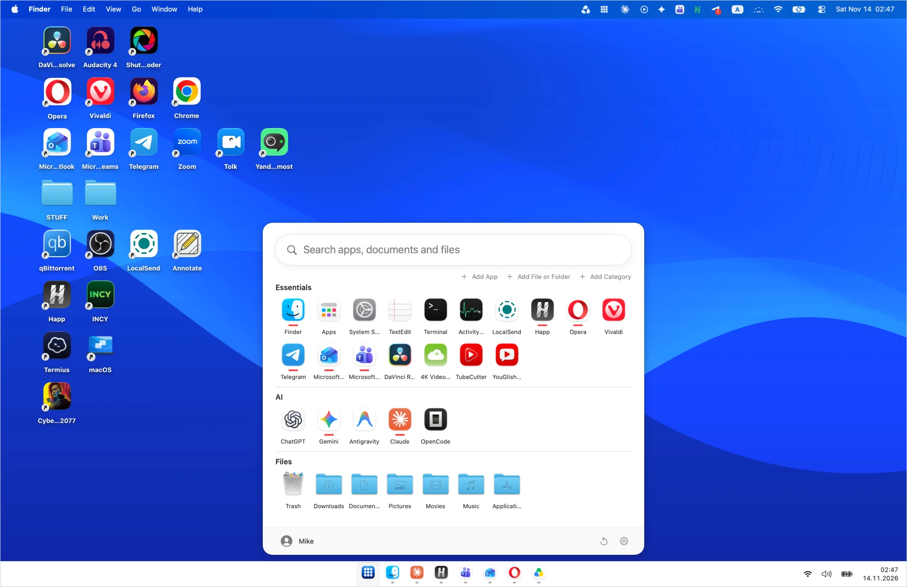
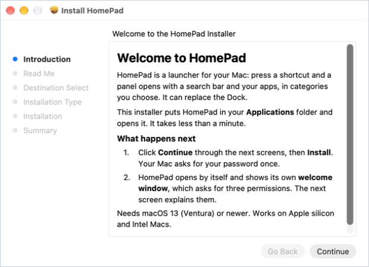

<!-- languages:start -->

<b>🌐 Language · Idioma · Langue · Sprache · Язык · 语言 · 言語 · 언어 · भाषा · لغة</b>

 

<table>
  <tr>
    <td align="center"><a href="../../README.md">English</a></td>
    <td align="center"><a href="README.ar.md">العربية</a></td>
    <td align="center"><b>বাংলা</b></td>
    <td align="center"><a href="README.zh-Hans.md">简体中文</a></td>
    <td align="center"><a href="README.fil.md">Filipino</a></td>
  </tr>
  <tr>
    <td align="center"><a href="README.fr.md">Français</a></td>
    <td align="center"><a href="README.de.md">Deutsch</a></td>
    <td align="center"><a href="README.hi.md">हिन्दी</a></td>
    <td align="center"><a href="README.id.md">Bahasa Indonesia</a></td>
    <td align="center"><a href="README.it.md">Italiano</a></td>
  </tr>
  <tr>
    <td align="center"><a href="README.ja.md">日本語</a></td>
    <td align="center"><a href="README.ko.md">한국어</a></td>
    <td align="center"><a href="README.fa.md">فارسی</a></td>
    <td align="center"><a href="README.pt-BR.md">Português (Brasil)</a></td>
    <td align="center"><a href="README.ru.md">Русский</a></td>
  </tr>
  <tr>
    <td align="center"><a href="README.es.md">Español</a></td>
    <td align="center"><a href="README.te.md">తెలుగు</a></td>
    <td align="center"><a href="README.th.md">ไทย</a></td>
    <td align="center"><a href="README.tr.md">Türkçe</a></td>
    <td align="center"><a href="README.vi.md">Tiếng Việt</a></td>
  </tr>
</table>

<!-- languages:end -->

# HomePad for macOS

> এই অনুবাদ একটি AI লিখেছে এবং মাতৃভাষী কেউ যাচাই করেননি। HomePad এই ভাষাতেও পাওয়া যায়; বোতাম ও মেনুর নাম এখানে অ্যাপ যেভাবে দেখায় সেভাবেই দেওয়া হয়েছে (ভাষা বদলাতে সেটিংস → সাধারণ → ভাষা)। নির্ভরযোগ্য সংস্করণ [ইংরেজি README](../../README.md)।

**আপনি যা ব্যবহার করেন, সবই এক কিস্ট্রোকের দূরত্বে।** HomePad হলো সেই লঞ্চার যার অভাব আপনার Mac-এ ছিল: অ্যাপগুলো ক্যাটাগরিতে সাজান, ফোল্ডারে রাখুন, প্রিয়গুলো পিন করুন, সবকিছু মুহূর্তে খুঁজুন আর চলমান অ্যাপগুলো চোখের সামনে রাখুন, চাইলে সঙ্গে Windows-ধাঁচের একটি টাস্কবারও।

Windows-ধাঁচের একটি লঞ্চার: একটি শর্টকাট চাপলে পর্দার মাঝখানে একটি প্যানেল ওঠে, ওপরে সার্চ বার (Spotlight যে ইনডেক্সে খোঁজে সেটিতেই খোঁজে) আর নিচে পিন করা অ্যাপের একটি গ্রিড।

HomePad তিনটি মোডে কাজ করে। আপনার পছন্দেরটি বেছে নিন সেটিংস → মোড থেকে।

**টাস্কবার।** Windows-এর টাস্কবার আর স্টার্ট মেনুর অনুকরণ। macOS-এ Windows-এর অভিজ্ঞতা মিস করলে এখানে নিজের বাড়ির মতোই লাগবে।

**Dock + HomePad।** যাঁরা macOS-এর “Dock” রাখতে চান কিন্তু স্টার্ট-মেনু ধাঁচের একটি লঞ্চার দরকার। macOS-এ Apps লঞ্চার আছে, কিন্তু তা প্রেরণাহীন: এটি আপনার অ্যাপগুলোকে নিজে নিজে ক্যাটাগরিতে ভাগ করে, আপনি সেগুলো বেছে নিতে পারেন না, অ্যাপ ফোল্ডারে গুছিয়ে রাখতে পারেন না, প্রিয়গুলো পিন করতে পারেন না, নিজের মতো সাজাতেও পারেন না। HomePad এসবের সমাধান।

**স্বতন্ত্র।** যাঁরা পর্দার জায়গা সবচেয়ে বেশি চান, পর্দা ভরে থাকা “Dock” বা টাস্কবার ছাড়া, সেই মিনিমালিস্টদের জন্য। যখনই দরকার, শর্টকাট কী, ডাবল ট্যাপ বা মাউসকে হট কর্নারে ঠেলে HomePad ডেকে আনুন। এটি মাঝখানে ওঠে, আর আপনার প্রিয় অ্যাপ, ফাইল ও ফোল্ডার, সার্চ এবং চলমান অ্যাপ ও তাদের উইন্ডোর ওপর আপনার পুরো নিয়ন্ত্রণ থাকে। আপনার “Dock” লাগে না, Spotlight-ও লাগে না: আপনি এক জায়গা থেকেই Mac চালান। শুরুতে অদ্ভুত লাগতে পারে, কিন্তু অভ্যস্ত হয়ে গেলে এটি অবিশ্বাস্য রকম শক্তিশালী।

## ইনস্টলেশন

HomePad বিনামূল্যের এবং Apple স্বাক্ষর করেনি, তাই macOS একবার এটি থামিয়ে দেয় আর আপনাকে নিশ্চিত করতে বলে যে এটি ঠিক আছে। এতে প্রায় পাঁচ মিনিট লাগে, একবারই। আপনার macOS 13 (Ventura) বা নতুন লাগবে; Apple silicon ও Intel দুই ধরনের Mac-ই চলে। ([INSTALL.md](../../INSTALL.md)-এ একই ধাপ কথায় লেখা আছে, zip ও সাধারণ ডিস্ক ইমেজের জন্যও।)

**১. ইনস্টলার ডিস্ক ইমেজ খুলুন।** `HomePad-Installer.dmg`-এ ডাবল-ক্লিক করুন (যিনি আপনাকে HomePad দিয়েছেন তাঁর কাছ থেকে, অথবা নিজে বানান: `tools/make_installer_dmg.sh`, দেখুন [Build and run](../../README.md#build-and-run))। এর উইন্ডোতে ধাপগুলো লেখা আছে।

**২. Install HomePad.pkg-তে ডাবল-ক্লিক করুন।** আপনার Mac বলবে এটি খোলা যাচ্ছে না। **Done** ক্লিক করুন, Move to Trash নয়।

**৩. Privacy & Security-তে অনুমতি দিন।** ডিস্ক ইমেজ উইন্ডোর নীল **Open Privacy & Security** টাইলে ডাবল-ক্লিক করুন (অথবা নিজে System Settings → Privacy & Security খুলুন), নিচে **Security** পর্যন্ত স্ক্রল করুন আর ইনস্টলার নিয়ে বার্তার পাশে **Open Anyway** ক্লিক করুন।

**৪. নিশ্চিত করুন।** এরপরের বার্তায় **Open Anyway** ক্লিক করুন, তারপর Touch ID ব্যবহার করুন বা আপনার Mac-এর পাসওয়ার্ড দিন।

<table align="center"><tr>
<td align="center"></td>
<td align="center"></td>
</tr></table>

> macOS 13 Ventura ও 14 Sonoma-তে একটি শর্টকাট আছে: ইনস্টলারে রাইট-ক্লিক করুন, **Open** বেছে নিন, তারপর আবার **Open**।

**৫. ইনস্টলারের ধাপগুলো পার হন।** ভূমিকা, কী আশা করবেন আর গন্তব্য (এই কম্পিউটারের সব ব্যবহারকারীর জন্য) পর্যন্ত **Continue** ক্লিক করুন, তারপর **Install**। আপনার Mac একবার পাসওয়ার্ড চাইবে। ইনস্টলার যখন বলে HomePad আপনার Applications ফোল্ডারে আছে, **Close** ক্লিক করুন।

<table align="center">
<tr>
<td align="center"></td>
<td align="center"></td>
</tr>
<tr>
<td align="center"></td>
<td align="center"></td>
</tr>
<tr>
<td align="center" colspan="2"></td>
</tr>
</table>

**৬. সেটআপ গাইড।** HomePad নিজেই একটি স্বাগত উইন্ডো নিয়ে খোলে। তিনটি অনুমতি দিন, কীভাবে HomePad খুলতে চান বেছে নিন (কিবোর্ড শর্টকাট, ডাবল-ট্যাপ, হট কর্নার), আর **শুরু করুন** ক্লিক করুন। প্রতিটি অনুমতি ঐচ্ছিক, কিন্তু তিনটি থাকলে HomePad সবচেয়ে ভালো চলে।

**৭. অনুমতিগুলো।** প্রতিটির পাশে ওপর থেকে নিচে **অনুমতি দিন…** ক্লিক করুন।

- **স্ক্রিন রেকর্ডিং** (চলমান অ্যাপের উইন্ডোর প্রিভিউ)। তালা আঁকা একটি বার্তা আসে: **Open System Settings** ক্লিক করুন, **HomePad**-এর পাশের সুইচ চালু করুন, তারপর **Quit & Reopen** ক্লিক করুন। HomePad নিজেই রিস্টার্ট হয় আর স্বাগত উইন্ডো ফিরে আসে। macOS আরও একবার জিজ্ঞেস করতে পারে HomePad সরাসরি আপনার স্ক্রিন দেখতে পারবে কি না: **Allow** ক্লিক করুন।

<table align="center">
<tr>
<td align="center" valign="top"></td>
<td align="center" valign="top"></td>
</tr>
<tr>
<td align="center" valign="top"></td>
<td align="center" valign="top"></td>
</tr>
</table>

- **অ্যাক্সেসিবিলিটি** (আপনার বাছা উইন্ডোতে লাফ দেওয়া, আর ডাবল-ট্যাপ শর্টকাট)। **অনুমতি দিন…** ক্লিক করুন, তারপর বার্তায় **Open System Settings**, আর **HomePad**-এর পাশের সুইচ চালু করুন (পাসওয়ার্ড চাইলে দিন)। নতুন macOS-এ এই পেজের নাম **Device Control and Data Access**।

- **ফুল ডিস্ক অ্যাক্সেস** (Documents, Desktop ও Downloads-এর ফাইল খোঁজা)। **অনুমতি দিন…** ক্লিক করুন; System Settings খোলে, পাশে ছোট একটি HomePad উইন্ডো থাকে। **HomePad**-এর পাশের সুইচ চালু করুন। তালিকায় না থাকলে ছোট উইন্ডো থেকে এর আইকন তালিকায় টেনে আনুন।

**৮. ব্যবহার করুন।** **Option-Space** চাপুন (বা আপনার বাছা শর্টকাট)। বাকি সবকিছু, ওপরের তিনটি মোডসহ, সেটিংসে: মেনু বারের গ্রিড আইকনে রাইট-ক্লিক করুন, তারপর **সেটিংস…**।

## ব্যবহারের নিয়ম

- **Option-Space** প্যানেল খোলে ও বন্ধ করে (সেটিংসে বদলানো যায়), অথবা Control, Option বা Command ডাবল-ট্যাপ করুন (সেটিংস → খোলা; অ্যাক্সেসিবিলিটি অনুমতি লাগে)।
- **হট কর্নার**: সেটিংস → খোলা → হট কর্নার। ছোট পর্দার চার কোণের যেকোনোটিতে ক্লিক করুন (একটি, কয়েকটি বা সব)। বাছা কোণে পয়েন্টারটি কিছুক্ষণ রাখলে প্যানেল সেই কোণে খোলে; বন্ধ করতে আবার তা-ই করুন। কোণ ছুঁয়ে দ্রুত সরে গেলে, বা মাউসের বোতাম চেপে ধরে টানলে, কিছুই হয় না। শর্টকাট ও ডাবল-ট্যাপ এখনও মাঝখানে খোলে। সেটআপ গাইডের দ্বিতীয় ধাপেও আছে। macOS যদি একই কোণ নিজের কোনো কাজে ব্যবহার করে, HomePad তা জানায়, সঙ্গে **macOS “Hot Corners” খুলুন…** বোতাম থাকে, যা System Settings → Desktop & Dock খোলে, Hot Corners শিট আগে থেকেই দেখানো অবস্থায় (এই বোতাম চাপতে অ্যাক্সেসিবিলিটি লাগে; ছাড়া শুধু পেজটি খোলে)।
- **ক্যাটাগরি**: অ্যাপগুলো নামওয়ালা ক্যাটাগরিতে থাকে। **প্রয়োজনীয়** আসে প্রথমে এবং প্রথম চালুর সময় আপনার Dock থেকে ভরা হয়, সঙ্গে ট্র্যাশ ও Downloads সহ একটি **ফাইল** ক্যাটাগরি, Dock-এর ডান প্রান্তের মতো (শুধু একেবারে প্রথমবার; মুছে ফেললে মোছাই থাকে)। নিজের ক্যাটাগরি (ব্রাউজার, লেখালেখি…) যোগ করুন **ক্যাটাগরি যোগ করুন** দিয়ে বা ফাঁকা জায়গায় রাইট-ক্লিক করে। নতুন ক্যাটাগরিতে ধূসর একটি “আপনার অ্যাপ এখানে যোগ করুন” টাইল দেখা যায়। নাম বদলাতে বা মুছতে ক্যাটাগরির ভেতরে রাইট-ক্লিক করুন (এর সবকিছুই আনপিন হয়; অ্যাপ ও ফাইল নিজেরা অক্ষত থাকে)।
- **ফাইল ও ফোল্ডার যোগ করা**: **ফাইল বা ফোল্ডার যোগ করুন** (হেডারের লিংক, রাইট-ক্লিক মেনু বা সেটিংস), Finder থেকে টেনে আনুন, অথবা সার্চ ফলাফলে রাইট-ক্লিক → পিন। ক্লিক করলে খোলে; ফোল্ডার Finder-এ খোলে। বাছাইয়ের জায়গাটি একটি ব্রাউজার উইন্ডো, সঙ্গে সাইডবার (হোম, ডেস্কটপ, Documents, Downloads, ..., ড্রাইভ) আর একটি **ট্র্যাশ** এন্ট্রি যা আপনার ট্র্যাশ পিন করে। সাইডবারে কোনো জায়গায় (Documents, Downloads, ট্র্যাশ ...) ক্লিক করলে সেটি খোলে আর ফোল্ডারটিও নিজে বেছে নেয়, তাই **যোগ করুন** তৈরি থাকে। এই উইন্ডোগুলো প্যানেলকে আটকায় না: একটি সরিয়ে রেখে তার যেকোনো টাইল প্যানেলে টেনে আনুন। ট্র্যাশ টাইলে রাইট-ক্লিক করলে **“ট্র্যাশ” খালি করুন…** পাবেন (আগে জিজ্ঞেস করে; Dock-এর মতো HomePad Finder-কে দিয়ে খালি করায়, তাই প্রথমবার macOS জিজ্ঞেস করে HomePad Finder নিয়ন্ত্রণ করতে পারবে কি না)।
- **ক্যাটাগরির ক্রম**: ক্যাটাগরির নামের ওপর পয়েন্ট করলে তা সবুজ হয়। চাপুন, পুরো সারি নির্বাচিত হয় (সবুজ ভরাট ও বাইরের রেখা); টানুন, সারিটিই সঙ্গে আসে আর অন্য সারিগুলো জায়গা করে দিতে সরে যায় (প্যানেল নিজের জায়গায় থাকে)। ছাড়লে সেটি যেখানে পৌঁছেছে সেখানেই থাকে। অথবা ক্যাটাগরির ভেতরে রাইট-ক্লিক করে **ওপরে সরান** / **নিচে সরান** বেছে নিন। কিছু টানার সময় হোভার ইফেক্ট ও উইন্ডো প্রিভিউ বন্ধ থাকে। “প্রয়োজনীয়”-ও সরানো যায়; নতুন আইটেমের ডিফল্ট জায়গা সেটিই থাকে এবং মোছা যায় না। চিকন ধূসর রেখা ক্যাটাগরিগুলো আলাদা করে।
- **রাইট-ক্লিকে যোগ করা**: ক্যাটাগরির ভেতরে ফাঁকা জায়গায় রাইট-ক্লিক করুন (এর শিরোনাম, বা টাইলগুলোর মাঝের ও পরের ফাঁক) আর মেনু *সেই* ক্যাটাগরিতে যোগ করে: “ফাইলে অ্যাপ যোগ করুন…”, “ফাইলে ফাইল বা ফোল্ডার যোগ করুন…”, সঙ্গে এর জন্য ক্যাটাগরি যোগ, নাম বদল ও মোছা, এবং **বর্ণানুক্রমে সাজান** (ক্যাটাগরির টাইলগুলো তাদের দেখানো নাম অনুযায়ী বর্ণানুক্রমে সাজায়; আগে থেকেই সাজানো থাকলে ধূসর; ফোল্ডারের ভেতরের টাইলগুলো তাদের ক্রম রাখে)। শেষ অংশের নিচের ফাঁকা জায়গা সেই অংশেরই।
- **অ্যাপ যোগ করা**: অ্যাপ যোগ করুন বোতাম (বাছাইয়ে কোনো অ্যাপে ডাবল-ক্লিক করলে সেটি যোগ হয়ে বাছাই বন্ধ হয়), ফাঁকা জায়গায় রাইট-ক্লিক, Finder থেকে অ্যাপ টেনে আনা (টানার মাঝখানে শর্টকাট চাপুন), অথবা সার্চ ফলাফলে রাইট-ক্লিক → অ্যাপ পিন।
- **ফোল্ডার** (Windows-এর স্টার্ট মেনুর মতো): একটি টাইল অন্য টাইলের আইকনের মাঝখানে টেনে এনে আধ সেকেন্ড ধরে রাখুন, আইকনটি জ্বলে উঠলে ছেড়ে দিন: দুটি মিলে সেই জায়গায় “ফোল্ডার” নামে একটি ফোল্ডার হয়, যার টাইলে প্রথম চারটি আইটেম দেখা যায়। আরও টাইল ফোল্ডারে ফেলে যোগ করুন। প্যানেলের ওপর ফোল্ডার খুলতে এতে ক্লিক করুন: নাম বদলাতে নামে ক্লিক করুন, খুলতে আইটেমে ক্লিক করুন, সাজাতে বা ফোল্ডারের বাইরে আনতে আইটেম টানুন (এটি বন্ধ হয়ে যায় যাতে আইটেমটি অন্য টাইলের মাঝে ফেলতে পারেন)। Esc বা বাইরে ক্লিক করলে বন্ধ হয়। একটিমাত্র আইটেম থাকলে ফোল্ডারটি আবার সেই আইটেমেই ফিরে যায়। ফোল্ডারে রাইট-ক্লিক করলে “ফোল্ডারের নাম বদলান…”, “সরান” ও “গ্রুপ ভাঙুন”; খোলা ফোল্ডারের আইটেমে রাইট-ক্লিক করলে “ফোল্ডার থেকে সরান”। টাইলের কিনারার ওপর (মাঝখানে নয়) টানলে শুধু ক্রম বদলায়।
- **সরানো / সাজানো**: টাইলে রাইট-ক্লিক → অ্যাপ আনপিন করুন / সরান, অথবা টাইল টেনে আনুন, ক্যাটাগরির মধ্যেও।
- **চলমান অ্যাপ**: আইকনের ঠিক নিচে (নামের ওপরে) লাল দাগ মানে অ্যাপটি চলছে। চলমান অ্যাপের ওপর পয়েন্ট করলে এর প্রতিটি উইন্ডোর থাম্বনেইল দেখা যায় (ছোট করা উইন্ডোর বন্ধ-ক্রসের পাশে একটি মাইনাস থাকে), প্রতিটি ডেস্কটপে (Space), Mission Control-এর ক্রমে, আর অ্যাপের উইন্ডো একাধিক ডেস্কটপে থাকলে “Space N” শিরোনামে; একটিতে ক্লিক করে সরাসরি সেখানে যান (দরকারে ডেস্কটপ বদলে), অথবা তার কোণের ক্রসে ক্লিক করে শুধু সেই উইন্ডো বন্ধ করুন (অন্য ডেস্কটপের উইন্ডোর জন্যও কাজ করে) (স্ক্রিন রেকর্ডিং ও অ্যাক্সেসিবিলিটি লাগে; স্ক্রিন রেকর্ডিং ছাড়া সাধারণ একটি তালিকা পান)। চলমান অ্যাপে ক্লিক করলে বর্তমান ডেস্কটপ আগে আসে: সেখানে দেখা যাওয়া উইন্ডো অ্যাপকে সামনে আনে; সেখানে এর সব উইন্ডো ছোট করা থাকলে সবচেয়ে সাম্প্রতিকটি ফিরে আসে; সেখানে কোনো উইন্ডোই না থাকলে তবেই অন্য যে ডেস্কটপে এর উইন্ডো আছে সেখানে নিয়ে যায়। **চলমান** অংশ চলতে থাকা প্রতিটি অ্যাপ তালিকাভুক্ত করে (পিন করা হোক বা না হোক, Dock-এর চলমান সূচকের মতো); এতে কিছু যোগ বা বাদ দেওয়া যায় না, তবে এর টাইলগুলো **এর ভেতরে টেনে সাজানো যায়** (আপনি একটি সরানো পর্যন্ত বর্ণানুক্রমে; ক্রম মনে থাকে, বন্ধ হয়ে আবার চালু হওয়া অ্যাপের জন্যও; টাইল অন্য কোথাও ফেলা যায় না, আর Esc বা অন্য জায়গায় ছাড়লে ফিরে যায়; চলমান-এ রাইট-ক্লিক → **বর্ণানুক্রমে সাজান** আপনার ক্রম ভুলিয়ে দেয়), আর অংশটির নাম বদলানো যায় না, কিন্তু এর শিরোনাম ধরে (বা এর রাইট-ক্লিক মেনুর **ওপরে সরান** / **নিচে সরান** দিয়ে) ক্যাটাগরিগুলোর মধ্যে যেকোনো জায়গায় টানা যায়, এবং লুকানো যায় (এতে রাইট-ক্লিক → চলমান লুকান; ফিরিয়ে আনতে সেটিংস → প্যানেল → চলমান অংশ দেখান)। প্রতিটি চলমান অ্যাপের **ছোট করা উইন্ডো** সেখানে এর টাইলের পিছনে নিজেদের টাইল হিসেবে আসতে পারে: কোণে অ্যাপের আইকনসহ উইন্ডোর ছবি আর উইন্ডোর শিরোনাম (Dock যেমন দেখায়)। একটিতে ক্লিক করলে সেই উইন্ডো ফিরে আসে; রাইট-ক্লিক করলে “পুনরুদ্ধার” বা “উইন্ডো বন্ধ করুন”। এগুলো ডিফল্টে বন্ধ: চালু করুন সেটিংস → প্যানেল → চলমান অংশে ছোট করা উইন্ডো দেখান, বা চলমান-এ রাইট-ক্লিক → ছোট করা উইন্ডো দেখান। প্যানেল খোলার প্রতিবার এগুলো সংগ্রহ হয় (অ্যাক্সেসিবিলিটি লাগে; ছবিগুলোর জন্য স্ক্রিন রেকর্ডিং)।
- **চলমান অ্যাপের মেনু**: চলমান অ্যাপে রাইট-ক্লিক করলে Dock-এর মতো একটি মেনু আসে: এর উইন্ডোগুলো (সামনেরটিতে টিক; একটি বেছে সামনে আনুন), এর File মেনুর “New …” কমান্ড (ব্রাউজারে New Tab, New Window, New Private Window), তারপর **উইন্ডো বন্ধ করুন** (শুধু উইন্ডো খোলা থাকলে), **লুকান** ও **বন্ধ করুন** (জোর করে বন্ধ করতে Option চেপে ধরুন; Quit-এর কয়েক সেকেন্ড পরও চলতে থাকা অ্যাপে এর জায়গায় **জোর করে বন্ধ করুন** আসে; Finder-এর Quit নেই, Dock-এর মতোই, কারণ এটি বন্ধ করলে ডেস্কটপের আইকন চলে যায়)। পয়েন্টার টাইলে পৌঁছালে উইন্ডো ও কমান্ড অ্যাক্সেসিবিলিটির মাধ্যমে পড়া হয়।
- **ফাইল খোঁজা**: Documents, Desktop ও Downloads-এর ফাইল সার্চে শুধু তখনই আসে যখন HomePad-এর **ফুল ডিস্ক অ্যাক্সেস** থাকে (System Settings → Privacy & Security)। ততক্ষণ ফলাফলে সুইচের লিংকসহ একটি নোটিশ দেখায়।
- **ক্যালকুলেটর**: `7+3`, `(2+3)*4`, `2^10` বা `15%`-এর মতো একটি হিসাব লিখুন, আর উত্তর সবার আগে আসে। ↩ বা কপি বোতাম এটি কপি করে।
- **উইন্ডো**: আকার বদলাতে প্যানেলের যেকোনো কিনারা বা কোণ টানুন (কিনারায় চওড়া ধরার পট্টি আছে আর আকার-বদলের কার্সার দেখা যায়), বা সরাতে যেকোনো ফাঁকা অংশ টানুন (টাইল গ্রিড নিজে নয়, সেখানে টানলে টাইল সাজানো হয়)। প্যানেল খুললেই সার্চ ফিল্ডে ফোকাস থাকে, তাই সঙ্গে সঙ্গে টাইপ করা যায়; অন্য কোথাও ক্লিক করার পর পরের কী আবার তাতেই যায়। সেটিংস → প্যানেলে আছে **উইন্ডোর আকার মনে রাখুন** (ডিফল্টে চালু) ও **উইন্ডোর অবস্থান মনে রাখুন** (ডিফল্টে বন্ধ)। সেটিংসের কগহুইলের পাশের ↺ বোতাম প্যানেলকে আদর্শ আকারে, মাঝখানে ফিরিয়ে আনে। অ্যাপ যোগ ও ফাইল বা ফোল্ডার যোগের উইন্ডোরও আকার বদলানো যায় (এগুলো সবসময় আদর্শ আকারে খোলে)।
- প্যানেলের নিচের বাঁ কোণে **আপনার নাম** আপনার Apple অ্যাকাউন্টে System Settings খোলে।
- **সার্চ**: শুধু টাইপ করা শুরু করুন। আগে অ্যাপ, তারপর ডকুমেন্ট ও ফোল্ডার, তারপর ওয়েব সার্চ। বাছতে ↑ ↓, খুলতে ↩, Finder-এ দেখাতে ⌘↩, মুছে তারপর বন্ধ করতে Esc। ‹ বোতাম বা ফাঁকা জায়গায় ক্লিকও আপনার অ্যাপে ফিরিয়ে আনে।

## প্রথমবার চালু

একটি স্বাগত উইন্ডো আপনাকে স্ক্রিন রেকর্ডিং, অ্যাক্সেসিবিলিটি ও ফুল ডিস্ক অ্যাক্সেসের অনুমতি দিতে এবং HomePad কীভাবে খুলবেন তা বাছতে বলে (দেখুন ইনস্টলেশন)। যেকোনো সময় আবার খুলুন মেনু বারের আইকন → সেটআপ গাইড… থেকে।

## সেটিংস

সেটিংসের টুলবারে ছয়টি ট্যাব আছে: **মোড**, **সাধারণ** (ভাষা, মেনু বারের আইকন, লগইনে খুলুন, ডিফল্টে রিসেট করুন, নতুন করে শুরু করুন), **টাস্কবার**, **খোলা** (শর্টকাট, ডাবল-ট্যাপ, হট কর্নার), **প্যানেল** (লেআউট, উইন্ডো, আইটেম) ও **অনুমতি**। এটি আপনার শেষ ব্যবহার করা ট্যাবেই খোলে।

- **শর্টকাট**: বোতামে ক্লিক করে নতুন একটি সমন্বয় চাপুন। ⌘Space ব্যবহার করতে আগে System Settings → Keyboard → Keyboard Shortcuts → Spotlight-এ Spotlight-এর শর্টকাট বন্ধ করুন।
- **শর্টকাট**: একটি রেকর্ড করুন, শুধু ডাবল-ট্যাপ চাইলে **কিছু না** বেছে নিন, বা ⌥Space-এ **রিসেট** করুন।
- **মেনু বারের আইকন**: সেটিংস → সাধারণ এটি লুকাতে পারে। অ্যাপ আবার চালালে প্যানেল খোলে।
- **ডিফল্টে রিসেট করুন**: শর্টকাট, ডাবল-ট্যাপ, লেআউট, Dock লুকানো ও লগইনে খোলা ফিরিয়ে আনে (অ্যাপ ও ক্যাটাগরি থেকে যায়)।
- **ডাবল-ট্যাপ**: Control, Option বা Command দুবার ট্যাপ করে খুলুন।
- **প্রতি সারিতে আইকন** (ডিফল্ট 8, 4–10) আর **সারির উচ্চতা** (আইকনের সারির মাঝের দূরত্ব, ডিফল্ট 101 pt, 85–125) আর **আইকনের ফাঁক** (আইকনের মাঝে আড়াআড়ি ফাঁক, ডিফল্ট 10 pt, 0–40; প্যানেল ফাঁকের জন্য খুব সরু হলে আগে ফাঁক কমে, তারপর আইকন): একটি সংখ্যা লিখুন বা − / + ক্লিক করুন, **চলমান অ্যাপ দেখান**, **Dock থেকে আবার আমদানি করুন**।
- **মোড** (প্রথম ট্যাব):
  - **স্বতন্ত্র** (ডিফল্ট): ভাসমান প্যানেল, শর্টকাট, ডাবল-ট্যাপ, হট কর্নার বা মেনু বারের আইকন থেকে খোলে। এতে গেলে Dock লুকিয়ে যায়; নিচের **“Dock” লুকান** তা ফিরিয়ে আনে।
  - **HomePad + “Dock”**: Dock-কে টাস্কবার ধরে Windows-এর স্টার্ট-মেনু ধাঁচের কাজের ধরন। এটি বাছলে Dock সবসময় দেখানো হয় (স্বয়ংক্রিয় লুকানো বন্ধ হয়, HomePad-এর বা System Settings-এর) আর সেখানে না থাকলে HomePad যোগ হয় (Dock একবার রিস্টার্ট হয়); Dock আপনার রাখা জায়গাতেই থাকে। প্যানেল ঠিক HomePad-এর আইকনের পাশে খোলে (নিচের Dock হলে ওপরে, পাশের Dock হলে পাশে, পর্দার মধ্যে রেখে), আইকনে ক্লিক করুন বা শর্টকাট বা ডাবল-ট্যাপ ব্যবহার করুন; আইকনে আবার ক্লিক করলে বন্ধ হয়। হট কর্নার এখনও নিজের কোণে খোলে। HomePad Dock-এ না থাকলে, Dock লুকানো থাকলে বা অ্যাক্সেসিবিলিটি অনুমতি না থাকলে প্যানেল কেন মাঝখানে খোলে, সেটিংস তা বলে।
  - **টাস্কবার**: প্রধান পর্দার নিচ বরাবর Windows-ধাঁচের টাস্কবার: একটি স্টার্ট বোতাম (HomePad-এর আইকন), তারপর আপনি যা পিন করেছেন ও চলমান অ্যাপ, মাঝখানে। তখন চলমান অ্যাপগুলো প্যানেল ছেড়ে যায়। টাস্কবারের ফাঁকা জায়গায় রাইট-ক্লিক করে (**অ্যাপ যোগ করুন…**, **ফাইল বা ফোল্ডার যোগ করুন…**) বা কোনো টাইলে (**টাস্কবারে পিন করুন**; HomePad-এর প্যানেলেও) অ্যাপ, ফাইল ও ফোল্ডার পিন করুন। টাস্কবার আইকনের মেনুতেও আছে **HomePad-এ পিন করুন** (বা HomePad থেকে আনপিন করুন), HomePad-এর নিজস্ব ক্যাটাগরির জন্য। অথবা Finder বা HomePad-এর প্যানেল থেকে অ্যাপ, ফাইল ও ফোল্ডার টাস্কবারে টেনে আনুন: যে আইকনে ছাড়বেন তার আগে পিন হয়, বা ফাঁকা জায়গায় ছাড়লে শেষে (আগে থেকে পিন করা থাকলে সেখানে সরে যায়; প্যানেল নিজের গুলো রাখে)। টাস্কবারের পিনগুলো আলাদা একটি তালিকা, HomePad-এর ক্যাটাগরি থেকে পৃথক। সাজাতে আইকন টাস্কবার বরাবর টানুন। **অ্যাপ আইকন** **মাঝে** বা **বাঁয়ে** থাকে; মাঝে থাকলে **HomePad আইকন** তাদের সঙ্গে মাঝে বা বাঁয়ে থাকতে পারে (অ্যাপ আইকন বাঁয়ে থাকলে এটি সবসময় সেখানেই থাকে, তাই বাছাইটি ধূসর)। আরবি ও ফারসিতে বাঁ-দিক মানে ডান, Windows-এর মতো উল্টো। HomePad-এর আইকন বাঁয়ে থাকলে এর প্যানেল টাস্কবারের ওপরে বাঁ কিনারায় খোলে। ডানদিকে আছে **নেটওয়ার্ক**, **ভলিউম**, **ব্যাটারি** ও **ঘড়ি**, প্রতিটির একটি সুইচ সহ: নেটওয়ার্ক ও ব্যাটারি System Settings-এ নিজেদের পেজ খোলে (নতুন macOS-এ macOS-এর নিজস্ব স্ট্যাটাস মেনু বাইরে থেকে খোলা যায় না), ভলিউম একটি স্লাইডার খোলে (ভলিউম বদলাতে এর ওপর স্ক্রল করুন), ঘড়ি একটি ক্যালেন্ডার। কোনো আইটেম খুলতে বা সামনে আনতে ক্লিক করুন (বা সামনেই থাকলে লুকাতে); চলমান অ্যাপের উইন্ডো দেখতে এর ওপর পয়েন্ট করুন; এর মেনুর জন্য রাইট-ক্লিক করুন। সেটিংস → টাস্কবার → **চলমান অ্যাপ** (শুরুতে গুটানো) প্রতিটি চলমান অ্যাপ **টাস্কবারে দেখান** সুইচ সহ তালিকাভুক্ত করে; বন্ধ করা অ্যাপ চলা অবস্থায় টাস্কবারের বাইরে থাকে (এর মেনুতে **টাস্কবার থেকে লুকান**-ও আছে)। পিন করা আইটেম সবসময় দেখানো হয়। কোনো অ্যাপ লুকালে (Cmd-H) টাস্কবার বদলায় না। প্যানেল টাস্কবারের ওপরে মাঝখানে খোলে। এই সময় Dock লুকানো থাকে। macOS শুধু Dock-কে পর্দার একটি অংশ উইন্ডোর জন্য ছেড়ে রাখতে দেয়, তাই অ্যাক্সেসিবিলিটি দিয়ে HomePad কোনো উইন্ডো টাস্কবারের নিচে গেলে (খোলা, আকার বদল, বড় করা বা টাইল করার সময়) সেটিকে ছোট করে (খুব ছোট হয়ে গেলে বদলে ওপরে সরায়)। শুধু টেনে সেখানে নেওয়া উইন্ডো Windows-এর মতোই ছাড়া থাকে। (আসল Dock টাস্কবারের নিচে রাখা কাজ করেনি: পয়েন্টার এর আইকনের ওপর দিয়ে গেলেই এটি নামের লেবেল দেখায়।) **টাস্কবার স্বয়ংক্রিয়ভাবে লুকান** এটিকে পর্দার নিচ দিয়ে সরিয়ে দেয়, যতক্ষণ না পয়েন্টার **দেখানোর আগের বিলম্ব** সময় ধরে নিচের কিনারায় থাকে (0–1000 ms, ডিফল্ট 300, যাতে কিনারা ছুঁয়ে দ্রুত গেলে তা না দেখায়); HomePad-এর প্যানেল, পপ-আপ, উইন্ডো প্রিভিউ বা মেনু খোলা থাকলে এটি ওপরে থাকে, আর তখন উইন্ডো পুরো পর্দা ব্যবহার করে। **HomePad শুধু স্টার্ট বোতাম থেকে খুলুন** শর্টকাট, ডাবল-ট্যাপ ও হট কর্নার বন্ধ করে (মেনু বারের আইকন তবু কাজ করে)।
- **“Dock” লুকান** (শুধু স্বতন্ত্র মোডে): ১০০০ সেকেন্ডের বিলম্বে Dock-এর স্বয়ংক্রিয় লুকানো চালু করে, যাতে তা কখনো ওঠে না। বন্ধ করলে স্বাভাবিক Dock ফিরে আসে।
- **লগইনে খুলুন**।
- **ভাষা** (সেটিংস → সাধারণ, বা মেনু বারের আইকনে রাইট-ক্লিক → ভাষা): Mac-এর মতো, বা ২০টি ভাষার একটি (আরবি, বাংলা, চীনা (সরলীকৃত), ইংরেজি, ফিলিপিনো, ফরাসি, জার্মান, হিন্দি, ইন্দোনেশীয়, ইতালীয়, জাপানি, কোরীয়, ফারসি, পর্তুগিজ (ব্রাজিল), রুশ, স্প্যানিশ, তেলুগু, থাই, তুর্কি, ভিয়েতনামী), বর্তমান ভাষার বর্ণানুক্রমে সাজানো। HomePad নতুন ভাষায় রিস্টার্ট হয়; আরবি ও ফারসি ডান থেকে বাঁয়ে সাজানো হয়। অ্যাপ, ফোল্ডার ও System Settings-এর অংশের নাম Mac যেভাবে দেখায় সেভাবেই থাকে।

## অনুমতি সেট করা

আপনি কোনো অনুমতি দিলে (সেটআপ গাইডে, সেটিংসে বা উইন্ডো প্রিভিউয়ে), HomePad লক্ষ রাখে System Settings-এ সেটি চালু হলো কি না, আর হওয়া মাত্র আবার সামনে আসে। স্ক্রিন রেকর্ডিং ও ফুল ডিস্ক অ্যাক্সেসে সাধারণত রিস্টার্ট লাগে: System Settings যখন **Quit & Reopen** দেয়, HomePad বন্ধ হয়, নিজেই আবার চালু হয় আর আপনি যে উইন্ডোতে ছিলেন তা আবার খোলে।

সেটআপ গাইড প্রথম চালুতে শুধু তখনই আসে যখন কোনো অনুমতি নেই। একেবারে গোড়া থেকে আবার দেখতে **সেটিংস → সাধারণ → নতুন করে শুরু করুন…** ব্যবহার করুন: macOS HomePad-এর অনুমতি ফিরিয়ে নেয়, গাইড আবার আসে আর HomePad রিস্টার্ট হয় (নতুন ইনস্টলের মতো আপনার ক্যাটাগরি ও সেটিংসও ভুলিয়ে দিতে বাক্সে টিক দিন)।

## ডেভেলপমেন্ট

অ্যাপ বানানোর নির্দেশনা, অনুবাদ কীভাবে কাজ করে, ফাইলের তালিকা ও অ্যাপ আইকন শুধু [ইংরেজি README](../../README.md#development)-তে আছে।

## লাইসেন্স

[MIT](../../LICENSE)।
