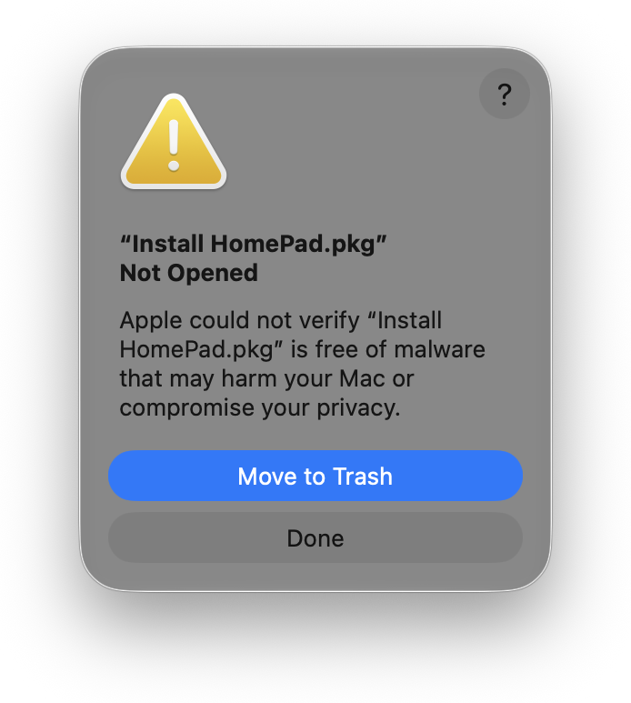
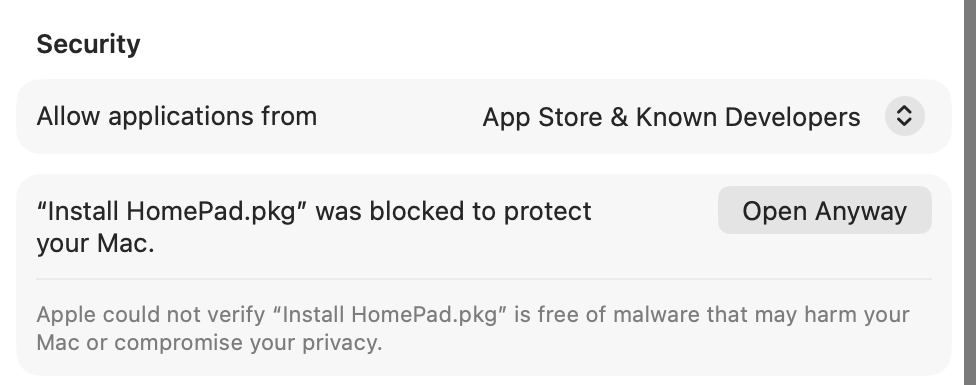

<!-- languages:start -->

<b>🌐 Language · Idioma · Langue · Sprache · Язык · 语言 · 言語 · 언어 · भाषा · لغة</b>

 

<table>
  <tr>
    <td align="center"><a href="../../README.md">English</a></td>
    <td align="center"><a href="README.ar.md">العربية</a></td>
    <td align="center"><a href="README.bn.md">বাংলা</a></td>
    <td align="center"><a href="README.zh-Hans.md">简体中文</a></td>
    <td align="center"><a href="README.fil.md">Filipino</a></td>
  </tr>
  <tr>
    <td align="center"><a href="README.fr.md">Français</a></td>
    <td align="center"><a href="README.de.md">Deutsch</a></td>
    <td align="center"><a href="README.hi.md">हिन्दी</a></td>
    <td align="center"><a href="README.id.md">Bahasa Indonesia</a></td>
    <td align="center"><a href="README.it.md">Italiano</a></td>
  </tr>
  <tr>
    <td align="center"><a href="README.ja.md">日本語</a></td>
    <td align="center"><a href="README.ko.md">한국어</a></td>
    <td align="center"><b>فارسی</b></td>
    <td align="center"><a href="README.pt-BR.md">Português (Brasil)</a></td>
    <td align="center"><a href="README.ru.md">Русский</a></td>
  </tr>
  <tr>
    <td align="center"><a href="README.es.md">Español</a></td>
    <td align="center"><a href="README.te.md">తెలుగు</a></td>
    <td align="center"><a href="README.th.md">ไทย</a></td>
    <td align="center"><a href="README.tr.md">Türkçe</a></td>
    <td align="center"><a href="README.vi.md">Tiếng Việt</a></td>
  </tr>
</table>

<!-- languages:end -->

# HomePad for macOS

> این ترجمه را یک هوش مصنوعی نوشته و گویشور بومی آن را بازبینی نکرده است. HomePad به این زبان هم موجود است؛ نام دکمه‌ها و منوها در اینجا همان‌طور که برنامه نشان می‌دهد آمده است (زبان را می‌توان در تنظیمات ← عمومی ← زبان عوض کرد). متن مرجع [README انگلیسی](../../README.md) است.

**هر چه به کار می‌برید، با یک کلید در دسترس.** HomePad همان لانچری است که Mac شما کم داشت: برنامه‌هایتان را در دسته‌ها بچینید، در پوشه‌ها بگذارید، موردعلاقه‌ها را سنجاق کنید، همه‌چیز را فوری جست‌وجو کنید و برنامه‌های در حال اجرا را همیشه در دید داشته باشید، و اگر بخواهید با یک نوار وظیفه به سبک ویندوز.

یک لانچر به سبک ویندوز: میان‌بری را بزنید و در میانه صفحه پنلی ظاهر می‌شود که بالایش نوار جست‌وجو (همان فهرستی را جست‌وجو می‌کند که Spotlight به کار می‌برد) و پایینش شبکه‌ای از برنامه‌های سنجاق‌شده است.

HomePad در سه حالت کار می‌کند. حالت مناسب خود را در تنظیمات ← حالت انتخاب کنید.

**نوار وظیفه.** نوار وظیفه و منوی Start ویندوز را شبیه‌سازی می‌کند. اگر در macOS دلتنگ تجربه ویندوز هستید، اینجا حس خانه خواهید داشت.

**Dock + HomePad.** برای کسانی که می‌خواهند «Dock» مک را نگه دارند اما به لانچری به سبک منوی Start نیاز دارند. macOS لانچر Apps را دارد، اما الهام‌بخش نیست: برنامه‌هایتان را خودکار در دسته‌ها می‌چیند و شما نمی‌توانید دسته‌ها را انتخاب کنید، برنامه‌ها را در پوشه‌ها گروه کنید، موردعلاقه‌ها را سنجاق کنید یا آن را به میل خود بچینید. HomePad همه این‌ها را حل می‌کند.

**مستقل.** برای مینیمالیست‌هایی که می‌خواهند بیشترین فضای صفحه را داشته باشند، بدون «Dock» یا نوار وظیفه‌ای که صفحه را شلوغ کند. هر وقت لازم داشتید، HomePad را با یک کلید میان‌بر، دوبار زدن یا پرتاب ماوس به گوشه‌ای فعال فرا می‌خوانید. در میانه ظاهر می‌شود و شما کنترل کامل برنامه‌ها، فایل‌ها و پوشه‌های موردعلاقه‌تان، جست‌وجو، و برنامه‌های در حال اجرا و پنجره‌هایشان را دارید. به «Dock» نیازی ندارید، به Spotlight هم نه: Mac را از یک جا اداره می‌کنید. شاید اول عجیب به نظر برسد، اما وقتی به آن عادت کنید فوق‌العاده قدرتمند است.

## نصب

HomePad رایگان است و Apple آن را امضا نکرده است، بنابراین macOS یک بار جلویش را می‌گیرد و از شما می‌خواهد تأیید کنید که اشکالی ندارد. حدود پنج دقیقه طول می‌کشد و فقط یک بار لازم است. به macOS 13 (Ventura) یا جدیدتر نیاز دارید؛ Macهای Apple silicon و Intel هر دو کار می‌کنند. ([INSTALL.md](../../INSTALL.md) همین مراحل را با کلمات شرح داده است، از جمله برای zip و دیسک ایمیج ساده.)

**۱. دیسک ایمیج نصب‌کننده را باز کنید.** روی `HomePad-Installer.dmg` دوبار کلیک کنید (از کسی که HomePad را با شما به اشتراک گذاشته، یا خودتان بسازید: `tools/make_installer_dmg.sh`، نگاه کنید به [Build and run](../../README.md#build-and-run)). پنجره‌اش مراحل را فهرست می‌کند.

**۲. روی Install HomePad.pkg دوبار کلیک کنید.** Mac می‌گوید نمی‌تواند آن را باز کند. روی **Done** کلیک کنید، نه Move to Trash.

**۳. در Privacy & Security اجازه دهید.** روی کاشی آبی **Open Privacy & Security** در پنجره دیسک ایمیج دوبار کلیک کنید (یا خودتان System Settings ← Privacy & Security را باز کنید)، تا **Security** پایین بروید و کنار پیام درباره نصب‌کننده روی **Open Anyway** کلیک کنید.

**۴. تأیید کنید.** در پیام بعدی روی **Open Anyway** کلیک کنید، سپس از Touch ID استفاده کنید یا گذرواژه Mac را وارد کنید.

<table align="center"><tr>
<td align="center"></td>
<td align="center"></td>
</tr></table>

> در macOS 13 Ventura و 14 Sonoma میان‌بری هست: روی نصب‌کننده کلیک راست کنید، **Open** را انتخاب کنید، سپس دوباره **Open**.

**۵. مراحل نصب‌کننده را بروید.** در مقدمه، آنچه انتظار دارید و مقصد (برای همه کاربران این رایانه) روی **Continue** کلیک کنید، سپس **Install**. Mac یک بار گذرواژه‌تان را می‌پرسد. وقتی نصب‌کننده می‌گوید HomePad در پوشه Applications شما است، روی **Close** کلیک کنید.

<table align="center">
<tr>
<td align="center"></td>
<td align="center"></td>
</tr>
<tr>
<td align="center"></td>
<td align="center"></td>
</tr>
<tr>
<td align="center" colspan="2"></td>
</tr>
</table>

**۶. راهنمای راه‌اندازی.** HomePad خودش با یک پنجره خوش‌آمدگویی باز می‌شود. سه مجوز را بدهید، انتخاب کنید می‌خواهید HomePad را چگونه باز کنید (میان‌بر صفحه‌کلید، دوبار زدن، گوشه‌های فعال) و روی **شروع کنید** کلیک کنید. هر مجوز اختیاری است، اما HomePad با هر سه بهترین کارکرد را دارد.

**۷. مجوزها.** کنار هر کدام، از بالا به پایین، روی **اجازه…** کلیک کنید.

- **ضبط صفحه** (پیش‌نمایش پنجره‌های برنامه در حال اجرا). پیامی با یک قفل ظاهر می‌شود: روی **Open System Settings** کلیک کنید، کلید کنار **HomePad** را روشن کنید، سپس روی **Quit & Reopen** کلیک کنید. HomePad خودش دوباره راه‌اندازی می‌شود و پنجره خوش‌آمدگویی برمی‌گردد. macOS ممکن است یک بار دیگر بپرسد که HomePad مستقیم به صفحه شما دسترسی داشته باشد یا نه: روی **Allow** کلیک کنید.

<table align="center">
<tr>
<td align="center" valign="top"></td>
<td align="center" valign="top"></td>
</tr>
<tr>
<td align="center" valign="top"></td>
<td align="center" valign="top"></td>
</tr>
</table>

- **دسترس‌پذیری** (پریدن به پنجره‌ای که برمی‌گزینید، و میان‌بر دوبار زدن). روی **اجازه…** کلیک کنید، سپس در پیام روی **Open System Settings**، و کلید کنار **HomePad** را روشن کنید (اگر گذرواژه خواست وارد کنید). در macOSهای جدید، این صفحه در رابط انگلیسی **Device Control and Data Access** نام دارد.

- **دسترسی کامل به دیسک** (یافتن فایل‌ها در Documents، میز کار و Downloads). روی **اجازه…** کلیک کنید؛ System Settings باز می‌شود و کنارش پنجره کوچک HomePad دیده می‌شود. کلید کنار **HomePad** را روشن کنید. اگر در فهرست نیست، نمادش را از پنجره کوچک به فهرست بکشید.

**۸. به کار ببرید.** **Option-Space** را بزنید (یا میان‌بری که انتخاب کرده‌اید). بقیه چیزها، از جمله سه حالت بالا، در تنظیمات است: روی نماد شبکه در نوار منو کلیک راست کنید، سپس **تنظیمات…**.

## طرز استفاده

- **Option-Space** پنل را باز و بسته می‌کند (در تنظیمات تغییرش دهید)، یا Control، Option یا Command را دوبار بزنید (تنظیمات ← باز کردن؛ مجوز دسترس‌پذیری لازم است).
- **گوشه‌های فعال**: تنظیمات ← باز کردن ← گوشه‌های فعال. روی هر یک از چهار گوشه صفحه کوچک کلیک کنید (یکی، چندتا یا همه). نشانگر را لحظه‌ای در گوشه‌ای انتخاب‌شده نگه دارید و پنل در همان گوشه باز می‌شود؛ برای بستن دوباره همین کار را بکنید. رد شدن سریع از کنار گوشه، یا کشیدن با دکمه ماوس نگه‌داشته، کاری نمی‌کند. میان‌بر و دوبار زدن همچنان آن را در میانه باز می‌کنند. در مرحله دوم راهنمای راه‌اندازی هم هست. اگر macOS همان گوشه را برای یکی از کارهای خودش به کار ببرد، HomePad آن را اعلام می‌کند، با دکمه **باز کردن «Hot Corners» macOS…** که System Settings ← Desktop & Dock را با برگه Hot Corners که از پیش نمایان است باز می‌کند (فشار دادن آن دکمه به دسترس‌پذیری نیاز دارد؛ بدون آن فقط صفحه باز می‌شود).
- **دسته‌ها**: برنامه‌ها در دسته‌هایی با نام قرار دارند. **اصلی** اول می‌آید و در نخستین اجرا از Dock شما پر می‌شود، به‌علاوه دسته **Files** با سطل زباله و Downloads، مانند انتهای راست Dock (فقط در همان اولین اجرا؛ اگر حذفش کنید، حذف‌شده می‌ماند). دسته‌های خودتان (مرورگرها، نوشتن…) را با **افزودن دسته** یا با کلیک راست روی فضای خالی اضافه کنید. دسته جدید کاشی خاکستری «برنامه‌تان را اینجا اضافه کنید» را نشان می‌دهد. داخل یک دسته کلیک راست کنید تا نامش را عوض یا حذفش کنید (هر چه در آن است هم سنجاقش برداشته می‌شود؛ خود برنامه‌ها و فایل‌ها دست‌نخورده می‌مانند).
- **افزودن فایل و پوشه**: **افزودن فایل یا پوشه** (پیوند سربرگ، منوی کلیک راست یا تنظیمات)، از Finder بکشید و بیندازید، یا روی یک نتیجه جست‌وجو کلیک راست کنید ← سنجاق. با کلیک باز می‌شوند؛ پوشه‌ها در Finder باز می‌شوند. انتخابگر یک پنجره مرورگر است با نوار کناری (خانه، میز کار، Documents، Downloads، ...، درایوها) و یک ورودی **سطل زباله** که سطل زباله شما را سنجاق می‌کند. کلیک روی یک مکان در نوار کناری (Documents، Downloads، سطل زباله ...) آن را باز می‌کند و خود پوشه را انتخاب می‌کند، بنابراین **افزودن** آماده است. این پنجره‌ها پنل را مسدود نمی‌کنند: یکی را کنار بزنید و هر کاشی‌ای را از آن به پنل بکشید. روی کاشی سطل زباله کلیک راست کنید تا **خالی کردن «سطل زباله»…** را ببینید (اول می‌پرسد؛ HomePad مانند Dock از Finder می‌خواهد آن را خالی کند، پس بار اول macOS می‌پرسد HomePad اجازه دارد Finder را کنترل کند یا نه).
- **ترتیب دسته‌ها**: وقتی نشانگر را روی نام یک دسته می‌برید سبز می‌شود. آن را فشار دهید و کل ردیف انتخاب می‌شود (پر شدن و حاشیه سبز)؛ بکشید و خود ردیف همراه می‌آید در حالی که ردیف‌های دیگر کنار می‌روند تا جا باز شود (پنل سر جایش می‌ماند). رها کنید و همان‌جا می‌ماند. یا داخل یک دسته کلیک راست کنید و **انتقال به بالا** / **انتقال به پایین** را انتخاب کنید. تا وقتی چیزی کشیده می‌شود، جلوه‌های هاور و پیش‌نمایش پنجره‌ها خاموش می‌مانند. «اصلی» را هم می‌توان جابه‌جا کرد؛ همچنان جای پیش‌فرض موارد جدید است و حذف نمی‌شود. خط‌های باریک خاکستری دسته‌ها را از هم جدا می‌کنند.
- **کلیک راست برای افزودن**: روی فضای خالی داخل یک دسته (عنوانش، یا فاصله‌های بین کاشی‌ها و بعد از آن‌ها) کلیک راست کنید و منو به *همان* دسته اضافه می‌کند: «افزودن برنامه به Files…»، «افزودن فایل یا پوشه به Files…»، به‌علاوه افزودن دسته، تغییر نام و حذف برای آن، و **مرتب‌سازی الفبایی** (کاشی‌های آن دسته را بر اساس نام نمایش‌داده‌شان به ترتیب الفبا می‌چیند؛ اگر از قبل مرتب باشند خاکستری است؛ کاشی‌های داخل پوشه‌هایش ترتیب خودشان را نگه می‌دارند). فضای خالی زیر آخرین بخش متعلق به همان بخش است.
- **افزودن برنامه‌ها**: دکمه افزودن برنامه (روی یک برنامه در انتخابگر دوبار کلیک کنید تا اضافه شود و انتخابگر بسته شود)، کلیک راست روی فضای خالی، کشیدن برنامه‌ها از Finder (میان‌بر را وسط کشیدن بزنید)، یا کلیک راست روی یک نتیجه جست‌وجو ← سنجاق برنامه.
- **پوشه‌ها** (مانند منوی Start ویندوز): کاشی‌ای را به وسط نماد کاشی دیگر بکشید، نیم ثانیه همان‌جا نگه دارید تا آن نماد روشن شود، و رها کنید: آن دو در همان جا به پوشه‌ای با نام «پوشه» تبدیل می‌شوند که کاشی‌اش چهار مورد اول را نشان می‌دهد. کاشی‌های بیشتری را روی پوشه بیندازید تا اضافه شوند. روی پوشه کلیک کنید تا بالای پنل باز شود: روی نامش کلیک کنید تا تغییر نام دهید، روی موردی کلیک کنید تا باز شود، موردها را بکشید تا دوباره بچینید یا از پوشه بیرون ببرید (بسته می‌شود تا بتوانید مورد را بین کاشی‌های دیگر بیندازید). Esc یا کلیک بیرون آن را می‌بندد. پوشه‌ای که یک مورد دارد دوباره به همان مورد تبدیل می‌شود. روی پوشه کلیک راست کنید برای «تغییر نام پوشه…»، «انتقال به» و «برداشتن گروه»؛ روی موردی در پوشه بازشده کلیک راست کنید برای «برداشتن از پوشه». کشیدن روی لبه‌های کاشی (نه وسطش) همچنان فقط ترتیب را عوض می‌کند.
- **حذف / چیدن دوباره**: روی کاشی کلیک راست کنید ← برداشتن سنجاق برنامه / انتقال به، یا کاشی‌ها را بکشید، از جمله بین دسته‌ها.
- **برنامه‌های در حال اجرا**: نوار قرمزی درست زیر یک نماد (بالای نامش) یعنی برنامه در حال اجراست. نشانگر را روی برنامه‌ای در حال اجرا ببرید تا تصویر کوچک هر پنجره‌اش را ببینید (پنجره کوچک‌شده کنار ضربدر بستنش یک منفی دارد)، روی هر میزکار (Space)، به ترتیب Mission Control و با عنوان «Space N» وقتی برنامه‌ای در بیش از یکی پنجره دارد، و روی یکی کلیک کنید تا مستقیم به آن بپرید (در صورت لزوم میزکار را عوض می‌کند)، یا روی ضربدر گوشه‌اش کلیک کنید تا فقط همان پنجره بسته شود (برای پنجره‌های روی میزکارهای دیگر هم کار می‌کند) (ضبط صفحه و دسترس‌پذیری لازم است؛ بدون ضبط صفحه فهرستی ساده می‌گیرید). کلیک روی برنامه در حال اجرا میزکار فعلی را اول می‌گذارد: پنجره‌ای که آنجا دیده می‌شود برنامه را جلو می‌آورد؛ اگر همه پنجره‌هایش آنجا کوچک‌شده باشند، تازه‌ترین برمی‌گردد؛ فقط وقتی آنجا اصلاً پنجره‌ای نباشد شما را به میزکار دیگری می‌برد که پنجره دارد. بخش **در حال اجرا** هر برنامه‌ای را که اجرا می‌شود فهرست می‌کند (سنجاق‌شده یا نه، مانند نشانگرهای اجرای Dock)؛ چیزی نمی‌توان به آن افزود یا از آن برداشت، اما کاشی‌هایش را می‌توان **درون همان بخش کشید تا دوباره چیده شوند** (تا وقتی یکی را جابه‌جا نکرده‌اید الفبایی؛ ترتیب به خاطر سپرده می‌شود، حتی برای برنامه‌ای که بسته و دوباره اجرا می‌شود؛ کاشی را نمی‌توان جای دیگری انداخت، و Esc یا رها کردن در جای دیگر آن را برمی‌گرداند؛ کلیک راست روی «در حال اجرا» ← **مرتب‌سازی الفبایی** ترتیب شما را فراموش می‌کند)، و نام خود بخش را نمی‌توان عوض کرد اما می‌توان آن را از روی عنوانش (یا با **انتقال به بالا** / **انتقال به پایین** در منوی کلیک راستش) به هر جای میان دسته‌ها کشید، و می‌توان آن را پنهان کرد (کلیک راست روی آن ← پنهان کردن «در حال اجرا»؛ با تنظیمات ← پنل ← نمایش بخش «در حال اجرا» برش گردانید). **پنجره‌های کوچک‌شده** هر برنامه در حال اجرا می‌توانند آنجا دنبال کاشی‌اش بیایند، به‌صورت کاشی‌های جداگانه: تصویری از پنجره با نماد برنامه در گوشه و عنوان پنجره (همان‌طور که Dock نشان‌شان می‌دهد). روی یکی کلیک کنید تا آن پنجره برگردد؛ کلیک راست برای «بازگرداندن» یا «بستن پنجره». به‌طور پیش‌فرض خاموش‌اند: تنظیمات ← پنل ← نمایش پنجره‌های کوچک‌شده در «در حال اجرا» را روشن کنید، یا روی «در حال اجرا» کلیک راست کنید ← نمایش پنجره‌های کوچک‌شده. هر بار که پنل باز می‌شود جمع‌آوری می‌شوند (دسترس‌پذیری لازم است؛ تصاویر ضبط صفحه می‌خواهند).
- **منوی برنامه در حال اجرا**: روی برنامه‌ای در حال اجرا کلیک راست کنید تا منویی مانند منوی Dock بیاید: پنجره‌هایش (پنجره جلو علامت می‌خورد؛ یکی را انتخاب کنید تا جلو بیاید)، دستورهای «New …» از منوی File آن (New Tab، New Window، New Private Window در یک مرورگر)، سپس **بستن پنجره‌ها** (فقط اگر پنجره‌ای باز باشد)، **پنهان کردن** و **خروج** (برای خروج اجباری Option را نگه دارید؛ برنامه‌ای که چند ثانیه پس از خروج هنوز اجراست به جای آن **خروج اجباری** می‌گیرد؛ Finder خروج ندارد، مانند Dock، چون خروج از آن نمادهای میز کار را برمی‌دارد). وقتی نشانگر به کاشی می‌رسد، پنجره‌ها و دستورها از طریق دسترس‌پذیری خوانده می‌شوند.
- **یافتن فایل‌ها**: فایل‌های Documents، میز کار و Downloads فقط وقتی در جست‌وجو دیده می‌شوند که HomePad **دسترسی کامل به دیسک** (System Settings ← Privacy & Security) داشته باشد. تا آن زمان، نتایج اعلانی با پیوند به کلید نشان می‌دهند.
- **ماشین‌حساب**: حسابی مانند `7+3`، `(2+3)*4`، `2^10` یا `15%` بنویسید و پاسخ اول می‌آید. ↩ یا دکمه رونوشت آن را کپی می‌کند.
- **پنجره**: هر لبه یا گوشه پنل را بکشید تا اندازه‌اش را عوض کنید (لبه‌ها نوارهای گرفتن پهن دارند و نشانگرهای تغییر اندازه نشان می‌دهند)، یا هر بخش خالی را بکشید تا جابه‌جایش کنید (نه خود شبکه کاشی‌ها، که کشیدن آنجا کاشی‌ها را دوباره می‌چیند). هر بار که پنل باز می‌شود فیلد جست‌وجو فوکوس دارد، پس می‌توانید فوراً تایپ کنید؛ بعد از کلیک در جای دیگر، کلید بعدی که می‌زنید دوباره به آن می‌رود. تنظیمات ← پنل **به خاطر سپردن اندازه پنجره** (به‌طور پیش‌فرض روشن) و **به خاطر سپردن مکان پنجره** (به‌طور پیش‌فرض خاموش) را دارد. دکمه ↺ کنار چرخ‌دنده تنظیمات پنل را به اندازه استاندارد و در میانه برمی‌گرداند. پنجره‌های افزودن برنامه و افزودن فایل یا پوشه را هم می‌توان تغییر اندازه داد (همیشه با اندازه استاندارد باز می‌شوند).
- **نام شما** در گوشه پایین چپ پنل System Settings را روی Apple Account شما باز می‌کند.
- **جست‌وجو**: فقط شروع به تایپ کنید. اول برنامه‌ها می‌آیند، بعد سندها و پوشه‌ها، بعد جست‌وجوی وب. ↑ ↓ برای انتخاب، ↩ برای باز کردن، ⌘↩ برای نمایش در Finder، Esc برای پاک کردن و سپس بستن. دکمه ‹ یا کلیک روی فضای خالی هم شما را به برنامه‌هایتان برمی‌گرداند.

## نخستین اجرا

پنجره‌ای خوش‌آمدگویی از شما می‌خواهد ضبط صفحه، دسترس‌پذیری و دسترسی کامل به دیسک را اجازه دهید و انتخاب کنید HomePad را چگونه باز کنید (نگاه کنید به نصب). هر وقت خواستید از نماد نوار منو ← راهنمای راه‌اندازی… دوباره بازش کنید.

## تنظیمات

تنظیمات شش زبانه در نوار ابزارش دارد: **حالت**، **عمومی** (زبان، نماد نوار منو، باز شدن هنگام ورود، بازنشانی به پیش‌فرض‌ها، شروع دوباره)، **نوار وظیفه**، **باز کردن** (میان‌بر، دوبار زدن، گوشه‌های فعال)، **پنل** (چیدمان، پنجره، موارد) و **مجوزها**. روی زبانه‌ای که آخرین بار به کار برده‌اید باز می‌شود.

- **میان‌بر**: روی دکمه کلیک کنید و ترکیب جدیدی را بزنید. برای استفاده از ⌘Space، اول میان‌بر Spotlight را در System Settings ← Keyboard ← Keyboard Shortcuts ← Spotlight خاموش کنید.
- **میان‌بر**: یکی را ضبط کنید، اگر فقط دوبار زدن می‌خواهید **هیچ** را انتخاب کنید، یا با **بازنشانی** آن را به ⌥Space برگردانید.
- **نماد نوار منو**: تنظیمات ← عمومی می‌تواند آن را پنهان کند. اجرای دوباره برنامه پنل را باز می‌کند.
- **بازنشانی به پیش‌فرض‌ها**: میان‌بر، دوبار زدن، چیدمان، پنهان کردن Dock و باز شدن هنگام ورود را برمی‌گرداند (برنامه‌ها و دسته‌ها می‌مانند).
- **دوبار زدن**: با دوبار زدن Control، Option یا Command باز کنید.
- **نمادها در هر ردیف** (پیش‌فرض ۸، از ۴ تا ۱۰) و **ارتفاع ردیف** (فاصله ردیف‌های نماد، پیش‌فرض ۱۰۱ pt، از ۸۵ تا ۱۲۵) و **فاصله نمادها** (فاصله افقی بین نمادها، پیش‌فرض ۱۰ pt، از ۰ تا ۴۰؛ وقتی پنل برای این فاصله زیادی باریک است، ابتدا فاصله کم می‌شود، بعد نمادها): عددی بنویسید یا روی − / + کلیک کنید، **نمایش برنامه‌های در حال اجرا**، **وارد کردن دوباره از Dock**.
- **حالت** (زبانه اول):
  - **مستقل** (پیش‌فرض): پنل شناور، که با میان‌بر، دوبار زدن، گوشه‌های فعال یا نماد نوار منو باز می‌شود. رفتن به این حالت Dock را پنهان می‌کند؛ **پنهان کردن «Dock»** در پایین آن را برمی‌گرداند.
  - **HomePad + «Dock»**: روشی شبیه منوی Start ویندوز با Dock به‌جای نوار وظیفه. انتخابش Dock را همیشه نشان می‌دهد (پنهان‌سازی خودکار را، چه از HomePad و چه از System Settings، خاموش می‌کند) و اگر HomePad در آن نباشد اضافه‌اش می‌کند (Dock یک بار دوباره راه‌اندازی می‌شود)؛ Dock همان‌جا که گذاشته‌اید می‌ماند. پنل درست کنار نماد HomePad باز می‌شود (بالای آن برای Dock پایین، کنارش برای Dock کناری، در محدوده صفحه نگه داشته می‌شود) چه روی نماد کلیک کنید چه از میان‌بر یا دوبار زدن استفاده کنید؛ کلیک دوباره روی نماد آن را می‌بندد. گوشه‌های فعال همچنان آن را در گوشه خود باز می‌کنند. تنظیمات می‌گوید چرا وقتی HomePad در Dock نیست، Dock پنهان است یا مجوز دسترس‌پذیری نیست، پنل در میانه باز می‌شود.
  - **نوار وظیفه**: نوار وظیفه‌ای به سبک ویندوز در امتداد پایین صفحه اصلی: یک دکمه Start (نماد HomePad)، سپس آنچه به آن سنجاق کرده‌اید و برنامه‌های در حال اجرا، در میانه. برنامه‌های در حال اجرا آن‌گاه پنل را ترک می‌کنند. برنامه‌ها، فایل‌ها و پوشه‌ها را با کلیک راست روی فضای خالی نوار وظیفه (**افزودن برنامه…**، **افزودن فایل یا پوشه…**) یا روی یک کاشی (**سنجاق به نوار وظیفه**؛ در پنل HomePad هم) سنجاق کنید. منوی نماد نوار وظیفه **سنجاق به HomePad** (یا برداشتن از HomePad) را هم دارد، برای دسته‌های خود HomePad. یا برنامه‌ها، فایل‌ها و پوشه‌ها را از Finder یا از پنل HomePad روی نوار وظیفه بکشید: پیش از نمادی که روی آن رها می‌کنید سنجاق می‌شوند، یا اگر روی فضای خالی باشد در انتها (موردی که از قبل سنجاق شده به آنجا می‌رود؛ پنل مواد خودش را نگه می‌دارد). سنجاق‌های نوار وظیفه فهرستی جداگانه‌اند، جدا از دسته‌های HomePad. نمادها را در امتداد نوار وظیفه بکشید تا دوباره بچینیدشان. **نمادهای برنامه‌ها** در **وسط** یا در **راست** قرار می‌گیرند؛ تا وقتی در وسط‌اند، **نماد HomePad** می‌تواند با آن‌ها در وسط باشد یا در راست (وقتی نمادهای برنامه‌ها در راست‌اند همیشه همان‌جاست، پس این انتخاب خاکستری است). در فارسی و عربی «اول» نوار سمت راست است، آینه‌ای مانند ویندوز. وقتی نماد HomePad در راست است، پنل آن در لبه راست بالای نوار وظیفه باز می‌شود. در طرف دیگر **شبکه**، **صدا**، **باتری** و **ساعت** هستند، هر کدام با یک کلید: شبکه و باتری صفحه‌های خود را در System Settings باز می‌کنند (منوهای وضعیت خود macOS در macOSهای جدید از بیرون باز نمی‌شوند)، صدا لغزنده‌ای باز می‌کند (برای تغییر صدا روی آن اسکرول کنید)، ساعت تقویمی. روی موردی کلیک کنید تا باز شود یا جلو بیاید (یا اگر از قبل جلوست پنهان شود)؛ نشانگر را روی برنامه‌ای در حال اجرا ببرید تا پنجره‌هایش را ببینید؛ برای منویش کلیک راست کنید. تنظیمات ← نوار وظیفه ← **برنامه‌های در حال اجرا** (در ابتدا جمع‌شده) هر برنامه در حال اجرا را با کلید **نمایش در نوار وظیفه** فهرست می‌کند؛ برنامه‌ای که خاموش شود تا وقتی اجراست از نوار وظیفه بیرون می‌ماند (در منویش **پنهان کردن از نوار وظیفه** هم هست). موارد سنجاق‌شده همیشه نشان داده می‌شوند. پنهان کردن یک برنامه (Cmd-H) نوار وظیفه را تغییر نمی‌دهد. پنل در میانه بالای نوار وظیفه باز می‌شود. در این مدت Dock پنهان است. macOS فقط به Dock اجازه می‌دهد بخشی از صفحه را از پنجره‌ها خالی نگه دارد، بنابراین HomePad با دسترس‌پذیری وقتی پنجره‌ای باز می‌شود، اندازه‌اش عوض می‌شود، بزرگ یا کاشی می‌شود و به زیر نوار وظیفه می‌رسد آن را کوتاه می‌کند (اگر بیش از حد کوتاه شود به جایش بالا می‌برد). پنجره‌ای که فقط به آنجا کشیده شود مانند ویندوز دست‌نخورده می‌ماند. (نگه داشتن Dock واقعی زیر نوار وظیفه جواب نداد: هر جا نشانگر از روی نمادهایش بگذرد برچسب نام‌هایش را نشان می‌دهد.) **پنهان‌سازی خودکار نوار وظیفه** آن را از پایین صفحه بیرون می‌لغزاند تا نشانگر به اندازه **تأخیر پیش از نمایش** روی لبه پایین بماند (۰ تا ۱۰۰۰ میلی‌ثانیه، پیش‌فرض ۳۰۰، تا گذر سریع از کنار لبه آن را نشان ندهد)؛ تا وقتی پنل HomePad، یک پنجره بازشو، پیش‌نمایش پنجره یا منویی باز است بالا می‌ماند، و پنجره‌ها آن‌گاه از کل صفحه استفاده می‌کنند. **باز کردن HomePad فقط از دکمه Start** میان‌بر، دوبار زدن و گوشه‌های فعال را خاموش می‌کند (نماد نوار منو همچنان کار می‌کند).
- **پنهان کردن «Dock»** (فقط در حالت مستقل): پنهان‌سازی خودکار Dock را با تأخیر ۱۰۰۰ ثانیه روشن می‌کند تا هرگز ظاهر نشود. خاموش کردنش Dock عادی را برمی‌گرداند.
- **باز شدن هنگام ورود**.
- **زبان** (تنظیمات ← عمومی، یا کلیک راست روی نماد نوار منو ← زبان): مانند Mac، یا یکی از ۲۰ زبان (عربی، بنگالی، چینی (ساده‌شده)، انگلیسی، فیلیپینی، فرانسوی، آلمانی، هندی، اندونزیایی، ایتالیایی، ژاپنی، کره‌ای، فارسی، پرتغالی (برزیل)، روسی، اسپانیایی، تلوگو، تایلندی، ترکی، ویتنامی)، به ترتیب الفبای زبان فعلی فهرست‌شده. HomePad با زبان جدید دوباره راه‌اندازی می‌شود؛ عربی و فارسی از راست به چپ چیده می‌شوند. نام برنامه‌ها، پوشه‌ها و بخش‌های System Settings همان‌طور می‌ماند که Mac نشان می‌دهد.

## راه‌اندازی مجوزها

وقتی مجوزی را اجازه می‌دهید (در راهنمای راه‌اندازی، تنظیمات یا پیش‌نمایش پنجره)، HomePad مراقب است که در System Settings روشن شود و به محض روشن شدن دوباره جلو می‌آید. ضبط صفحه و دسترسی کامل به دیسک معمولاً به راه‌اندازی دوباره نیاز دارند: وقتی System Settings **Quit & Reopen** را پیشنهاد می‌کند، HomePad خارج می‌شود، خودش دوباره شروع می‌کند و پنجره‌ای را که در آن بودید دوباره باز می‌کند.

راهنمای راه‌اندازی در نخستین اجرا فقط وقتی نشان داده می‌شود که مجوزی کم باشد. برای گذراندن دوباره آن از ابتدا، از **تنظیمات ← عمومی ← شروع دوباره…** استفاده کنید: macOS مجوزهای HomePad را پس می‌گیرد، راهنما دوباره نمایان می‌شود و HomePad دوباره راه‌اندازی می‌شود (کادر را علامت بزنید تا دسته‌ها و تنظیمات شما هم فراموش شود، مانند نصب تازه).

## توسعه

راهنمای ساخت برنامه، شیوه کار ترجمه‌ها، فهرست فایل‌ها و نماد برنامه فقط در [README انگلیسی](../../README.md#development) آمده است.

## مجوز

[MIT](../../LICENSE).
