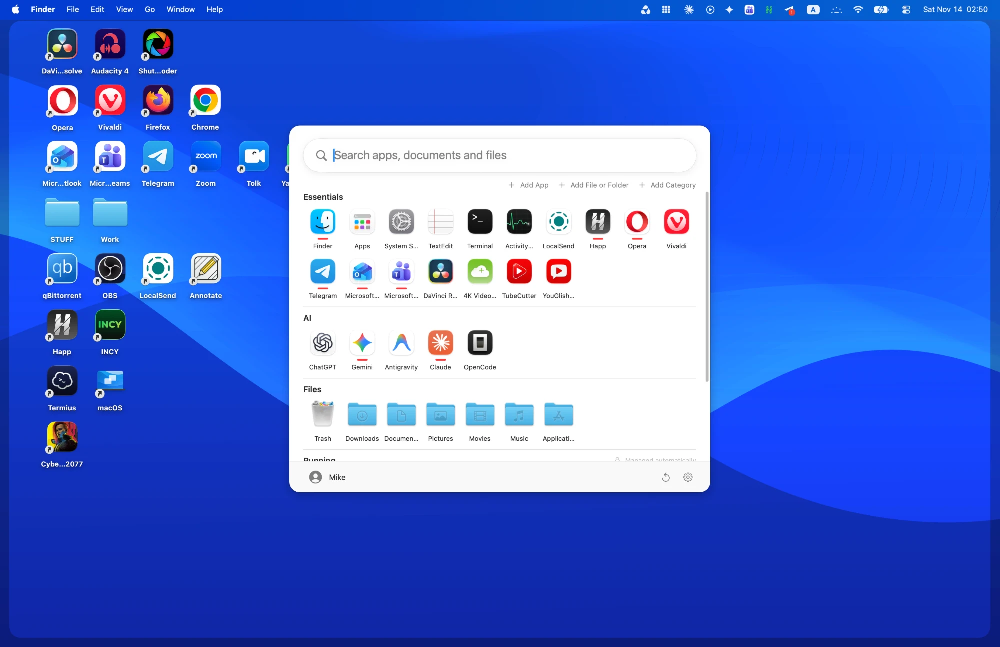
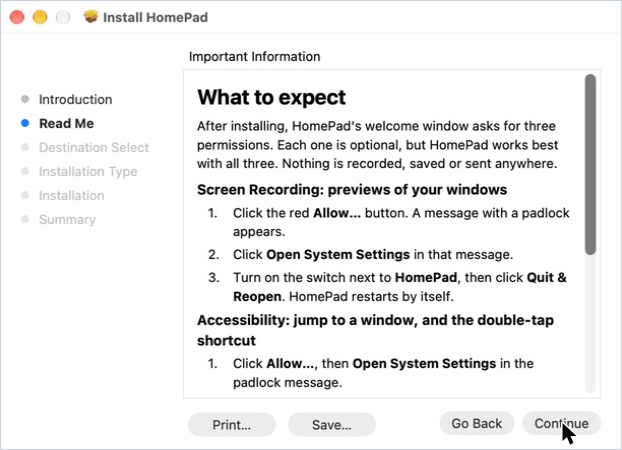
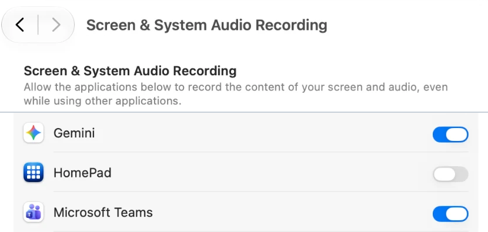

<!-- languages:start -->

<b>🌐 Language · Idioma · Langue · Sprache · Язык · 语言 · 言語 · 언어 · भाषा · لغة</b>

 

<table>
  <tr>
    <td align="center"><a href="../../README.md">English</a></td>
    <td align="center"><a href="README.ar.md">العربية</a></td>
    <td align="center"><a href="README.bn.md">বাংলা</a></td>
    <td align="center"><a href="README.zh-Hans.md">简体中文</a></td>
    <td align="center"><b>Filipino</b></td>
  </tr>
  <tr>
    <td align="center"><a href="README.fr.md">Français</a></td>
    <td align="center"><a href="README.de.md">Deutsch</a></td>
    <td align="center"><a href="README.hi.md">हिन्दी</a></td>
    <td align="center"><a href="README.id.md">Bahasa Indonesia</a></td>
    <td align="center"><a href="README.it.md">Italiano</a></td>
  </tr>
  <tr>
    <td align="center"><a href="README.ja.md">日本語</a></td>
    <td align="center"><a href="README.ko.md">한국어</a></td>
    <td align="center"><a href="README.fa.md">فارسی</a></td>
    <td align="center"><a href="README.pt-BR.md">Português (Brasil)</a></td>
    <td align="center"><a href="README.ru.md">Русский</a></td>
  </tr>
  <tr>
    <td align="center"><a href="README.es.md">Español</a></td>
    <td align="center"><a href="README.te.md">తెలుగు</a></td>
    <td align="center"><a href="README.th.md">ไทย</a></td>
    <td align="center"><a href="README.tr.md">Türkçe</a></td>
    <td align="center"><a href="README.vi.md">Tiếng Việt</a></td>
  </tr>
</table>

<!-- languages:end -->

# HomePad for macOS

> Isinulat ng isang AI ang pagsasalin na ito at hindi ito nasuri ng mga katutubong nagsasalita. Available din ang HomePad sa wikang ito; ang mga pangalan ng mga button at menu ay ibinibigay dito gaya ng ipinapakita ng app (puwedeng baguhin ang wika sa Mga Setting → Pangkalahatan → Wika). Ang [English na README](../../README.md) ang batayan.

**Lahat ng ginagamit mo, isang pindot lang ang layo.** Ang HomePad ang launcher na kulang sa Mac mo: ayusin ang mga app mo sa mga kategorya, ilagay sa mga folder, i-pin ang mga paborito, hanapin ang lahat nang mabilis at laging tanaw ang mga tumatakbong app, na may opsyonal na taskbar na estilo-Windows kung gusto mo.

Isang launcher na estilo-Windows: pindutin ang shortcut at lalabas sa gitna ng screen ang isang panel na may search bar sa itaas (hinahanap nito ang parehong index na ginagamit ng Spotlight) at isang grid ng mga naka-pin na app sa ibaba.

Gumagana ang HomePad sa tatlong mode. Piliin ang bagay sa iyo sa Mga Setting → Mode.

**Taskbar.** Ginagaya ang taskbar at Start menu ng Windows. Kung nami-miss mo ang karanasan sa Windows sa macOS, mararamdaman mong nasa bahay ka.

**Dock + HomePad.** Para sa mga gustong panatilihin ang “Dock” ng macOS pero kailangan ng launcher na estilo-Start menu. May Apps launcher ang macOS, pero hindi ito nakaka-inspire: awtomatiko nitong inaayos ang mga app mo sa mga kategorya, hindi mo ito mapipili, hindi mo mapagsasama-sama ang mga app sa mga folder, hindi ka makaka-pin ng mga paborito, at hindi mo ito maaayos ayon sa gusto mo. Nalulutas ng HomePad ang lahat ng iyon.

**Hiwalay.** Para sa mga minimalist na gustong palakihin ang espasyo ng screen, na walang “Dock” o taskbar na nakakalat sa screen. Tinatawag mo ang HomePad gamit ang shortcut key, double tap o paghagis ng mouse sa isang hot corner tuwing kailangan mo ito. Lumalabas ito sa gitna, at buo ang kontrol mo sa mga paborito mong app, file at folder, sa paghahanap, at sa mga tumatakbong app at kanilang mga window. Hindi mo kailangan ang “Dock”, at hindi mo kailangan ang Spotlight: kontrolado mo ang Mac mo mula sa iisang lugar. Maaaring maging kakaiba ito sa simula, pero nagiging napakalakas nito kapag nasanay ka na.

## Pag-install

Libre ang HomePad at hindi ito pinirmahan ng Apple, kaya hinaharang ito ng macOS nang isang beses at hinihiling na kumpirmahin mong ayos lang ito. Mga limang minuto ito, isang beses lang. Kailangan mo ng macOS 13 (Ventura) o mas bago; gumagana ang parehong Mac na may Apple silicon at Intel. (Ang [INSTALL.md](../../INSTALL.md) ay may parehong mga hakbang sa mga salita, pati para sa zip at sa simpleng disk image.)

**1. Buksan ang installer disk image.** I-double click ang `HomePad-Installer.dmg` (mula sa nagbahagi sa iyo ng HomePad, o buuin mo mismo: `tools/make_installer_dmg.sh`, tingnan ang [Build and run](../../README.md#build-and-run)). Nakalista sa window nito ang mga hakbang.

**2. I-double click ang Install HomePad.pkg.** Sasabihin ng Mac mo na hindi ito mabubuksan. I-click ang **Done**, hindi ang Move to Trash.

**3. Payagan ito sa Privacy & Security.** I-double click ang asul na tile na **Open Privacy & Security** sa window ng disk image (o buksan mo mismo ang System Settings → Privacy & Security), mag-scroll pababa sa **Security**, at i-click ang **Open Anyway** sa tabi ng mensahe tungkol sa installer.

**4. Kumpirmahin.** I-click ang **Open Anyway** sa susunod na mensahe, pagkatapos ay gamitin ang Touch ID o ilagay ang password ng Mac mo.

<table align="center"><tr>
<td align="center"></td>
<td align="center"></td>
</tr></table>

> Sa macOS 13 Ventura at 14 Sonoma may shortcut: i-right click ang installer, piliin ang **Open**, pagkatapos ay **Open** ulit.

**5. Daanan ang installer.** I-click ang **Continue** sa introduksyon, sa kung ano ang aasahan, at sa destinasyon (para sa lahat ng user ng computer na ito), pagkatapos ay **Install**. Hihingin ng Mac mo ang password mo nang isang beses. Kapag sinabi ng installer na nasa Applications folder mo na ang HomePad, i-click ang **Close**.

<table align="center">
<tr>
<td align="center"></td>
<td align="center"></td>
</tr>
<tr>
<td align="center"></td>
<td align="center"></td>
</tr>
<tr>
<td align="center" colspan="2"></td>
</tr>
</table>

**6. Ang Gabay sa Pag-set Up.** Kusang bumubukas ang HomePad na may welcome window. Payagan ang tatlong pahintulot, piliin kung paano mo gustong buksan ang HomePad (keyboard shortcut, double-tap, hot corners), at i-click ang **Magsimula**. Opsyonal ang bawat pahintulot, pero pinakamahusay gumana ang HomePad kapag lahat ng tatlo ay mayroon.

**7. Ang mga pahintulot.** I-click ang **Payagan…** sa tabi ng bawat isa, mula itaas pababa.

- **Screen Recording** (mga preview ng mga window ng tumatakbong app). May lalabas na mensaheng may padlock: i-click ang **Open System Settings**, i-on ang switch sa tabi ng **HomePad**, pagkatapos ay i-click ang **Quit & Reopen**. Kusang magre-restart ang HomePad at babalik ang Welcome window. Maaaring magtanong ulit ang macOS kung papayagan ang HomePad na direktang ma-access ang screen mo: i-click ang **Allow**.

<table align="center">
<tr>
<td align="center" valign="top"></td>
<td align="center" valign="top"></td>
</tr>
<tr>
<td align="center" valign="top"></td>
<td align="center" valign="top"></td>
</tr>
</table>

- **Accessibility** (pagtalon sa window na pipiliin mo, at ang double-tap na shortcut). I-click ang **Payagan…**, pagkatapos ay **Open System Settings** sa mensahe, at i-on ang switch sa tabi ng **HomePad** (ilagay ang password mo kung hihingin). Sa mga bagong macOS, tinatawag na **Device Control and Data Access** ang page na ito.

- **Full Disk Access** (paghahanap ng mga file sa Documents, Desktop at Downloads). I-click ang **Payagan…**; bubukas ang System Settings na may maliit na window ng HomePad sa tabi. I-on ang switch sa tabi ng **HomePad**. Kung wala ito sa listahan, i-drag ang icon nito mula sa maliit na window papunta sa listahan.

**8. Gamitin ito.** Pindutin ang **Option-Space** (o ang shortcut na pinili mo). Ang lahat ng iba pa, kasama ang tatlong mode sa itaas, ay nasa Mga Setting: i-right click ang grid icon sa menu bar, pagkatapos ay **Mga Setting…**.

## Paano ito gamitin

- Binubuksan at isinasara ng **Option-Space** ang panel (palitan ito sa Mga Setting), o i-double tap ang Control, Option o Command (Mga Setting → Pagbubukas; kailangan ang pahintulot na Accessibility).
- **Hot corners**: Mga Setting → Pagbubukas → hot corners. I-click ang alinman sa apat na sulok ng maliit na screen (isa, ilan o lahat). Ipahinga ang pointer sa napiling sulok nang sandali at bubukas ang panel sa sulok na iyon; gawin ulit para isara. Walang mangyayari kung dadaan lang nang mabilis sa sulok, o kung magda-drag nang hawak ang button ng mouse. Bubuksan pa rin ito sa gitna ng shortcut at double-tap. Nasa ikalawang hakbang din ito ng Gabay sa Pag-set Up. Kung ginagamit ng macOS ang parehong sulok para sa sarili nitong aksyon, sasabihin ito ng HomePad, na may button na **Buksan ang “Hot Corners” ng macOS…** na nagbubukas ng System Settings → Desktop & Dock na nakabukas na ang sheet ng Hot Corners (kailangan ng Accessibility para mapindot ang button na iyon; kung wala, ang page lang ang bubukas).
- **Mga kategorya**: nasa mga may-pangalang kategorya ang mga app. Una ang **Mahahalaga** at pinupunan ito mula sa Dock mo sa unang pagbukas, kasama ang kategoryang **Files** na may Basurahan at Downloads, tulad ng kanang dulo ng Dock (sa pinakaunang takbo lang; kung buburahin mo, mananatili itong burado). Magdagdag ng sarili mo (Mga Browser, Pagsusulat…) gamit ang **Magdagdag ng Kategorya** o sa pag-right click sa walang laman na espasyo. Nagpapakita ang bagong kategorya ng kulay-abong tile na “Idagdag dito ang app mo”. I-right click sa loob ng kategorya para palitan ang pangalan o burahin ito (naa-unpin din ang lahat ng nasa loob nito; hindi nagagalaw ang mga app at file mismo).
- **Magdagdag ng mga file at folder**: **Magdagdag ng File o Folder** (link sa header, right-click menu, o Mga Setting), i-drag mula sa Finder, o i-right click ang resulta ng paghahanap → I-pin. Bumubukas ang mga ito kapag na-click; bumubukas ang mga folder sa Finder. Ang picker ay isang browser window na may sidebar (Home, Desktop, Documents, Downloads, ..., mga drive) at isang entry na **Basurahan** na nagpi-pin ng Basurahan mo. Ang pag-click sa isang lugar sa sidebar (Documents, Downloads, Basurahan ...) ay bubuksan ito at pipiliin mismo ang folder, kaya handa na ang **Add**. Hindi hinaharangan ng mga window na ito ang panel: ilipat ang isa sa gilid at i-drag ang anumang tile mula roon papunta sa panel. I-right click ang tile ng Basurahan para sa **Alisan ng Laman ang “Basurahan”…** (nagtatanong muna; ipinapaalis ng HomePad sa Finder ang laman, tulad ng Dock, kaya sa unang beses nagtatanong ang macOS kung puwedeng kontrolin ng HomePad ang Finder).
- **Pagkakasunod-sunod ng mga kategorya**: nagiging berde ang pangalan ng kategorya kapag itinuro mo ito. Pindutin ito at napipili ang buong hanay (berdeng puno at balangkas); i-drag at sumasama ang hanay mismo habang umaatras sa gilid ang ibang mga hanay para magbigay ng espasyo (nananatili ang panel sa kinaroroonan nito). Bitawan at mananatili ito kung nasaan ito. O i-right click sa loob ng kategorya at piliin ang **Ilipat Pataas** / **Ilipat Pababa**. Habang may kinakaladkad, naka-off ang mga hover effect at preview ng window. Maaari ring ilipat ang Essentials; nananatili itong default na lugar para sa mga bagong item at hindi ito mabubura. Pinaghihiwalay ng manipis na kulay-abong linya ang mga kategorya.
- **I-right click para magdagdag**: i-right click ang walang laman na espasyo sa loob ng kategorya (ang pamagat nito, o ang mga puwang sa pagitan at pagkatapos ng mga tile nito) at nagdaragdag ang menu sa *kategoryang iyon*: “Magdagdag ng App sa Files…”, “Magdagdag ng File o Folder sa Files…”, kasama ang Magdagdag ng Kategorya, Palitan ang Pangalan at Burahin para dito, at **Ayusin ayon sa Alpabeto** (inaayos ang mga tile ng kategorya ayon sa alpabeto batay sa mga pangalang ipinapakita nila; kulay-abo kapag nakaayos na; pinananatili ng mga tile sa loob ng mga folder nito ang sarili nilang pagkakasunod-sunod). Pag-aari ng seksyong iyon ang walang laman na espasyo sa ibaba ng huling seksyon.
- **Magdagdag ng mga app**: ang button na Magdagdag ng App (i-double click ang isang app sa picker para idagdag ito at isara ang picker), i-right click ang walang laman na espasyo, i-drag ang mga app mula sa Finder (pindutin ang shortcut sa kalagitnaan ng pag-drag), o i-right click ang resulta ng paghahanap → I-pin ang App.
- **Mga folder** (tulad ng sa Start menu ng Windows): i-drag ang isang tile sa gitna ng icon ng ibang tile, hawakan doon nang kalahating segundo hanggang umilaw ang icon na iyon, at bitawan: magiging folder sa lugar na iyon ang dalawa, na pinangalanang “Folder”, at ipinapakita ng tile nito ang unang apat na item. Maghulog pa ng mga tile sa folder para idagdag ang mga ito. I-click ang folder para buksan ito sa ibabaw ng panel: i-click ang pangalan nito para palitan ito, i-click ang isang item para buksan, i-drag ang mga item para ayusin o ilabas sa folder (nagsasara ito para mailagay mo ang item sa gitna ng ibang mga tile). Isinasara ito ng Esc o pag-click sa labas. Bumabalik sa pagiging item na iyon ang folder na isang item na lang ang natira. I-right click ang folder para sa “Palitan ang Pangalan ng Folder…”, “Ilipat sa” at “I-ungroup”; i-right click ang isang item sa bukas na folder para sa “Alisin sa Folder”. Ang pag-drag sa mga gilid ng tile (hindi sa gitna) ay nagpapalit lang ng pagkakasunod-sunod.
- **Alisin / ayusin**: i-right click ang tile → I-unpin ang App / Ilipat sa, o i-drag ang mga tile, pati sa pagitan ng mga kategorya.
- **Mga tumatakbong app**: ang pulang bar sa ilalim mismo ng icon (sa itaas ng pangalan nito) ay nangangahulugang tumatakbo ang app. Ituro ang tumatakbong app para makita ang thumbnail ng bawat window nito (may minus sa tabi ng close cross ang naka-minimize), sa bawat desktop (Space), nakalista ayon sa pagkakasunod-sunod ng Mission Control na may pamagat na “Space N” kapag may mga window ang app sa higit sa isa, at i-click ang isa para dumiretso roon (nagpapalit ng desktop kung kailangan), o i-click ang cross sa sulok nito para isara lang ang window na iyon (gumagana rin para sa mga window sa ibang desktop) (kailangan ang Screen Recording at Accessibility; kung walang Screen Recording, simpleng listahan ang makukuha). Inuuna ng pag-click sa tumatakbong app ang kasalukuyang desktop: dinadala ng window na nakikita roon ang app sa harap; kung naka-minimize lahat ng window nito roon, bumabalik ang pinakahuli; kung walang window doon, saka ka lang dadalhin sa ibang desktop kung saan may mga window ito. Inililista ng seksyong **Tumatakbo** ang bawat app na tumatakbo (naka-pin man o hindi, tulad ng mga indicator ng pagtakbo ng Dock); walang maidaragdag o maaalis dito, pero puwedeng **i-drag ang mga tile nito sa loob mismo para ayusin ang mga ito** (ayon sa alpabeto hanggang may ilipat ka; naaalala ang pagkakasunod-sunod, pati para sa app na umalis at muling nagsimula; hindi maibababa ang tile kahit saan pa, at ibinabalik ito ng Esc o pagbitaw sa ibang lugar; ang pag-right click sa Tumatakbo → **Ayusin ayon sa Alpabeto** ay nagpapalimot sa pagkakasunod-sunod mo), at hindi mapapalitan ang pangalan ng seksyon pero puwede itong i-drag sa pamagat nito (o ilipat gamit ang **Ilipat Pataas** / **Ilipat Pababa** sa right-click menu nito) sa kahit anong lugar sa pagitan ng mga kategorya, at puwede itong itago (i-right click ito → Itago ang Tumatakbo; ibalik ito sa Mga Setting → Panel → Ipakita ang seksyong Tumatakbo). Puwedeng sundan ng **mga naka-minimize na window** ng bawat tumatakbong app ang tile nito roon, bilang sarili nilang mga tile: larawan ng window na may icon ng app sa sulok at ang pamagat ng window (tulad ng ipinapakita ng Dock). I-click ang isa para ibalik ang window na iyon; i-right click para sa Ibalik o Isara ang Window. Naka-off ang mga ito bilang default: i-on ang Mga Setting → Panel → Ipakita ang mga naka-minimize na window sa Tumatakbo, o i-right click ang Tumatakbo → Ipakita ang Mga Naka-minimize na Window. Kinokolekta ang mga ito tuwing bubukas ang panel (kailangan ang Accessibility; kailangan ng mga larawan ang Screen Recording).
- **Menu ng tumatakbong app**: i-right click ang tumatakbong app para sa menu na parang sa Dock: ang mga window nito (may check ang nasa harap; pumili ng isa para dalhin ito sa harap), ang mga command na “New …” mula sa File menu nito (New Tab, New Window, New Private Window sa isang browser), pagkatapos ay **Isara ang mga Window** (kung may nakabukas na window lang), **Itago** at **Umalis** (pindutin nang matagal ang Option para sapilitang umalis; ang app na tumatakbo pa rin ilang segundo pagkatapos ng Umalis ay makakakuha ng **Sapilitang Umalis** bilang kapalit; walang Umalis ang Finder, tulad sa Dock, dahil inaalis ng pag-quit dito ang mga icon sa desktop). Binabasa ang mga window at command sa pamamagitan ng Accessibility kapag naabot ng pointer ang tile.
- **Paghahanap ng mga file**: lumalabas lang sa paghahanap ang mga file sa Documents, Desktop at Downloads kapag may **Full Disk Access** na ang HomePad (System Settings → Privacy & Security). Hanggang noon, nagpapakita ang mga resulta ng paunawa na may link sa switch.
- **Calculator**: mag-type ng kuwenta tulad ng `7+3`, `(2+3)*4`, `2^10` o `15%` at lalabas muna ang sagot. Kinokopya ito ng ↩ o ng copy button.
- **Window**: i-drag ang anumang gilid o sulok ng panel para baguhin ang laki nito (may malalapad na grab strip ang mga gilid at nagpapakita ng mga resize cursor), o i-drag ang anumang walang laman na bahagi para ilipat ito (hindi ang tile grid mismo, kung saan inaayos ng pag-drag ang mga tile). May focus ang search field tuwing bubukas ang panel, kaya makakapag-type ka agad; pagkatapos mong mag-click sa iba, babalik doon ang susunod na key na itatype mo. May **Tandaan ang laki ng window** (naka-on bilang default) at **Tandaan ang posisyon ng window** (naka-off bilang default) sa Mga Setting → Panel. Ibinabalik ng button na ↺ sa tabi ng cogwheel ng mga setting ang panel sa karaniwang laki, nasa gitna. Mababago rin ang laki ng mga window na Magdagdag ng App at Magdagdag ng File o Folder (laging karaniwang laki ang pagbukas nila).
- Ang **pangalan mo** sa ibabang kaliwang sulok ng panel ay nagbubukas ng System Settings sa Apple Account mo.
- **Paghahanap**: magsimula lang mag-type. Una ang mga app, pagkatapos ang mga dokumento at folder, pagkatapos ang paghahanap sa web. ↑ ↓ para pumili, ↩ para buksan, ⌘↩ para ipakita sa Finder, Esc para i-clear at pagkatapos ay isara. Ibinabalik ka rin ng button na ‹ o ng pag-click sa walang laman na espasyo sa mga app mo.

## Unang takbo

Hinihiling ng welcome window na payagan mo ang Screen Recording, Accessibility at Full Disk Access at piliin kung paano bubuksan ang HomePad (tingnan ang Pag-install). Buksan itong muli anumang oras mula sa icon sa menu bar → Gabay sa Pag-set Up…

## Mga Setting

May anim na tab ang Mga Setting sa toolbar nito: **Mode**, **Pangkalahatan** (wika, icon sa menu bar, buksan sa pag-login, I-reset sa Mga Default, Magsimulang Muli), **Taskbar**, **Pagbubukas** (shortcut, double-tap, hot corners), **Panel** (layout, window, mga item) at **Mga Pahintulot**. Bumubukas ito sa tab na huli mong ginamit.

- **Shortcut**: i-click ang button at pindutin ang bagong kombinasyon. Para magamit ang ⌘Space, i-off muna ang shortcut ng Spotlight sa System Settings → Keyboard → Keyboard Shortcuts → Spotlight.
- **Shortcut**: mag-record ng isa, piliin ang **Wala** kung double-tap lang ang gusto mo, o **I-reset** ito sa ⌥Space.
- **Icon sa menu bar**: maitatago ito ng Mga Setting → Pangkalahatan. Bubuksan ng muling paglulunsad ng app ang panel.
- **I-reset sa Mga Default**: ibinabalik ang shortcut, double-tap, layout, pagtatago ng Dock at buksan sa pag-login (pinananatili ang mga app at kategorya).
- **Double-tap**: buksan sa pamamagitan ng dalawang tap sa Control, Option o Command.
- **Mga icon bawat hanay** (8 bilang default, 4–10) at **taas ng hanay** (ang layo ng mga hanay ng icon, 101 pt bilang default, 85–125) at **espasyo ng icon** (ang pahalang na puwang sa pagitan ng mga icon, 10 pt bilang default, 0–40; kapag masyadong makitid ang panel para sa puwang, uunahing liliit ang puwang, pagkatapos ang mga icon): mag-type ng numero o i-click ang − / +, **ipakita ang mga tumatakbong app**, **i-import ulit mula sa Dock**.
- **Mode** (ang unang tab):
  - **Hiwalay** (default): ang lumulutang na panel, binubuksan ng shortcut, double-tap, hot corners o ng icon sa menu bar. Itinatago nito ang Dock kapag lumipat dito; ibinabalik ito ng **Itago ang “Dock”** sa ibaba.
  - **HomePad + “Dock”**: daloy na parang Start menu ng Windows na ang Dock ang taskbar. Palaging ipinapakita ng pagpili nito ang Dock (ino-off nito ang auto-hide, ng HomePad o ng System Settings) at idinaragdag ang HomePad dito kung wala pa (isang beses magre-restart ang Dock); nananatili ang Dock kung saan mo ito inilagay. Bumubukas ang panel mismo sa tabi ng icon ng HomePad (sa itaas nito para sa Dock na nasa ibaba, sa tabi nito para sa Dock na nasa gilid, pinananatili sa screen) mag-click ka man sa icon o gumamit ng shortcut o double-tap; isinasara ito ng muling pag-click sa icon. Binubuksan pa rin ito ng hot corners sa sulok nila. Sinasabi ng Mga Setting kung bakit bumubukas ito sa gitna kapag wala ang HomePad sa Dock, nakatago ang Dock, o kulang ang pahintulot na Accessibility.
  - **Taskbar**: isang taskbar na estilo-Windows sa ibaba ng pangunahing screen: isang Start button (ang icon ng HomePad), pagkatapos ang mga ipi-pin mo rito at ang mga tumatakbong app, nasa gitna. Iiwan na ng mga tumatakbong app ang panel. Mag-pin ng mga app, file at folder sa pag-right click sa walang laman na espasyo ng taskbar (**Magdagdag ng App…**, **Magdagdag ng File o Folder…**) o sa isang tile (**I-pin sa Taskbar**; sa panel ng HomePad din). May **I-pin sa HomePad** (o I-unpin sa HomePad) din ang menu ng icon sa taskbar, para sa sariling mga kategorya ng HomePad. O i-drag ang mga app, file at folder sa taskbar, mula sa Finder o sa panel ng HomePad: ipi-pin ang mga ito bago ang icon na binitawan mo, o sa dulo kapag sa walang laman na espasyo (lilipat doon ang naka-pin na; pinananatili ng panel ang sarili nito). Hiwalay na listahan ang mga pin ng taskbar, bukod sa mga kategorya ng HomePad. I-drag ang mga icon sa taskbar para ayusin ang mga ito. Nasa **Gitna** o sa **Kaliwa** ang **mga icon ng app**; habang nasa gitna sila, puwedeng nasa gitna kasama nila ang **icon ng HomePad** o nasa kaliwa (kapag nasa kaliwa ang mga icon ng app, laging nandoon ito, kaya kulay-abo ang pagpili). Ang kaliwa ay ang kanan sa Arabic at Persian, naka-mirror tulad ng sa Windows. Kapag nasa kaliwa ang icon ng HomePad, bumubukas ang panel nito sa kaliwang gilid sa ibabaw ng taskbar. Sa kanan ang **network**, **volume**, **baterya** at **orasan**, bawat isa ay may switch: binubuksan ng network at baterya ang mga page nila sa System Settings (hindi mabubuksan mula sa labas ang sariling status menu ng macOS sa mga bagong macOS), nagbubukas ng slider ang volume (mag-scroll dito para baguhin ang volume), kalendaryo naman ang orasan. I-click ang isang item para buksan ito o dalhin sa harap (o itago kung nasa harap na); ituro ang tumatakbong app para sa mga window nito; i-right click para sa menu nito. Inililista ng Mga Setting → Taskbar → **Mga tumatakbong app** (nakatupi sa simula) ang bawat tumatakbong app na may switch na **Ipakita sa taskbar**; nananatili sa labas ng taskbar ang app na na-off habang tumatakbo ito (may **Itago sa Taskbar** din sa menu nito). Palaging ipinapakita ang mga naka-pin na item. Hindi binabago ng pagtatago ng app (Cmd-H) ang taskbar. Bumubukas ang panel na nasa gitna sa ibabaw ng taskbar. Nakatago ang Dock sa panahong ito. Tanging ang Dock lang ang pinapayagan ng macOS na magpanatili ng mga window sa labas ng bahagi ng screen, kaya sa tulong ng Accessibility, pinaiikli ng HomePad ang isang window kapag binuksan, binago ang laki, ginawang maximize o na-tile ito para umabot sa ilalim ng taskbar (inililipat pataas sa halip kung magiging masyadong maikli). Hindi ginagalaw ang window na na-drag lang doon, tulad sa Windows. (Hindi gumana ang pananatili ng totoong Dock sa ilalim ng taskbar: ipinapakita nito ang mga label ng pangalan nito saanman dumaan ang pointer sa mga icon nito.) Ang **Awtomatikong itago ang taskbar** ay dumudulas palabas sa ibaba ng screen hanggang magpahinga ang pointer sa ibabang gilid nang kasing-tagal ng **Antala bago ipakita** (0–1000 ms, 300 bilang default, para hindi ito ipakita ng mabilis na pagdaan sa gilid); nananatili itong nakataas habang nakabukas ang panel ng HomePad, isang pop-up, preview ng window o menu, at gagamitin na ng mga window ang buong screen. Ino-off ng **Buksan lang ang HomePad mula sa Start button** ang shortcut, double-tap at hot corners (gumagana pa rin ang icon sa menu bar).
- **Itago ang “Dock”** (sa Hiwalay lang): ino-on ang auto-hide ng Dock na may 1000-segundong antala para hindi ito lumitaw kailanman. Ibinabalik ng pag-off ang normal na Dock.
- **Buksan sa pag-login**.
- **Wika** (Mga Setting → Pangkalahatan, o i-right click ang icon sa menu bar → Wika): Kapareho ng Mac, o isa sa 20 wika (Arabic, Bengali, Chinese (Simplified), English, Filipino, French, German, Hindi, Indonesian, Italian, Japanese, Korean, Persian, Portuguese (Brazil), Russian, Spanish, Telugu, Thai, Turkish, Vietnamese), nakalista ayon sa alpabeto sa kasalukuyang wika. Magre-restart ang HomePad sa bagong wika; nakalatag mula kanan pakaliwa ang Arabic at Persian. Nananatili ang mga pangalan ng mga app, folder at seksyon ng System Settings gaya ng ipinapakita ng Mac.

## Pag-set up ng mga pahintulot

Kapag pinayagan mo ang isang pahintulot (sa Gabay sa Pag-set Up, Mga Setting o preview ng window), binabantayan ng HomePad kung na-on ito sa System Settings at bumabalik sa harap sa sandaling na-on ito. Karaniwang kailangan ng restart ang Screen Recording at Full Disk Access: kapag nag-alok ang System Settings ng **Quit & Reopen**, aalis ang HomePad, kusang magsisimulang muli, at bubuksan ulit ang window na kinaroroonan mo.

Lumalabas lang ang Gabay sa Pag-set Up sa unang paglulunsad kung may kulang na pahintulot. Para daanan itong muli mula sa simula, gamitin ang **Mga Setting → Pangkalahatan → Magsimulang Muli…**: binabawi ng macOS ang mga pahintulot ng HomePad, lalabas muli ang gabay at magre-restart ang HomePad (lagyan ng tsek ang kahon para kalimutan din ang mga kategorya at setting mo, tulad ng sa bagong install).

## Pagbuo

Ang mga tagubilin sa pagbuo ng app, kung paano gumagana ang mga pagsasalin, ang listahan ng mga file at ang icon ng app ay nasa [English na README](../../README.md#development) lang.

## Lisensya

[MIT](../../LICENSE).
