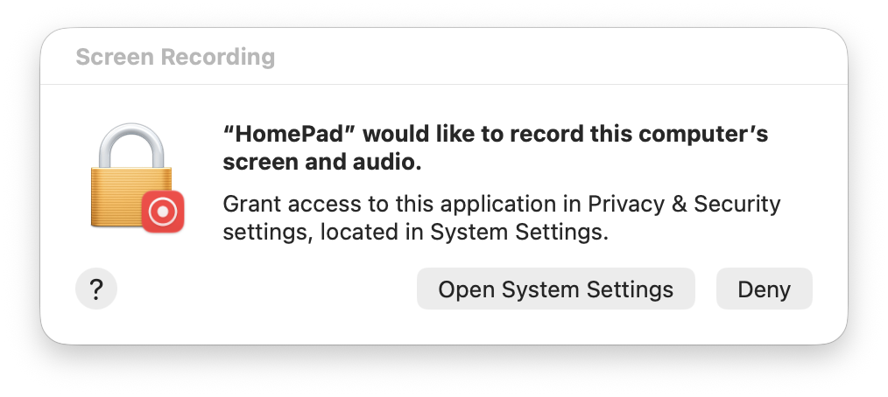
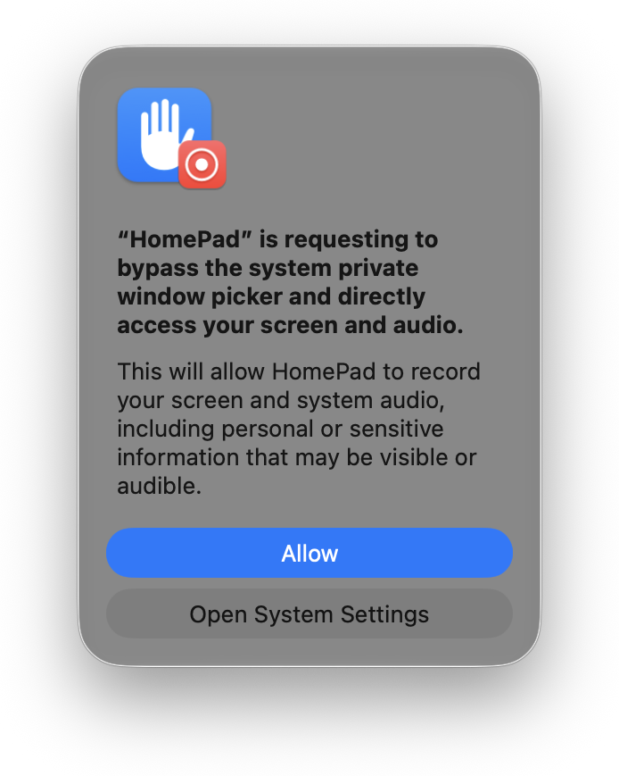

<!-- languages:start -->

<b>🌐 Language · Idioma · Langue · Sprache · Язык · 语言 · 言語 · 언어 · भाषा · لغة</b>

 

<table>
  <tr>
    <td align="center"><a href="../../README.md">English</a></td>
    <td align="center"><a href="README.ar.md">العربية</a></td>
    <td align="center"><a href="README.bn.md">বাংলা</a></td>
    <td align="center"><a href="README.zh-Hans.md">简体中文</a></td>
    <td align="center"><a href="README.fil.md">Filipino</a></td>
  </tr>
  <tr>
    <td align="center"><b>Français</b></td>
    <td align="center"><a href="README.de.md">Deutsch</a></td>
    <td align="center"><a href="README.hi.md">हिन्दी</a></td>
    <td align="center"><a href="README.id.md">Bahasa Indonesia</a></td>
    <td align="center"><a href="README.it.md">Italiano</a></td>
  </tr>
  <tr>
    <td align="center"><a href="README.ja.md">日本語</a></td>
    <td align="center"><a href="README.ko.md">한국어</a></td>
    <td align="center"><a href="README.fa.md">فارسی</a></td>
    <td align="center"><a href="README.pt-BR.md">Português (Brasil)</a></td>
    <td align="center"><a href="README.ru.md">Русский</a></td>
  </tr>
  <tr>
    <td align="center"><a href="README.es.md">Español</a></td>
    <td align="center"><a href="README.te.md">తెలుగు</a></td>
    <td align="center"><a href="README.th.md">ไทย</a></td>
    <td align="center"><a href="README.tr.md">Türkçe</a></td>
    <td align="center"><a href="README.vi.md">Tiếng Việt</a></td>
  </tr>
</table>

<!-- languages:end -->

# HomePad for macOS

> Cette traduction a été rédigée par une IA et n’a pas été relue par des locuteurs natifs. HomePad existe aussi dans cette langue ; les noms des boutons et des menus sont donnés ici tels que l’app les affiche (la langue se change dans Réglages → Général → Langue). La [README anglaise](../../README.md) fait foi.

**Tout ce que vous utilisez, à une touche de distance.** HomePad est le lanceur qui manquait à votre Mac : rangez vos apps dans des catégories, regroupez-les dans des dossiers, épinglez vos favoris, cherchez tout instantanément et gardez vos apps ouvertes sous les yeux, avec une barre des tâches de style Windows en option si vous le souhaitez.

Un lanceur de style Windows : appuyez sur un raccourci et un panneau s’affiche au milieu de l’écran, avec une barre de recherche en haut (elle interroge le même index que Spotlight) et une grille d’apps épinglées en dessous.

HomePad fonctionne selon trois modes. Choisissez celui qui vous convient dans Réglages → Mode.

**Barre des tâches.** Imite la barre des tâches et le menu Démarrer de Windows. Si l’expérience Windows vous manque sur macOS, vous vous sentirez chez vous.

**Dock + HomePad.** Pour ceux qui veulent garder le « Dock » de macOS mais ont besoin d’un lanceur de style menu Démarrer. macOS a le lanceur Apps, mais il n’a rien d’inspirant : il range vos apps automatiquement dans des catégories, vous ne pouvez pas les choisir, ni regrouper les apps dans des dossiers, ni épingler vos favoris, ni l’organiser à votre façon. HomePad résout tout cela.

**Autonome.** Pour les minimalistes qui veulent gagner un maximum d’espace à l’écran, sans « Dock » ni barre des tâches qui encombrent l’écran. Vous faites apparaître HomePad avec un raccourci clavier, une double frappe ou un coup de souris vers un coin actif, chaque fois que vous en avez besoin. Il s’affiche au centre, et vous contrôlez entièrement vos apps, fichiers et dossiers favoris, la recherche, ainsi que vos apps ouvertes et leurs fenêtres. Vous n’avez pas besoin du « Dock », ni de Spotlight : vous pilotez votre Mac depuis un seul endroit. Cela peut sembler étrange au début, mais devient incroyablement puissant une fois qu’on s’y habitue.

## Installation

HomePad est gratuit et n’est pas signé par Apple ; macOS le bloque donc une fois et vous demande de confirmer que tout va bien. Cela prend environ cinq minutes, une seule fois. Il vous faut macOS 13 (Ventura) ou version ultérieure ; les Mac Apple silicon et Intel fonctionnent tous les deux. ([INSTALL.md](../../INSTALL.md) décrit les mêmes étapes en toutes lettres, y compris pour le zip et l’image disque simple.)

**1. Ouvrez l’image disque du programme d’installation.** Double-cliquez sur `HomePad-Installer.dmg` (reçu de la personne qui vous a partagé HomePad, ou à compiler vous-même : `tools/make_installer_dmg.sh`, voir [Build and run](../../README.md#build-and-run)). Sa fenêtre liste les étapes.

**2. Double-cliquez sur Install HomePad.pkg.** Votre Mac indique qu’il ne peut pas l’ouvrir. Cliquez sur **Terminé**, pas sur Placer dans la corbeille.

**3. Autorisez-le dans Confidentialité et sécurité.** Double-cliquez sur la vignette bleue **Ouvrir Confidentialité et sécurité** dans la fenêtre de l’image disque (ou ouvrez vous-même Réglages Système → Confidentialité et sécurité), faites défiler jusqu’à **Sécurité** et cliquez sur **Ouvrir quand même** à côté du message concernant le programme d’installation.

**4. Confirmez.** Cliquez sur **Ouvrir quand même** dans le message qui suit, puis utilisez Touch ID ou saisissez le mot de passe de votre Mac.

<table align="center"><tr>
<td align="center"></td>
<td align="center"></td>
</tr></table>

> Sous macOS 13 Ventura et 14 Sonoma, il existe un raccourci : faites un clic droit sur le programme d’installation, choisissez **Ouvrir**, puis **Ouvrir** à nouveau.

**5. Parcourez le programme d’installation.** Cliquez sur **Continuer** à l’introduction, à « À savoir » et à la destination (pour tous les utilisateurs de cet ordinateur), puis sur **Installer**. Votre Mac demande votre mot de passe une fois. Quand le programme d’installation indique que HomePad se trouve dans votre dossier Applications, cliquez sur **Fermer**.

<table align="center">
<tr>
<td align="center"></td>
<td align="center"></td>
</tr>
<tr>
<td align="center"></td>
<td align="center"></td>
</tr>
<tr>
<td align="center" colspan="2"></td>
</tr>
</table>

**6. Le guide de configuration.** HomePad s’ouvre tout seul avec une fenêtre de bienvenue. Autorisez les trois accès, choisissez comment vous voulez ouvrir HomePad (un raccourci clavier, une double frappe, les coins actifs), puis cliquez sur **Commencer**. Chaque autorisation est facultative, mais HomePad fonctionne mieux avec les trois.

**7. Les autorisations.** Cliquez sur **Autoriser…** à côté de chacune, de haut en bas.

- **Enregistrement de l’écran** (aperçus des fenêtres d’une app ouverte). Un message avec un cadenas apparaît : cliquez sur **Ouvrir Réglages Système**, activez l’interrupteur à côté de **HomePad**, puis cliquez sur **Quitter et rouvrir**. HomePad redémarre tout seul et la fenêtre de bienvenue revient. macOS peut aussi demander une fois de plus s’il faut laisser HomePad accéder directement à votre écran : cliquez sur **Autoriser**.

<table align="center">
<tr>
<td align="center" valign="top"></td>
<td align="center" valign="top"></td>
</tr>
<tr>
<td align="center" valign="top"></td>
<td align="center" valign="top"></td>
</tr>
</table>

- **Accessibilité** (sauter vers la fenêtre que vous choisissez, et le raccourci à double frappe). Cliquez sur **Autoriser…**, puis sur **Ouvrir Réglages Système** dans le message, et activez l’interrupteur à côté de **HomePad** (saisissez votre mot de passe si on vous le demande). Sur les versions récentes de macOS, cette page s’appelle, dans l’interface en anglais, **Device Control and Data Access**.

- **Accès complet au disque** (trouver des fichiers dans Documents, Bureau et Téléchargements). Cliquez sur **Autoriser…** ; Réglages Système s’ouvre avec une petite fenêtre HomePad à côté. Activez l’interrupteur à côté de **HomePad**. S’il n’est pas dans la liste, faites glisser son icône de la petite fenêtre dans la liste.

**8. Utilisez-le.** Appuyez sur **Option-Espace** (ou sur le raccourci que vous avez choisi). Tout le reste, y compris les trois modes ci-dessus, se trouve dans les Réglages : faites un clic droit sur l’icône en grille dans la barre des menus, puis choisissez **Réglages…**.

## Utilisation

- **Option-Espace** ouvre et ferme le panneau (modifiable dans les Réglages), ou double-appuyez sur Contrôle, Option ou Commande (Réglages → Ouverture ; nécessite l’autorisation Accessibilité).
- **Coins actifs** : Réglages → Ouverture → coins actifs. Cliquez sur l’un des quatre coins du petit écran (un, plusieurs ou tous). Laissez le pointeur un instant dans un coin choisi et le panneau s’ouvre dans ce coin ; recommencez pour le fermer. Un simple effleurement du coin, ou un glissement avec le bouton de la souris maintenu, ne fait rien. Le raccourci et la double frappe l’ouvrent toujours au milieu. Également à la deuxième étape du guide de configuration. Si macOS utilise le même coin pour l’une de ses propres actions, HomePad le signale, avec un bouton **Ouvrir « Coins actifs » de macOS…** qui ouvre Réglages Système → Bureau et Dock avec la feuille Coins actifs déjà affichée (appuyer sur ce bouton nécessite l’Accessibilité ; sans elle, seule la page s’ouvre).
- **Catégories** : les apps vivent dans des catégories nommées. **Essentiels** vient en premier et est remplie à partir de votre Dock au premier lancement, avec en plus une catégorie **Fichiers** contenant la Corbeille et Téléchargements, comme l’extrémité droite du Dock (uniquement au tout premier lancement ; si vous la supprimez, elle reste supprimée). Ajoutez les vôtres (Navigateurs, Écriture…) avec **Ajouter une catégorie** ou par un clic droit dans l’espace vide. Une nouvelle catégorie affiche une vignette grisée « Ajoutez votre app ici ». Faites un clic droit dans une catégorie pour la renommer ou la supprimer (tout ce qu’elle contient est aussi détaché ; les apps et les fichiers eux-mêmes ne sont pas touchés).
- **Ajouter des fichiers et des dossiers** : **Ajouter un fichier ou un dossier** (lien de l’en-tête, menu contextuel ou Réglages), faites-les glisser depuis le Finder, ou faites un clic droit sur un résultat de recherche → Épingler. Ils s’ouvrent d’un clic ; les dossiers s’ouvrent dans le Finder. Le sélecteur est une fenêtre de navigation avec une barre latérale (Dossier personnel, Bureau, Documents, Téléchargements, ..., disques) et une entrée **Corbeille** qui épingle votre Corbeille. Cliquer sur un lieu de la barre latérale (Documents, Téléchargements, Corbeille ...) l’ouvre et sélectionne le dossier lui-même, de sorte que **Ajouter** est prêt. Ces fenêtres ne bloquent pas le panneau : écartez-en une et faites glisser n’importe quelle vignette qu’elle contient vers le panneau. Faites un clic droit sur la vignette de la Corbeille pour **Vider « Corbeille »…** (il demande d’abord ; HomePad fait vider la Corbeille par le Finder, comme le Dock, donc la première fois macOS demande si HomePad peut contrôler le Finder).
- **Ordre des catégories** : le nom d’une catégorie devient vert quand vous le survolez. Appuyez dessus et toute la rangée est sélectionnée (remplissage et contour verts) ; faites glisser et la rangée elle-même suit pendant que les autres rangées s’écartent pour lui faire de la place (le panneau reste où il est). Relâchez et elle reste là où elle est. Ou faites un clic droit dans une catégorie et choisissez **Monter** / **Descendre**. Tant que quelque chose est glissé, les effets de survol et les aperçus de fenêtres restent désactivés. « Essentiels » peut aussi être déplacée ; elle reste l’endroit par défaut pour les nouveaux éléments et ne peut pas être supprimée. De fines lignes grises séparent les catégories.
- **Clic droit pour ajouter** : faites un clic droit dans l’espace vide d’une catégorie (son titre, ou les espaces entre ses vignettes et après elles) et le menu ajoute à *cette* catégorie : « Ajouter une app à Fichiers… », « Ajouter un fichier ou un dossier à Fichiers… », plus Ajouter une catégorie, Renommer et Supprimer pour elle, et **Trier par ordre alphabétique** (classe les vignettes de cette catégorie par ordre alphabétique des noms qu’elles affichent ; grisé quand elles le sont déjà ; les vignettes à l’intérieur de ses dossiers gardent leur ordre). L’espace vide sous la dernière section appartient à cette section.
- **Ajouter des apps** : le bouton Ajouter une app (double-cliquez sur une app dans le sélecteur pour l’ajouter et fermer le sélecteur), un clic droit dans l’espace vide, glisser des apps depuis le Finder (appuyez sur le raccourci en plein glissement), ou un clic droit sur un résultat de recherche → Épingler l’app.
- **Dossiers** (comme dans le menu Démarrer de Windows) : faites glisser une vignette sur le milieu de l’icône d’une autre vignette, maintenez-la une demi-seconde jusqu’à ce que cette icône s’éclaire, puis relâchez : les deux deviennent un dossier à cet endroit, nommé « Dossier », dont la vignette montre ses quatre premiers éléments. Déposez d’autres vignettes sur un dossier pour les y ajouter. Cliquez sur un dossier pour l’ouvrir au-dessus du panneau : cliquez sur son nom pour le renommer, sur un élément pour l’ouvrir, faites glisser des éléments pour les réorganiser ou hors du dossier (il se ferme pour que vous puissiez déposer l’élément parmi les autres vignettes). Échap ou un clic à l’extérieur le ferme. Un dossier qui ne contient plus qu’un élément redevient cet élément. Faites un clic droit sur un dossier pour « Renommer le dossier… », « Déplacer vers » et « Dissocier » ; faites un clic droit sur un élément d’un dossier ouvert pour « Retirer du dossier ». Glisser sur les bords d’une vignette (pas sur son milieu) ne fait toujours que réordonner.
- **Retirer / réordonner** : clic droit sur une vignette → Détacher l’app / Déplacer vers, ou faites glisser les vignettes, y compris d’une catégorie à l’autre.
- **Apps ouvertes** : une barre rouge juste sous une icône (au-dessus de son nom) signifie que l’app est ouverte. Survolez une app ouverte pour voir une vignette de chacune de ses fenêtres (une fenêtre réduite a un signe moins à côté de sa croix de fermeture), sur chaque bureau (Space), listées dans l’ordre de Mission Control avec un titre « Space N » quand une app a des fenêtres sur plusieurs bureaux, et cliquez sur l’une d’elles pour y aller directement (en changeant de bureau si nécessaire), ou cliquez sur la croix dans son coin pour fermer seulement cette fenêtre (cela marche aussi pour les fenêtres d’autres bureaux) (nécessite l’Enregistrement de l’écran et l’Accessibilité ; sans l’Enregistrement de l’écran, vous obtenez une simple liste). Cliquer sur une app ouverte met d’abord le bureau actuel : une fenêtre visible là fait passer l’app au premier plan ; si ses fenêtres y sont toutes réduites, la plus récente revient ; ce n’est que s’il n’y a aucune fenêtre là que cela vous emmène vers un autre bureau où elle a des fenêtres. La section **Ouvertes** liste chaque app ouverte (épinglée ou non, comme les indicateurs d’ouverture du Dock) ; on ne peut rien y ajouter ni en retirer, mais ses vignettes peuvent être **déplacées à l’intérieur pour les réordonner** (par ordre alphabétique jusqu’à ce que vous en déplaciez une ; l’ordre est mémorisé, y compris pour une app qui quitte puis redémarre ; une vignette ne peut être déposée nulle part ailleurs, et Échap ou relâcher ailleurs la remet en place ; clic droit sur Ouvertes → **Trier par ordre alphabétique** oublie votre ordre), et la section elle-même ne peut pas être renommée mais peut être glissée par son titre (ou déplacée avec **Monter** / **Descendre** dans son menu contextuel) à n’importe quel endroit parmi les catégories, et elle peut être masquée (clic droit dessus → Masquer « Ouvertes » ; rétablissez-la avec Réglages → Panneau → Afficher la section « Ouvertes »). Les **fenêtres réduites** de chaque app ouverte peuvent suivre sa vignette, comme des vignettes à part : une image de la fenêtre avec l’icône de l’app dans le coin et le titre de la fenêtre (comme le Dock les affiche). Cliquez sur l’une d’elles pour ramener cette fenêtre ; clic droit pour Restaurer ou Fermer la fenêtre. Elles sont désactivées par défaut : activez Réglages → Panneau → Afficher les fenêtres réduites dans « Ouvertes », ou faites un clic droit sur Ouvertes → Afficher les fenêtres réduites. Elles sont rassemblées chaque fois que le panneau s’ouvre (nécessite l’Accessibilité ; les images nécessitent l’Enregistrement de l’écran).
- **Menu d’une app ouverte** : faites un clic droit sur une app ouverte pour un menu semblable à celui du Dock : ses fenêtres (celle du premier plan cochée ; choisissez-en une pour la ramener au premier plan), les commandes « Nouveau… » de son menu Fichier (Nouvel onglet, Nouvelle fenêtre, Nouvelle fenêtre privée dans un navigateur), puis **Fermer les fenêtres** (seulement si elle a une fenêtre ouverte), **Masquer** et **Quitter** (maintenez Option pour forcer à quitter ; une app encore ouverte quelques secondes après Quitter reçoit **Forcer à quitter** à la place ; le Finder n’a pas de Quitter, comme dans le Dock, car le quitter supprime les icônes du bureau). Les fenêtres et les commandes sont lues via l’Accessibilité quand le pointeur atteint la vignette.
- **Trouver des fichiers** : les fichiers de Documents, du Bureau et de Téléchargements n’apparaissent dans la recherche qu’une fois que HomePad a l’**Accès complet au disque** (Réglages Système → Confidentialité et sécurité). D’ici là, les résultats affichent un avis avec un lien vers l’interrupteur.
- **Calculatrice** : tapez un calcul comme `7+3`, `(2+3)*4`, `2^10` ou `15%` et la réponse apparaît en premier. ↩ ou le bouton de copie la copie.
- **Fenêtre** : faites glisser n’importe quel bord ou coin du panneau pour le redimensionner (les bords ont de larges zones de saisie et affichent des curseurs de redimensionnement), ou faites glisser n’importe quelle partie vide pour le déplacer (pas la grille de vignettes elle-même, où glisser réorganise les vignettes). Le champ de recherche a le focus chaque fois que le panneau s’ouvre, vous pouvez donc taper tout de suite ; après un clic ailleurs, la prochaine touche que vous tapez y retourne. Réglages → Panneau propose **Mémoriser la taille de la fenêtre** (activé par défaut) et **Mémoriser la position de la fenêtre** (désactivé par défaut). Le bouton ↺ à côté de la roue crantée des réglages remet le panneau à la taille standard, centré. Les fenêtres Ajouter une app et Ajouter un fichier ou un dossier peuvent aussi être redimensionnées (elles s’ouvrent toujours à leur taille standard).
- **Votre nom**, dans le coin inférieur gauche du panneau, ouvre Réglages Système sur votre compte Apple.
- **Recherche** : commencez simplement à taper. Les apps viennent d’abord, puis les documents et les dossiers, puis une recherche sur le web. ↑ ↓ pour choisir, ↩ pour ouvrir, ⌘↩ pour afficher dans le Finder, Échap pour effacer puis fermer. Le bouton ‹ ou un clic dans l’espace vide ramène aussi à vos apps.

## Premier lancement

Une fenêtre de bienvenue vous demande d’autoriser l’Enregistrement de l’écran, l’Accessibilité et l’Accès complet au disque, et de choisir comment ouvrir HomePad (voir Installation). Rouvrez-la à tout moment depuis l’icône de la barre des menus → Guide de configuration…

## Réglages

Les Réglages comptent six onglets dans leur barre d’outils : **Mode**, **Général** (langue, icône de la barre des menus, ouvrir à la connexion, Rétablir les valeurs par défaut, Recommencer), **Barre des tâches**, **Ouverture** (raccourci, double frappe, coins actifs), **Panneau** (disposition, fenêtre, éléments) et **Autorisations**. Ils se rouvrent sur l’onglet que vous avez utilisé en dernier.

- **Raccourci** : cliquez sur le bouton et appuyez sur une nouvelle combinaison. Pour utiliser ⌘Espace, désactivez d’abord le raccourci de Spotlight dans Réglages Système → Clavier → Raccourcis clavier → Spotlight.
- **Raccourci** : enregistrez-en un, choisissez **Aucun** si vous ne voulez que la double frappe, ou **Réinitialiser** pour le remettre sur ⌥Espace.
- **Icône de la barre des menus** : Réglages → Général peut la masquer. Relancer l’app ouvre le panneau.
- **Rétablir les valeurs par défaut** : rétablit le raccourci, la double frappe, la disposition, le masquage du Dock et l’ouverture à la connexion (les apps et les catégories sont conservées).
- **Double frappe** : ouvrir en appuyant deux fois sur Contrôle, Option ou Commande.
- **Icônes par rangée** (8 par défaut, de 4 à 10), **hauteur de rangée** (la distance entre les rangées d’icônes, 101 pt par défaut, de 85 à 125) et **espacement des icônes** (l’écart horizontal entre les icônes, 10 pt par défaut, de 0 à 40 ; quand le panneau est trop étroit pour cet écart, l’écart rétrécit d’abord, puis les icônes) : tapez un nombre ou cliquez sur − / +, **afficher les apps ouvertes**, **réimporter depuis le Dock**.
- **Mode** (le premier onglet) :
  - **Autonome** (par défaut) : le panneau flottant, ouvert par le raccourci, la double frappe, les coins actifs ou l’icône de la barre des menus. Passer à ce mode masque le Dock ; **Masquer « Dock »** ci-dessous le ramène.
  - **HomePad + « Dock »** : un fonctionnement à la menu Démarrer de Windows, avec le Dock comme barre des tâches. Le choisir affiche toujours le Dock (il désactive le masquage automatique, celui de HomePad ou celui de Réglages Système) et y ajoute HomePad s’il n’y est pas (le Dock redémarre une fois) ; le Dock reste où vous l’avez mis. Le panneau s’ouvre juste à côté de l’icône de HomePad (au-dessus pour un Dock en bas, à côté pour un Dock sur le côté, maintenu à l’écran), que vous cliquiez sur l’icône ou que vous utilisiez le raccourci ou la double frappe ; cliquer à nouveau sur l’icône le ferme. Les coins actifs l’ouvrent toujours dans leur coin. Les Réglages indiquent pourquoi il s’ouvre au milieu quand HomePad n’est pas dans le Dock, que le Dock est masqué ou que l’autorisation Accessibilité manque.
  - **Barre des tâches** : une barre des tâches de style Windows le long du bas de l’écran principal : un bouton Démarrer (l’icône de HomePad), puis ce que vous y avez épinglé et les apps ouvertes, centrés. Les apps ouvertes quittent alors le panneau. Épinglez des apps, des fichiers et des dossiers par un clic droit dans l’espace vide de la barre des tâches (**Ajouter une app…**, **Ajouter un fichier ou un dossier…**) ou sur une vignette (**Épingler à la barre des tâches** ; aussi dans le panneau de HomePad). Le menu d’une icône de la barre des tâches propose aussi **Épingler à HomePad** (ou Détacher de HomePad), pour les propres catégories de HomePad. Ou faites glisser des apps, des fichiers et des dossiers sur la barre des tâches, depuis le Finder ou depuis le panneau de HomePad : ils sont épinglés avant l’icône sur laquelle vous relâchez, ou à la fin dans l’espace vide (un élément déjà épinglé s’y déplace ; le panneau garde les siens). Les épingles de la barre des tâches forment une liste à part, distincte des catégories de HomePad. Faites glisser les icônes le long de la barre des tâches pour les réordonner. Les **icônes des apps** vont au **Centre** ou à **Gauche** ; tant qu’elles sont centrées, l’**icône de HomePad** peut être centrée avec elles ou à gauche (quand les icônes des apps sont à gauche, elle y est toujours, donc le choix est grisé). La gauche est la droite en arabe et en persan, en miroir comme sous Windows. Quand l’icône de HomePad est à gauche, son panneau s’ouvre au bord gauche, au-dessus de la barre des tâches. À droite se trouvent le **réseau**, le **volume**, la **batterie** et l’**horloge**, chacun avec un interrupteur : le réseau et la batterie ouvrent leurs pages dans Réglages Système (les menus d’état propres à macOS ne peuvent pas être ouverts de l’extérieur sur les versions récentes de macOS), le volume ouvre un curseur (faites défiler dessus pour changer le volume), l’horloge un calendrier. Cliquez sur un élément pour l’ouvrir ou le ramener au premier plan (ou le masquer s’il y est déjà) ; pointez une app ouverte pour ses fenêtres ; clic droit pour son menu. Réglages → Barre des tâches → **Apps ouvertes** (repliée au début) liste chaque app ouverte avec un interrupteur **Afficher dans la barre des tâches** ; une app désactivée reste hors de la barre des tâches tant qu’elle est ouverte (aussi **Masquer dans la barre des tâches** dans son menu). Les éléments épinglés sont toujours affichés. Masquer une app (Cmd-H) ne change pas la barre des tâches. Le panneau s’ouvre centré au-dessus de la barre des tâches. Le Dock est masqué pendant ce temps. macOS ne laisse que le Dock tenir les fenêtres à l’écart d’une partie de l’écran ; avec l’Accessibilité, HomePad raccourcit donc une fenêtre quand elle est ouverte, redimensionnée, agrandie ou juxtaposée de sorte qu’elle passe sous la barre des tâches (remontée à la place si elle devenait trop courte). Une fenêtre simplement glissée là est laissée telle quelle, comme sous Windows. (Garder le vrai Dock sous la barre des tâches n’a pas fonctionné : il affiche ses étiquettes de nom partout où le pointeur passe sur ses icônes.) **Masquer automatiquement la barre des tâches** la fait glisser hors du bas de l’écran jusqu’à ce que le pointeur reste sur le bord inférieur pendant le **Délai avant l’affichage** (0 à 1000 ms, 300 par défaut, pour qu’un passage rapide le long du bord ne l’affiche pas) ; elle reste visible tant que le panneau de HomePad, une fenêtre contextuelle, un aperçu de fenêtre ou un menu est ouvert, et les fenêtres utilisent alors tout l’écran. **Ouvrir HomePad uniquement avec le bouton Démarrer** désactive le raccourci, la double frappe et les coins actifs (l’icône de la barre des menus fonctionne toujours).
- **Masquer « Dock »** (mode Autonome uniquement) : active le masquage automatique du Dock avec un délai de 1000 secondes pour qu’il n’apparaisse jamais. Le désactiver rétablit le Dock normal.
- **Ouvrir à la connexion**.
- **Langue** (Réglages → Général, ou clic droit sur l’icône de la barre des menus → Langue) : Comme le Mac, ou l’une des 20 langues (arabe, bengali, chinois (simplifié), anglais, filipino, français, allemand, hindi, indonésien, italien, japonais, coréen, persan, portugais (Brésil), russe, espagnol, télougou, thaï, turc, vietnamien), listées par ordre alphabétique dans la langue actuelle. HomePad redémarre dans la nouvelle langue ; l’arabe et le persan s’affichent de droite à gauche. Les noms des apps, des dossiers et des sections de Réglages Système restent tels que le Mac les affiche.

## Configurer les autorisations

Quand vous accordez une autorisation (dans le guide de configuration, les Réglages ou un aperçu de fenêtre), HomePad surveille son activation dans Réglages Système et repasse au premier plan dès qu’elle est activée. L’Enregistrement de l’écran et l’Accès complet au disque demandent en général un redémarrage : quand Réglages Système propose **Quitter et rouvrir**, HomePad quitte, redémarre tout seul et rouvre la fenêtre où vous étiez.

Le guide de configuration ne s’affiche au premier lancement que s’il manque une autorisation. Pour le refaire entièrement depuis le début, utilisez **Réglages → Général → Recommencer…** : macOS reprend les autorisations de HomePad, le guide s’affiche à nouveau et HomePad redémarre (cochez la case pour oublier aussi vos catégories et vos réglages, comme sur une installation neuve).

## Développement

Les instructions pour compiler l’app, le fonctionnement des traductions, la liste des fichiers et l’icône de l’app figurent uniquement dans la [README anglaise](../../README.md#development).

## Licence

[MIT](../../LICENSE).
