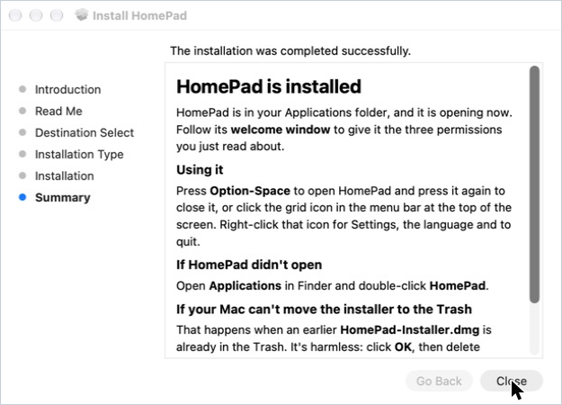
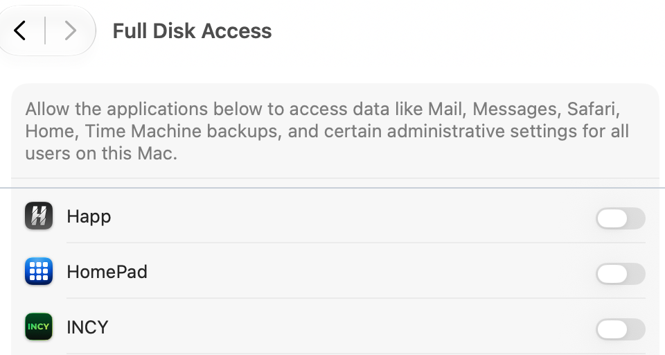

<!-- languages:start -->

<b>🌐 Language · Idioma · Langue · Sprache · Язык · 语言 · 言語 · 언어 · भाषा · لغة</b>

 

<table>
  <tr>
    <td align="center"><a href="../../README.md">English</a></td>
    <td align="center"><a href="README.ar.md">العربية</a></td>
    <td align="center"><a href="README.bn.md">বাংলা</a></td>
    <td align="center"><a href="README.zh-Hans.md">简体中文</a></td>
    <td align="center"><a href="README.fil.md">Filipino</a></td>
  </tr>
  <tr>
    <td align="center"><a href="README.fr.md">Français</a></td>
    <td align="center"><a href="README.de.md">Deutsch</a></td>
    <td align="center"><b>हिन्दी</b></td>
    <td align="center"><a href="README.id.md">Bahasa Indonesia</a></td>
    <td align="center"><a href="README.it.md">Italiano</a></td>
  </tr>
  <tr>
    <td align="center"><a href="README.ja.md">日本語</a></td>
    <td align="center"><a href="README.ko.md">한국어</a></td>
    <td align="center"><a href="README.fa.md">فارسی</a></td>
    <td align="center"><a href="README.pt-BR.md">Português (Brasil)</a></td>
    <td align="center"><a href="README.ru.md">Русский</a></td>
  </tr>
  <tr>
    <td align="center"><a href="README.es.md">Español</a></td>
    <td align="center"><a href="README.te.md">తెలుగు</a></td>
    <td align="center"><a href="README.th.md">ไทย</a></td>
    <td align="center"><a href="README.tr.md">Türkçe</a></td>
    <td align="center"><a href="README.vi.md">Tiếng Việt</a></td>
  </tr>
</table>

<!-- languages:end -->

# HomePad for macOS

> यह अनुवाद एक AI ने लिखा है और किसी मूल भाषी ने इसकी जाँच नहीं की है। HomePad इस भाषा में भी उपलब्ध है; बटनों और मेनू के नाम यहाँ वैसे ही दिए गए हैं जैसे ऐप दिखाता है (भाषा सेटिंग्ज़ → सामान्य → भाषा में बदली जा सकती है)। प्रामाणिक [अंग्रेज़ी README](../../README.md) है।

**आप जो भी इस्तेमाल करते हैं, बस एक कीस्ट्रोक दूर।** HomePad वह लॉन्चर है जिसकी कमी आपके Mac में थी: अपनी ऐप्स को श्रेणियों में बाँटें, फ़ोल्डरों में रखें, पसंदीदा पिन करें, सब कुछ तुरंत खोजें और चल रही ऐप्स को नज़र के सामने रखें, चाहें तो साथ में Windows जैसा टास्कबार भी।

Windows जैसा लॉन्चर: शॉर्टकट दबाएँ और स्क्रीन के बीच में एक पैनल खुलता है, जिसके ऊपर सर्च बार (वही इंडेक्स खोजता है जो Spotlight इस्तेमाल करता है) और नीचे पिन की गई ऐप्स का ग्रिड होता है।

HomePad तीन मोड में काम करता है। जो आपके लिए ठीक हो उसे सेटिंग्ज़ → मोड में चुनें।

**टास्कबार।** Windows के टास्कबार और स्टार्ट मेनू जैसा अनुभव देता है। अगर आपको macOS पर Windows का अनुभव याद आता है, तो यहाँ आप घर जैसा महसूस करेंगे।

**Dock + HomePad।** उनके लिए जो macOS का “Dock” रखना चाहते हैं पर उन्हें स्टार्ट-मेनू जैसा लॉन्चर चाहिए। macOS में Apps लॉन्चर है, पर वह बेदम है: वह आपकी ऐप्स को अपने आप श्रेणियों में बाँटता है, आप उन्हें चुन नहीं सकते, ऐप्स को फ़ोल्डरों में समूहित नहीं कर सकते, पसंदीदा पिन नहीं कर सकते, और अपने ढंग से सजा नहीं सकते। HomePad यह सब हल कर देता है।

**अलग।** उन न्यूनतमवादियों के लिए जो स्क्रीन की जगह सबसे ज़्यादा चाहते हैं, बिना “Dock” या टास्कबार के जो स्क्रीन को भर दें। जब भी ज़रूरत हो, शॉर्टकट की, डबल टैप या माउस को हॉट कॉर्नर की ओर फेंककर HomePad बुलाएँ। यह बीच में खुलता है, और आपका अपनी पसंदीदा ऐप्स, फ़ाइलों और फ़ोल्डरों, सर्च, और चल रही ऐप्स व उनकी विंडो पर पूरा नियंत्रण रहता है। आपको “Dock” की ज़रूरत नहीं, Spotlight की भी नहीं: आप अपना Mac एक ही जगह से चलाते हैं। शुरू में यह अजीब लग सकता है, पर आदत पड़ने पर यह हैरान करने की हद तक ताक़तवर है।

## इंस्टॉलेशन

HomePad मुफ़्त है और Apple ने इस पर हस्ताक्षर नहीं किए हैं, इसलिए macOS इसे एक बार रोकता है और आपसे पुष्टि माँगता है कि यह ठीक है। इसमें करीब पाँच मिनट लगते हैं, सिर्फ़ एक बार। आपको macOS 13 (Ventura) या नया चाहिए; Apple silicon और Intel दोनों Mac चलते हैं। ([INSTALL.md](../../INSTALL.md) में यही चरण शब्दों में हैं, zip और सादे डिस्क इमेज के लिए भी।)

**1. इंस्टॉलर डिस्क इमेज खोलें।** `HomePad-Installer.dmg` पर डबल-क्लिक करें (जिसने आपको HomePad दिया उससे, या खुद बनाएँ: `tools/make_installer_dmg.sh`, देखें [Build and run](../../README.md#build-and-run))। इसकी विंडो में चरण लिखे हैं।

**2. Install HomePad.pkg पर डबल-क्लिक करें।** आपका Mac कहेगा कि इसे खोला नहीं जा सकता। **हो गया** क्लिक करें, “ट्रैश में ले जाएँ” नहीं।

**3. गोपनीयता और सुरक्षा में इसे अनुमति दें।** डिस्क इमेज विंडो में नीले **गोपनीयता और सुरक्षा खोलें** टाइल पर डबल-क्लिक करें (या खुद सिस्टम सेटिंग्ज़ → गोपनीयता और सुरक्षा खोलें), नीचे **सुरक्षा** तक स्क्रोल करें और इंस्टॉलर वाले संदेश के पास **फिर भी खोलें** क्लिक करें।

**4. पुष्टि करें।** अगले संदेश में **फिर भी खोलें** क्लिक करें, फिर Touch ID इस्तेमाल करें या अपने Mac का पासवर्ड डालें।

<table align="center"><tr>
<td align="center"></td>
<td align="center"></td>
</tr></table>

> macOS 13 Ventura और 14 Sonoma पर एक शॉर्टकट है: इंस्टॉलर पर राइट-क्लिक करें, **खोलें** चुनें, फिर दोबारा **खोलें**।

**5. इंस्टॉलर के चरण पूरे करें।** परिचय, क्या अपेक्षा करें और गंतव्य (इस कंप्यूटर के सभी उपयोगकर्ताओं के लिए) पर **जारी रखें** क्लिक करें, फिर **इंस्टॉल करें**। आपका Mac एक बार पासवर्ड माँगेगा। जब इंस्टॉलर कहे कि HomePad आपके ऐप्लिकेशन फ़ोल्डर में है, **बंद करें** क्लिक करें।

<table align="center">
<tr>
<td align="center"></td>
<td align="center"></td>
</tr>
<tr>
<td align="center"></td>
<td align="center"></td>
</tr>
<tr>
<td align="center" colspan="2"></td>
</tr>
</table>

**6. सेटअप गाइड।** HomePad अपने आप एक स्वागत विंडो के साथ खुलता है। तीनों अनुमतियाँ दें, चुनें कि आप HomePad कैसे खोलना चाहते हैं (कीबोर्ड शॉर्टकट, डबल-टैप, हॉट कॉर्नर), और **शुरू करें** क्लिक करें। हर अनुमति वैकल्पिक है, पर तीनों के साथ HomePad सबसे अच्छा चलता है।

**7. अनुमतियाँ।** हर एक के पास ऊपर से नीचे **अनुमति दें…** क्लिक करें।

- **स्क्रीन रिकॉर्डिंग** (चल रही ऐप की विंडो के प्रिव्यू)। ताले वाला एक संदेश आता है: **सिस्टम सेटिंग्ज़ खोलें** क्लिक करें, **HomePad** के पास का स्विच चालू करें, फिर **बंद करें और फिर से खोलें** क्लिक करें। HomePad अपने आप रीस्टार्ट होता है और स्वागत विंडो लौट आती है। macOS एक बार और पूछ सकता है कि HomePad को आपकी स्क्रीन सीधे देखने दें या नहीं: **अनुमति दें** क्लिक करें।

<table align="center">
<tr>
<td align="center" valign="top"></td>
<td align="center" valign="top"></td>
</tr>
<tr>
<td align="center" valign="top"></td>
<td align="center" valign="top"></td>
</tr>
</table>

- **ऐक्सेसिबिलिटी** (आपकी चुनी विंडो पर कूदना, और डबल-टैप शॉर्टकट)। **अनुमति दें…** क्लिक करें, फिर संदेश में **सिस्टम सेटिंग्ज़ खोलें**, और **HomePad** के पास का स्विच चालू करें (पूछे जाने पर पासवर्ड डालें)। नए macOS पर अंग्रेज़ी इंटरफ़ेस में इस पेज का नाम **Device Control and Data Access** है।

- **फ़ुल डिस्क ऐक्सेस** (दस्तावेज़, डेस्कटॉप और डाउनलोड में फ़ाइलें खोजना)। **अनुमति दें…** क्लिक करें; सिस्टम सेटिंग्ज़ खुलती है और उसके पास एक छोटी HomePad विंडो होती है। **HomePad** के पास का स्विच चालू करें। अगर यह सूची में नहीं है, तो छोटी विंडो से इसका आइकॉन सूची में ड्रैग करें।

**8. इस्तेमाल करें।** **Option-Space** दबाएँ (या आपका चुना शॉर्टकट)। बाकी सब कुछ, ऊपर के तीन मोड समेत, सेटिंग्ज़ में है: मेनू बार के ग्रिड आइकॉन पर राइट-क्लिक करें, फिर **सेटिंग्ज़…**।

## इस्तेमाल कैसे करें

- **Option-Space** पैनल खोलता और बंद करता है (इसे सेटिंग्ज़ में बदलें), या Control, Option या Command को डबल-टैप करें (सेटिंग्ज़ → खोलना; ऐक्सेसिबिलिटी अनुमति चाहिए)।
- **हॉट कॉर्नर**: सेटिंग्ज़ → खोलना → हॉट कॉर्नर। छोटी स्क्रीन के चारों कोनों में से किसी पर भी क्लिक करें (एक, कई या सभी)। चुने हुए कोने में पॉइंटर को थोड़ी देर टिकाएँ और पैनल उसी कोने में खुलता है; बंद करने के लिए फिर वही करें। कोने के पास से तेज़ी से गुज़रने या माउस का बटन दबाकर खींचने पर कुछ नहीं होता। शॉर्टकट और डबल-टैप फिर भी इसे बीच में खोलते हैं। सेटअप गाइड के दूसरे चरण में भी है। अगर macOS उसी कोने को अपने किसी काम के लिए इस्तेमाल करता है, तो HomePad बताता है, साथ में **macOS “हॉट कॉर्नर” खोलें…** बटन के साथ जो सिस्टम सेटिंग्ज़ → डेस्कटॉप और डॉक खोलता है और हॉट कॉर्नर शीट पहले से दिखती है (उस बटन को दबाने के लिए ऐक्सेसिबिलिटी चाहिए; इसके बिना सिर्फ़ पेज खुलता है)।
- **श्रेणियाँ**: ऐप्स नामवाली श्रेणियों में रहती हैं। **ज़रूरी** पहले आती है और पहली बार खोलने पर आपके Dock से भरी जाती है, साथ में ट्रैश और डाउनलोड वाली **फ़ाइलें** श्रेणी, Dock के दाहिने सिरे जैसी (सिर्फ़ बिल्कुल पहली बार; हटा दें तो हटी ही रहती है)। अपनी श्रेणियाँ (ब्राउज़र, लेखन…) **श्रेणी जोड़ें** से या खाली जगह पर राइट-क्लिक करके जोड़ें। नई श्रेणी में धूसर “अपनी ऐप यहाँ जोड़ें” टाइल दिखती है। किसी श्रेणी का नाम बदलने या उसे हटाने के लिए उसके अंदर राइट-क्लिक करें (उसके अंदर का सब कुछ अनपिन भी हो जाता है; ऐप्स और फ़ाइलें खुद अछूती रहती हैं)।
- **फ़ाइलें और फ़ोल्डर जोड़ना**: **फ़ाइल या फ़ोल्डर जोड़ें** (हेडर का लिंक, राइट-क्लिक मेनू या सेटिंग्ज़), Finder से खींचकर लाएँ, या सर्च नतीजे पर राइट-क्लिक → पिन करें। क्लिक करने पर ये खुलते हैं; फ़ोल्डर Finder में खुलते हैं। पिकर एक ब्राउज़र विंडो है जिसमें साइडबार (होम, डेस्कटॉप, दस्तावेज़, डाउनलोड, ..., ड्राइव) और एक **ट्रैश** प्रविष्टि है जो आपका ट्रैश पिन करती है। साइडबार में किसी जगह (दस्तावेज़, डाउनलोड, ट्रैश ...) पर क्लिक करने से वह खुलती है और फ़ोल्डर खुद चुन लेती है, इसलिए **जोड़ें** तैयार रहता है। ये विंडो पैनल को नहीं रोकतीं: एक को किनारे सरकाएँ और उसमें से कोई भी टाइल पैनल में खींचें। ट्रैश टाइल पर राइट-क्लिक करके **“ट्रैश” खाली करें…** पाएँ (यह पहले पूछता है; Dock की तरह HomePad Finder से खाली कराता है, इसलिए पहली बार macOS पूछता है कि HomePad Finder को नियंत्रित कर सकता है या नहीं)।
- **श्रेणियों का क्रम**: किसी श्रेणी के नाम पर पॉइंट करने से वह हरा हो जाता है। उसे दबाएँ तो पूरी पंक्ति चुन ली जाती है (हरा भराव और रूपरेखा); खींचें तो पंक्ति खुद साथ आती है और बाकी पंक्तियाँ जगह देने के लिए किनारे सरक जाती हैं (पैनल अपनी जगह रहता है)। छोड़ें तो वह जहाँ है वहीं रहती है। या किसी श्रेणी के अंदर राइट-क्लिक करके **ऊपर ले जाएँ** / **नीचे ले जाएँ** चुनें। कुछ खींचे जाने के दौरान होवर प्रभाव और विंडो प्रिव्यू बंद रहते हैं। “ज़रूरी” को भी हटाया-सरकाया जा सकता है; वह नई चीज़ों की डिफ़ॉल्ट जगह बनी रहती है और उसे मिटाया नहीं जा सकता। पतली धूसर रेखाएँ श्रेणियों को अलग करती हैं।
- **राइट-क्लिक से जोड़ना**: किसी श्रेणी के अंदर खाली जगह पर (उसका शीर्षक, या उसकी टाइलों के बीच और बाद की खाली जगहें) राइट-क्लिक करें और मेनू *उसी* श्रेणी में जोड़ता है: “फ़ाइलें में ऐप जोड़ें…”, “फ़ाइलें में फ़ाइल या फ़ोल्डर जोड़ें…”, साथ में उसके लिए श्रेणी जोड़ें, नाम बदलें और मिटाएँ, और **वर्णानुक्रम में सजाएँ** (उस श्रेणी की टाइलों को उनके दिखाए नामों के वर्णानुक्रम में रखता है; पहले से वैसी हों तो धूसर; उसके फ़ोल्डरों के अंदर की टाइलें अपना क्रम रखती हैं)। आख़िरी सेक्शन के नीचे की खाली जगह उसी सेक्शन की है।
- **ऐप्स जोड़ना**: ऐप जोड़ें बटन (पिकर में किसी ऐप पर डबल-क्लिक करने से वह जुड़ जाती है और पिकर बंद हो जाता है), खाली जगह पर राइट-क्लिक, Finder से ऐप्स खींचकर लाना (खींचने के बीच में शॉर्टकट दबाएँ), या सर्च नतीजे पर राइट-क्लिक → ऐप पिन करें।
- **फ़ोल्डर** (Windows के स्टार्ट मेनू की तरह): एक टाइल को दूसरी टाइल के आइकॉन के बीच में खींचकर आधा सेकंड रोके रखें जब तक वह आइकॉन चमक न उठे, फिर छोड़ दें: दोनों उसी जगह एक फ़ोल्डर बन जाती हैं, जिसका नाम “फ़ोल्डर” होता है और जिसकी टाइल पर उसके पहले चार आइटम दिखते हैं। और टाइलें फ़ोल्डर पर गिराकर जोड़ें। फ़ोल्डर को पैनल के ऊपर खोलने के लिए उस पर क्लिक करें: नाम बदलने के लिए उसके नाम पर क्लिक करें, किसी आइटम को खोलने के लिए उस पर क्लिक करें, आइटम को दोबारा सजाने या फ़ोल्डर से बाहर निकालने के लिए खींचें (यह बंद हो जाता है ताकि आप आइटम को बाकी टाइलों के बीच गिरा सकें)। Esc या बाहर क्लिक करने से यह बंद होता है। जिस फ़ोल्डर में एक ही आइटम बचे वह फिर उसी आइटम में बदल जाता है। फ़ोल्डर पर राइट-क्लिक करने से “फ़ोल्डर का नाम बदलें…”, “यहाँ ले जाएँ” और “समूह हटाएँ”; खुले फ़ोल्डर के किसी आइटम पर राइट-क्लिक करने से “फ़ोल्डर से हटाएँ”। टाइल के किनारों पर (बीच में नहीं) खींचने से सिर्फ़ क्रम बदलता है।
- **हटाना / क्रम बदलना**: किसी टाइल पर राइट-क्लिक → ऐप अनपिन करें / यहाँ ले जाएँ, या टाइलों को खींचें, श्रेणियों के बीच भी।
- **चल रही ऐप्स**: आइकॉन के ठीक नीचे (उसके नाम के ऊपर) की लाल पट्टी का मतलब है कि ऐप चल रही है। चल रही ऐप पर पॉइंट करें तो उसकी हर विंडो का थंबनेल दिखता है (छोटी की गई विंडो के बंद-क्रॉस के पास एक माइनस होता है), हर डेस्कटॉप (Space) पर, Mission Control के क्रम में, और जब किसी ऐप की विंडो एक से ज़्यादा डेस्कटॉप पर हों तो “Space N” शीर्षक के साथ, और किसी एक पर क्लिक करके सीधे उसी पर जाएँ (ज़रूरत हो तो डेस्कटॉप बदलकर), या उसके कोने के क्रॉस पर क्लिक करके सिर्फ़ वही विंडो बंद करें (दूसरे डेस्कटॉप की विंडो के लिए भी चलता है) (स्क्रीन रिकॉर्डिंग और ऐक्सेसिबिलिटी चाहिए; स्क्रीन रिकॉर्डिंग के बिना सादी सूची मिलती है)। चल रही ऐप पर क्लिक करने से मौजूदा डेस्कटॉप पहले आता है: वहाँ दिखती कोई विंडो ऐप को आगे लाती है; अगर वहाँ उसकी सारी विंडो छोटी की गई हैं, तो सबसे हाल की लौट आती है; सिर्फ़ तब जब वहाँ कोई विंडो ही न हो तो यह आपको दूसरे डेस्कटॉप पर ले जाता है जहाँ उसकी विंडो हों। **चल रही ऐप्स** सेक्शन हर चलती ऐप को सूचीबद्ध करता है (पिन हो या नहीं, Dock के चलने के संकेतकों की तरह); इसमें कुछ जोड़ा या हटाया नहीं जा सकता, पर इसकी टाइलों को **इसी के अंदर खींचकर दोबारा सजाया जा सकता है** (जब तक आप कोई न सरकाएँ तब तक वर्णानुक्रम में; क्रम याद रखा जाता है, बंद होकर फिर चालू होने वाली ऐप के लिए भी; टाइल कहीं और नहीं गिराई जा सकती, और Esc या कहीं और छोड़ने पर वह वापस लौट जाती है; चल रही ऐप्स पर राइट-क्लिक → **वर्णानुक्रम में सजाएँ** आपका क्रम भुला देता है), और सेक्शन का नाम नहीं बदला जा सकता पर उसे उसके शीर्षक से (या उसके राइट-क्लिक मेनू के **ऊपर ले जाएँ** / **नीचे ले जाएँ** से) श्रेणियों के बीच किसी भी जगह खींचा जा सकता है, और उसे छिपाया जा सकता है (उस पर राइट-क्लिक → चल रही ऐप्स छिपाएँ; वापस लाने के लिए सेटिंग्ज़ → पैनल → चल रही ऐप्स सेक्शन दिखाएँ)। हर चल रही ऐप की **छोटी की गई विंडो** वहाँ उसकी टाइल के पीछे अपनी टाइलों की तरह आ सकती हैं: कोने में ऐप के आइकॉन के साथ विंडो की तस्वीर और विंडो का शीर्षक (जैसे Dock उन्हें दिखाता है)। किसी एक पर क्लिक करके वह विंडो वापस लाएँ; राइट-क्लिक करने पर “पुनर्स्थापित करें” या “विंडो बंद करें”। ये डिफ़ॉल्ट रूप से बंद हैं: सेटिंग्ज़ → पैनल → चल रही ऐप्स में छोटी की गई विंडो दिखाएँ चालू करें, या चल रही ऐप्स पर राइट-क्लिक → छोटी की गई विंडो दिखाएँ। पैनल खुलने पर हर बार ये इकट्ठी की जाती हैं (ऐक्सेसिबिलिटी चाहिए; तस्वीरों के लिए स्क्रीन रिकॉर्डिंग)।
- **चल रही ऐप का मेनू**: चल रही ऐप पर राइट-क्लिक करने से Dock जैसा मेनू आता है: उसकी विंडो (सामने वाली पर निशान; किसी एक को चुनकर आगे लाएँ), उसके File मेनू के “New …” कमांड (ब्राउज़र में New Tab, New Window, New Private Window), फिर **विंडो बंद करें** (सिर्फ़ जब कोई विंडो खुली हो), **छिपाएँ** और **बंद करें** (ज़बरदस्ती बंद करने के लिए Option दबाए रखें; Quit के कुछ सेकंड बाद भी चल रही ऐप को उसकी जगह **ज़बरदस्ती बंद करें** मिलता है; Finder में Quit नहीं होता, Dock की तरह, क्योंकि इसे बंद करने से डेस्कटॉप के आइकॉन हट जाते हैं)। पॉइंटर के टाइल तक पहुँचने पर विंडो और कमांड ऐक्सेसिबिलिटी के ज़रिए पढ़े जाते हैं।
- **फ़ाइलें खोजना**: दस्तावेज़, डेस्कटॉप और डाउनलोड की फ़ाइलें सर्च में तभी दिखती हैं जब HomePad के पास **फ़ुल डिस्क ऐक्सेस** हो (सिस्टम सेटिंग्ज़ → गोपनीयता और सुरक्षा)। तब तक नतीजों में स्विच के लिंक के साथ एक सूचना दिखती है।
- **कैलकुलेटर**: `7+3`, `(2+3)*4`, `2^10` या `15%` जैसा हिसाब लिखें और जवाब सबसे पहले आता है। ↩ या कॉपी बटन उसे कॉपी करता है।
- **विंडो**: आकार बदलने के लिए पैनल का कोई भी किनारा या कोना खींचें (किनारों पर चौड़ी पकड़ पट्टियाँ हैं और आकार बदलने वाले कर्सर दिखते हैं), या हिलाने के लिए कोई भी खाली हिस्सा खींचें (टाइल ग्रिड खुद नहीं, जहाँ खींचने से टाइलें दोबारा सजती हैं)। पैनल खुलने पर सर्च फ़ील्ड पर फ़ोकस रहता है, इसलिए तुरंत टाइप किया जा सकता है; कहीं और क्लिक करने के बाद अगली कुंजी फिर उसी में जाती है। सेटिंग्ज़ → पैनल में **विंडो का आकार याद रखें** (डिफ़ॉल्ट रूप से चालू) और **विंडो की जगह याद रखें** (डिफ़ॉल्ट रूप से बंद) हैं। सेटिंग्ज़ के कॉगव्हील के पास का ↺ बटन पैनल को मानक आकार में, बीच में, लौटा देता है। ऐप जोड़ें और फ़ाइल या फ़ोल्डर जोड़ें विंडो का आकार भी बदला जा सकता है (वे हमेशा मानक आकार में खुलती हैं)।
- पैनल के निचले बाएँ कोने में **आपका नाम** सिस्टम सेटिंग्ज़ को आपके Apple अकाउंट पर खोलता है।
- **सर्च**: बस टाइप करना शुरू करें। पहले ऐप्स, फिर दस्तावेज़ और फ़ोल्डर, फिर वेब सर्च। चुनने के लिए ↑ ↓, खोलने के लिए ↩, Finder में दिखाने के लिए ⌘↩, साफ़ करने और फिर बंद करने के लिए Esc। ‹ बटन या खाली जगह पर क्लिक भी आपकी ऐप्स पर लौटा देता है।

## पहली बार चलाना

एक स्वागत विंडो आपसे स्क्रीन रिकॉर्डिंग, ऐक्सेसिबिलिटी और फ़ुल डिस्क ऐक्सेस की अनुमति देने और HomePad कैसे खोलें यह चुनने को कहती है (देखें इंस्टॉलेशन)। इसे कभी भी मेनू बार के आइकॉन → सेटअप गाइड… से फिर खोलें।

## सेटिंग्ज़

सेटिंग्ज़ के टूलबार में छह टैब हैं: **मोड**, **सामान्य** (भाषा, मेनू बार का आइकॉन, लॉगिन पर खोलें, डिफ़ॉल्ट पर रीसेट करें, नए सिरे से शुरू करें), **टास्कबार**, **खोलना** (शॉर्टकट, डबल-टैप, हॉट कॉर्नर), **पैनल** (लेआउट, विंडो, आइटम) और **अनुमतियाँ**। यह आपके आख़िरी इस्तेमाल किए टैब पर खुलती है।

- **शॉर्टकट**: बटन पर क्लिक करें और नया संयोजन दबाएँ। ⌘Space इस्तेमाल करने के लिए पहले सिस्टम सेटिंग्ज़ → कीबोर्ड → कीबोर्ड शॉर्टकट → Spotlight में Spotlight का शॉर्टकट बंद करें।
- **शॉर्टकट**: एक रिकॉर्ड करें, अगर सिर्फ़ डबल-टैप चाहिए तो **कोई नहीं** चुनें, या इसे ⌥Space पर **रीसेट** करें।
- **मेनू बार का आइकॉन**: सेटिंग्ज़ → सामान्य इसे छिपा सकती है। ऐप को दोबारा चलाने से पैनल खुलता है।
- **डिफ़ॉल्ट पर रीसेट करें**: शॉर्टकट, डबल-टैप, लेआउट, Dock छिपाना और लॉगिन पर खोलना वापस लाता है (ऐप्स और श्रेणियाँ बनी रहती हैं)।
- **डबल-टैप**: Control, Option या Command को दो बार टैप करके खोलें।
- **प्रति पंक्ति आइकॉन** (डिफ़ॉल्ट 8, 4–10) और **पंक्ति की ऊँचाई** (आइकॉन की पंक्तियों के बीच की दूरी, डिफ़ॉल्ट 101 pt, 85–125) और **आइकॉन के बीच जगह** (आइकॉन के बीच की क्षैतिज दूरी, डिफ़ॉल्ट 10 pt, 0–40; जब पैनल इस जगह के लिए बहुत संकरा हो तो पहले जगह घटती है, फिर आइकॉन): कोई संख्या लिखें या − / + क्लिक करें, **चल रही ऐप्स दिखाएँ**, **Dock से दोबारा आयात करें**।
- **मोड** (पहला टैब):
  - **अलग** (डिफ़ॉल्ट): तैरता पैनल, शॉर्टकट, डबल-टैप, हॉट कॉर्नर या मेनू बार के आइकॉन से खुलता है। इसमें जाने पर Dock छिप जाता है; नीचे **“Dock” छिपाएँ** उसे वापस लाता है।
  - **HomePad + “Dock”**: Dock को टास्कबार मानकर Windows के स्टार्ट-मेनू जैसा तरीक़ा। इसे चुनने पर Dock हमेशा दिखता है (यह ऑटो-हाइड बंद कर देता है, HomePad का या सिस्टम सेटिंग्ज़ का) और HomePad वहाँ न हो तो जुड़ जाता है (Dock एक बार रीस्टार्ट होता है); Dock वहीं रहता है जहाँ आपने उसे रखा है। पैनल HomePad के आइकॉन के ठीक पास खुलता है (नीचे वाले Dock के लिए उसके ऊपर, किनारे वाले Dock के लिए उसके पास, स्क्रीन के अंदर रखा हुआ), चाहे आप आइकॉन पर क्लिक करें या शॉर्टकट या डबल-टैप इस्तेमाल करें; आइकॉन पर दोबारा क्लिक करने से यह बंद होता है। हॉट कॉर्नर फिर भी इसे अपने कोने में खोलते हैं। सेटिंग्ज़ बताती हैं कि HomePad के Dock में न होने, Dock के छिपे होने या ऐक्सेसिबिलिटी अनुमति के न होने पर यह बीच में क्यों खुलता है।
  - **टास्कबार**: मुख्य स्क्रीन के निचले किनारे पर Windows जैसा टास्कबार: एक स्टार्ट बटन (HomePad का आइकॉन), फिर जो आपने उस पर पिन किया और चल रही ऐप्स, बीच में। तब चल रही ऐप्स पैनल छोड़ देती हैं। टास्कबार की खाली जगह पर राइट-क्लिक करके (**ऐप जोड़ें…**, **फ़ाइल या फ़ोल्डर जोड़ें…**) या किसी टाइल पर (**टास्कबार पर पिन करें**; HomePad के पैनल में भी) ऐप्स, फ़ाइलें और फ़ोल्डर पिन करें। टास्कबार आइकॉन के मेनू में **HomePad पर पिन करें** (या HomePad से अनपिन करें) भी है, HomePad की अपनी श्रेणियों के लिए। या ऐप्स, फ़ाइलें और फ़ोल्डर Finder या HomePad के पैनल से टास्कबार पर खींचें: जिस आइकॉन पर आप छोड़ें उससे पहले वे पिन हो जाते हैं, या खाली जगह पर छोड़ें तो अंत में (पहले से पिन किया हुआ वहाँ सरक जाता है; पैनल अपने आइटम रखता है)। टास्कबार के पिन एक अलग सूची हैं, HomePad की श्रेणियों से अलग। उन्हें दोबारा सजाने के लिए टास्कबार पर आइकॉन खींचें। **ऐप आइकॉन** **बीच में** या **बाएँ** रहते हैं; जब वे बीच में हों तो **HomePad आइकॉन** उनके साथ बीच में या बाएँ रह सकता है (ऐप आइकॉन बाएँ हों तो यह हमेशा वहीं होता है, इसलिए चुनाव धूसर होता है)। अरबी और फ़ारसी में बायाँ मतलब दायाँ, Windows की तरह उलटा। HomePad का आइकॉन बाएँ हो तो उसका पैनल टास्कबार के ऊपर बाएँ किनारे पर खुलता है। दाहिनी ओर **नेटवर्क**, **वॉल्यूम**, **बैटरी** और **घड़ी** हैं, हर एक के लिए एक स्विच: नेटवर्क और बैटरी सिस्टम सेटिंग्ज़ में अपने पेज खोलते हैं (नए macOS पर macOS के अपने स्टेटस मेनू बाहर से नहीं खोले जा सकते), वॉल्यूम एक स्लाइडर खोलता है (वॉल्यूम बदलने के लिए उस पर स्क्रोल करें), घड़ी एक कैलेंडर। किसी आइटम को खोलने या आगे लाने के लिए क्लिक करें (या वह आगे हो तो छिपाने के लिए); चल रही ऐप की विंडो देखने के लिए उस पर पॉइंट करें; उसके मेनू के लिए राइट-क्लिक करें। सेटिंग्ज़ → टास्कबार → **चल रही ऐप्स** (शुरू में समेटी हुई) हर चल रही ऐप को **टास्कबार में दिखाएँ** स्विच के साथ सूचीबद्ध करती है; बंद की गई ऐप चलने के दौरान टास्कबार से बाहर रहती है (उसके मेनू में **टास्कबार से छिपाएँ** भी है)। पिन किए आइटम हमेशा दिखते हैं। किसी ऐप को छिपाने (Cmd-H) से टास्कबार नहीं बदलता। पैनल टास्कबार के ऊपर बीच में खुलता है। इस दौरान Dock छिपा रहता है। macOS सिर्फ़ Dock को स्क्रीन का एक हिस्सा विंडो से खाली रखने देता है, इसलिए ऐक्सेसिबिलिटी के साथ HomePad किसी विंडो को छोटा कर देता है जब वह खुलने, आकार बदलने, बड़ी करने या टाइल करने पर टास्कबार के नीचे पहुँचे (बहुत छोटी हो जाने पर उसकी जगह ऊपर सरकाई जाती है)। सिर्फ़ खींचकर वहाँ ले जाई गई विंडो को Windows की तरह छोड़ दिया जाता है। (असली Dock को टास्कबार के नीचे रखना काम नहीं आया: पॉइंटर उसके आइकॉन के ऊपर से गुज़रे तो वह अपने नाम के लेबल दिखाता है।) **टास्कबार अपने आप छिपाएँ** उसे स्क्रीन के निचले किनारे से बाहर सरका देता है जब तक पॉइंटर निचले किनारे पर **दिखाने से पहले की देरी** जितनी देर टिक न जाए (0–1000 ms, डिफ़ॉल्ट 300, ताकि किनारे से तेज़ी से गुज़रने पर वह न दिखे); HomePad का पैनल, पॉप-अप, विंडो प्रिव्यू या मेनू खुला हो तो यह ऊपर रहता है, और तब विंडो पूरी स्क्रीन इस्तेमाल करती हैं। **HomePad को सिर्फ़ स्टार्ट बटन से खोलें** शॉर्टकट, डबल-टैप और हॉट कॉर्नर बंद कर देता है (मेनू बार का आइकॉन फिर भी चलता है)।
- **“Dock” छिपाएँ** (सिर्फ़ अलग मोड में): 1000 सेकंड की देरी के साथ Dock का ऑटो-हाइड चालू करता है ताकि वह कभी न उभरे। इसे बंद करने से सामान्य Dock लौट आता है।
- **लॉगिन पर खोलें**।
- **भाषा** (सेटिंग्ज़ → सामान्य, या मेनू बार के आइकॉन पर राइट-क्लिक → भाषा): Mac जैसी, या 20 भाषाओं में से एक (अरबी, बांग्ला, चीनी (सरलीकृत), अंग्रेज़ी, फ़िलिपिनो, फ़्रांसीसी, जर्मन, हिन्दी, इंडोनेशियाई, इतालवी, जापानी, कोरियाई, फ़ारसी, पुर्तगाली (ब्राज़ील), रूसी, स्पेनिश, तेलुगु, थाई, तुर्की, वियतनामी), मौजूदा भाषा के वर्णानुक्रम में सूचीबद्ध। HomePad नई भाषा में रीस्टार्ट होता है; अरबी और फ़ारसी दाएँ से बाएँ सजती हैं। ऐप्स, फ़ोल्डरों और सिस्टम सेटिंग्ज़ के हिस्सों के नाम वैसे ही रहते हैं जैसे Mac दिखाता है।

## अनुमतियाँ सेट करना

जब आप कोई अनुमति देते हैं (सेटअप गाइड, सेटिंग्ज़ या विंडो प्रिव्यू में), HomePad देखता रहता है कि वह सिस्टम सेटिंग्ज़ में चालू हुई या नहीं, और होते ही फिर सामने आ जाता है। स्क्रीन रिकॉर्डिंग और फ़ुल डिस्क ऐक्सेस को आम तौर पर रीस्टार्ट चाहिए: जब सिस्टम सेटिंग्ज़ **बंद करें और फिर से खोलें** दे, HomePad बंद होता है, अपने आप दोबारा शुरू होता है और वह विंडो फिर खोलता है जिसमें आप थे।

सेटअप गाइड पहली बार चलाने पर सिर्फ़ तब दिखता है जब कोई अनुमति न हो। इसे बिल्कुल शुरू से फिर देखने के लिए **सेटिंग्ज़ → सामान्य → नए सिरे से शुरू करें…** इस्तेमाल करें: macOS HomePad की अनुमतियाँ वापस ले लेता है, गाइड फिर दिखता है और HomePad रीस्टार्ट होता है (बॉक्स पर निशान लगाएँ तो आपकी श्रेणियाँ और सेटिंग्ज़ भी भुला दी जाती हैं, नए इंस्टॉल की तरह)।

## डेवलपमेंट

ऐप बनाने के निर्देश, अनुवाद कैसे काम करते हैं, फ़ाइलों की सूची और ऐप का आइकॉन सिर्फ़ [अंग्रेज़ी README](../../README.md#development) में हैं।

## लाइसेंस

[MIT](../../LICENSE)।
