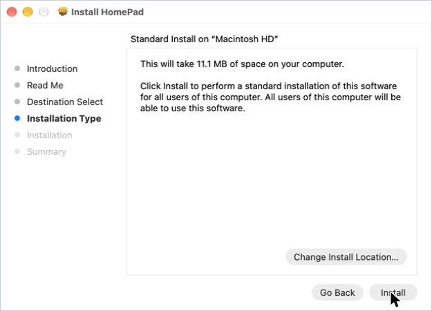

<!-- languages:start -->

<b>🌐 Language · Idioma · Langue · Sprache · Язык · 语言 · 言語 · 언어 · भाषा · لغة</b>

 

<table>
  <tr>
    <td align="center"><a href="../../README.md">English</a></td>
    <td align="center"><a href="README.ar.md">العربية</a></td>
    <td align="center"><a href="README.bn.md">বাংলা</a></td>
    <td align="center"><a href="README.zh-Hans.md">简体中文</a></td>
    <td align="center"><a href="README.fil.md">Filipino</a></td>
  </tr>
  <tr>
    <td align="center"><a href="README.fr.md">Français</a></td>
    <td align="center"><a href="README.de.md">Deutsch</a></td>
    <td align="center"><a href="README.hi.md">हिन्दी</a></td>
    <td align="center"><b>Bahasa Indonesia</b></td>
    <td align="center"><a href="README.it.md">Italiano</a></td>
  </tr>
  <tr>
    <td align="center"><a href="README.ja.md">日本語</a></td>
    <td align="center"><a href="README.ko.md">한국어</a></td>
    <td align="center"><a href="README.fa.md">فارسی</a></td>
    <td align="center"><a href="README.pt-BR.md">Português (Brasil)</a></td>
    <td align="center"><a href="README.ru.md">Русский</a></td>
  </tr>
  <tr>
    <td align="center"><a href="README.es.md">Español</a></td>
    <td align="center"><a href="README.te.md">తెలుగు</a></td>
    <td align="center"><a href="README.th.md">ไทย</a></td>
    <td align="center"><a href="README.tr.md">Türkçe</a></td>
    <td align="center"><a href="README.vi.md">Tiếng Việt</a></td>
  </tr>
</table>

<!-- languages:end -->

# HomePad for macOS

> Terjemahan ini ditulis oleh AI dan belum ditinjau oleh penutur asli. HomePad juga tersedia dalam bahasa ini; nama tombol dan menu diberikan di sini seperti yang ditampilkan app (bahasa dapat diubah di Pengaturan → Umum → Bahasa). Yang menjadi acuan adalah [README bahasa Inggris](../../README.md).

**Semua yang Anda pakai, hanya sekali ketukan tombol.** HomePad adalah peluncur yang selama ini kurang di Mac Anda: kelompokkan app ke dalam kategori, simpan di folder, sematkan favorit, cari semuanya seketika, dan pantau app yang sedang berjalan, dengan bilah tugas bergaya Windows sebagai pilihan jika Anda mau.

Peluncur bergaya Windows: tekan pintasan dan sebuah panel muncul di tengah layar dengan bilah cari di atas (mencari di indeks yang sama dengan yang dipakai Spotlight) dan kisi app yang disematkan di bawahnya.

HomePad bekerja dalam tiga mode. Pilih yang cocok untuk Anda di Pengaturan → Mode.

**Bilah tugas.** Meniru bilah tugas dan menu Start Windows. Jika Anda merindukan pengalaman Windows di macOS, Anda akan merasa seperti di rumah.

**Dock + HomePad.** Untuk yang ingin tetap memakai “Dock” macOS tetapi butuh peluncur bergaya menu Start. macOS punya peluncur Apps, tetapi kurang menarik: ia mengelompokkan app Anda ke dalam kategori secara otomatis, dan Anda tidak bisa memilihnya, mengelompokkan app ke dalam folder, menyematkan favorit, atau menatanya sesuka hati. HomePad menyelesaikan semua itu.

**Mandiri.** Untuk para minimalis yang ingin ruang layar sebesar mungkin, tanpa “Dock” atau bilah tugas yang memenuhi layar. Anda memanggil HomePad dengan tombol pintasan, ketukan dua kali, atau sentakan mouse ke sudut aktif kapan pun Anda memerlukannya. HomePad muncul di tengah, dan Anda memegang kendali penuh atas app, file, dan folder favorit Anda, pencarian, serta app yang sedang berjalan beserta jendelanya. Anda tidak butuh “Dock”, dan Anda tidak butuh Spotlight: Anda mengendalikan Mac dari satu tempat. Mungkin terasa aneh pada awalnya, tetapi menjadi luar biasa andal setelah Anda terbiasa.

## Instalasi

HomePad gratis dan tidak ditandatangani oleh Apple, jadi macOS menghentikannya sekali dan meminta Anda memastikan bahwa app ini aman. Prosesnya sekitar lima menit, cukup sekali. Anda membutuhkan macOS 13 (Ventura) atau yang lebih baru; Mac dengan Apple silicon maupun Intel sama-sama bisa. ([INSTALL.md](../../INSTALL.md) berisi langkah yang sama dalam bentuk kata-kata, juga untuk zip dan image disk biasa.)

**1. Buka image disk penginstal.** Klik dua kali `HomePad-Installer.dmg` (dari orang yang membagikan HomePad kepada Anda, atau bangun sendiri: `tools/make_installer_dmg.sh`, lihat [Build and run](../../README.md#build-and-run)). Jendelanya mencantumkan langkah-langkahnya.

**2. Klik dua kali Install HomePad.pkg.** Mac Anda mengatakan tidak dapat membukanya. Klik **Selesai**, bukan Pindahkan ke Tempat Sampah.

**3. Izinkan di Privasi & Keamanan.** Klik dua kali kotak biru **Buka Privasi & Keamanan** di jendela image disk (atau buka sendiri Pengaturan Sistem → Privasi & Keamanan), gulir ke bawah sampai **Keamanan**, lalu klik **Tetap Buka** di samping pesan tentang penginstal.

**4. Konfirmasi.** Klik **Tetap Buka** di pesan berikutnya, lalu gunakan Touch ID atau masukkan kata sandi Mac Anda.

<table align="center"><tr>
<td align="center"></td>
<td align="center"></td>
</tr></table>

> Di macOS 13 Ventura dan 14 Sonoma ada jalan pintas: klik kanan penginstal, pilih **Buka**, lalu **Buka** lagi.

**5. Ikuti langkah-langkah penginstal.** Klik **Lanjutkan** pada pengantar, hal yang perlu diketahui, dan tujuan (untuk semua pengguna komputer ini), lalu **Instal**. Mac Anda meminta kata sandi sekali. Saat penginstal menyatakan HomePad sudah ada di folder Aplikasi Anda, klik **Tutup**.

<table align="center">
<tr>
<td align="center"></td>
<td align="center"></td>
</tr>
<tr>
<td align="center"></td>
<td align="center"></td>
</tr>
<tr>
<td align="center" colspan="2"></td>
</tr>
</table>

**6. Panduan Penyiapan.** HomePad terbuka dengan sendirinya dengan jendela sambutan. Berikan ketiga izin, pilih cara Anda ingin membuka HomePad (pintasan keyboard, ketukan dua kali, sudut aktif), lalu klik **Mulai**. Setiap izin bersifat opsional, tetapi HomePad bekerja paling baik dengan ketiganya.

**7. Izin.** Klik **Izinkan…** di samping masing-masing, dari atas ke bawah.

- **Perekaman Layar** (pratinjau jendela app yang sedang berjalan). Sebuah pesan dengan gembok muncul: klik **Buka Pengaturan Sistem**, nyalakan sakelar di samping **HomePad**, lalu klik **Keluar & Buka Ulang**. HomePad memulai ulang dengan sendirinya dan jendela Sambutan kembali. macOS mungkin bertanya sekali lagi apakah HomePad boleh mengakses layar Anda secara langsung: klik **Izinkan**.

<table align="center">
<tr>
<td align="center" valign="top"></td>
<td align="center" valign="top"></td>
</tr>
<tr>
<td align="center" valign="top"></td>
<td align="center" valign="top"></td>
</tr>
</table>

- **Aksesibilitas** (melompat ke jendela yang Anda pilih, dan pintasan ketuk dua kali). Klik **Izinkan…**, lalu **Buka Pengaturan Sistem** di pesan itu, dan nyalakan sakelar di samping **HomePad** (masukkan kata sandi jika diminta). Di macOS terbaru, halaman ini pada antarmuka bahasa Inggris bernama **Device Control and Data Access**.

- **Akses Disk Penuh** (menemukan file di Dokumen, Desktop, dan Unduhan). Klik **Izinkan…**; Pengaturan Sistem terbuka dengan jendela HomePad kecil di sampingnya. Nyalakan sakelar di samping **HomePad**. Jika tidak ada di daftar, seret ikonnya dari jendela kecil ke daftar.

**8. Pakai.** Tekan **Option-Spasi** (atau pintasan yang Anda pilih). Semua yang lain, termasuk tiga mode di atas, ada di Pengaturan: klik kanan ikon kisi di bar menu, lalu **Pengaturan…**.

## Cara memakainya

- **Option-Spasi** membuka dan menutup panel (ubah di Pengaturan), atau ketuk dua kali Control, Option, atau Command (Pengaturan → Membuka; memerlukan izin Aksesibilitas).
- **Sudut aktif**: Pengaturan → Membuka → sudut aktif. Klik salah satu dari empat sudut layar kecil itu (satu, beberapa, atau semuanya). Diamkan penunjuk di sudut yang dipilih sejenak dan panel terbuka di sudut itu; lakukan lagi untuk menutupnya. Menyenggol sudut sekilas, atau menyeret dengan tombol mouse ditahan, tidak berbuat apa-apa. Pintasan dan ketukan dua kali tetap membukanya di tengah. Ada juga di langkah kedua Panduan Penyiapan. Jika macOS memakai sudut yang sama untuk salah satu aksinya sendiri, HomePad memberi tahu, dengan tombol **Buka “Sudut Aktif” macOS…** yang membuka Pengaturan Sistem → Desktop & Dock dengan lembar Sudut Aktif sudah tampil (menekan tombol itu memerlukan Aksesibilitas; tanpanya, hanya halamannya yang terbuka).
- **Kategori**: app berada di kategori bernama. **Utama** berada paling depan dan diisi dari Dock Anda saat pertama kali dibuka, ditambah kategori **File** dengan Tempat Sampah dan Unduhan, seperti ujung kanan Dock (hanya pada peluncuran pertama; jika Anda menghapusnya, ia tetap terhapus). Tambahkan kategori Anda sendiri (Browser, Menulis…) dengan **Tambah Kategori** atau dengan klik kanan di ruang kosong. Kategori baru menampilkan kotak abu-abu “Tambahkan app Anda di sini”. Klik kanan di dalam kategori untuk mengganti nama atau menghapusnya (semua isinya juga dilepas sematannya; app dan file itu sendiri tidak disentuh).
- **Menambah file dan folder**: **Tambah File atau Folder** (tautan di header, menu klik kanan, atau Pengaturan), seret dari Finder, atau klik kanan hasil pencarian → Sematkan. Terbuka saat diklik; folder terbuka di Finder. Pemilihnya adalah jendela penjelajah dengan bilah samping (Rumah, Desktop, Dokumen, Unduhan, ..., drive) dan entri **Tempat Sampah** yang menyematkan Tempat Sampah Anda. Mengklik sebuah lokasi di bilah samping (Dokumen, Unduhan, Tempat Sampah ...) membukanya dan memilih foldernya sendiri, sehingga **Tambah** siap dipakai. Jendela-jendela ini tidak memblokir panel: geser satu ke samping dan seret kotak apa pun darinya ke panel. Klik kanan kotak Tempat Sampah untuk **Kosongkan “Tempat Sampah”…** (menanyakan dulu; HomePad meminta Finder mengosongkannya, seperti Dock, jadi pertama kali macOS menanyakan apakah HomePad boleh mengendalikan Finder).
- **Urutan kategori**: nama kategori berubah hijau saat Anda mengarahkan penunjuk ke sana. Tekan, dan seluruh baris terpilih (isian dan garis tepi hijau); seret dan barisnya ikut terbawa sementara baris lain bergeser memberi ruang (panel tetap di tempatnya). Lepaskan dan ia tetap di tempatnya. Atau klik kanan di dalam kategori dan pilih **Naikkan** / **Turunkan**. Selama ada yang diseret, efek hover dan pratinjau jendela tetap mati. “Utama” juga dapat dipindahkan; ia tetap menjadi tempat bawaan untuk item baru dan tidak dapat dihapus. Garis abu-abu tipis memisahkan kategori.
- **Klik kanan untuk menambah**: klik kanan ruang kosong di dalam kategori (judulnya, atau celah di antara dan setelah kotak-kotaknya) dan menu menambahkan ke kategori *itu*: “Tambah App ke File…”, “Tambah File atau Folder ke File…”, ditambah Tambah Kategori, Ganti Nama, dan Hapus untuknya, serta **Urutkan Sesuai Abjad** (menyusun kotak kategori itu sesuai abjad berdasarkan nama yang ditampilkan; berwarna abu-abu jika sudah berurutan; kotak di dalam foldernya mempertahankan urutannya sendiri). Ruang kosong di bawah bagian terakhir menjadi milik bagian itu.
- **Menambah app**: tombol Tambah App (klik dua kali sebuah app di pemilih untuk menambahkannya dan menutup pemilih), klik kanan ruang kosong, seret app dari Finder (tekan pintasan di tengah seretan), atau klik kanan hasil pencarian → Sematkan App.
- **Folder** (seperti di menu Start Windows): seret sebuah kotak ke tengah ikon kotak lain, tahan di sana selama setengah detik sampai ikon itu menyala, lalu lepaskan: keduanya menjadi folder di tempat itu, bernama “Folder”, dengan kotak yang menampilkan empat item pertamanya. Jatuhkan lebih banyak kotak ke sebuah folder untuk menambahkannya. Klik folder untuk membukanya di atas panel: klik namanya untuk mengganti nama, klik sebuah item untuk membukanya, seret item untuk menata ulang atau keluar dari folder (folder menutup sehingga Anda dapat menjatuhkan item di antara kotak lain). Esc atau klik di luar menutupnya. Folder yang tersisa satu item kembali menjadi item itu. Klik kanan folder untuk “Ganti Nama Folder…”, “Pindahkan ke”, dan “Pisahkan Grup”; klik kanan item di folder yang terbuka untuk “Keluarkan dari Folder”. Menyeret di tepi kotak (bukan tengahnya) tetap hanya menata ulang urutan.
- **Menghapus / menata ulang**: klik kanan kotak → Lepas Sematan App / Pindahkan ke, atau seret kotak-kotak, termasuk di antara kategori.
- **App yang berjalan**: batang merah tepat di bawah ikon (di atas namanya) berarti app sedang berjalan. Arahkan penunjuk ke app yang berjalan untuk melihat thumbnail setiap jendelanya (jendela yang dikecilkan punya tanda minus di samping silang tutupnya), di setiap desktop (Space), tercantum menurut urutan Mission Control dengan judul “Space N” jika sebuah app punya jendela di lebih dari satu, dan klik salah satunya untuk langsung ke sana (berpindah desktop jika perlu), atau klik silang di sudutnya untuk menutup hanya jendela itu (juga berlaku untuk jendela di desktop lain) (memerlukan Perekaman Layar dan Aksesibilitas; tanpa Perekaman Layar Anda mendapat daftar biasa). Mengklik app yang berjalan mengutamakan desktop saat ini: jendela yang tampil di sana membawa app ke depan; jika semua jendelanya di sana dikecilkan, yang terbaru kembali; hanya jika sama sekali tidak ada jendela di sana, Anda dibawa ke desktop lain tempat ia punya jendela. Bagian **Berjalan** mencantumkan setiap app yang berjalan (disematkan atau tidak, seperti indikator berjalan di Dock); tidak ada yang bisa ditambahkan atau dihapus, tetapi kotak-kotaknya dapat **diseret di dalamnya untuk diurutkan ulang** (sesuai abjad sampai Anda memindahkan satu; urutannya diingat, juga untuk app yang keluar lalu berjalan lagi; kotak tidak bisa dijatuhkan di tempat lain, dan Esc atau melepas di tempat lain mengembalikannya; klik kanan Berjalan → **Urutkan Sesuai Abjad** melupakan urutan Anda), dan bagian itu sendiri tidak dapat diganti namanya tetapi dapat diseret lewat judulnya (atau dipindahkan dengan **Naikkan** / **Turunkan** di menu klik kanannya) ke tempat mana pun di antara kategori, dan dapat disembunyikan (klik kanan → Sembunyikan Berjalan; tampilkan lagi dengan Pengaturan → Panel → Tampilkan bagian Berjalan). **Jendela yang dikecilkan** dari setiap app yang berjalan dapat mengikuti kotaknya di sana, sebagai kotak tersendiri: gambar jendela dengan ikon app di sudut dan judul jendela (seperti yang ditampilkan Dock). Klik salah satunya untuk mengembalikan jendela itu; klik kanan untuk Pulihkan atau Tutup Jendela. Fitur ini mati secara bawaan: nyalakan Pengaturan → Panel → Tampilkan jendela yang dikecilkan di Berjalan, atau klik kanan Berjalan → Tampilkan Jendela yang Dikecilkan. Jendela dikumpulkan setiap kali panel dibuka (memerlukan Aksesibilitas; gambarnya memerlukan Perekaman Layar).
- **Menu app yang berjalan**: klik kanan app yang berjalan untuk menu seperti milik Dock: jendelanya (yang di depan diberi tanda centang; pilih satu untuk membawanya ke depan), perintah “Baru …” dari menu File-nya (Tab Baru, Jendela Baru, Jendela Pribadi Baru di browser), lalu **Tutup Jendela** (hanya jika ada jendela terbuka), **Sembunyikan**, dan **Keluar** (tahan Option untuk paksa keluar; app yang masih berjalan beberapa detik setelah Keluar mendapat **Paksa Keluar** sebagai gantinya; Finder tidak punya Keluar, seperti di Dock, karena menutupnya menghilangkan ikon desktop). Jendela dan perintah dibaca lewat Aksesibilitas saat penunjuk mencapai kotak.
- **Menemukan file**: file di Dokumen, Desktop, dan Unduhan baru muncul dalam pencarian setelah HomePad mendapat **Akses Disk Penuh** (Pengaturan Sistem → Privasi & Keamanan). Sebelum itu, hasil menampilkan pemberitahuan dengan tautan ke sakelarnya.
- **Kalkulator**: ketik hitungan seperti `7+3`, `(2+3)*4`, `2^10`, atau `15%` dan jawabannya muncul paling atas. ↩ atau tombol salin menyalinnya.
- **Jendela**: seret tepi atau sudut mana pun dari panel untuk mengubah ukurannya (tepinya punya strip pegangan yang lebar dan menampilkan kursor pengubah ukuran), atau seret bagian kosong mana pun untuk memindahkannya (bukan kisi kotak itu sendiri, tempat menyeret menata ulang kotak). Kolom cari mendapat fokus setiap kali panel dibuka, sehingga Anda bisa langsung mengetik; setelah Anda mengklik tempat lain, tombol berikutnya yang Anda ketik kembali ke sana. Pengaturan → Panel memiliki **Ingat ukuran jendela** (aktif secara bawaan) dan **Ingat posisi jendela** (mati secara bawaan). Tombol ↺ di samping roda gigi pengaturan mengembalikan panel ke ukuran standar, di tengah. Jendela Tambah App dan Tambah File atau Folder juga dapat diubah ukurannya (selalu terbuka dalam ukuran standar).
- **Nama Anda** di sudut kiri bawah panel membuka Pengaturan Sistem di Akun Apple Anda.
- **Cari**: cukup mulai mengetik. App muncul lebih dulu, lalu dokumen dan folder, lalu pencarian web. ↑ ↓ untuk memilih, ↩ untuk membuka, ⌘↩ untuk menampilkan di Finder, Esc untuk mengosongkan lalu menutup. Tombol ‹ atau klik di ruang kosong juga kembali ke app Anda.

## Peluncuran pertama

Jendela sambutan meminta Anda mengizinkan Perekaman Layar, Aksesibilitas, dan Akses Disk Penuh serta memilih cara membuka HomePad (lihat Instalasi). Buka lagi kapan saja dari ikon bar menu → Panduan Penyiapan…

## Pengaturan

Pengaturan memiliki enam tab di bilah alatnya: **Mode**, **Umum** (bahasa, ikon bar menu, buka saat masuk, Kembalikan ke Default, Mulai Ulang dari Awal), **Bilah tugas**, **Membuka** (pintasan, ketuk dua kali, sudut aktif), **Panel** (tata letak, jendela, item), dan **Izin**. Pengaturan terbuka pada tab yang terakhir Anda pakai.

- **Pintasan**: klik tombol dan tekan kombinasi baru. Untuk memakai ⌘Spasi, matikan dulu pintasan Spotlight di Pengaturan Sistem → Keyboard → Pintasan Keyboard → Spotlight.
- **Pintasan**: rekam satu, pilih **Tidak Ada** jika Anda hanya ingin ketuk dua kali, atau **Reset** ke ⌥Spasi.
- **Ikon bar menu**: Pengaturan → Umum dapat menyembunyikannya. Meluncurkan app lagi membuka panel.
- **Kembalikan ke Default**: memulihkan pintasan, ketuk dua kali, tata letak, penyembunyian Dock, dan buka saat masuk (app dan kategori tetap ada).
- **Ketuk dua kali**: buka dengan mengetuk Control, Option, atau Command dua kali.
- **Ikon per baris** (bawaan 8, 4–10) dan **tinggi baris** (jarak antar baris ikon, bawaan 101 pt, 85–125) dan **jarak ikon** (celah horizontal antar ikon, bawaan 10 pt, 0–40; jika panel terlalu sempit untuk celah itu, celah menyusut lebih dulu, lalu ikon): ketik angka atau klik − / +, **tampilkan app yang berjalan**, **impor ulang dari Dock**.
- **Mode** (tab pertama):
  - **Mandiri** (bawaan): panel yang melayang, dibuka dengan pintasan, ketuk dua kali, sudut aktif, atau ikon bar menu. Beralih ke mode ini menyembunyikan Dock; **Sembunyikan “Dock”** di bawah mengembalikannya.
  - **HomePad + “Dock”**: alur kerja seperti menu Start Windows dengan Dock sebagai bilah tugas. Memilihnya selalu menampilkan Dock (ia mematikan sembunyi otomatis, milik HomePad maupun Pengaturan Sistem) dan menambahkan HomePad ke sana jika belum ada (Dock dimulai ulang sekali); Dock tetap di tempat yang Anda tentukan. Panel terbuka tepat di samping ikon HomePad (di atasnya untuk Dock di bawah, di sampingnya untuk Dock di sisi, dijaga tetap di layar) baik Anda mengklik ikon maupun memakai pintasan atau ketuk dua kali; mengklik ikon lagi menutupnya. Sudut aktif tetap membukanya di sudut masing-masing. Pengaturan menjelaskan mengapa panel terbuka di tengah ketika HomePad tidak ada di Dock, Dock disembunyikan, atau izin Aksesibilitas tidak ada.
  - **Bilah tugas**: bilah tugas bergaya Windows di sepanjang bawah layar utama: tombol Start (ikon HomePad), lalu apa yang Anda sematkan padanya dan app yang berjalan, di tengah. App yang berjalan lalu meninggalkan panel. Sematkan app, file, dan folder dengan klik kanan ruang kosong bilah tugas (**Tambah App…**, **Tambah File atau Folder…**) atau sebuah kotak (**Sematkan ke Bilah Tugas**; di panel HomePad juga). Menu ikon bilah tugas juga memiliki **Sematkan ke HomePad** (atau Lepas Sematan dari HomePad), untuk kategori milik HomePad sendiri. Atau seret app, file, dan folder ke bilah tugas, dari Finder atau dari panel HomePad: semuanya disematkan sebelum ikon tempat Anda melepas, atau di akhir pada ruang kosong (yang sudah disematkan berpindah ke sana; panel tetap menyimpan miliknya sendiri). Sematan bilah tugas adalah daftar tersendiri, terpisah dari kategori HomePad. Seret ikon di sepanjang bilah tugas untuk mengurutkannya ulang. **Ikon app** berada di **Tengah** atau di **Kiri**; selama berada di tengah, **ikon HomePad** dapat ditengahkan bersamanya atau di kiri (dengan ikon app di kiri ia selalu di sana, jadi pilihannya berwarna abu-abu). Kiri adalah kanan dalam bahasa Arab dan Persia, dicerminkan seperti di Windows. Dengan ikon HomePad di kiri, panelnya terbuka di tepi kiri di atas bilah tugas. Di sisi kanan ada **jaringan**, **volume**, **baterai**, dan **jam**, masing-masing dengan sakelar: jaringan dan baterai membuka halamannya di Pengaturan Sistem (menu status bawaan macOS tidak dapat dibuka dari luar di macOS terbaru), volume membuka penggeser (gulir di atasnya untuk mengubah volume), jam membuka kalender. Klik sebuah item untuk membukanya atau membawanya ke depan (atau menyembunyikannya jika sudah di depan); arahkan penunjuk ke app yang berjalan untuk melihat jendelanya; klik kanan untuk menunya. Pengaturan → Bilah tugas → **App yang berjalan** (awalnya terlipat) mencantumkan setiap app yang berjalan dengan sakelar **Tampilkan di bilah tugas**; app yang dimatikan tetap di luar bilah tugas selama berjalan (juga **Sembunyikan dari Bilah Tugas** di menunya). Item yang disematkan selalu ditampilkan. Menyembunyikan app (Cmd-H) tidak mengubah bilah tugas. Panel terbuka di tengah di atas bilah tugas. Dock disembunyikan selama itu. macOS hanya membiarkan Dock menjaga jendela dari sebagian layar, jadi dengan Aksesibilitas HomePad memendekkan jendela ketika dibuka, diubah ukurannya, dimaksimalkan, atau ditata berdampingan sehingga mencapai bagian bawah bilah tugas (dinaikkan sebagai gantinya jika menjadi terlalu pendek). Jendela yang hanya diseret ke sana dibiarkan, seperti di Windows. (Mempertahankan Dock asli di bawah bilah tugas tidak berhasil: ia menampilkan label namanya di mana pun penunjuk melewati ikonnya.) **Sembunyikan bilah tugas secara otomatis** menggesernya keluar dari bawah layar sampai penunjuk berhenti di tepi bawah selama **Jeda sebelum ditampilkan** (0–1000 ms, bawaan 300, sehingga melintas cepat di tepi tidak menampilkannya); ia tetap tampil selama panel HomePad, pop-up, pratinjau jendela, atau menu terbuka, dan jendela lalu memakai seluruh layar. **Buka HomePad hanya dari tombol Mulai** mematikan pintasan, ketuk dua kali, dan sudut aktif (ikon bar menu tetap berfungsi).
- **Sembunyikan “Dock”** (hanya Mandiri): menyalakan sembunyi otomatis Dock dengan jeda 1000 detik sehingga tidak pernah muncul. Mematikannya memulihkan Dock normal.
- **Buka saat masuk**.
- **Bahasa** (Pengaturan → Umum, atau klik kanan ikon bar menu → Bahasa): Sama seperti Mac, atau salah satu dari 20 bahasa (Arab, Bengali, Tionghoa (Sederhana), Inggris, Filipino, Prancis, Jerman, Hindi, Indonesia, Italia, Jepang, Korea, Persia, Portugis (Brasil), Rusia, Spanyol, Telugu, Thai, Turki, Vietnam), diurutkan sesuai abjad dalam bahasa saat ini. HomePad dimulai ulang dalam bahasa baru; bahasa Arab dan Persia ditata dari kanan ke kiri. Nama app, folder, dan bagian Pengaturan Sistem tetap seperti yang ditampilkan Mac.

## Menyiapkan izin

Saat Anda memberikan izin (di Panduan Penyiapan, Pengaturan, atau pratinjau jendela), HomePad memantau apakah izin itu dinyalakan di Pengaturan Sistem dan kembali ke depan segera setelah itu. Perekaman Layar dan Akses Disk Penuh biasanya memerlukan mulai ulang: saat Pengaturan Sistem menawarkan **Keluar & Buka Ulang**, HomePad keluar, mulai lagi dengan sendirinya, dan membuka kembali jendela tempat Anda tadi.

Panduan Penyiapan muncul pada peluncuran pertama hanya jika ada izin yang kurang. Untuk menjalaninya lagi dari awal, gunakan **Pengaturan → Umum → Mulai Ulang dari Awal…**: macOS mengambil kembali izin HomePad, panduan muncul lagi, dan HomePad dimulai ulang (centang kotaknya untuk sekaligus melupakan kategori dan pengaturan Anda, seperti pada instalasi baru).

## Pengembangan

Petunjuk membangun app, cara kerja terjemahan, daftar file, dan ikon app hanya ada di [README bahasa Inggris](../../README.md#development).

## Lisensi

[MIT](../../LICENSE).
