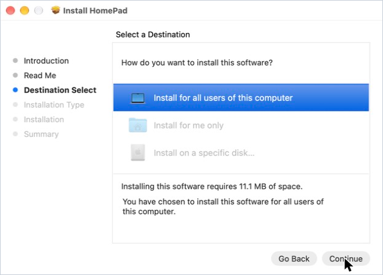

<!-- languages:start -->

<b>🌐 Language · Idioma · Langue · Sprache · Язык · 语言 · 言語 · 언어 · भाषा · لغة</b>

 

<table>
  <tr>
    <td align="center"><a href="../../README.md">English</a></td>
    <td align="center"><a href="README.ar.md">العربية</a></td>
    <td align="center"><a href="README.bn.md">বাংলা</a></td>
    <td align="center"><a href="README.zh-Hans.md">简体中文</a></td>
    <td align="center"><a href="README.fil.md">Filipino</a></td>
  </tr>
  <tr>
    <td align="center"><a href="README.fr.md">Français</a></td>
    <td align="center"><a href="README.de.md">Deutsch</a></td>
    <td align="center"><a href="README.hi.md">हिन्दी</a></td>
    <td align="center"><a href="README.id.md">Bahasa Indonesia</a></td>
    <td align="center"><a href="README.it.md">Italiano</a></td>
  </tr>
  <tr>
    <td align="center"><a href="README.ja.md">日本語</a></td>
    <td align="center"><a href="README.ko.md">한국어</a></td>
    <td align="center"><a href="README.fa.md">فارسی</a></td>
    <td align="center"><a href="README.pt-BR.md">Português (Brasil)</a></td>
    <td align="center"><b>Русский</b></td>
  </tr>
  <tr>
    <td align="center"><a href="README.es.md">Español</a></td>
    <td align="center"><a href="README.te.md">తెలుగు</a></td>
    <td align="center"><a href="README.th.md">ไทย</a></td>
    <td align="center"><a href="README.tr.md">Türkçe</a></td>
    <td align="center"><a href="README.vi.md">Tiếng Việt</a></td>
  </tr>
</table>

<!-- languages:end -->

# HomePad for macOS

> Этот перевод выполнен ИИ и не проверялся носителями языка. HomePad также доступен на этом языке; названия кнопок и меню даны так, как их показывает приложение (язык меняется в Настройки → Основные → Язык). Главным считается [английский README](../../README.md).

**Всё, чем вы пользуетесь, — на расстоянии одной клавиши.** HomePad — это недостающий лаунчер для вашего Mac: раскладывайте приложения по категориям, собирайте их в папки, закрепляйте любимые, мгновенно ищите что угодно и держите запущенные приложения на виду, а при желании — с панелью задач в стиле Windows.

Лаунчер в стиле Windows: вы нажимаете сочетание клавиш, и по центру экрана появляется панель с поиском сверху (он ищет по тому же индексу, что и Spotlight) и сеткой закреплённых приложений под ним.

HomePad работает в трёх режимах. Выберите подходящий в Настройки → Режим.

**Панель задач.** Повторяет панель задач и меню «Пуск» из Windows. Если вам не хватает Windows на macOS, вы почувствуете себя как дома.

**Dock + HomePad.** Для тех, кто хочет оставить «Dock» macOS, но нуждается в лаунчере в духе меню «Пуск». В macOS есть лаунчер «Приложения», но он не впечатляет: он сам раскладывает приложения по категориям, выбрать которые нельзя, нельзя собирать приложения в папки, закреплять любимые и расставлять всё по-своему. HomePad решает всё это.

**Отдельно.** Для минималистов, которым нужно как можно больше места на экране, без «Dock» и панели задач. Вы вызываете HomePad клавишей, двойным нажатием или взмахом мыши в активный угол, когда он вам нужен. Он появляется по центру, и вы полностью управляете любимыми приложениями, файлами и папками, поиском и запущенными приложениями вместе с их окнами. Вам не нужны ни «Dock», ни Spotlight: вы управляете Mac из одного места. Сначала это может показаться странным, но к этому привыкаешь, и это становится невероятно мощным.

## Установка

HomePad бесплатен и не подписан Apple, поэтому macOS один раз блокирует его и просит подтвердить, что всё в порядке. Это занимает около пяти минут и делается один раз. Нужна macOS 13 (Ventura) или новее; подходят Mac на Apple silicon и на Intel. ([INSTALL.md](../../INSTALL.md) повторяет те же шаги словами, в том числе для zip-архива и простого образа диска.)

**1. Откройте образ диска установщика.** Дважды нажмите `HomePad-Installer.dmg` (от того, кто поделился с вами HomePad, или соберите сами: `tools/make_installer_dmg.sh`, см. [Build and run](../../README.md#build-and-run)). В его окне перечислены шаги.

**2. Дважды нажмите Install HomePad.pkg.** Mac сообщит, что не может его открыть. Нажмите **Готово**, а не «Переместить в Корзину».

**3. Разрешите в разделе «Конфиденциальность и безопасность».** Дважды нажмите синюю кнопку **Открыть «Конфиденциальность и безопасность»** в окне образа диска (или сами откройте Системные настройки → Конфиденциальность и безопасность), прокрутите до раздела **Безопасность** и нажмите **Всё равно открыть** рядом с сообщением об установщике.

**4. Подтвердите.** Нажмите **Всё равно открыть** в следующем сообщении, затем используйте Touch ID или введите пароль Mac.

<table align="center"><tr>
<td align="center"></td>
<td align="center"></td>
</tr></table>

> В macOS 13 Ventura и 14 Sonoma есть короткий путь: правый щелчок по установщику, выберите **Открыть**, затем ещё раз **Открыть**.

**5. Пройдите установщик.** Нажимайте **Продолжить** на вступлении, на экране «Что вас ждёт» и на выборе места установки (для всех пользователей этого компьютера), затем **Установить**. Mac один раз попросит пароль. Когда установщик сообщит, что HomePad лежит в папке «Программы», нажмите **Закрыть**.

<table align="center">
<tr>
<td align="center"></td>
<td align="center"></td>
</tr>
<tr>
<td align="center"></td>
<td align="center"></td>
</tr>
<tr>
<td align="center" colspan="2"></td>
</tr>
</table>

**6. Мастер настройки.** HomePad сам открывается с окном приветствия. Разрешите три доступа, выберите, как открывать HomePad (сочетание клавиш, двойное нажатие, активные углы) и нажмите **Начать**. Каждое разрешение необязательно, но с тремя HomePad работает лучше всего.

**7. Разрешения.** Нажимайте **Разрешить…** рядом с каждым, сверху вниз.

- **Запись экрана** (миниатюры окон запущенного приложения). Появится сообщение с замком: нажмите **Открыть Системные настройки**, включите переключатель рядом с **HomePad** и нажмите **Завершить и открыть снова**. HomePad перезапустится сам, и окно приветствия вернётся. macOS может ещё раз спросить, можно ли HomePad напрямую обращаться к вашему экрану: нажмите **Разрешить**.

<table align="center">
<tr>
<td align="center" valign="top"></td>
<td align="center" valign="top"></td>
</tr>
<tr>
<td align="center" valign="top"></td>
<td align="center" valign="top"></td>
</tr>
</table>

- **Универсальный доступ** (переход к выбранному окну и двойное нажатие). Нажмите **Разрешить…**, затем **Открыть Системные настройки** в сообщении и включите переключатель рядом с **HomePad** (при запросе введите пароль). В новых версиях macOS эта страница в английском интерфейсе называется **Device Control and Data Access**.

- **Полный доступ к диску** (поиск файлов в «Документах», на «Рабочем столе» и в «Загрузках»). Нажмите **Разрешить…**; откроются Системные настройки, рядом — маленькое окно HomePad. Включите переключатель рядом с **HomePad**. Если его нет в списке, перетащите его значок из маленького окна в список.

**8. Пользуйтесь.** Нажмите **Option-Пробел** (или выбранное вами сочетание). Всё остальное, включая три режима выше, находится в настройках: правый щелчок по значку-сетке в строке меню, затем **Настройки…**.

## Как пользоваться

- **Option-Пробел** открывает и закрывает панель (меняется в настройках), либо дважды нажмите Control, Option или Command (Настройки → Открытие; нужен доступ «Универсальный доступ»).
- **Активные углы**: Настройки → Открытие → активные углы. Нажмите любой из четырёх углов на миниатюре (один, несколько или все). Задержите указатель на выбранном углу, и панель откроется в этом углу; повторите, чтобы закрыть. Быстрое касание угла или перетаскивание с зажатой кнопкой мыши ничего не делает. Сочетание клавиш и двойное нажатие по-прежнему открывают панель по центру. То же есть на втором шаге мастера настройки. Если macOS использует тот же угол для своего действия, HomePad предупредит и покажет кнопку **Открыть «Активные углы» macOS…**, которая открывает Системные настройки → Рабочий стол и Dock сразу с листом «Активные углы» (нажатие этой кнопки требует «Универсального доступа»; без него откроется только страница).
- **Категории**: приложения лежат в именованных категориях. **Главное** идёт первой и при первом запуске заполняется из вашего Dock, плюс категория **Файлы** с «Корзиной» и «Загрузками», как правый край Dock (только в самый первый раз; если удалить её, она не вернётся). Добавляйте свои (Браузеры, Письмо…) через **Добавить категорию** или правым щелчком по пустому месту. В новой категории виден серый блок «Добавьте сюда приложение». Правый щелчок внутри категории — переименовать или удалить её (всё в ней тоже открепляется; сами приложения и файлы не затрагиваются).
- **Добавление файлов и папок**: **Добавить файл или папку** (ссылка в заголовке, меню по правому щелчку или настройки), перетащите их из Finder или правым щелчком по результату поиска → Закрепить. Они открываются по нажатию; папки открываются в Finder. Выбор — это окно-проводник с боковой панелью (Домой, Рабочий стол, Документы, Загрузки, ..., диски) и пунктом **Корзина**, который закрепляет вашу «Корзину». Нажатие на место в боковой панели (Документы, Загрузки, Корзина ...) открывает его и выбирает саму папку, так что **Добавить** сразу готова. Эти окна не блокируют панель: отодвиньте одно из них и перетащите любой его блок на панель. Правый щелчок по блоку «Корзины» — **Очистить «Корзину»…** (сначала спрашивает; HomePad просит Finder очистить её, как Dock, поэтому в первый раз macOS спросит, можно ли HomePad управлять Finder).
- **Порядок категорий**: имя категории становится зелёным при наведении. Нажмите на него — вся строка выделяется (зелёные заливка и контур); перетащите, и сама строка движется с указателем, пока остальные расступаются (панель остаётся на месте). Отпустите, и она останется там. Либо правый щелчок внутри категории и **Переместить выше** / **Переместить ниже**. Пока что-то перетаскивается, эффекты наведения и превью окон отключены. «Главное» тоже можно двигать; оно остаётся местом по умолчанию для новых объектов и не удаляется. Тонкие серые линии разделяют категории.
- **Правый щелчок, чтобы добавить**: правый щелчок по пустому месту внутри категории (заголовок или промежутки между блоками и после них), и меню добавляет в *эту* категорию: «Добавить приложение в Файлы…», «Добавить файл или папку в Файлы…», а также Добавить категорию, Переименовать и Удалить для неё и **Сортировать по алфавиту** (расставляет блоки категории по алфавиту по показываемым именам; серый, если они уже по порядку; блоки внутри её папок сохраняют порядок). Пустое место под последним разделом принадлежит этому разделу.
- **Добавление приложений**: кнопка «Добавить приложение» (двойное нажатие на приложение в выборе добавляет его и закрывает выбор), правый щелчок по пустому месту, перетаскивание приложений из Finder (нажмите сочетание клавиш посреди перетаскивания) или правый щелчок по результату поиска → Закрепить приложение.
- **Папки** (как в меню «Пуск» Windows): перетащите блок на середину значка другого блока, подержите там полсекунды, пока значок не подсветится, и отпустите: они превратятся в папку на этом месте с названием «Папка», а её блок покажет первые четыре объекта. Бросайте на папку ещё блоки, чтобы добавить их. Нажмите на папку, чтобы открыть её поверх панели: нажмите на название, чтобы переименовать, на объект, чтобы открыть, перетаскивайте объекты, чтобы переставить их или вынуть из папки (она закроется, чтобы вы могли положить объект между другими блоками). Esc или нажатие снаружи закрывает её. Папка с единственным объектом снова становится этим объектом. Правый щелчок по папке — «Переименовать папку…», «Переместить в» и «Разгруппировать»; правый щелчок по объекту в открытой папке — «Убрать из папки». Перетаскивание на края блока (не на середину) по-прежнему только меняет порядок.
- **Удаление и порядок**: правый щелчок по блоку → Открепить приложение / Переместить в, или перетаскивайте блоки, в том числе между категориями.
- **Запущенные приложения**: красная полоса прямо под значком (над названием) означает, что приложение запущено. Наведите на запущенное приложение, чтобы увидеть миниатюру каждого его окна (свёрнутое помечено минусом рядом с крестиком), на всех рабочих столах (Spaces), в порядке Mission Control с заголовком «Space N», если у приложения окна на нескольких, и нажмите на одно, чтобы сразу перейти к нему (при необходимости сменив рабочий стол), либо нажмите крестик в его углу, чтобы закрыть только это окно (работает и для окон на других рабочих столах) (нужны «Запись экрана» и «Универсальный доступ»; без «Записи экрана» вы получите простой список). Нажатие на запущенное приложение сначала учитывает текущий рабочий стол: видимое там окно выводит приложение вперёд; если все его окна здесь свёрнуты, возвращается самое недавнее; только когда окон здесь нет, вас переносит на другой рабочий стол, где они есть. Раздел **Запущенные** перечисляет каждое запущенное приложение (закреплённое или нет, как индикаторы запуска в Dock); ничего нельзя в него добавить или убрать, но его блоки можно **перетаскивать внутри него, меняя порядок** (по алфавиту, пока вы что-то не сдвинете; порядок запоминается, в том числе для приложения, которое закрылось и открылось снова; блок нельзя бросить в другое место, а Esc или бросок в другом месте возвращает его; правый щелчок по «Запущенным» → **Сортировать по алфавиту** забывает ваш порядок), а сам раздел нельзя переименовать, но можно тащить за заголовок (или двигать **Переместить выше** / **Переместить ниже** в меню по правому щелчку) в любое место между категориями, и его можно скрыть (правый щелчок по нему → Скрыть «Запущенные»; вернуть — Настройки → Панель → Показывать раздел «Запущенные»). **Свёрнутые окна** каждого запущенного приложения могут идти за его блоком как отдельные блоки: картинка окна со значком приложения в углу и названием окна (как их показывает Dock). Нажмите на одно, чтобы вернуть это окно; правый щелчок — Развернуть или Закрыть окно. По умолчанию выключено: включите в Настройки → Панель → Показывать свёрнутые окна в «Запущенных» или правым щелчком по «Запущенным» → Показывать свёрнутые окна. Они собираются при каждом открытии панели (нужен «Универсальный доступ»; картинкам нужна «Запись экрана»).
- **Меню запущенного приложения**: правый щелчок по запущенному приложению открывает меню, как в Dock: его окна (переднее отмечено; выберите одно, чтобы вывести его вперёд), команды «Новое …» из его меню «Файл» (Новая вкладка, Новое окно, Новое приватное окно в браузере), затем **Закрыть окна** (только если есть открытое окно), **Скрыть** и **Завершить** (с Option — принудительно; приложение, всё ещё запущенное через несколько секунд после «Завершить», получает вместо этого **Завершить принудительно**; у Finder нет «Завершить», как в Dock, потому что его завершение убирает значки с рабочего стола). Окна и команды читаются через «Универсальный доступ», когда указатель доходит до блока.
- **Поиск файлов**: файлы в «Документах», на «Рабочем столе» и в «Загрузках» появляются в поиске только после того, как у HomePad есть **Полный доступ к диску** (Системные настройки → Конфиденциальность и безопасность). До этого результаты показывают предупреждение со ссылкой на переключатель.
- **Калькулятор**: введите выражение вроде `7+3`, `(2+3)*4`, `2^10` или `15%`, и ответ появится первым. ↩ или кнопка копирования копирует его.
- **Окно**: потяните любой край или угол панели, чтобы изменить размер (у краёв широкие зоны захвата и курсоры изменения размера), или потяните любое пустое место, чтобы переместить её (но не саму сетку блоков, где перетаскивание переставляет блоки). Поле поиска получает фокус при каждом открытии панели, так что вы можете сразу печатать; после нажатия в другом месте следующая нажатая клавиша возвращается в него. Настройки → Панель содержат **Запоминать размер окна** (включено по умолчанию) и **Запоминать положение окна** (выключено по умолчанию). Кнопка ↺ рядом с шестерёнкой настроек возвращает панели размер по умолчанию по центру. Окна «Добавить приложение» и «Добавить файл или папку» тоже можно растягивать (они всегда открываются стандартного размера).
- **Ваше имя** в левом нижнем углу панели открывает Системные настройки на вашем Аккаунте Apple.
- **Поиск**: просто начните печатать. Сначала приложения, затем документы и папки, затем поиск в интернете. ↑ ↓ — выбор, ↩ — открыть, ⌘↩ — показать в Finder, Esc — очистить, затем закрыть. Кнопка ‹ или нажатие на пустое место тоже возвращает к вашим приложениям.

## Первый запуск

Окно приветствия просит разрешить «Запись экрана», «Универсальный доступ» и «Полный доступ к диску» и выбрать, как открывать HomePad (см. «Установка»). Откройте его снова в любой момент через значок в строке меню → Мастер настройки…

## Настройки

В настройках шесть вкладок на панели инструментов: **Режим**, **Основные** (язык, значок в строке меню, запуск при входе, «Сбросить настройки…», «Начать заново…»), **Панель задач**, **Открытие** (сочетание клавиш, двойное нажатие, активные углы), **Панель** (вид, окно, объекты) и **Разрешения**. Они открываются на последней использованной вкладке.

- **Сочетание клавиш**: нажмите кнопку и введите новую комбинацию. Чтобы использовать ⌘Пробел, сначала отключите сочетание Spotlight в Системные настройки → Клавиатура → Сочетания клавиш → Spotlight.
- **Сочетание клавиш**: запишите своё, выберите **Нет**, если нужно только двойное нажатие, или **Сброс**, чтобы вернуть ⌥Пробел.
- **Значок в строке меню**: в Настройки → Основные его можно скрыть. Повторный запуск приложения открывает панель.
- **Сбросить настройки**: возвращает сочетание клавиш, двойное нажатие, вид, скрытие Dock и запуск при входе (приложения и категории сохраняются).
- **Двойное нажатие**: откройте двойным нажатием Control, Option или Command.
- **Значков в ряду** (по умолчанию 8, 4–10), **высота ряда** (расстояние между рядами значков, по умолчанию 101 пт, 85–125) и **интервал между значками** (горизонтальный промежуток между значками, по умолчанию 10 пт, 0–40; когда панель слишком узка для промежутка, сначала уменьшается промежуток, затем значки): введите число или нажмите − / +, **показывать запущенные приложения**, **заново импортировать из Dock**.
- **Режим** (первая вкладка):
  - **Отдельно** (по умолчанию): плавающая панель, открываемая сочетанием клавиш, двойным нажатием, активными углами или значком в строке меню. При переключении на него Dock скрывается; **Скрыть «Dock»** ниже возвращает его.
  - **HomePad + «Dock»**: поток, как в меню «Пуск» Windows, где Dock — панель задач. Выбор всегда показывает Dock (выключает автоскрытие, своё или из Системных настроек) и добавляет в него HomePad, если его там нет (Dock один раз перезапускается); Dock остаётся там, где вы его поставили. Панель открывается прямо у значка HomePad (над ним для Dock внизу, сбоку для бокового Dock, в пределах экрана) независимо от того, нажали ли вы на значок или использовали сочетание клавиш или двойное нажатие; повторное нажатие на значок закрывает её. Активные углы по-прежнему открывают в своём углу. Настройки объясняют, почему панель открывается по центру, когда HomePad нет в Dock, Dock скрыт или не хватает «Универсального доступа».
  - **Панель задач**: панель в стиле Windows вдоль нижнего края основного экрана: кнопка «Пуск» (значок HomePad), затем закреплённые вами объекты и запущенные приложения, по центру. Запущенные приложения при этом уходят с панели. Закрепляйте приложения, файлы и папки правым щелчком по пустому месту панели (**Добавить приложение…**, **Добавить файл или папку…**) или по блоку (**Закрепить на панели задач**; в панели HomePad тоже). В меню значка панели есть и **Закрепить в HomePad** (или «Открепить от HomePad») для собственных категорий HomePad. Или перетаскивайте приложения, файлы и папки на панель из Finder или из панели HomePad: они закрепляются перед значком, на который вы бросили, или в конце, на пустом месте (уже закреплённый переезжает туда; панель сохраняет свои). Закреплённые объекты панели — отдельный список, независимый от категорий HomePad. Перетаскивайте значки вдоль панели, чтобы менять порядок. **Значки приложений** стоят **По центру** или **Слева**; пока они по центру, **значок HomePad** может быть по центру вместе с ними или слева (при значках приложений слева он всегда слева, так что выбор серый). «Слева» в арабском и персидском — справа, зеркально, как в Windows. Когда значок HomePad слева, его панель открывается у левого края над панелью задач. Справа — **сеть**, **громкость**, **аккумулятор** и **часы**, у каждого свой переключатель: сеть и аккумулятор открывают свои страницы в Системных настройках (собственные меню состояния macOS в новых версиях снаружи не открыть), громкость открывает ползунок (прокрутите над ним, чтобы изменить громкость), часы — календарь. Нажмите на объект, чтобы открыть его или вывести вперёд (или скрыть, если он уже впереди); наведите на запущенное приложение, чтобы увидеть его окна; правый щелчок — его меню. Настройки → Панель задач → **Запущенные приложения** (по умолчанию свёрнуто) перечисляет каждое запущенное приложение с переключателем **Показывать на панели задач**; выключенное приложение остаётся вне панели, пока запущено (также **Скрыть с панели задач** в его меню). Закреплённые объекты видны всегда. Скрытие приложения (Cmd-H) панель не меняет. Панель открывается по центру над панелью задач. Dock тем временем скрыт. macOS позволяет Dock держать окна вне части экрана, поэтому с «Универсальным доступом» HomePad укорачивает окно, когда оно открыто, изменено, развёрнуто или поставлено рядом так, что доходит до панели задач (а если оно стало бы слишком коротким, поднимает его). Окно, просто перетащенное туда, остаётся как есть, как в Windows. (Удержать настоящий Dock под панелью не вышло: он показывает подписи имён везде, где указатель проходит над значками.) **Автоматически скрывать панель задач** сдвигает её вниз за экран, пока указатель не задержится у нижнего края на **Задержка перед показом** (0–1000 мс, по умолчанию 300, чтобы быстрое касание края её не показало); она остаётся видимой, пока открыта панель HomePad, всплывающее окно, превью окна или меню, и окна тогда занимают весь экран. **Открывать HomePad только кнопкой «Пуск»** отключает сочетание клавиш, двойное нажатие и активные углы (значок в строке меню продолжает работать).
- **Скрыть «Dock»** (только в режиме «Отдельно»): включает автоскрытие Dock с задержкой 1000 секунд, так что он никогда не появляется. Выключение возвращает обычный Dock.
- **Запускать при входе**.
- **Язык** (Настройки → Основные или правый щелчок по значку в строке меню → Язык): Как на Mac или один из 20 языков (английский, арабский, бенгальский, вьетнамский, индонезийский, испанский, итальянский, китайский (упрощённый), корейский, немецкий, персидский, португальский (Бразилия), русский, тайский, телугу, турецкий, филиппинский, французский, хинди, японский), в алфавитном порядке на текущем языке. HomePad перезапускается на новом языке; арабский и персидский выводятся справа налево. Названия приложений, папок и разделов Системных настроек остаются такими, как их показывает Mac.

## Настройка разрешений

Когда вы выдаёте разрешение (в мастере настройки, в настройках или в превью окна), HomePad следит, включили ли вы его в Системных настройках, и возвращается на передний план, как только это произойдёт. «Запись экрана» и «Полный доступ к диску» обычно требуют перезапуска: когда Системные настройки предлагают **Завершить и открыть снова**, HomePad завершается, сам запускается снова и открывает то окно, в котором вы были.

Мастер настройки при первом запуске появляется, только если не хватает какого-то разрешения. Чтобы пройти его с самого начала снова, используйте **Настройки → Основные → Начать заново…**: macOS забирает разрешения у HomePad, мастер появляется снова, и HomePad перезапускается (отметьте флажок, чтобы забыть и ваши категории и настройки, как при новой установке).

## Разработка

Инструкции по сборке, устройство переводов, список файлов и значок приложения есть только в [английском README](../../README.md#development).

## Лицензия

[MIT](../../LICENSE).
