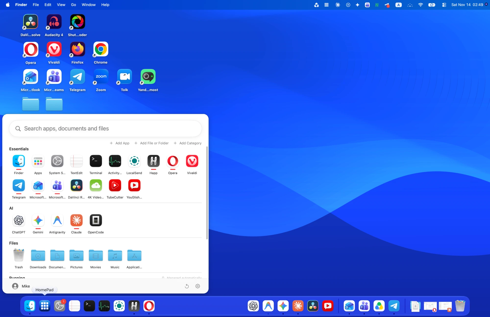

<!-- languages:start -->

<b>🌐 Language · Idioma · Langue · Sprache · Язык · 语言 · 言語 · 언어 · भाषा · لغة</b>

 

<table>
  <tr>
    <td align="center"><a href="../../README.md">English</a></td>
    <td align="center"><a href="README.ar.md">العربية</a></td>
    <td align="center"><a href="README.bn.md">বাংলা</a></td>
    <td align="center"><a href="README.zh-Hans.md">简体中文</a></td>
    <td align="center"><a href="README.fil.md">Filipino</a></td>
  </tr>
  <tr>
    <td align="center"><a href="README.fr.md">Français</a></td>
    <td align="center"><a href="README.de.md">Deutsch</a></td>
    <td align="center"><a href="README.hi.md">हिन्दी</a></td>
    <td align="center"><a href="README.id.md">Bahasa Indonesia</a></td>
    <td align="center"><a href="README.it.md">Italiano</a></td>
  </tr>
  <tr>
    <td align="center"><a href="README.ja.md">日本語</a></td>
    <td align="center"><a href="README.ko.md">한국어</a></td>
    <td align="center"><a href="README.fa.md">فارسی</a></td>
    <td align="center"><a href="README.pt-BR.md">Português (Brasil)</a></td>
    <td align="center"><a href="README.ru.md">Русский</a></td>
  </tr>
  <tr>
    <td align="center"><a href="README.es.md">Español</a></td>
    <td align="center"><b>తెలుగు</b></td>
    <td align="center"><a href="README.th.md">ไทย</a></td>
    <td align="center"><a href="README.tr.md">Türkçe</a></td>
    <td align="center"><a href="README.vi.md">Tiếng Việt</a></td>
  </tr>
</table>

<!-- languages:end -->

# HomePad for macOS

> ఈ అనువాదాన్ని AI రాసింది; స్థానిక భాషా వక్తలు దీన్ని సమీక్షించలేదు. HomePad ఈ భాషలో కూడా అందుబాటులో ఉంది; బటన్లు, మెనూల పేర్లు యాప్ చూపించే విధంగానే ఇవ్వబడ్డాయి (భాషను సెట్టింగ్‌లు → సాధారణం → భాష లో మార్చవచ్చు). [ఇంగ్లీష్ README](../../README.md) అధికారికమైనది.

**మీరు వాడేవన్నీ, ఒక కీ దూరంలో.** HomePad మీ Mac కు లేని లాంచర్: యాప్‌లను వర్గాలుగా అమర్చండి, ఫోల్డర్లలో ఉంచండి, ఇష్టమైనవి పిన్ చేయండి, ఏదైనా వెంటనే వెతకండి, నడుస్తున్న యాప్‌లను కళ్ల ముందే ఉంచండి — కావాలంటే Windows తరహా టాస్క్‌బార్‌తో.

Windows తరహా లాంచర్: మీరు ఒక షార్ట్‌కట్ నొక్కగానే స్క్రీన్ మధ్యలో ఒక ప్యానెల్ కనిపిస్తుంది; పైన సెర్చ్ బార్ (Spotlight వాడే ఇండెక్స్‌నే వెతుకుతుంది), కింద పిన్ చేసిన యాప్‌ల గ్రిడ్.

HomePad మూడు మోడ్‌లలో పనిచేస్తుంది. మీకు సరిపోయేదాన్ని సెట్టింగ్‌లు → మోడ్ లో ఎంచుకోండి.

**టాస్క్‌బార్.** Windows టాస్క్‌బార్, స్టార్ట్ మెనూను అనుకరిస్తుంది. macOS లో Windows అనుభవాన్ని మిస్ అయితే, ఇది మీకు ఇంటిలా అనిపిస్తుంది.

**Dock + HomePad.** macOS “Dock” ను ఉంచుకోవాలనుకుంటూ, స్టార్ట్ మెనూ తరహా లాంచర్ కావాల్సినవారి కోసం. macOS లో Apps లాంచర్ ఉంది, కానీ అది ఆకట్టుకోదు: మీ యాప్‌లను ఆటోమేటిక్‌గా వర్గాలుగా అమరుస్తుంది, వాటిని మీరు ఎంచుకోలేరు; యాప్‌లను ఫోల్డర్లుగా సమూహపరచలేరు, ఇష్టమైనవి పిన్ చేయలేరు, మీ ఇష్టం వచ్చినట్లు అమర్చలేరు. HomePad ఇవన్నీ పరిష్కరిస్తుంది.

**స్వతంత్రం.** గరిష్ఠ స్క్రీన్ స్థలం కావాలనుకునే మినిమలిస్టుల కోసం, “Dock”, టాస్క్‌బార్ లేకుండా. కావాలనుకున్నప్పుడు హాట్‌కీ, డబుల్-ట్యాప్ లేదా హాట్ కార్నర్‌కు మౌస్ విసురుతో HomePad ను పిలవండి. అది మధ్యలో కనిపిస్తుంది, మీ ఇష్టమైన యాప్‌లు, ఫైళ్లు, ఫోల్డర్లు, సెర్చ్, నడుస్తున్న యాప్‌లు వాటి విండోలతో సహా అన్నింటిపై మీకు పూర్తి నియంత్రణ ఉంటుంది. మీకు “Dock” గానీ Spotlight గానీ అవసరం లేదు: మీ Mac ను ఒకే చోటి నుండి నియంత్రిస్తారు. మొదట ఇది వింతగా అనిపించవచ్చు, కానీ అలవాటు పడ్డాక అద్భుతమైన శక్తినిస్తుంది.

## ఇన్‌స్టాలేషన్

HomePad ఉచితం, Apple సంతకం చేయలేదు, కాబట్టి macOS ఒకసారి దాన్ని ఆపి, అంతా సరేనని నిర్ధారించమని అడుగుతుంది. దీనికి సుమారు ఐదు నిమిషాలు పడుతుంది, ఒక్కసారే. macOS 13 (Ventura) లేదా తర్వాతి వెర్షన్ కావాలి; Apple silicon, Intel Mac లు రెండూ పనిచేస్తాయి. ([INSTALL.md](../../INSTALL.md) లో ఇవే దశలు మాటల్లో ఉన్నాయి, zip, సాధారణ డిస్క్ ఇమేజ్ కోసం కూడా.)

**1. ఇన్‌స్టాలర్ డిస్క్ ఇమేజ్ తెరవండి.** `HomePad-Installer.dmg` పై డబుల్-క్లిక్ చేయండి (HomePad ను మీతో పంచుకున్నవారి నుండి, లేదా మీరే బిల్డ్ చేయండి: `tools/make_installer_dmg.sh`, [Build and run](../../README.md#build-and-run) చూడండి). దాని విండోలో దశలు ఉంటాయి.

**2. Install HomePad.pkg పై డబుల్-క్లిక్ చేయండి.** దాన్ని తెరవలేమని Mac చెబుతుంది. **OK** క్లిక్ చేయండి, Move to Trash కాదు.

**3. Privacy & Security లో అనుమతించండి.** డిస్క్ ఇమేజ్ విండోలోని నీలి **Open Privacy & Security** టైల్‌పై డబుల్-క్లిక్ చేయండి (లేదా మీరే System Settings → Privacy & Security తెరవండి), **Security** వరకు స్క్రోల్ చేసి, ఇన్‌స్టాలర్ గురించిన సందేశం పక్కన **Open Anyway** క్లిక్ చేయండి.

**4. నిర్ధారించండి.** తర్వాతి సందేశంలో **Open Anyway** క్లిక్ చేసి, ఆపై Touch ID వాడండి లేదా మీ Mac పాస్‌వర్డ్ టైప్ చేయండి.

<table align="center"><tr>
<td align="center"></td>
<td align="center"></td>
</tr></table>

> macOS 13 Ventura, 14 Sonoma లలో ఒక షార్ట్‌కట్ ఉంది: ఇన్‌స్టాలర్‌పై రైట్-క్లిక్ చేసి **Open** ఎంచుకుని, మళ్లీ **Open** క్లిక్ చేయండి.

**5. ఇన్‌స్టాలర్ ద్వారా వెళ్లండి.** పరిచయం, ఏమి ఆశించాలి, గమ్యం (ఈ కంప్యూటర్‌లోని వినియోగదారులందరికీ) వద్ద **Continue** క్లిక్ చేసి, ఆపై **Install** క్లిక్ చేయండి. Mac ఒకసారి మీ పాస్‌వర్డ్ అడుగుతుంది. HomePad మీ Applications ఫోల్డర్‌లో ఉందని ఇన్‌స్టాలర్ చెప్పినప్పుడు **Close** క్లిక్ చేయండి.

<table align="center">
<tr>
<td align="center"></td>
<td align="center"></td>
</tr>
<tr>
<td align="center"></td>
<td align="center"></td>
</tr>
<tr>
<td align="center" colspan="2"></td>
</tr>
</table>

**6. సెటప్ గైడ్.** HomePad స్వాగత విండోతో తానే తెరుచుకుంటుంది. మూడు అనుమతులను అనుమతించండి, HomePad ను ఎలా తెరవాలో ఎంచుకోండి (కీబోర్డ్ షార్ట్‌కట్, డబుల్-ట్యాప్, హాట్ కార్నర్‌లు), ఆపై **ప్రారంభించండి** క్లిక్ చేయండి. ప్రతి అనుమతీ ఐచ్ఛికమే, కానీ మూడూ ఉంటే HomePad ఉత్తమంగా పనిచేస్తుంది.

**7. అనుమతులు.** పై నుండి కిందికి, ప్రతిదాని పక్కన **అనుమతించండి…** క్లిక్ చేయండి.

- **స్క్రీన్ రికార్డింగ్** (నడుస్తున్న యాప్ విండోల ప్రివ్యూలు). తాళంతో ఒక సందేశం కనిపిస్తుంది: **Open System Settings** క్లిక్ చేసి, **HomePad** పక్కన ఉన్న స్విచ్ ఆన్ చేసి, **Quit & Reopen** క్లిక్ చేయండి. HomePad స్వయంగా రీస్టార్ట్ అవుతుంది, స్వాగత విండో తిరిగి వస్తుంది. HomePad మీ స్క్రీన్‌ను నేరుగా చూడవచ్చా అని macOS మరోసారి అడగవచ్చు: **Allow** క్లిక్ చేయండి.

<table align="center">
<tr>
<td align="center" valign="top"></td>
<td align="center" valign="top"></td>
</tr>
<tr>
<td align="center" valign="top"></td>
<td align="center" valign="top"></td>
</tr>
</table>

- **యాక్సెసిబిలిటీ** (మీరు ఎంచుకున్న విండోకు వెళ్లడం, డబుల్-ట్యాప్ షార్ట్‌కట్). **అనుమతించండి…** క్లిక్ చేసి, సందేశంలో **Open System Settings** క్లిక్ చేసి, **HomePad** పక్కన ఉన్న స్విచ్ ఆన్ చేయండి (అడిగితే మీ పాస్‌వర్డ్ ఇవ్వండి). కొత్త macOS లలో ఈ పేజీని ఇంగ్లీష్ ఇంటర్‌ఫేస్‌లో **Device Control and Data Access** అంటారు.

- **పూర్తి డిస్క్ యాక్సెస్** (Documents, Desktop, Downloads లోని ఫైళ్లను కనుగొనడం). **అనుమతించండి…** క్లిక్ చేయండి; System Settings తెరుచుకుంటుంది, పక్కన HomePad చిన్న విండో ఉంటుంది. **HomePad** పక్కన ఉన్న స్విచ్ ఆన్ చేయండి. జాబితాలో లేకపోతే, చిన్న విండో నుండి దాని ఐకాన్‌ను జాబితాలోకి లాగండి.

**8. వాడండి.** **Option-Space** (లేదా మీరు ఎంచుకున్న షార్ట్‌కట్) నొక్కండి. పైన ఉన్న మూడు మోడ్‌లతో సహా మిగతా అన్నీ సెట్టింగ్‌లలో ఉన్నాయి: మెనూ బార్‌లోని గ్రిడ్ ఐకాన్‌పై రైట్-క్లిక్ చేసి, ఆపై **సెట్టింగ్‌లు…** క్లిక్ చేయండి.

## ఎలా వాడాలి

- **Option-Space** ప్యానెల్‌ను తెరుస్తుంది, మూసివేస్తుంది (సెట్టింగ్‌లలో మార్చవచ్చు), లేదా Control, Option లేదా Command ను రెండుసార్లు ట్యాప్ చేయండి (సెట్టింగ్‌లు → తెరవడం; యాక్సెసిబిలిటీ అనుమతి కావాలి).
- **హాట్ కార్నర్‌లు**: సెట్టింగ్‌లు → తెరవడం → హాట్ కార్నర్‌లు. చిన్న చిత్రంలోని నాలుగు మూలల్లో ఏదైనా క్లిక్ చేయండి (ఒకటి, కొన్ని లేదా అన్నీ). ఎంచుకున్న మూలలో పాయింటర్‌ను ఒక క్షణం ఆపితే, ప్యానెల్ ఆ మూలలో తెరుచుకుంటుంది; మూసివేయడానికి మళ్లీ అలాగే చేయండి. మూలను వేగంగా తాకడం, లేదా మౌస్ బటన్ నొక్కి లాగడం ఏమీ చేయదు. షార్ట్‌కట్, డబుల్-ట్యాప్ ఇంకా మధ్యలోనే తెరుస్తాయి. ఇది సెటప్ గైడ్ రెండో దశలో కూడా ఉంది. అదే మూలను macOS తన సొంత చర్యకు వాడుతుంటే, HomePad హెచ్చరిస్తుంది, **macOS “Hot Corners” తెరవండి…** బటన్‌తో — అది System Settings → Desktop & Dock ను Hot Corners షీట్ అప్పటికే కనిపించేలా తెరుస్తుంది (ఆ బటన్ నొక్కడానికి యాక్సెసిబిలిటీ కావాలి; అది లేకపోతే పేజీ మాత్రమే తెరుచుకుంటుంది).
- **వర్గాలు**: యాప్‌లు పేరున్న వర్గాలలో ఉంటాయి. **ముఖ్యమైనవి** మొదట వస్తుంది, మొదటిసారి తెరిచినప్పుడు మీ Dock నుండి నింపబడుతుంది, దానితో పాటు Dock కుడి చివరలా ట్రాష్, Downloads లతో **ఫైల్‌లు** వర్గం (మొట్టమొదటిసారి మాత్రమే; దాన్ని తొలగిస్తే తొలగించినట్లే ఉంటుంది). మీ సొంతవి (బ్రౌజర్లు, రచన…) **వర్గం జోడించండి** తో లేదా ఖాళీ స్థలంలో రైట్-క్లిక్ చేసి జోడించండి. కొత్త వర్గం “మీ యాప్‌ను ఇక్కడ జోడించండి” అనే బూడిద రంగు టైల్ చూపిస్తుంది. వర్గం లోపల రైట్-క్లిక్ చేసి దాని పేరు మార్చవచ్చు లేదా తొలగించవచ్చు (దానిలోని ప్రతిదీ కూడా అన్‌పిన్ అవుతుంది; యాప్‌లు, ఫైళ్లు మాత్రం ముట్టుకోబడవు).
- **ఫైళ్లు, ఫోల్డర్లు జోడించడం**: **ఫైల్ లేదా ఫోల్డర్ జోడించండి** (హెడర్ లింక్, రైట్-క్లిక్ మెనూ లేదా సెట్టింగ్‌లు), Finder నుండి లాగండి, లేదా సెర్చ్ ఫలితంపై రైట్-క్లిక్ → పిన్. క్లిక్ చేస్తే తెరుచుకుంటాయి; ఫోల్డర్లు Finder లో తెరుచుకుంటాయి. పికర్ సైడ్‌బార్ (హోమ్, Desktop, Documents, Downloads, ..., డిస్క్‌లు) తో కూడిన బ్రౌజింగ్ విండో, దానిలో మీ ట్రాష్‌ను పిన్ చేసే **ట్రాష్** ఎంట్రీ ఉంటుంది. సైడ్‌బార్‌లో ఒక చోటును (Documents, Downloads, ట్రాష్ ...) క్లిక్ చేస్తే అది తెరుచుకుని ఆ ఫోల్డర్‌నే ఎంచుకుంటుంది, కాబట్టి **జోడించండి** సిద్ధంగా ఉంటుంది. ఈ విండోలు ప్యానెల్‌ను అడ్డుకోవు: ఒకదాన్ని పక్కకు జరిపి, దాని ఏ టైల్‌నైనా ప్యానెల్‌లోకి లాగండి. ట్రాష్ టైల్‌పై రైట్-క్లిక్ చేసి **“ట్రాష్” ఖాళీ చేయండి…** (ముందు అడుగుతుంది; Dock లాగే HomePad Finder ను ఖాళీ చేయమని అడుగుతుంది, కాబట్టి మొదటిసారి HomePad Finder ను నియంత్రించవచ్చా అని macOS అడుగుతుంది).
- **వర్గాల క్రమం**: వర్గం పేరుపై పాయింట్ చేస్తే అది ఆకుపచ్చగా మారుతుంది. దాన్ని నొక్కితే మొత్తం వరుస ఎంపికవుతుంది (ఆకుపచ్చ నింపు, అంచు); లాగితే మిగతావి చోటు ఇవ్వడానికి జరుగుతుండగా వరుసే మీతో పాటు కదులుతుంది (ప్యానెల్ ఉన్న చోటే ఉంటుంది). వదిలితే అక్కడే ఉంటుంది. లేదా వర్గం లోపల రైట్-క్లిక్ చేసి **పైకి జరపండి** / **కిందికి జరపండి** ఎంచుకోండి. ఏదైనా లాగుతున్నప్పుడు హోవర్ ప్రభావాలు, విండో ప్రివ్యూలు ఆఫ్ అవుతాయి. “ముఖ్యమైనవి” ని కూడా జరపవచ్చు; కొత్త అంశాలకు అదే డిఫాల్ట్ చోటు, దాన్ని తొలగించలేరు. సన్నని బూడిద గీతలు వర్గాలను వేరు చేస్తాయి.
- **జోడించడానికి రైట్-క్లిక్**: వర్గం లోపలి ఖాళీ స్థలంలో (శీర్షిక, లేదా టైల్‌ల మధ్య, తర్వాతి ఖాళీలు) రైట్-క్లిక్ చేస్తే మెనూ *ఆ* వర్గానికే జోడిస్తుంది: “ఫైల్‌లు కు యాప్ జోడించండి…”, “ఫైల్‌లు కు ఫైల్ లేదా ఫోల్డర్ జోడించండి…”, అలాగే దాని కోసం వర్గం జోడించండి, పేరు మార్చండి, తొలగించండి, **అక్షర క్రమంలో అమర్చండి** (వర్గంలోని టైల్‌లను అవి చూపే పేర్ల అక్షర క్రమంలో ఉంచుతుంది; ఇప్పటికే ఉంటే బూడిద రంగులో ఉంటుంది; దాని ఫోల్డర్ల లోపలి టైల్‌ల క్రమం మారదు). చివరి విభాగం కింది ఖాళీ స్థలం ఆ విభాగానికే చెందుతుంది.
- **యాప్‌లు జోడించడం**: యాప్ జోడించండి బటన్ (పికర్‌లో యాప్‌పై డబుల్-క్లిక్ చేస్తే అది జోడించి పికర్‌ను మూసివేస్తుంది), ఖాళీ స్థలంలో రైట్-క్లిక్, Finder నుండి యాప్‌లు లాగడం (లాగుతున్నప్పుడు షార్ట్‌కట్ నొక్కండి), లేదా సెర్చ్ ఫలితంపై రైట్-క్లిక్ → యాప్ పిన్ చేయండి.
- **ఫోల్డర్లు** (Windows స్టార్ట్ మెనూ లాగా): ఒక టైల్‌ను మరో టైల్ ఐకాన్ మధ్యకు లాగి, ఆ ఐకాన్ వెలిగే వరకు అర సెకను అక్కడ పట్టి ఉంచి వదలండి: రెండూ ఆ చోట “ఫోల్డర్” అనే పేరుతో ఒక ఫోల్డర్‌గా మారతాయి, దాని టైల్ మొదటి నాలుగు అంశాలను చూపుతుంది. జోడించడానికి మరిన్ని టైల్‌లను ఫోల్డర్‌పై వదలండి. ఫోల్డర్‌ను క్లిక్ చేస్తే అది ప్యానెల్ పైన తెరుచుకుంటుంది: పేరు మార్చడానికి పేరును క్లిక్ చేయండి, తెరవడానికి అంశాన్ని క్లిక్ చేయండి, క్రమం మార్చడానికి లేదా ఫోల్డర్ నుండి బయటకు తీయడానికి అంశాలను లాగండి (అంశాన్ని ఇతర టైల్‌ల మధ్య వదలడానికి అది మూసుకుంటుంది). Esc లేదా బయట క్లిక్ చేస్తే మూసుకుంటుంది. ఒక్క అంశమే మిగిలిన ఫోల్డర్ మళ్లీ ఆ అంశంగా మారుతుంది. ఫోల్డర్‌పై రైట్-క్లిక్ చేసి “ఫోల్డర్ పేరు మార్చండి…”, “దీనికి తరలించండి”, “సమూహాన్ని విడదీయండి”; తెరిచిన ఫోల్డర్‌లోని అంశంపై రైట్-క్లిక్ చేసి “ఫోల్డర్ నుండి తీసివేయండి”. టైల్ అంచులపై (మధ్యలో కాదు) లాగడం ఇంకా క్రమం మార్చడమే చేస్తుంది.
- **తీసివేయడం / క్రమం మార్చడం**: టైల్‌పై రైట్-క్లిక్ → యాప్‌ను అన్‌పిన్ చేయండి / దీనికి తరలించండి, లేదా టైల్‌లను లాగండి, వర్గాల మధ్య కూడా.
- **నడుస్తున్న యాప్‌లు**: ఐకాన్ కిందే (పేరు పైన) ఎరుపు గీత ఉంటే యాప్ నడుస్తోందని అర్థం. నడుస్తున్న యాప్‌పై పాయింట్ చేస్తే దాని ప్రతి విండో థంబ్‌నెయిల్ కనిపిస్తుంది (కనిష్టీకరించినదానికి మూసివేసే X పక్కన మైనస్ గుర్తు ఉంటుంది), అన్ని డెస్క్‌టాప్‌లలో (Spaces), యాప్‌కు ఒకటి కంటే ఎక్కువ డెస్క్‌టాప్‌లలో విండోలు ఉంటే “Space N” శీర్షికతో Mission Control క్రమంలో జాబితా అవుతాయి, ఒకదాన్ని క్లిక్ చేస్తే నేరుగా దానికి వెళ్తుంది (అవసరమైతే డెస్క్‌టాప్ మారుతుంది), లేదా దాని మూలలోని X ను క్లిక్ చేసి ఆ విండోను మాత్రమే మూసివేయండి (ఇతర డెస్క్‌టాప్‌లలోని విండోలకూ పనిచేస్తుంది) (స్క్రీన్ రికార్డింగ్, యాక్సెసిబిలిటీ కావాలి; స్క్రీన్ రికార్డింగ్ లేకపోతే సాధారణ జాబితా వస్తుంది). నడుస్తున్న యాప్‌ను క్లిక్ చేస్తే ప్రస్తుత డెస్క్‌టాప్‌కు మొదటి ప్రాధాన్యత: అక్కడ కనిపిస్తున్న విండో ఉంటే యాప్ ముందుకు వస్తుంది; అక్కడి విండోలన్నీ కనిష్టీకరించి ఉంటే తాజాది తిరిగి వస్తుంది; అక్కడ ఏ విండో లేనప్పుడే విండోలు ఉన్న మరో డెస్క్‌టాప్‌కు తీసుకెళ్తుంది. **నడుస్తున్నవి** విభాగం ప్రతి నడుస్తున్న యాప్‌ను జాబితా చేస్తుంది (పిన్ చేసినా చేయకపోయినా, Dock లోని ఓపెన్ సూచికల లాగా); దానికి ఏదీ జోడించలేరు, తీసివేయలేరు, కానీ దాని టైల్‌లను **దాని లోపలే లాగి క్రమం మార్చవచ్చు** (మీరు ఒకదాన్ని జరిపే వరకు అక్షర క్రమంలో; క్రమం గుర్తుంచుకోబడుతుంది, నిష్క్రమించి మళ్లీ తెరిచిన యాప్‌కు కూడా; టైల్‌ను మరెక్కడా వదలలేరు, Esc లేదా మరో చోట వదిలితే అది తిరిగి వస్తుంది; నడుస్తున్నవిపై రైట్-క్లిక్ → **అక్షర క్రమంలో అమర్చండి** మీ క్రమాన్ని మరచిపోతుంది), విభాగం పేరు మార్చలేరు, కానీ శీర్షిక పట్టుకుని లాగి (లేదా రైట్-క్లిక్ మెనూలోని **పైకి జరపండి** / **కిందికి జరపండి** తో) వర్గాల మధ్య ఎక్కడికైనా జరపవచ్చు, దాచవచ్చు (దానిపై రైట్-క్లిక్ → “నడుస్తున్నవి” దాచండి; సెట్టింగ్‌లు → ప్యానెల్ → నడుస్తున్నవి విభాగం చూపండి తో తిరిగి తేవచ్చు). ప్రతి నడుస్తున్న యాప్ యొక్క **కనిష్టీకరించిన విండోలు** అక్కడ దాని టైల్‌ను అనుసరించి తమ సొంత టైల్‌లుగా కనిపించవచ్చు: మూలలో యాప్ ఐకాన్‌తో విండో చిత్రం, విండో శీర్షిక (Dock చూపినట్లు). ఒకదాన్ని క్లిక్ చేస్తే ఆ విండో తిరిగి వస్తుంది; రైట్-క్లిక్ చేసి పునరుద్ధరించండి లేదా విండో మూసివేయండి. ఇవి డిఫాల్ట్‌గా ఆఫ్: సెట్టింగ్‌లు → ప్యానెల్ → నడుస్తున్నవిలో కనిష్టీకరించిన విండోలు చూపండి ఆన్ చేయండి, లేదా నడుస్తున్నవిపై రైట్-క్లిక్ → కనిష్టీకరించిన విండోలను చూపండి. ప్యానెల్ తెరిచిన ప్రతిసారీ ఇవి సేకరించబడతాయి (యాక్సెసిబిలిటీ కావాలి; చిత్రాలకు స్క్రీన్ రికార్డింగ్ కావాలి).
- **నడుస్తున్న యాప్ మెనూ**: నడుస్తున్న యాప్‌పై రైట్-క్లిక్ చేస్తే Dock లాంటి మెనూ వస్తుంది: దాని విండోలు (ముందున్నది గుర్తుతో; ఒకదాన్ని ఎంచుకుంటే అది ముందుకు వస్తుంది), దాని File మెనూలోని “కొత్త …” ఆదేశాలు (బ్రౌజర్‌లో కొత్త ట్యాబ్, కొత్త విండో, కొత్త ప్రైవేట్ విండో), తర్వాత **విండోలు మూసివేయండి** (తెరిచిన విండో ఉంటేనే), **దాచండి**, **నిష్క్రమించండి** (బలవంతంగా నిష్క్రమించడానికి Option పట్టుకోండి; నిష్క్రమించండి తర్వాత కొన్ని సెకన్లకూ యాప్ నడుస్తూనే ఉంటే దాని బదులు **బలవంతంగా నిష్క్రమించండి** వస్తుంది; Dock లో లాగే Finder కు నిష్క్రమించండి లేదు, ఎందుకంటే అది నిష్క్రమిస్తే డెస్క్‌టాప్ ఐకాన్‌లు పోతాయి). పాయింటర్ టైల్‌ను చేరినప్పుడు విండోలు, ఆదేశాలు యాక్సెసిబిలిటీ ద్వారా చదవబడతాయి.
- **ఫైళ్లను కనుగొనడం**: Documents, Desktop, Downloads లోని ఫైళ్లు HomePad కు **పూర్తి డిస్క్ యాక్సెస్** (System Settings → Privacy & Security) ఉన్న తర్వాతే సెర్చ్‌లో కనిపిస్తాయి. అప్పటి వరకు ఫలితాలు స్విచ్‌కు లింక్‌తో ఒక హెచ్చరిక చూపుతాయి.
- **కాలిక్యులేటర్**: `7+3`, `(2+3)*4`, `2^10` లేదా `15%` లాంటి లెక్క టైప్ చేయండి, జవాబు మొదట కనిపిస్తుంది. ↩ లేదా కాపీ బటన్ దాన్ని కాపీ చేస్తుంది.
- **విండో**: పరిమాణం మార్చడానికి ప్యానెల్ ఏ అంచునైనా లేదా మూలనైనా లాగండి (అంచులకు పట్టుకోవడానికి వెడల్పాటి పట్టీలు ఉంటాయి, పరిమాణం మార్చే కర్సర్‌లు కనిపిస్తాయి), లేదా కదపడానికి ఏ ఖాళీ భాగాన్నైనా లాగండి (టైల్ గ్రిడ్‌ను కాదు, అక్కడ లాగితే టైల్‌లు క్రమం మారతాయి). ప్యానెల్ తెరిచిన ప్రతిసారీ సెర్చ్ ఫీల్డ్‌కు ఫోకస్ ఉంటుంది, కాబట్టి వెంటనే టైప్ చేయవచ్చు; మరెక్కడైనా క్లిక్ చేసిన తర్వాత, మీరు నొక్కే తర్వాతి కీ తిరిగి దానికే వెళ్తుంది. సెట్టింగ్‌లు → ప్యానెల్ లో **విండో పరిమాణం గుర్తుంచుకోండి** (డిఫాల్ట్‌గా ఆన్) మరియు **విండో స్థానం గుర్తుంచుకోండి** (డిఫాల్ట్‌గా ఆఫ్) ఉన్నాయి. సెట్టింగ్‌ల గేర్ పక్కన ఉన్న ↺ బటన్ ప్యానెల్‌ను డిఫాల్ట్ పరిమాణానికి, మధ్యకు తిరిగి తెస్తుంది. యాప్ జోడించండి, ఫైల్ లేదా ఫోల్డర్ జోడించండి విండోల పరిమాణాన్ని కూడా మార్చవచ్చు (అవి ఎప్పుడూ డిఫాల్ట్ పరిమాణంలో తెరుచుకుంటాయి).
- ప్యానెల్ కింద ఎడమ మూలలోని **మీ పేరు** మీ Apple ఖాతా వద్ద System Settings ను తెరుస్తుంది.
- **సెర్చ్**: టైప్ చేయడం మొదలుపెట్టండి. మొదట యాప్‌లు, తర్వాత డాక్యుమెంట్‌లు, ఫోల్డర్లు, తర్వాత వెబ్ సెర్చ్. ఎంచుకోవడానికి ↑ ↓, తెరవడానికి ↩, Finder లో చూపడానికి ⌘↩, క్లియర్ చేసి ఆపై మూసివేయడానికి Esc. ‹ బటన్ లేదా ఖాళీ స్థలంలో క్లిక్ కూడా మిమ్మల్ని మీ యాప్‌లకు తిరిగి తెస్తుంది.

## మొదటిసారి తెరవడం

ఒక స్వాగత విండో స్క్రీన్ రికార్డింగ్, యాక్సెసిబిలిటీ, పూర్తి డిస్క్ యాక్సెస్ లను అనుమతించి, HomePad ను ఎలా తెరవాలో ఎంచుకోమని అడుగుతుంది (ఇన్‌స్టాలేషన్ చూడండి). మెనూ బార్ ఐకాన్ → సెటప్ గైడ్… నుండి ఎప్పుడైనా దాన్ని మళ్లీ తెరవండి.

## సెట్టింగ్‌లు

సెట్టింగ్‌లకు టూల్‌బార్‌లో ఆరు ట్యాబ్‌లు ఉన్నాయి: **మోడ్**, **సాధారణం** (భాష, మెనూ బార్ ఐకాన్, లాగిన్‌లో తెరవడం, డిఫాల్ట్‌లకు రీసెట్ చేయండి, మళ్లీ మొదటి నుండి), **టాస్క్‌బార్**, **తెరవడం** (షార్ట్‌కట్, డబుల్-ట్యాప్, హాట్ కార్నర్‌లు), **ప్యానెల్** (లేఅవుట్, విండో, అంశాలు) మరియు **అనుమతులు**. మీరు చివరిగా వాడిన ట్యాబ్‌లోనే అవి తిరిగి తెరుచుకుంటాయి.

- **షార్ట్‌కట్**: బటన్‌ను క్లిక్ చేసి కొత్త కలయిక నొక్కండి. ⌘Space వాడాలంటే, ముందుగా System Settings → Keyboard → Keyboard Shortcuts → Spotlight లో Spotlight షార్ట్‌కట్‌ను ఆఫ్ చేయండి.
- **షార్ట్‌కట్**: ఒకటి రికార్డ్ చేయండి, డబుల్-ట్యాప్ మాత్రమే కావాలంటే **ఏదీ కాదు** ఎంచుకోండి, లేదా ⌥Space కు తిరిగి వెళ్లడానికి **రీసెట్** ఎంచుకోండి.
- **మెనూ బార్ ఐకాన్**: సెట్టింగ్‌లు → సాధారణం దాన్ని దాచగలదు. యాప్‌ను మళ్లీ తెరిస్తే ప్యానెల్ తెరుచుకుంటుంది.
- **డిఫాల్ట్‌లకు రీసెట్ చేయండి**: షార్ట్‌కట్, డబుల్-ట్యాప్, లేఅవుట్, Dock దాచడం, లాగిన్‌లో తెరవడం పునరుద్ధరిస్తుంది (యాప్‌లు, వర్గాలు అలాగే ఉంటాయి).
- **డబుల్-ట్యాప్**: Control, Option లేదా Command ను రెండుసార్లు ట్యాప్ చేసి తెరవండి.
- **ప్రతి వరుసలో ఐకాన్‌లు** (డిఫాల్ట్ 8, 4–10), **వరుస ఎత్తు** (ఐకాన్ వరుసల మధ్య దూరం, డిఫాల్ట్ 101 pt, 85–125) మరియు **ఐకాన్‌ల మధ్య దూరం** (ఐకాన్‌ల మధ్య అడ్డంగా ఖాళీ, డిఫాల్ట్ 10 pt, 0–40; ఖాళీకి ప్యానెల్ మరీ ఇరుకుగా ఉన్నప్పుడు ముందు ఖాళీ తగ్గుతుంది, తర్వాత ఐకాన్‌లు): సంఖ్య టైప్ చేయండి లేదా − / + క్లిక్ చేయండి, **నడుస్తున్న యాప్‌లు చూపండి**, **Dock నుండి మళ్లీ దిగుమతి చేయండి**.
- **మోడ్** (మొదటి ట్యాబ్):
  - **స్వతంత్రం** (డిఫాల్ట్): షార్ట్‌కట్, డబుల్-ట్యాప్, హాట్ కార్నర్‌లు లేదా మెనూ బార్ ఐకాన్‌తో తెరిచే తేలియాడే ప్యానెల్. దీనికి మారితే Dock దాగుతుంది; కింద ఉన్న **“Dock” దాచండి** దాన్ని తిరిగి తెస్తుంది.
  - **HomePad + “Dock”**: Windows స్టార్ట్ మెనూ లాంటి ప్రవాహం, Dock టాస్క్‌బార్‌గా. దీన్ని ఎంచుకుంటే Dock ఎప్పుడూ కనిపిస్తుంది (ఆటో-హైడ్‌ను ఆఫ్ చేస్తుంది, HomePad దైనా System Settings దైనా) మరియు HomePad అందులో లేకపోతే జోడిస్తుంది (Dock ఒకసారి రీస్టార్ట్ అవుతుంది); Dock మీరు ఉంచిన చోటే ఉంటుంది. మీరు ఐకాన్‌ను క్లిక్ చేసినా, షార్ట్‌కట్ లేదా డబుల్-ట్యాప్ వాడినా ప్యానెల్ HomePad ఐకాన్ పక్కనే తెరుచుకుంటుంది (Dock కింద ఉంటే దాని పైన, పక్కన ఉంటే దాని పక్కన, స్క్రీన్ లోపలే); ఐకాన్‌ను మళ్లీ క్లిక్ చేస్తే మూసుకుంటుంది. హాట్ కార్నర్‌లు ఇంకా తమ మూలలోనే తెరుస్తాయి. HomePad Dock లో లేనప్పుడు, Dock దాగి ఉన్నప్పుడు, లేదా యాక్సెసిబిలిటీ అనుమతి లేనప్పుడు ప్యానెల్ ఎందుకు మధ్యలో తెరుచుకుంటుందో సెట్టింగ్‌లు చెబుతాయి.
  - **టాస్క్‌బార్**: ప్రధాన స్క్రీన్ అడుగున Windows తరహా టాస్క్‌బార్: స్టార్ట్ బటన్ (HomePad ఐకాన్), తర్వాత మీరు దానిపై పిన్ చేసినవి, నడుస్తున్న యాప్‌లు, మధ్యలో. నడుస్తున్న యాప్‌లు అప్పుడు ప్యానెల్‌ను వదిలేస్తాయి. బార్ ఖాళీ స్థలంలో రైట్-క్లిక్ చేసి (**యాప్ జోడించండి…**, **ఫైల్ లేదా ఫోల్డర్ జోడించండి…**) లేదా టైల్‌పై (**టాస్క్‌బార్‌కు పిన్ చేయండి**; HomePad ప్యానెల్‌లో కూడా) యాప్‌లు, ఫైళ్లు, ఫోల్డర్లు పిన్ చేయండి. టాస్క్‌బార్ ఐకాన్ మెనూలో HomePad యొక్క సొంత వర్గాల కోసం **HomePadకు పిన్ చేయండి** (లేదా HomePad నుండి అన్‌పిన్ చేయండి) కూడా ఉంది. లేదా Finder నుండి లేదా HomePad ప్యానెల్ నుండి యాప్‌లు, ఫైళ్లు, ఫోల్డర్లను బార్‌పైకి లాగండి: మీరు వదిలిన ఐకాన్ ముందు, లేదా ఖాళీ స్థలంలో వదిలితే చివరన పిన్ అవుతాయి (ఇప్పటికే పిన్ చేసినది అక్కడికి కదులుతుంది; ప్యానెల్ తన సొంతవి ఉంచుకుంటుంది). టాస్క్‌బార్ పిన్ చేసిన అంశాలు HomePad వర్గాలకు వేరుగా, ప్రత్యేక జాబితా. క్రమం మార్చడానికి ఐకాన్‌లను బార్ వెంట లాగండి. **యాప్ ఐకాన్‌లు** **మధ్యలో** లేదా **ఎడమ** వైపు ఉంటాయి; అవి మధ్యలో ఉన్నప్పుడు, **HomePad ఐకాన్** వాటితో పాటు మధ్యలో లేదా ఎడమ వైపు ఉండవచ్చు (యాప్ ఐకాన్‌లు ఎడమ వైపు ఉంటే అది ఎప్పుడూ అక్కడే ఉంటుంది, కాబట్టి ఎంపిక బూడిద రంగులో ఉంటుంది). అరబిక్, పర్షియన్ లలో ఎడమ అంటే కుడి, Windows లో లాగా అద్దంలా. HomePad ఐకాన్ ఎడమ వైపు ఉంటే, దాని ప్యానెల్ టాస్క్‌బార్ పైన ఎడమ అంచున తెరుచుకుంటుంది. కుడి వైపున **నెట్‌వర్క్**, **వాల్యూమ్**, **బ్యాటరీ**, **గడియారం** ఉంటాయి, ప్రతిదానికీ ఒక స్విచ్: నెట్‌వర్క్, బ్యాటరీ System Settings లో తమ పేజీలను తెరుస్తాయి (కొత్త macOS లలో macOS సొంత స్టేటస్ మెనూలను బయటి నుండి తెరవలేము), వాల్యూమ్ స్లైడర్‌ను తెరుస్తుంది (వాల్యూమ్ మార్చడానికి దానిపై స్క్రోల్ చేయండి), గడియారం క్యాలెండర్‌ను. ఒక అంశాన్ని క్లిక్ చేస్తే అది తెరుచుకుంటుంది లేదా ముందుకు వస్తుంది (ఇప్పటికే ముందుంటే దాగుతుంది); నడుస్తున్న యాప్‌పై పాయింట్ చేస్తే దాని విండోలు కనిపిస్తాయి; రైట్-క్లిక్ దాని మెనూ. సెట్టింగ్‌లు → టాస్క్‌బార్ → **నడుస్తున్న యాప్‌లు** (మొదట ముడుచుకుని ఉంటుంది) ప్రతి నడుస్తున్న యాప్‌ను **టాస్క్‌బార్‌లో చూపించండి** స్విచ్‌తో జాబితా చేస్తుంది; ఆఫ్ చేసిన యాప్ నడుస్తున్నంత వరకు బార్ బయటే ఉంటుంది (దాని మెనూలో **టాస్క్‌బార్ నుండి దాచండి** కూడా). పిన్ చేసిన అంశాలు ఎల్లప్పుడూ కనిపిస్తాయి. యాప్‌ను దాచడం (Cmd-H) బార్‌ను మార్చదు. ప్యానెల్ టాస్క్‌బార్ పైన మధ్యలో తెరుచుకుంటుంది. ఈలోగా Dock దాగి ఉంటుంది. స్క్రీన్‌లో కొంత భాగం వెలుపల విండోలను ఉంచడం Dock కు మాత్రమే macOS అనుమతిస్తుంది, కాబట్టి యాక్సెసిబిలిటీతో, ఒక విండో తెరిచినప్పుడు, పరిమాణం మార్చినప్పుడు, గరిష్ఠీకరించినప్పుడు లేదా టైల్ చేసినప్పుడు అది టాస్క్‌బార్ కిందకు చేరితే HomePad దాన్ని పొట్టిగా చేస్తుంది (మరీ పొట్టిగా అయ్యేటట్టు ఉంటే బదులుగా పైకి జరుపుతుంది). అక్కడికి ఊరికే లాగిన విండోను Windows లో లాగే వదిలేస్తుంది. (నిజమైన Dock ను బార్ కింద ఉంచడం పనిచేయలేదు: ఐకాన్‌లపై పాయింటర్ వెళ్లిన ప్రతిచోటా అది పేరు లేబుల్‌లను చూపిస్తుంది.) **టాస్క్‌బార్‌ను ఆటోమేటిక్‌గా దాచండి** పాయింటర్ అడుగు అంచున **చూపించే ముందు ఆలస్యం** (0–1000 ms, డిఫాల్ట్ 300, అంచును వేగంగా తాకితే అది కనిపించకుండా) సేపు ఆగే వరకు దాన్ని స్క్రీన్ అడుగుకు జారుస్తుంది; HomePad ప్యానెల్, పాప్-అప్, విండో ప్రివ్యూ లేదా మెనూ తెరిచి ఉన్నంత వరకు అది కనిపిస్తూనే ఉంటుంది, అప్పుడు విండోలు మొత్తం స్క్రీన్‌ను వాడుతాయి. **HomePadను స్టార్ట్ బటన్ నుండి మాత్రమే తెరవండి** షార్ట్‌కట్, డబుల్-ట్యాప్, హాట్ కార్నర్‌లను ఆఫ్ చేస్తుంది (మెనూ బార్ ఐకాన్ ఇంకా పనిచేస్తుంది).
- **“Dock” దాచండి** (స్వతంత్ర మోడ్‌లో మాత్రమే): Dock ఆటో-హైడ్‌ను 1000 సెకన్ల ఆలస్యంతో ఆన్ చేస్తుంది, అందువల్ల అది ఎప్పుడూ కనిపించదు. ఆఫ్ చేస్తే సాధారణ Dock తిరిగి వస్తుంది.
- **లాగిన్‌లో తెరవండి**.
- **భాష** (సెట్టింగ్‌లు → సాధారణం, లేదా మెనూ బార్ ఐకాన్‌పై రైట్-క్లిక్ → భాష): Mac లాగానే, లేదా 20 భాషలలో ఒకటి (అరబిక్, ఇంగ్లీష్, ఇండోనేషియన్, ఇటాలియన్, కొరియన్, చైనీస్ (సరళీకృతం), జపనీస్, జర్మన్, టర్కిష్, తెలుగు, థాయ్, పర్షియన్, పోర్చుగీస్ (బ్రెజిల్), ఫిలిపినో, ఫ్రెంచ్, బెంగాలీ, రష్యన్, వియత్నామీస్, స్పానిష్, హిందీ), ప్రస్తుత భాషలో అక్షర క్రమంలో జాబితా అవుతాయి. HomePad కొత్త భాషలో రీస్టార్ట్ అవుతుంది; అరబిక్, పర్షియన్ కుడి నుండి ఎడమకు అమరుతాయి. యాప్‌లు, ఫోల్డర్లు, System Settings విభాగాల పేర్లు Mac చూపించే విధంగానే ఉంటాయి.

## అనుమతులను సెటప్ చేయడం

మీరు ఒక అనుమతిని ఇచ్చినప్పుడు (సెటప్ గైడ్‌లో, సెట్టింగ్‌లలో, లేదా విండో ప్రివ్యూలో), మీరు దాన్ని System Settings లో ఆన్ చేశారో లేదో HomePad గమనిస్తుంది, ఆన్ చేయగానే తిరిగి ముందుకు వస్తుంది. స్క్రీన్ రికార్డింగ్, పూర్తి డిస్క్ యాక్సెస్ లకు సాధారణంగా రీస్టార్ట్ అవసరం: System Settings **Quit & Reopen** ఇచ్చినప్పుడు, HomePad నిష్క్రమించి, తానే మళ్లీ మొదలై, మీరు ఉన్న విండోను తిరిగి తెరుస్తుంది.

ఏదైనా అనుమతి లేనప్పుడు మాత్రమే సెటప్ గైడ్ మొదటిసారి తెరిచినప్పుడు కనిపిస్తుంది. మళ్లీ మొదటి నుండి చూడాలంటే, **సెట్టింగ్‌లు → సాధారణం → మళ్లీ మొదటి నుండి…** వాడండి: macOS HomePad అనుమతులను వెనక్కి తీసుకుంటుంది, గైడ్ మళ్లీ కనిపిస్తుంది, HomePad రీస్టార్ట్ అవుతుంది (కొత్త ఇన్‌స్టాల్ లాగా మీ వర్గాలు, సెట్టింగ్‌లను కూడా మరచిపోవాలంటే చెక్‌బాక్స్ టిక్ చేయండి).

## డెవలప్‌మెంట్

బిల్డ్ సూచనలు, అనువాదాలు ఎలా పనిచేస్తాయి, ఫైళ్ల జాబితా, యాప్ ఐకాన్ — ఇవి [ఇంగ్లీష్ README](../../README.md#development) లో మాత్రమే ఉన్నాయి.

## లైసెన్స్

[MIT](../../LICENSE).
