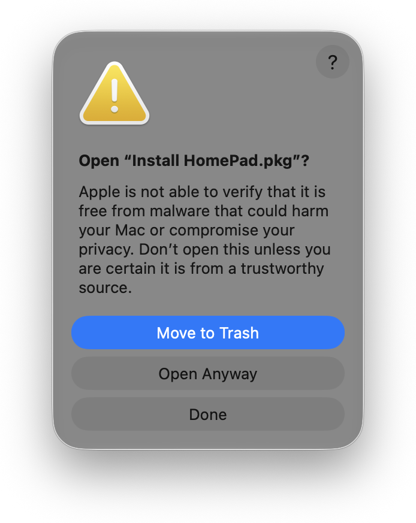

<!-- languages:start -->

<b>🌐 Language · Idioma · Langue · Sprache · Язык · 语言 · 言語 · 언어 · भाषा · لغة</b>

 

<table>
  <tr>
    <td align="center"><a href="../../README.md">English</a></td>
    <td align="center"><a href="README.ar.md">العربية</a></td>
    <td align="center"><a href="README.bn.md">বাংলা</a></td>
    <td align="center"><a href="README.zh-Hans.md">简体中文</a></td>
    <td align="center"><a href="README.fil.md">Filipino</a></td>
  </tr>
  <tr>
    <td align="center"><a href="README.fr.md">Français</a></td>
    <td align="center"><a href="README.de.md">Deutsch</a></td>
    <td align="center"><a href="README.hi.md">हिन्दी</a></td>
    <td align="center"><a href="README.id.md">Bahasa Indonesia</a></td>
    <td align="center"><a href="README.it.md">Italiano</a></td>
  </tr>
  <tr>
    <td align="center"><a href="README.ja.md">日本語</a></td>
    <td align="center"><a href="README.ko.md">한국어</a></td>
    <td align="center"><a href="README.fa.md">فارسی</a></td>
    <td align="center"><a href="README.pt-BR.md">Português (Brasil)</a></td>
    <td align="center"><a href="README.ru.md">Русский</a></td>
  </tr>
  <tr>
    <td align="center"><a href="README.es.md">Español</a></td>
    <td align="center"><a href="README.te.md">తెలుగు</a></td>
    <td align="center"><b>ไทย</b></td>
    <td align="center"><a href="README.tr.md">Türkçe</a></td>
    <td align="center"><a href="README.vi.md">Tiếng Việt</a></td>
  </tr>
</table>

<!-- languages:end -->

# HomePad for macOS

> คำแปลนี้เขียนโดย AI และยังไม่ได้รับการตรวจทานโดยเจ้าของภาษา HomePad มีภาษานี้ให้ใช้เช่นกัน ชื่อปุ่มและเมนูเขียนตามที่แอปแสดง (เปลี่ยนภาษาได้ที่ การตั้งค่า → ทั่วไป → ภาษา) ให้ถือ [README ภาษาอังกฤษ](../../README.md) เป็นฉบับหลัก

**ทุกอย่างที่คุณใช้ อยู่ห่างแค่ปุ่มเดียว** HomePad คือตัวเรียกใช้แอปที่ Mac ของคุณยังขาด จัดแอปเป็นหมวดหมู่ เก็บใส่โฟลเดอร์ ปักหมุดแอปโปรด ค้นหาทุกอย่างได้ทันที และเห็นแอปที่กำลังทำงานอยู่ตลอด พร้อมแถบงานสไตล์ Windows ถ้าคุณต้องการ

ตัวเรียกใช้แอปสไตล์ Windows เมื่อกดปุ่มลัด แผงจะปรากฏกลางหน้าจอ ด้านบนเป็นแถบค้นหา (ค้นจากดัชนีเดียวกับที่ Spotlight ใช้) และด้านล่างเป็นตารางแอปที่ปักหมุดไว้

HomePad ทำงานได้สามโหมด เลือกแบบที่เหมาะกับคุณได้ที่ การตั้งค่า → โหมด

**แถบงาน** เลียนแบบแถบงานและเมนูเริ่มของ Windows ถ้าคุณคิดถึงประสบการณ์แบบ Windows บน macOS คุณจะรู้สึกเหมือนอยู่บ้าน

**Dock + HomePad** สำหรับคนที่อยากเก็บ “Dock” ของ macOS ไว้ แต่ต้องการตัวเรียกใช้แอปแบบเมนูเริ่ม macOS มีตัวเรียกใช้ Apps อยู่แล้ว แต่ไม่น่าประทับใจนัก เพราะจัดแอปเป็นหมวดหมู่ให้อัตโนมัติโดยที่คุณเลือกเองไม่ได้ ไม่สามารถรวมแอปเป็นโฟลเดอร์ ปักหมุดแอปโปรด หรือจัดวางตามใจได้ HomePad แก้ทั้งหมดนี้

**แบบแยก** สำหรับสายมินิมอลที่อยากได้พื้นที่หน้าจอมากที่สุด ไม่มี “Dock” และไม่มีแถบงาน คุณเรียก HomePad ด้วยปุ่มลัด การแตะสองครั้ง หรือการปัดเมาส์ไปที่มุมร้อนเมื่อต้องการ มันจะปรากฏตรงกลาง และคุณควบคุมแอป ไฟล์ และโฟลเดอร์โปรด การค้นหา และแอปที่กำลังทำงานพร้อมหน้าต่างของมันได้เต็มที่ คุณไม่ต้องใช้ทั้ง “Dock” และ Spotlight เพราะควบคุม Mac ได้จากที่เดียว ตอนแรกอาจรู้สึกแปลก แต่เมื่อคุ้นเคยแล้วจะทรงพลังอย่างไม่น่าเชื่อ

## การติดตั้ง

HomePad ใช้ฟรีและไม่ได้ลงนามโดย Apple ดังนั้น macOS จะบล็อกหนึ่งครั้งและขอให้คุณยืนยันว่าไม่เป็นไร ใช้เวลาประมาณห้านาที ทำครั้งเดียว ต้องใช้ macOS 13 (Ventura) ขึ้นไป ใช้ได้ทั้ง Mac ที่ใช้ Apple silicon และ Intel ([INSTALL.md](../../INSTALL.md) มีขั้นตอนเดียวกันเป็นตัวอักษร รวมถึงสำหรับไฟล์ zip และอิมเมจดิสก์แบบง่าย)

**1. เปิดอิมเมจดิสก์ของตัวติดตั้ง** ดับเบิลคลิก `HomePad-Installer.dmg` (จากคนที่แชร์ HomePad ให้คุณ หรือสร้างเอง: `tools/make_installer_dmg.sh` ดู [Build and run](../../README.md#build-and-run)) หน้าต่างของมันแสดงขั้นตอนต่าง ๆ

**2. ดับเบิลคลิก Install HomePad.pkg** Mac จะบอกว่าเปิดไม่ได้ ให้คลิก **เสร็จสิ้น** ไม่ใช่ย้ายไปที่ถังขยะ

**3. อนุญาตใน ความเป็นส่วนตัวและความปลอดภัย** ดับเบิลคลิกไทล์สีน้ำเงิน **เปิดความเป็นส่วนตัวและความปลอดภัย** ในหน้าต่างอิมเมจดิสก์ (หรือเปิดเองที่ การตั้งค่าระบบ → ความเป็นส่วนตัวและความปลอดภัย) เลื่อนลงไปที่ **ความปลอดภัย** แล้วคลิก **เปิดต่อไป** ข้างข้อความเกี่ยวกับตัวติดตั้ง

**4. ยืนยัน** คลิก **เปิดต่อไป** ในข้อความถัดไป แล้วใช้ Touch ID หรือพิมพ์รหัสผ่าน Mac ของคุณ

<table align="center"><tr>
<td align="center"></td>
<td align="center"></td>
</tr></table>

> บน macOS 13 Ventura และ 14 Sonoma มีทางลัด: คลิกขวาที่ตัวติดตั้ง เลือก **เปิด** แล้วคลิก **เปิด** อีกครั้ง

**5. ทำตามตัวติดตั้ง** คลิก **ดำเนินการต่อ** ที่หน้าแนะนำ หน้าสิ่งที่จะเกิดขึ้น และหน้าปลายทาง (สำหรับผู้ใช้ทุกคนของคอมพิวเตอร์เครื่องนี้) แล้วคลิก **ติดตั้ง** Mac จะขอรหัสผ่านของคุณหนึ่งครั้ง เมื่อตัวติดตั้งบอกว่า HomePad อยู่ในโฟลเดอร์แอปพลิเคชันของคุณแล้ว ให้คลิก **ปิด**

<table align="center">
<tr>
<td align="center"></td>
<td align="center"></td>
</tr>
<tr>
<td align="center"></td>
<td align="center"></td>
</tr>
<tr>
<td align="center" colspan="2"></td>
</tr>
</table>

**6. คู่มือการตั้งค่า** HomePad จะเปิดเองพร้อมหน้าต่างต้อนรับ อนุญาตสิทธิ์ทั้งสามอย่าง เลือกวิธีเปิด HomePad (ปุ่มลัดบนแป้นพิมพ์ การแตะสองครั้ง มุมร้อน) แล้วคลิก **เริ่มต้นใช้งาน** แต่ละสิทธิ์เป็นทางเลือก แต่ HomePad ทำงานได้ดีที่สุดเมื่อมีครบทั้งสาม

**7. สิทธิ์** คลิก **อนุญาต…** ข้างแต่ละรายการ จากบนลงล่าง

- **การบันทึกหน้าจอ** (ภาพตัวอย่างหน้าต่างของแอปที่กำลังทำงาน) จะมีข้อความพร้อมรูปแม่กุญแจปรากฏขึ้น: คลิก **เปิดการตั้งค่าระบบ** เปิดสวิตช์ข้าง **HomePad** แล้วคลิก **ออกและเปิดใหม่** HomePad จะเริ่มใหม่เองและหน้าต่างต้อนรับจะกลับมา macOS อาจถามอีกครั้งว่า HomePad เข้าถึงหน้าจอของคุณโดยตรงได้หรือไม่ ให้คลิก **อนุญาต**

<table align="center">
<tr>
<td align="center" valign="top"></td>
<td align="center" valign="top"></td>
</tr>
<tr>
<td align="center" valign="top"></td>
<td align="center" valign="top"></td>
</tr>
</table>

- **การช่วยการเข้าถึง** (ข้ามไปยังหน้าต่างที่คุณเลือก และปุ่มลัดแตะสองครั้ง) คลิก **อนุญาต…** จากนั้นคลิก **เปิดการตั้งค่าระบบ** ในข้อความ แล้วเปิดสวิตช์ข้าง **HomePad** (ใส่รหัสผ่านของคุณหากถูกถาม) บน macOS รุ่นใหม่ หน้านี้เรียกในอินเทอร์เฟซภาษาอังกฤษว่า **Device Control and Data Access**

- **การเข้าถึงดิสก์เต็มรูปแบบ** (ค้นหาไฟล์ในเอกสาร เดสก์ท็อป และดาวน์โหลด) คลิก **อนุญาต…** การตั้งค่าระบบจะเปิดขึ้นพร้อมหน้าต่าง HomePad เล็ก ๆ อยู่ข้าง ๆ เปิดสวิตช์ข้าง **HomePad** หากไม่มีในรายการ ให้ลากไอคอนของมันจากหน้าต่างเล็กเข้าไปในรายการ

**8. ใช้งาน** กด **Option-Space** (หรือปุ่มลัดที่คุณเลือก) ส่วนอื่นทั้งหมด รวมถึงสามโหมดข้างต้น อยู่ในการตั้งค่า: คลิกขวาที่ไอคอนตารางในแถบเมนู แล้วคลิก **การตั้งค่า…**

## วิธีใช้

- **Option-Space** เปิดและปิดแผง (เปลี่ยนได้ในการตั้งค่า) หรือแตะ Control, Option หรือ Command สองครั้ง (การตั้งค่า → การเปิด ต้องมีสิทธิ์การช่วยการเข้าถึง)
- **มุมร้อน**: การตั้งค่า → การเปิด → มุมร้อน คลิกมุมใดก็ได้จากสี่มุมบนภาพย่อ (หนึ่ง หลายมุม หรือทุกมุม) วางตัวชี้ค้างไว้ที่มุมที่เลือกครู่หนึ่ง แผงจะเปิดที่มุมนั้น ทำซ้ำเพื่อปิด การแตะมุมผ่าน ๆ หรือการลากขณะกดปุ่มเมาส์ค้างไม่ทำอะไร ปุ่มลัดและการแตะสองครั้งยังเปิดตรงกลางเช่นเดิม มีอยู่ในขั้นตอนที่สองของคู่มือการตั้งค่าด้วย หาก macOS ใช้มุมเดียวกันสำหรับการทำงานของตัวเอง HomePad จะแจ้งเตือน พร้อมปุ่ม **เปิด “มุมร้อน” ของ macOS…** ซึ่งเปิด การตั้งค่าระบบ → เดสก์ท็อปและ Dock พร้อมแผ่นมุมร้อนที่แสดงอยู่แล้ว (การกดปุ่มนั้นต้องใช้การช่วยการเข้าถึง หากไม่มีจะเปิดได้แค่หน้านั้น)
- **หมวดหมู่**: แอปอยู่ในหมวดหมู่ที่มีชื่อ **รายการหลัก** มาก่อนและถูกเติมจาก Dock ของคุณเมื่อเปิดครั้งแรก พร้อมหมวดหมู่ **ไฟล์** ที่มีถังขยะและดาวน์โหลด เหมือนปลายด้านขวาของ Dock (เฉพาะครั้งแรกสุด ถ้าลบแล้วก็จะไม่กลับมา) เพิ่มหมวดหมู่ของคุณเอง (เบราว์เซอร์ งานเขียน…) ด้วย **เพิ่มหมวดหมู่** หรือคลิกขวาที่พื้นที่ว่าง หมวดหมู่ใหม่จะแสดงไทล์สีเทา “เพิ่มแอปของคุณที่นี่” คลิกขวาภายในหมวดหมู่เพื่อเปลี่ยนชื่อหรือลบ (ทุกอย่างในนั้นจะถูกเลิกปักหมุดด้วย ตัวแอปและไฟล์เองไม่ถูกแตะต้อง)
- **เพิ่มไฟล์และโฟลเดอร์**: **เพิ่มไฟล์หรือโฟลเดอร์** (ลิงก์ในส่วนหัว เมนูคลิกขวา หรือการตั้งค่า) ลากจาก Finder หรือคลิกขวาที่ผลการค้นหา → ปักหมุด คลิกเพื่อเปิด โฟลเดอร์จะเปิดใน Finder ตัวเลือกเป็นหน้าต่างเรียกดูพร้อมแถบด้านข้าง (โฮม เดสก์ท็อป เอกสาร ดาวน์โหลด ... ดิสก์) และรายการ **ถังขยะ** ที่ปักหมุดถังขยะของคุณ การคลิกที่ตำแหน่งในแถบด้านข้าง (เอกสาร ดาวน์โหลด ถังขยะ ...) จะเปิดตำแหน่งนั้นและเลือกโฟลเดอร์นั้นเอง ดังนั้น **เพิ่ม** จึงพร้อมใช้ทันที หน้าต่างเหล่านี้ไม่บล็อกแผง ขยับอันหนึ่งออกไปแล้วลากไทล์ใดก็ได้ของมันเข้าไปในแผง คลิกขวาที่ไทล์ถังขยะเพื่อ **ล้าง “ถังขยะ”…** (ถามก่อน HomePad ขอให้ Finder ล้างให้ เหมือน Dock ดังนั้นครั้งแรก macOS จะถามว่า HomePad ควบคุม Finder ได้หรือไม่)
- **ลำดับหมวดหมู่**: ชื่อหมวดหมู่จะเป็นสีเขียวเมื่อชี้ที่มัน กดแล้วทั้งแถวจะถูกเลือก (พื้นและเส้นขอบสีเขียว) ลากแล้วตัวแถวจะเคลื่อนไปพร้อมคุณขณะที่แถวอื่นหลบเพื่อเว้นที่ (แผงอยู่ที่เดิม) ปล่อยแล้วมันจะอยู่ตรงนั้น หรือคลิกขวาภายในหมวดหมู่แล้วเลือก **เลื่อนขึ้น** / **เลื่อนลง** ขณะลากอะไรอยู่ เอฟเฟกต์เมื่อชี้และภาพตัวอย่างหน้าต่างจะปิดอยู่ “รายการหลัก” ก็ย้ายได้ ยังคงเป็นที่เริ่มต้นสำหรับรายการใหม่ และลบไม่ได้ เส้นสีเทาบางคั่นระหว่างหมวดหมู่
- **คลิกขวาเพื่อเพิ่ม**: คลิกขวาที่พื้นที่ว่างภายในหมวดหมู่ (ชื่อหมวด หรือช่องว่างระหว่างและหลังไทล์) แล้วเมนูจะเพิ่มลงใน *หมวดนั้น*: “เพิ่มแอปลงใน ไฟล์…”, “เพิ่มไฟล์หรือโฟลเดอร์ลงใน ไฟล์…” รวมถึงเพิ่มหมวดหมู่ เปลี่ยนชื่อ และลบสำหรับหมวดนั้น และ **เรียงตามตัวอักษร** (เรียงไทล์ของหมวดตามชื่อที่แสดง เป็นสีเทาเมื่อเรียงแล้ว ไทล์ในโฟลเดอร์ของหมวดคงลำดับเดิม) พื้นที่ว่างใต้ส่วนสุดท้ายเป็นของส่วนนั้น
- **เพิ่มแอป**: ปุ่มเพิ่มแอป (ดับเบิลคลิกแอปในตัวเลือกเพื่อเพิ่มและปิดตัวเลือก) คลิกขวาที่พื้นที่ว่าง ลากแอปจาก Finder (กดปุ่มลัดระหว่างลาก) หรือคลิกขวาที่ผลการค้นหา → ปักหมุดแอป
- **โฟลเดอร์** (เหมือนเมนูเริ่มของ Windows): ลากไทล์ไปที่กลางไอคอนของอีกไทล์ ค้างไว้ครึ่งวินาทีจนไอคอนนั้นสว่างขึ้น แล้วปล่อย ทั้งสองจะกลายเป็นโฟลเดอร์ตรงที่นั้น ชื่อ “โฟลเดอร์” โดยไทล์ของมันแสดงสี่รายการแรก ปล่อยไทล์เพิ่มลงบนโฟลเดอร์เพื่อเพิ่มเข้าไป คลิกโฟลเดอร์เพื่อเปิดเหนือแผง คลิกที่ชื่อเพื่อเปลี่ยนชื่อ คลิกรายการเพื่อเปิด ลากรายการเพื่อจัดลำดับใหม่หรือลากออกนอกโฟลเดอร์ (มันจะปิดเพื่อให้คุณวางรายการระหว่างไทล์อื่นได้) Esc หรือคลิกข้างนอกเพื่อปิด โฟลเดอร์ที่เหลือรายการเดียวจะกลับเป็นรายการนั้น คลิกขวาที่โฟลเดอร์เพื่อ “เปลี่ยนชื่อโฟลเดอร์…”, “ย้ายไปที่” และ “เลิกจัดกลุ่ม” คลิกขวาที่รายการในโฟลเดอร์ที่เปิดอยู่เพื่อ “นำออกจากโฟลเดอร์” การลากบนขอบของไทล์ (ไม่ใช่ตรงกลาง) ยังคงเป็นการจัดลำดับใหม่เท่านั้น
- **นำออก / จัดลำดับใหม่**: คลิกขวาที่ไทล์ → เลิกปักหมุดแอป / ย้ายไปที่ หรือลากไทล์ รวมถึงข้ามหมวดหมู่ได้
- **แอปที่กำลังทำงาน**: แถบสีแดงใต้ไอคอน (เหนือชื่อ) หมายความว่าแอปกำลังทำงาน ชี้ที่แอปที่กำลังทำงานเพื่อดูภาพย่อของแต่ละหน้าต่าง (หน้าต่างที่ย่ออยู่จะมีเครื่องหมายลบข้างปุ่ม X สำหรับปิด) บนทุกเดสก์ท็อป (Spaces) เรียงตามลำดับของ Mission Control พร้อมหัวข้อ “Space N” เมื่อแอปมีหน้าต่างในมากกว่าหนึ่ง แล้วคลิกอันหนึ่งเพื่อไปที่นั่นโดยตรง (สลับเดสก์ท็อปถ้าจำเป็น) หรือคลิก X ที่มุมของมันเพื่อปิดเฉพาะหน้าต่างนั้น (ใช้ได้กับหน้าต่างบนเดสก์ท็อปอื่นด้วย) (ต้องมีการบันทึกหน้าจอและการช่วยการเข้าถึง หากไม่มีการบันทึกหน้าจอ จะได้รายการธรรมดา) การคลิกแอปที่กำลังทำงานให้ความสำคัญกับเดสก์ท็อปปัจจุบันก่อน: หน้าต่างที่เห็นอยู่ที่นั่นจะนำแอปขึ้นมาข้างหน้า ถ้าหน้าต่างทั้งหมดของมันที่นั่นถูกย่ออยู่ หน้าต่างล่าสุดจะกลับมา และเฉพาะเมื่อไม่มีหน้าต่างที่นั่นเลยจึงจะพาคุณไปยังเดสก์ท็อปอื่นที่มีหน้าต่าง ส่วน **กำลังทำงาน** แสดงทุกแอปที่เปิดอยู่ (ปักหมุดหรือไม่ก็ตาม เหมือนตัวบอกการเปิดของ Dock) ไม่สามารถเพิ่มหรือนำสิ่งใดออกได้ แต่ **ลากไทล์ภายในส่วนนี้เพื่อจัดลำดับใหม่ได้** (เรียงตามตัวอักษรจนกว่าคุณจะย้ายอันหนึ่ง ลำดับถูกจดจำ รวมถึงแอปที่ออกแล้วเปิดใหม่ ไม่สามารถวางไทล์ที่อื่นได้ และ Esc หรือการปล่อยที่อื่นจะคืนมันกลับ คลิกขวาที่กำลังทำงาน → **เรียงตามตัวอักษร** จะลืมลำดับของคุณ) ตัวส่วนเองเปลี่ยนชื่อไม่ได้ แต่ลากที่หัวข้อ (หรือย้ายด้วย **เลื่อนขึ้น** / **เลื่อนลง** ในเมนูคลิกขวา) ไปไว้ที่ใดก็ได้ระหว่างหมวดหมู่ และซ่อนได้ (คลิกขวาที่มัน → ซ่อนกำลังทำงาน นำกลับด้วย การตั้งค่า → แผง → แสดงส่วนกำลังทำงาน) **หน้าต่างที่ย่อ** ของแต่ละแอปที่กำลังทำงานตามไทล์ของมันไปที่นั่นได้ เป็นไทล์ของตัวเอง: ภาพหน้าต่างพร้อมไอคอนแอปที่มุมและชื่อหน้าต่าง (เหมือนที่ Dock แสดง) คลิกอันหนึ่งเพื่อนำหน้าต่างนั้นกลับมา คลิกขวาเพื่อคืนค่าหรือปิดหน้าต่าง ปิดอยู่เป็นค่าเริ่มต้น: เปิดที่ การตั้งค่า → แผง → แสดงหน้าต่างที่ย่อในกำลังทำงาน หรือคลิกขวาที่กำลังทำงาน → แสดงหน้าต่างที่ย่อ มันถูกรวบรวมทุกครั้งที่เปิดแผง (ต้องมีการช่วยการเข้าถึง ส่วนภาพต้องมีการบันทึกหน้าจอ)
- **เมนูของแอปที่กำลังทำงาน**: คลิกขวาที่แอปที่กำลังทำงานเพื่อดูเมนูแบบ Dock: หน้าต่างของมัน (หน้าต่างหน้าสุดมีเครื่องหมาย เลือกอันหนึ่งเพื่อนำขึ้นมาข้างหน้า) คำสั่ง “ใหม่ …” จากเมนูไฟล์ของมัน (แท็บใหม่ หน้าต่างใหม่ หน้าต่างส่วนตัวใหม่ ในเบราว์เซอร์) จากนั้น **ปิดหน้าต่าง** (เฉพาะเมื่อมีหน้าต่างเปิดอยู่) **ซ่อน** และ **ออก** (กด Option ค้างเพื่อบังคับออก แอปที่ยังเปิดอยู่หลังจากออกไม่กี่วินาทีจะได้ **บังคับออก** แทน Finder ไม่มีออก เหมือนใน Dock เพราะการออกจะลบไอคอนบนเดสก์ท็อป) หน้าต่างและคำสั่งอ่านผ่านการช่วยการเข้าถึงเมื่อตัวชี้ไปถึงไทล์
- **ค้นหาไฟล์**: ไฟล์ในเอกสาร เดสก์ท็อป และดาวน์โหลดจะปรากฏในการค้นหาก็ต่อเมื่อ HomePad มี **การเข้าถึงดิสก์เต็มรูปแบบ** (การตั้งค่าระบบ → ความเป็นส่วนตัวและความปลอดภัย) จนกว่าจะถึงตอนนั้น ผลลัพธ์จะแสดงคำเตือนพร้อมลิงก์ไปที่สวิตช์
- **เครื่องคิดเลข**: พิมพ์โจทย์เช่น `7+3`, `(2+3)*4`, `2^10` หรือ `15%` แล้วคำตอบจะปรากฏเป็นอันดับแรก ↩ หรือปุ่มคัดลอกจะคัดลอกมัน
- **หน้าต่าง**: ลากขอบหรือมุมใดก็ได้ของแผงเพื่อปรับขนาด (ขอบมีแถบกว้างให้จับและแสดงเคอร์เซอร์ปรับขนาด) หรือลากส่วนว่างตรงไหนก็ได้เพื่อย้าย (ไม่ใช่ตารางไทล์เอง ซึ่งการลากจะจัดไทล์ใหม่) ช่องค้นหามีโฟกัสทุกครั้งที่เปิดแผง คุณจึงพิมพ์ได้ทันที หลังจากคลิกที่อื่นแล้ว แป้นที่กดครั้งถัดไปจะกลับไปที่ช่องนั้น การตั้งค่า → แผง มี **จำขนาดหน้าต่าง** (เปิดเป็นค่าเริ่มต้น) และ **จำตำแหน่งหน้าต่าง** (ปิดเป็นค่าเริ่มต้น) ปุ่ม ↺ ข้างเฟืองการตั้งค่าคืนแผงเป็นขนาดเริ่มต้นและอยู่กึ่งกลาง หน้าต่างเพิ่มแอปและเพิ่มไฟล์หรือโฟลเดอร์ก็ปรับขนาดได้ด้วย (เปิดด้วยขนาดเริ่มต้นเสมอ)
- **ชื่อของคุณ** ที่มุมซ้ายล่างของแผง เปิดการตั้งค่าระบบที่บัญชี Apple ของคุณ
- **ค้นหา**: เริ่มพิมพ์ได้เลย แอปมาก่อน ตามด้วยเอกสารและโฟลเดอร์ แล้วเป็นการค้นหาบนเว็บ ↑ ↓ เพื่อเลือก ↩ เพื่อเปิด ⌘↩ เพื่อแสดงใน Finder Esc เพื่อล้างแล้วปิด ปุ่ม ‹ หรือการคลิกที่พื้นที่ว่างก็พาคุณกลับไปที่แอปของคุณได้

## การเปิดครั้งแรก

หน้าต่างต้อนรับจะขอให้คุณอนุญาตการบันทึกหน้าจอ การช่วยการเข้าถึง และการเข้าถึงดิสก์เต็มรูปแบบ และเลือกวิธีเปิด HomePad (ดูการติดตั้ง) เปิดอีกครั้งได้ทุกเมื่อจากไอคอนในแถบเมนู → คู่มือการตั้งค่า…

## การตั้งค่า

การตั้งค่ามีหกแท็บบนแถบเครื่องมือ: **โหมด**, **ทั่วไป** (ภาษา ไอคอนในแถบเมนู เปิดเมื่อเข้าสู่ระบบ รีเซ็ตเป็นค่าเริ่มต้น เริ่มใหม่), **แถบงาน**, **การเปิด** (ปุ่มลัด การแตะสองครั้ง มุมร้อน), **แผง** (เค้าโครง หน้าต่าง รายการ) และ **สิทธิ์** มันเปิดกลับมาที่แท็บที่คุณใช้ล่าสุด

- **ปุ่มลัด**: คลิกปุ่มแล้วกดชุดปุ่มใหม่ หากจะใช้ ⌘Space ให้ปิดปุ่มลัดของ Spotlight ก่อนที่ การตั้งค่าระบบ → แป้นพิมพ์ → ปุ่มลัดแป้นพิมพ์ → Spotlight
- **ปุ่มลัด**: บันทึกปุ่มลัดหนึ่งชุด เลือก **ไม่มี** หากต้องการแค่การแตะสองครั้ง หรือ **รีเซ็ต** เพื่อกลับไปที่ ⌥Space
- **ไอคอนในแถบเมนู**: การตั้งค่า → ทั่วไป ซ่อนได้ การเปิดแอปอีกครั้งจะเปิดแผง
- **รีเซ็ตเป็นค่าเริ่มต้น**: คืนปุ่มลัด การแตะสองครั้ง เค้าโครง การซ่อน Dock และการเปิดเมื่อเข้าสู่ระบบ (แอปและหมวดหมู่ยังอยู่)
- **แตะสองครั้ง**: เปิดด้วยการแตะ Control, Option หรือ Command สองครั้ง
- **ไอคอนต่อแถว** (ค่าเริ่มต้น 8, 4–10) **ความสูงของแถว** (ระยะห่างระหว่างแถวไอคอน ค่าเริ่มต้น 101 pt, 85–125) และ **ระยะห่างไอคอน** (ช่องว่างแนวนอนระหว่างไอคอน ค่าเริ่มต้น 10 pt, 0–40 เมื่อแผงแคบเกินไปสำหรับช่องว่าง ช่องว่างจะลดก่อน แล้วจึงถึงไอคอน): พิมพ์ตัวเลขหรือคลิก − / + **แสดงแอปที่กำลังทำงาน** **นำเข้าจาก Dock ใหม่**
- **โหมด** (แท็บแรก):
  - **แบบแยก** (ค่าเริ่มต้น): แผงลอยที่เปิดด้วยปุ่มลัด การแตะสองครั้ง มุมร้อน หรือไอคอนในแถบเมนู การเปลี่ยนมาโหมดนี้จะซ่อน Dock ส่วน **ซ่อน “Dock”** ด้านล่างจะนำกลับมา
  - **HomePad + “Dock”**: การใช้งานแบบเมนูเริ่มของ Windows โดยมี Dock เป็นแถบงาน การเลือกโหมดนี้จะแสดง Dock เสมอ (ปิดการซ่อนอัตโนมัติ ทั้งของ HomePad และของการตั้งค่าระบบ) และเพิ่ม HomePad เข้าไปหากยังไม่มี (Dock เริ่มใหม่หนึ่งครั้ง) Dock อยู่ตรงที่คุณวางไว้ แผงเปิดข้างไอคอน HomePad พอดี (เหนือมันสำหรับ Dock ด้านล่าง ข้างมันสำหรับ Dock ด้านข้าง อยู่ในหน้าจอ) ไม่ว่าคุณจะคลิกไอคอนหรือใช้ปุ่มลัดหรือแตะสองครั้ง การคลิกไอคอนอีกครั้งจะปิดมัน มุมร้อนยังเปิดที่มุมของมัน การตั้งค่าบอกว่าทำไมแผงจึงเปิดตรงกลางเมื่อ HomePad ไม่อยู่ใน Dock, Dock ถูกซ่อน หรือขาดสิทธิ์การช่วยการเข้าถึง
  - **แถบงาน**: แถบงานสไตล์ Windows ตามขอบล่างของหน้าจอหลัก: ปุ่มเริ่ม (ไอคอน HomePad) ตามด้วยสิ่งที่คุณปักหมุดไว้และแอปที่กำลังทำงาน จัดกึ่งกลาง แอปที่กำลังทำงานจึงออกจากแผง ปักหมุดแอป ไฟล์ และโฟลเดอร์ด้วยการคลิกขวาที่พื้นที่ว่างของแถบ (**เพิ่มแอป…**, **เพิ่มไฟล์หรือโฟลเดอร์…**) หรือที่ไทล์ (**ปักหมุดที่แถบงาน** ในแผง HomePad ก็ได้) เมนูของไอคอนบนแถบงานยังมี **ปักหมุดที่ HomePad** (หรือเลิกปักหมุดจาก HomePad) สำหรับหมวดหมู่ของ HomePad เอง หรือลากแอป ไฟล์ และโฟลเดอร์มาที่แถบจาก Finder หรือจากแผง HomePad: จะถูกปักหมุดก่อนไอคอนที่คุณวางลงไป หรือที่ท้ายสุดหากวางบนพื้นที่ว่าง (อันที่ปักหมุดอยู่แล้วจะย้ายไปที่นั่น แผงยังเก็บของมันไว้) รายการที่ปักหมุดบนแถบงานเป็นรายการแยกต่างหากจากหมวดหมู่ของ HomePad ลากไอคอนไปตามแถบเพื่อจัดลำดับใหม่ **ไอคอนแอป** อยู่ที่ **กึ่งกลาง** หรือ **ซ้าย** ขณะที่อยู่กึ่งกลาง **ไอคอน HomePad** จะอยู่กึ่งกลางพร้อมกับพวกมันหรือทางซ้ายก็ได้ (เมื่อไอคอนแอปอยู่ซ้าย มันจะอยู่ทางซ้ายเสมอ ตัวเลือกจึงเป็นสีเทา) ซ้ายคือขวาในภาษาอาหรับและเปอร์เซีย สลับด้านเหมือนใน Windows เมื่อไอคอน HomePad อยู่ทางซ้าย แผงของมันเปิดที่ขอบซ้ายเหนือแถบงาน ทางขวาคือ **เครือข่าย** **ระดับเสียง** **แบตเตอรี่** และ **นาฬิกา** แต่ละอันมีสวิตช์: เครือข่ายและแบตเตอรี่เปิดหน้าของมันในการตั้งค่าระบบ (เมนูสถานะของ macOS เองเปิดจากภายนอกไม่ได้ใน macOS รุ่นใหม่) ระดับเสียงเปิดแถบเลื่อน (เลื่อนบนมันเพื่อเปลี่ยนระดับเสียง) นาฬิกาเปิดปฏิทิน คลิกรายการเพื่อเปิดหรือนำขึ้นมาข้างหน้า (หรือซ่อนหากอยู่ข้างหน้าแล้ว) ชี้ที่แอปที่กำลังทำงานเพื่อดูหน้าต่างของมัน คลิกขวาเพื่อดูเมนู การตั้งค่า → แถบงาน → **แอปที่กำลังทำงาน** (พับไว้ตอนแรก) แสดงทุกแอปที่กำลังทำงานพร้อมสวิตช์ **แสดงบนแถบงาน** แอปที่ปิดสวิตช์จะอยู่นอกแถบตราบที่ยังทำงานอยู่ (มี **ซ่อนจากแถบงาน** ในเมนูของมันด้วย) รายการที่ปักหมุดแสดงเสมอ การซ่อนแอป (Cmd-H) ไม่เปลี่ยนแถบ แผงเปิดกึ่งกลางเหนือแถบงาน Dock ถูกซ่อนไว้ระหว่างนั้น macOS ให้เฉพาะ Dock เท่านั้นที่กันหน้าต่างออกจากพื้นที่ส่วนหนึ่งของหน้าจอได้ ดังนั้นด้วยการช่วยการเข้าถึง HomePad จะย่อหน้าต่างให้สั้นลงเมื่อมันถูกเปิด ปรับขนาด ขยายเต็ม หรือจัดเรียงจนเลยลงไปใต้แถบ (ย้ายขึ้นแทนหากจะสั้นเกินไป) หน้าต่างที่เพียงถูกลากไปที่นั่นจะไม่ถูกแตะ เหมือนใน Windows (การเก็บ Dock จริงไว้ใต้แถบไม่ได้ผล เพราะมันแสดงป้ายชื่อทุกที่ที่ตัวชี้ผ่านไอคอนของมัน) **ซ่อนแถบงานอัตโนมัติ** เลื่อนแถบออกไปใต้หน้าจอจนกว่าตัวชี้จะอยู่ที่ขอบล่างครบ **หน่วงเวลาก่อนแสดง** (0–1000 ms ค่าเริ่มต้น 300 เพื่อให้การปัดผ่านขอบเร็ว ๆ ไม่ทำให้แสดง) แถบจะแสดงอยู่ตราบที่แผง HomePad ป๊อปอัป ภาพตัวอย่างหน้าต่าง หรือเมนูเปิดอยู่ และหน้าต่างจะใช้ทั้งหน้าจอ **เปิด HomePad จากปุ่มเริ่มเท่านั้น** ปิดปุ่มลัด การแตะสองครั้ง และมุมร้อน (ไอคอนในแถบเมนูยังใช้ได้)
- **ซ่อน “Dock”** (เฉพาะโหมดแบบแยก): เปิดการซ่อน Dock อัตโนมัติโดยหน่วง 1000 วินาที จึงไม่ปรากฏเลย การปิดจะคืน Dock ปกติ
- **เปิดเมื่อเข้าสู่ระบบ**
- **ภาษา** (การตั้งค่า → ทั่วไป หรือคลิกขวาที่ไอคอนในแถบเมนู → ภาษา): เหมือนกับ Mac หรือหนึ่งใน 20 ภาษา (อังกฤษ อาหรับ อินโดนีเซีย อิตาลี เกาหลี จีน (ตัวย่อ) ญี่ปุ่น เยอรมัน ตุรกี เตลูกู ไทย เปอร์เซีย โปรตุเกส (บราซิล) ฟิลิปปินส์ ฝรั่งเศส เบงกอล รัสเซีย เวียดนาม สเปน ฮินดี) เรียงตามตัวอักษรในภาษาปัจจุบัน HomePad เริ่มใหม่ในภาษาใหม่ ภาษาอาหรับและเปอร์เซียจัดจากขวาไปซ้าย ชื่อแอป โฟลเดอร์ และส่วนต่าง ๆ ของการตั้งค่าระบบยังคงเป็นอย่างที่ Mac แสดง

## การตั้งค่าสิทธิ์

เมื่อคุณอนุญาตสิทธิ์ (ในคู่มือการตั้งค่า ในการตั้งค่า หรือในภาพตัวอย่างหน้าต่าง) HomePad จะเฝ้าดูว่าคุณเปิดมันในการตั้งค่าระบบหรือยัง และกลับมาข้างหน้าทันทีที่เปิด การบันทึกหน้าจอและการเข้าถึงดิสก์เต็มรูปแบบมักต้องเริ่มใหม่ เมื่อการตั้งค่าระบบเสนอ **ออกและเปิดใหม่** HomePad จะออก เริ่มต้นใหม่เอง และเปิดหน้าต่างที่คุณอยู่อีกครั้ง

คู่มือการตั้งค่าจะปรากฏเมื่อเปิดครั้งแรกเฉพาะเมื่อขาดสิทธิ์บางอย่าง หากจะดูตั้งแต่ต้นอีกครั้ง ให้ใช้ **การตั้งค่า → ทั่วไป → เริ่มใหม่…** macOS จะถอนสิทธิ์ของ HomePad คู่มือจะปรากฏอีกครั้ง และ HomePad จะเริ่มใหม่ (ติ๊กช่องเพื่อให้ลืมหมวดหมู่และการตั้งค่าของคุณด้วย เหมือนติดตั้งใหม่)

## การพัฒนา

วิธีสร้างแอป วิธีทำงานของคำแปล รายการไฟล์ และไอคอนแอป มีอยู่เฉพาะใน [README ภาษาอังกฤษ](../../README.md#development) เท่านั้น

## ใบอนุญาต

[MIT](../../LICENSE)
