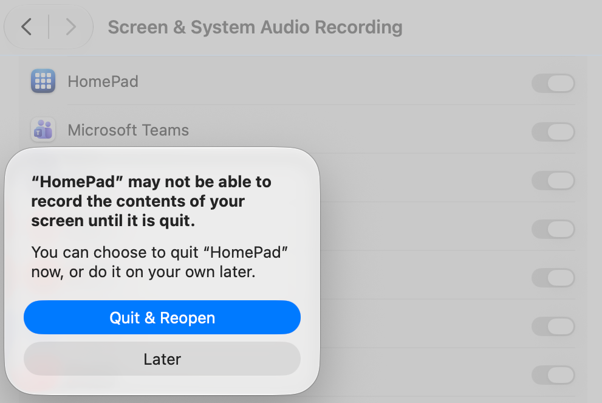

<!-- languages:start -->

<b>🌐 Language · Idioma · Langue · Sprache · Язык · 语言 · 言語 · 언어 · भाषा · لغة</b>

 

<table>
  <tr>
    <td align="center"><a href="../../README.md">English</a></td>
    <td align="center"><a href="README.ar.md">العربية</a></td>
    <td align="center"><a href="README.bn.md">বাংলা</a></td>
    <td align="center"><a href="README.zh-Hans.md">简体中文</a></td>
    <td align="center"><a href="README.fil.md">Filipino</a></td>
  </tr>
  <tr>
    <td align="center"><a href="README.fr.md">Français</a></td>
    <td align="center"><a href="README.de.md">Deutsch</a></td>
    <td align="center"><a href="README.hi.md">हिन्दी</a></td>
    <td align="center"><a href="README.id.md">Bahasa Indonesia</a></td>
    <td align="center"><a href="README.it.md">Italiano</a></td>
  </tr>
  <tr>
    <td align="center"><a href="README.ja.md">日本語</a></td>
    <td align="center"><a href="README.ko.md">한국어</a></td>
    <td align="center"><a href="README.fa.md">فارسی</a></td>
    <td align="center"><a href="README.pt-BR.md">Português (Brasil)</a></td>
    <td align="center"><a href="README.ru.md">Русский</a></td>
  </tr>
  <tr>
    <td align="center"><a href="README.es.md">Español</a></td>
    <td align="center"><a href="README.te.md">తెలుగు</a></td>
    <td align="center"><a href="README.th.md">ไทย</a></td>
    <td align="center"><a href="README.tr.md">Türkçe</a></td>
    <td align="center"><b>Tiếng Việt</b></td>
  </tr>
</table>

<!-- languages:end -->

# HomePad for macOS

> Bản dịch này do AI viết và chưa được người bản ngữ kiểm tra. HomePad cũng có sẵn bằng ngôn ngữ này; tên các nút và menu được ghi đúng như ứng dụng hiển thị (đổi ngôn ngữ trong Cài đặt → Chung → Ngôn ngữ). Bản [README tiếng Anh](../../README.md) là bản chính thức.

**Mọi thứ bạn dùng, chỉ cách một phím.** HomePad là trình khởi chạy còn thiếu của máy Mac: sắp xếp ứng dụng thành các danh mục, gom vào thư mục, ghim ứng dụng yêu thích, tìm mọi thứ ngay tức thì và luôn thấy các ứng dụng đang chạy, kèm thanh tác vụ kiểu Windows nếu bạn muốn.

Một trình khởi chạy kiểu Windows: bạn nhấn một phím tắt và một bảng hiện ra giữa màn hình, phía trên là thanh tìm kiếm (tìm trong cùng chỉ mục mà Spotlight dùng), bên dưới là lưới các ứng dụng đã ghim.

HomePad hoạt động ở ba chế độ. Hãy chọn chế độ hợp với bạn trong Cài đặt → Chế độ.

**Thanh tác vụ.** Mô phỏng thanh tác vụ và menu Start của Windows. Nếu bạn nhớ trải nghiệm Windows trên macOS, bạn sẽ thấy như ở nhà.

**Dock + HomePad.** Dành cho những ai muốn giữ “Dock” của macOS nhưng cần một trình khởi chạy kiểu menu Start. macOS có trình khởi chạy Apps nhưng nó chẳng gây ấn tượng: nó tự sắp xếp ứng dụng của bạn vào các danh mục mà bạn không chọn được, không cho gom ứng dụng vào thư mục, ghim mục yêu thích hay sắp xếp theo ý bạn. HomePad giải quyết tất cả những điều đó.

**Độc lập.** Dành cho người theo chủ nghĩa tối giản muốn có tối đa không gian màn hình, không có “Dock” và không có thanh tác vụ. Bạn gọi HomePad bằng phím tắt, chạm hai lần hoặc vung chuột vào một góc nóng bất cứ khi nào cần. Nó hiện ở giữa, và bạn kiểm soát hoàn toàn các ứng dụng, tệp và thư mục yêu thích, việc tìm kiếm, cùng các ứng dụng đang chạy với cửa sổ của chúng. Bạn không cần cả “Dock” lẫn Spotlight: bạn điều khiển máy Mac từ một nơi duy nhất. Lúc đầu có thể thấy lạ, nhưng khi quen rồi nó mạnh đến không ngờ.

## Cài đặt

HomePad miễn phí và không được Apple ký, nên macOS sẽ chặn nó một lần và yêu cầu bạn xác nhận mọi thứ ổn. Việc này mất khoảng năm phút, chỉ làm một lần. Bạn cần macOS 13 (Ventura) trở lên; máy Mac dùng Apple silicon và Intel đều chạy được. ([INSTALL.md](../../INSTALL.md) có cùng các bước bằng lời, kể cả cho tệp zip và ảnh đĩa đơn giản.)

**1. Mở ảnh đĩa của trình cài đặt.** Bấm đúp vào `HomePad-Installer.dmg` (từ người đã chia sẻ HomePad cho bạn, hoặc tự biên dịch: `tools/make_installer_dmg.sh`, xem [Build and run](../../README.md#build-and-run)). Cửa sổ của nó liệt kê các bước.

**2. Bấm đúp vào Install HomePad.pkg.** Máy Mac báo không mở được. Bấm **Xong**, không phải Chuyển vào Thùng rác.

**3. Cho phép trong Quyền riêng tư & Bảo mật.** Bấm đúp vào ô xanh **Mở Quyền riêng tư & Bảo mật** trong cửa sổ ảnh đĩa (hoặc tự mở Cài đặt hệ thống → Quyền riêng tư & Bảo mật), cuộn tới **Bảo mật** và bấm **Vẫn mở** cạnh thông báo về trình cài đặt.

**4. Xác nhận.** Bấm **Vẫn mở** trong thông báo tiếp theo, rồi dùng Touch ID hoặc nhập mật khẩu máy Mac.

<table align="center"><tr>
<td align="center"></td>
<td align="center"></td>
</tr></table>

> Trên macOS 13 Ventura và 14 Sonoma có đường tắt: bấm chuột phải vào trình cài đặt, chọn **Mở**, rồi **Mở** lần nữa.

**5. Đi qua trình cài đặt.** Bấm **Tiếp tục** ở phần giới thiệu, phần những điều cần biết và phần đích đến (cho mọi người dùng của máy tính này), rồi bấm **Cài đặt**. Máy Mac hỏi mật khẩu một lần. Khi trình cài đặt báo HomePad đã nằm trong thư mục Ứng dụng của bạn, bấm **Đóng**.

<table align="center">
<tr>
<td align="center"></td>
<td align="center"></td>
</tr>
<tr>
<td align="center"></td>
<td align="center"></td>
</tr>
<tr>
<td align="center" colspan="2"></td>
</tr>
</table>

**6. Hướng dẫn thiết lập.** HomePad tự mở với một cửa sổ chào mừng. Cho phép ba quyền, chọn cách bạn muốn mở HomePad (phím tắt bàn phím, chạm hai lần, góc nóng) và bấm **Bắt đầu**. Mỗi quyền đều không bắt buộc, nhưng HomePad hoạt động tốt nhất khi có cả ba.

**7. Các quyền.** Bấm **Cho phép…** cạnh từng quyền, từ trên xuống dưới.

- **Ghi màn hình** (xem trước cửa sổ của một ứng dụng đang chạy). Một thông báo có ổ khóa hiện ra: bấm **Mở Cài đặt hệ thống**, bật công tắc cạnh **HomePad** và bấm **Thoát & Mở lại**. HomePad tự khởi động lại và cửa sổ chào mừng quay lại. macOS có thể hỏi thêm một lần nữa liệu HomePad có được truy cập trực tiếp màn hình của bạn không: bấm **Cho phép**.

<table align="center">
<tr>
<td align="center" valign="top"></td>
<td align="center" valign="top"></td>
</tr>
<tr>
<td align="center" valign="top"></td>
<td align="center" valign="top"></td>
</tr>
</table>

- **Trợ năng** (nhảy tới cửa sổ bạn chọn, và phím tắt chạm hai lần). Bấm **Cho phép…**, rồi bấm **Mở Cài đặt hệ thống** trong thông báo, và bật công tắc cạnh **HomePad** (nhập mật khẩu nếu được hỏi). Trên các macOS mới hơn, trang này có tên **Device Control and Data Access** trong giao diện tiếng Anh.

- **Truy cập toàn bộ ổ đĩa** (tìm tệp trong Tài liệu, Màn hình nền và Tải về). Bấm **Cho phép…**; Cài đặt hệ thống mở ra cùng một cửa sổ HomePad nhỏ bên cạnh. Bật công tắc cạnh **HomePad**. Nếu nó không có trong danh sách, hãy kéo biểu tượng của nó từ cửa sổ nhỏ vào danh sách.

**8. Sử dụng.** Nhấn **Option-Phím cách** (hoặc phím tắt bạn đã chọn). Mọi thứ còn lại, kể cả ba chế độ ở trên, nằm trong Cài đặt: bấm chuột phải vào biểu tượng lưới trên thanh menu rồi bấm **Cài đặt…**.

## Cách sử dụng

- **Option-Phím cách** mở và đóng bảng (đổi trong Cài đặt), hoặc chạm hai lần vào Control, Option hay Command (Cài đặt → Mở; cần quyền Trợ năng).
- **Góc nóng**: Cài đặt → Mở → góc nóng. Bấm vào bất kỳ góc nào trong bốn góc của hình thu nhỏ (một, vài hoặc tất cả). Giữ con trỏ yên một lúc ở góc đã chọn, bảng sẽ mở tại góc đó; làm lại để đóng. Lướt nhanh qua góc, hoặc kéo khi đang giữ nút chuột, không có tác dụng gì. Phím tắt và chạm hai lần vẫn mở ở giữa. Nó cũng nằm ở bước thứ hai của Hướng dẫn thiết lập. Nếu macOS dùng cùng góc đó cho thao tác riêng của nó, HomePad sẽ cảnh báo, kèm nút **Mở “Góc nóng” của macOS…** để mở Cài đặt hệ thống → Màn hình nền & Dock với bảng Góc nóng đã hiện sẵn (bấm nút đó cần Trợ năng; không có thì chỉ mở trang).
- **Danh mục**: ứng dụng nằm trong các danh mục có tên. **Thiết yếu** đứng đầu và được điền từ Dock của bạn ở lần mở đầu tiên, cộng thêm danh mục **Tệp** với Thùng rác và Tải về, như đầu bên phải của Dock (chỉ lần đầu tiên; nếu bạn xóa, nó sẽ vẫn bị xóa). Thêm danh mục của riêng bạn (Trình duyệt, Viết lách…) bằng **Thêm danh mục** hoặc bấm chuột phải vào khoảng trống. Danh mục mới hiện một ô xám “Thêm ứng dụng của bạn tại đây”. Bấm chuột phải bên trong một danh mục để đổi tên hoặc xóa nó (mọi thứ trong đó cũng được bỏ ghim; bản thân ứng dụng và tệp không bị đụng tới).
- **Thêm tệp và thư mục**: **Thêm tệp hoặc thư mục** (liên kết ở đầu, menu chuột phải hoặc Cài đặt), kéo chúng từ Finder, hoặc bấm chuột phải vào kết quả tìm kiếm → Ghim. Bấm vào sẽ mở; thư mục mở trong Finder. Bộ chọn là một cửa sổ duyệt có thanh bên (Thư mục nhà, Màn hình nền, Tài liệu, Tải về, ..., ổ đĩa) và mục **Thùng rác** để ghim Thùng rác của bạn. Bấm vào một nơi trong thanh bên (Tài liệu, Tải về, Thùng rác ...) sẽ mở nơi đó và chọn chính thư mục, nên **Thêm** đã sẵn sàng. Các cửa sổ này không chặn bảng: dời một cửa sổ sang bên và kéo bất kỳ ô nào của nó vào bảng. Bấm chuột phải vào ô Thùng rác để **Dọn sạch “Thùng rác”…** (hỏi trước; HomePad nhờ Finder dọn, như Dock, nên lần đầu macOS hỏi liệu HomePad có được điều khiển Finder không).
- **Thứ tự danh mục**: tên danh mục chuyển sang màu xanh lá khi bạn trỏ vào. Nhấn vào đó và cả hàng được chọn (nền và viền xanh lá); kéo đi và chính hàng đó di chuyển cùng bạn trong khi các hàng khác tránh ra nhường chỗ (bảng đứng yên). Thả ra và nó nằm lại đó. Hoặc bấm chuột phải bên trong một danh mục và chọn **Chuyển lên** / **Chuyển xuống**. Khi đang kéo thứ gì đó, hiệu ứng khi trỏ vào và xem trước cửa sổ bị tắt. “Thiết yếu” cũng di chuyển được; nó vẫn là nơi mặc định cho mục mới và không xóa được. Các đường kẻ xám mảnh ngăn cách các danh mục.
- **Bấm chuột phải để thêm**: bấm chuột phải vào khoảng trống bên trong một danh mục (tiêu đề, hoặc các khoảng giữa và sau các ô) và menu sẽ thêm vào *danh mục đó*: “Thêm ứng dụng vào Tệp…”, “Thêm tệp hoặc thư mục vào Tệp…”, cùng với Thêm danh mục, Đổi tên và Xóa cho danh mục đó, và **Sắp xếp theo thứ tự chữ cái** (xếp các ô của danh mục theo thứ tự chữ cái của tên hiển thị; chuyển xám khi đã đúng; các ô bên trong thư mục của nó giữ nguyên thứ tự). Khoảng trống dưới phần cuối cùng thuộc về phần đó.
- **Thêm ứng dụng**: nút Thêm ứng dụng (bấm đúp vào một ứng dụng trong bộ chọn để thêm và đóng bộ chọn), bấm chuột phải vào khoảng trống, kéo ứng dụng từ Finder (nhấn phím tắt giữa lúc kéo), hoặc bấm chuột phải vào kết quả tìm kiếm → Ghim ứng dụng.
- **Thư mục** (như menu Start của Windows): kéo một ô vào giữa biểu tượng của ô khác, giữ ở đó nửa giây cho tới khi biểu tượng đó sáng lên rồi thả: cả hai trở thành một thư mục tại chỗ đó, tên “Thư mục”, ô của nó hiện bốn mục đầu tiên. Thả thêm ô lên một thư mục để thêm chúng. Bấm vào một thư mục để mở nó phía trên bảng: bấm vào tên để đổi tên, bấm vào một mục để mở, kéo các mục để sắp xếp lại hoặc kéo ra khỏi thư mục (nó đóng lại để bạn thả mục giữa các ô khác). Esc hoặc bấm ra ngoài sẽ đóng nó. Thư mục chỉ còn một mục thì trở lại thành mục đó. Bấm chuột phải vào thư mục để “Đổi tên thư mục…”, “Di chuyển tới” và “Bỏ nhóm”; bấm chuột phải vào một mục trong thư mục đang mở để “Bỏ khỏi thư mục”. Kéo lên các cạnh của một ô (không phải giữa) vẫn chỉ sắp xếp lại.
- **Gỡ bỏ / sắp xếp lại**: bấm chuột phải vào một ô → Bỏ ghim ứng dụng / Di chuyển tới, hoặc kéo các ô, kể cả giữa các danh mục.
- **Ứng dụng đang chạy**: một thanh đỏ ngay dưới biểu tượng (phía trên tên) nghĩa là ứng dụng đang chạy. Trỏ vào một ứng dụng đang chạy để xem hình thu nhỏ của từng cửa sổ (cửa sổ đã thu nhỏ có dấu trừ bên cạnh nút X đóng), trên mọi màn hình nền (Spaces), liệt kê theo thứ tự của Mission Control với tiêu đề “Space N” khi một ứng dụng có cửa sổ ở nhiều hơn một nơi, và bấm vào một cửa sổ để đi thẳng tới đó (chuyển màn hình nền nếu cần), hoặc bấm vào X ở góc của nó để chỉ đóng cửa sổ đó (cũng dùng được cho cửa sổ ở màn hình nền khác) (cần Ghi màn hình và Trợ năng; không có Ghi màn hình thì bạn nhận một danh sách đơn giản). Bấm vào một ứng dụng đang chạy ưu tiên màn hình nền hiện tại: một cửa sổ đang hiện ở đó đưa ứng dụng lên trước; nếu mọi cửa sổ của nó ở đó đều đã thu nhỏ, cửa sổ gần đây nhất quay lại; chỉ khi không có cửa sổ nào ở đó mới đưa bạn tới màn hình nền khác có cửa sổ. Phần **Đang chạy** liệt kê mọi ứng dụng đang mở (đã ghim hay chưa, như các chấm báo đang mở của Dock); không thêm hay gỡ gì khỏi nó được, nhưng các ô của nó có thể **được kéo bên trong nó để sắp xếp lại** (theo thứ tự chữ cái cho tới khi bạn di chuyển một ô; thứ tự được nhớ, kể cả với ứng dụng thoát rồi mở lại; một ô không thể thả ở nơi nào khác, và Esc hoặc thả ở chỗ khác sẽ trả nó về; bấm chuột phải vào Đang chạy → **Sắp xếp theo thứ tự chữ cái** quên thứ tự của bạn), còn bản thân phần này không đổi tên được nhưng có thể kéo bằng tiêu đề (hoặc di chuyển bằng **Chuyển lên** / **Chuyển xuống** trong menu chuột phải) tới bất kỳ đâu giữa các danh mục, và có thể ẩn (bấm chuột phải vào nó → Ẩn Đang chạy; đưa lại bằng Cài đặt → Bảng → Hiện phần Đang chạy). **Cửa sổ đã thu nhỏ** của mỗi ứng dụng đang chạy có thể đi theo ô của nó ở đó, thành các ô riêng: ảnh cửa sổ với biểu tượng ứng dụng ở góc và tiêu đề cửa sổ (như Dock hiển thị). Bấm vào một ô để đưa cửa sổ đó trở lại; bấm chuột phải để Khôi phục hoặc Đóng cửa sổ. Mặc định tắt: bật trong Cài đặt → Bảng → Hiện cửa sổ đã thu nhỏ trong Đang chạy, hoặc bấm chuột phải vào Đang chạy → Hiện cửa sổ đã thu nhỏ. Chúng được thu thập mỗi lần mở bảng (cần Trợ năng; hình ảnh cần Ghi màn hình).
- **Menu của ứng dụng đang chạy**: bấm chuột phải vào một ứng dụng đang chạy để có menu như của Dock: các cửa sổ của nó (cửa sổ phía trước được đánh dấu; chọn một cửa sổ để đưa lên trước), các lệnh “Mới …” trong menu Tệp của nó (Tab mới, Cửa sổ mới, Cửa sổ riêng tư mới trong trình duyệt), rồi **Đóng các cửa sổ** (chỉ khi có cửa sổ đang mở), **Ẩn** và **Thoát** (giữ Option để buộc thoát; ứng dụng vẫn chạy vài giây sau Thoát sẽ có **Buộc thoát** thay thế; Finder không có Thoát, như trong Dock, vì thoát nó sẽ gỡ các biểu tượng trên màn hình nền). Các cửa sổ và lệnh được đọc qua Trợ năng khi con trỏ tới ô.
- **Tìm tệp**: các tệp trong Tài liệu, Màn hình nền và Tải về chỉ hiện khi tìm kiếm sau khi HomePad có **Truy cập toàn bộ ổ đĩa** (Cài đặt hệ thống → Quyền riêng tư & Bảo mật). Cho tới lúc đó, kết quả hiện một cảnh báo kèm liên kết tới công tắc.
- **Máy tính**: gõ một phép tính như `7+3`, `(2+3)*4`, `2^10` hay `15%` và đáp án hiện ra đầu tiên. ↩ hoặc nút sao chép sẽ sao chép nó.
- **Cửa sổ**: kéo bất kỳ cạnh hay góc nào của bảng để đổi kích thước (các cạnh có dải rộng dễ nắm và hiện con trỏ đổi kích thước), hoặc kéo bất kỳ chỗ trống nào để di chuyển nó (không phải bản thân lưới ô, nơi kéo sẽ sắp xếp lại các ô). Ô tìm kiếm có tiêu điểm mỗi khi bảng mở, nên bạn gõ được ngay; sau khi bấm chỗ khác, phím tiếp theo bạn nhấn sẽ quay lại đó. Cài đặt → Bảng có **Nhớ kích thước cửa sổ** (mặc định bật) và **Nhớ vị trí cửa sổ** (mặc định tắt). Nút ↺ cạnh bánh răng cài đặt đưa bảng về kích thước mặc định, căn giữa. Các cửa sổ Thêm ứng dụng và Thêm tệp hoặc thư mục cũng đổi kích thước được (chúng luôn mở ở kích thước mặc định).
- **Tên của bạn**, ở góc dưới bên trái của bảng, mở Cài đặt hệ thống tại Tài khoản Apple của bạn.
- **Tìm kiếm**: cứ bắt đầu gõ. Ứng dụng đứng đầu, rồi tới tài liệu và thư mục, sau đó là tìm trên web. ↑ ↓ để chọn, ↩ để mở, ⌘↩ để hiện trong Finder, Esc để xóa rồi đóng. Nút ‹ hoặc bấm vào khoảng trống cũng đưa bạn về các ứng dụng của mình.

## Lần mở đầu tiên

Một cửa sổ chào mừng yêu cầu bạn cho phép Ghi màn hình, Trợ năng và Truy cập toàn bộ ổ đĩa, và chọn cách mở HomePad (xem Cài đặt). Mở lại bất cứ lúc nào từ biểu tượng trên thanh menu → Hướng dẫn thiết lập…

## Cài đặt

Cài đặt có sáu thẻ trên thanh công cụ: **Chế độ**, **Chung** (ngôn ngữ, biểu tượng trên thanh menu, mở khi đăng nhập, Đặt lại về mặc định, Bắt đầu lại), **Thanh tác vụ**, **Mở** (phím tắt, chạm hai lần, góc nóng), **Bảng** (bố cục, cửa sổ, mục) và **Quyền**. Chúng mở lại ở thẻ bạn dùng gần nhất.

- **Phím tắt**: bấm vào nút rồi nhấn một tổ hợp mới. Để dùng ⌘Phím cách, trước tiên hãy tắt phím tắt Spotlight trong Cài đặt hệ thống → Bàn phím → Phím tắt bàn phím → Spotlight.
- **Phím tắt**: ghi một phím tắt, chọn **Không** nếu bạn chỉ muốn chạm hai lần, hoặc **Đặt lại** để quay về ⌥Phím cách.
- **Biểu tượng trên thanh menu**: Cài đặt → Chung có thể ẩn nó. Mở lại ứng dụng sẽ mở bảng.
- **Đặt lại về mặc định**: khôi phục phím tắt, chạm hai lần, bố cục, ẩn Dock và mở khi đăng nhập (ứng dụng và danh mục được giữ nguyên).
- **Chạm hai lần**: mở bằng cách chạm hai lần vào Control, Option hoặc Command.
- **Số biểu tượng mỗi hàng** (mặc định 8, 4–10), **chiều cao hàng** (khoảng cách giữa các hàng biểu tượng, mặc định 101 pt, 85–125) và **khoảng cách biểu tượng** (khoảng trống ngang giữa các biểu tượng, mặc định 10 pt, 0–40; khi bảng quá hẹp so với khoảng trống, khoảng trống thu nhỏ trước, rồi tới biểu tượng): gõ một số hoặc bấm − / +, **hiện ứng dụng đang chạy**, **nhập lại từ Dock**.
- **Chế độ** (thẻ đầu tiên):
  - **Độc lập** (mặc định): bảng nổi, mở bằng phím tắt, chạm hai lần, góc nóng hoặc biểu tượng trên thanh menu. Chuyển sang chế độ này sẽ ẩn Dock; **Ẩn “Dock”** bên dưới đưa nó trở lại.
  - **HomePad + “Dock”**: một luồng như menu Start của Windows, với Dock làm thanh tác vụ. Chọn nó luôn hiện Dock (tắt tự động ẩn, của HomePad hay của Cài đặt hệ thống) và thêm HomePad vào đó nếu chưa có (Dock khởi động lại một lần); Dock ở nơi bạn đặt. Bảng mở ngay cạnh biểu tượng HomePad (phía trên nó với Dock ở dưới, bên cạnh nó với Dock ở bên, nằm trong màn hình) dù bạn bấm vào biểu tượng hay dùng phím tắt hoặc chạm hai lần; bấm lại vào biểu tượng sẽ đóng nó. Góc nóng vẫn mở ở góc của chúng. Cài đặt cho biết vì sao bảng mở ở giữa khi HomePad không có trong Dock, Dock đang ẩn hoặc thiếu quyền Trợ năng.
  - **Thanh tác vụ**: một thanh tác vụ kiểu Windows dọc theo đáy màn hình chính: một nút Bắt đầu (biểu tượng HomePad), rồi những gì bạn đã ghim lên đó và các ứng dụng đang chạy, căn giữa. Khi đó các ứng dụng đang chạy rời khỏi bảng. Ghim ứng dụng, tệp và thư mục bằng cách bấm chuột phải vào khoảng trống của thanh (**Thêm ứng dụng…**, **Thêm tệp hoặc thư mục…**) hoặc vào một ô (**Ghim vào thanh tác vụ**; cả trong bảng HomePad). Menu của biểu tượng trên thanh tác vụ cũng có **Ghim vào HomePad** (hoặc Bỏ ghim khỏi HomePad), cho các danh mục riêng của HomePad. Hoặc kéo ứng dụng, tệp và thư mục vào thanh từ Finder hay từ bảng HomePad: chúng được ghim trước biểu tượng bạn thả lên, hoặc ở cuối nếu thả vào khoảng trống (mục đã ghim sẽ chuyển tới đó; bảng giữ các mục của nó). Các mục ghim của thanh tác vụ là một danh sách riêng, tách khỏi các danh mục của HomePad. Kéo các biểu tượng dọc theo thanh để sắp xếp lại. **Biểu tượng ứng dụng** nằm ở **Giữa** hoặc **Trái**; khi chúng ở giữa, **biểu tượng HomePad** có thể ở giữa cùng chúng hoặc ở bên trái (khi biểu tượng ứng dụng ở bên trái thì nó luôn ở bên trái, nên lựa chọn bị xám). Trái là phải trong tiếng Ả Rập và tiếng Ba Tư, đảo ngược như trong Windows. Khi biểu tượng HomePad ở bên trái, bảng của nó mở ở cạnh trái phía trên thanh tác vụ. Bên phải là **mạng**, **âm lượng**, **pin** và **đồng hồ**, mỗi cái có một công tắc: mạng và pin mở trang của chúng trong Cài đặt hệ thống (các menu trạng thái của chính macOS không thể mở từ bên ngoài trên các macOS mới), âm lượng mở một thanh trượt (cuộn trên nó để đổi âm lượng), đồng hồ mở một lịch. Bấm vào một mục để mở hoặc đưa lên trước (hoặc ẩn nếu nó đã ở phía trước); trỏ vào một ứng dụng đang chạy để xem các cửa sổ của nó; bấm chuột phải để mở menu. Cài đặt → Thanh tác vụ → **Ứng dụng đang chạy** (ban đầu thu gọn) liệt kê mọi ứng dụng đang chạy kèm công tắc **Hiện trên thanh tác vụ**; ứng dụng bị tắt sẽ ở ngoài thanh chừng nào còn chạy (cũng có **Ẩn khỏi thanh tác vụ** trong menu của nó). Các mục đã ghim luôn được hiển thị. Ẩn một ứng dụng (Cmd-H) không làm đổi thanh. Bảng mở căn giữa phía trên thanh tác vụ. Dock được ẩn trong lúc đó. macOS chỉ cho Dock giữ các cửa sổ ra ngoài một phần màn hình, nên với Trợ năng, HomePad rút ngắn một cửa sổ khi nó được mở, đổi kích thước, phóng to hoặc xếp ô sao cho chạm xuống dưới thanh (thay vào đó sẽ dời lên nếu nó trở nên quá ngắn). Một cửa sổ chỉ được kéo tới đó thì được để yên, như trong Windows. (Giữ Dock thật dưới thanh không hiệu quả: nó hiện nhãn tên ở bất cứ nơi nào con trỏ đi qua các biểu tượng của nó.) **Tự động ẩn thanh tác vụ** trượt thanh ra khỏi đáy màn hình cho tới khi con trỏ nằm yên ở cạnh dưới trong **Độ trễ trước khi hiện** (0–1000 ms, mặc định 300, để lướt nhanh qua cạnh không làm nó hiện ra); nó vẫn hiện khi bảng HomePad, một cửa sổ bật lên, bản xem trước cửa sổ hoặc một menu đang mở, và khi đó các cửa sổ dùng toàn bộ màn hình. **Chỉ mở HomePad từ nút Bắt đầu** tắt phím tắt, chạm hai lần và góc nóng (biểu tượng trên thanh menu vẫn hoạt động).
- **Ẩn “Dock”** (chỉ ở chế độ Độc lập): bật tự động ẩn Dock với độ trễ 1000 giây, nên nó không bao giờ hiện ra. Tắt đi sẽ khôi phục Dock bình thường.
- **Mở khi đăng nhập**.
- **Ngôn ngữ** (Cài đặt → Chung, hoặc bấm chuột phải vào biểu tượng trên thanh menu → Ngôn ngữ): Giống máy Mac, hoặc một trong 20 ngôn ngữ (tiếng Ả Rập, tiếng Anh, tiếng Ba Tư, tiếng Bengal, tiếng Bồ Đào Nha (Brazil), tiếng Đức, tiếng Hàn, tiếng Hindi, tiếng Indonesia, tiếng Nga, tiếng Nhật, tiếng Pháp, tiếng Philippines, tiếng Tây Ban Nha, tiếng Telugu, tiếng Thái, tiếng Thổ Nhĩ Kỳ, tiếng Trung (giản thể), tiếng Việt, tiếng Ý), liệt kê theo thứ tự chữ cái trong ngôn ngữ hiện tại. HomePad khởi động lại bằng ngôn ngữ mới; tiếng Ả Rập và tiếng Ba Tư được bố trí từ phải sang trái. Tên ứng dụng, thư mục và các mục của Cài đặt hệ thống vẫn như máy Mac hiển thị.

## Thiết lập các quyền

Khi bạn cho phép một quyền (trong Hướng dẫn thiết lập, trong Cài đặt, hoặc trong bản xem trước cửa sổ), HomePad theo dõi xem bạn đã bật nó trong Cài đặt hệ thống chưa và quay lại phía trước ngay khi bạn bật. Ghi màn hình và Truy cập toàn bộ ổ đĩa thường cần khởi động lại: khi Cài đặt hệ thống đề nghị **Thoát & Mở lại**, HomePad thoát, tự khởi động lại và mở lại cửa sổ bạn đang dùng.

Hướng dẫn thiết lập chỉ hiện ở lần mở đầu tiên nếu thiếu một quyền nào đó. Để đi lại từ đầu, dùng **Cài đặt → Chung → Bắt đầu lại…**: macOS thu hồi các quyền của HomePad, hướng dẫn hiện lại và HomePad khởi động lại (đánh dấu ô để quên cả danh mục và cài đặt của bạn, như một lần cài mới).

## Phát triển

Hướng dẫn biên dịch, cách hoạt động của bản dịch, danh sách tệp và biểu tượng ứng dụng chỉ có trong [README tiếng Anh](../../README.md#development).

## Giấy phép

[MIT](../../LICENSE).
