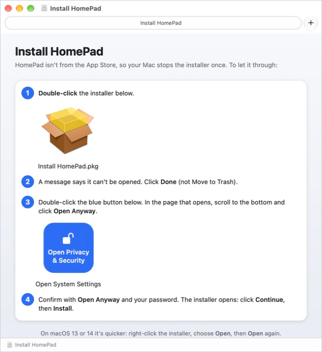
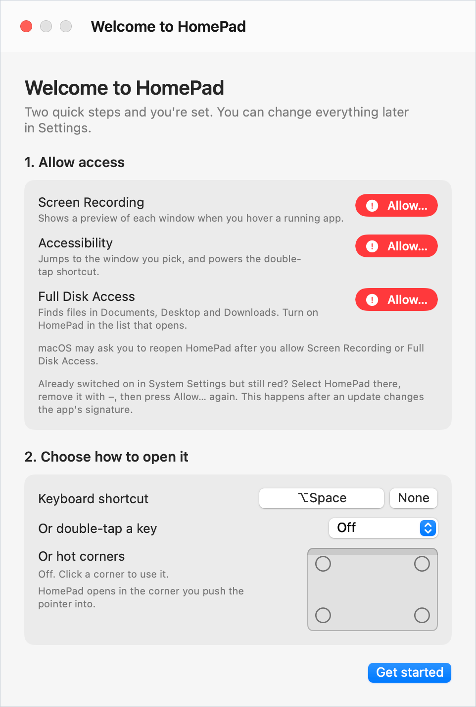
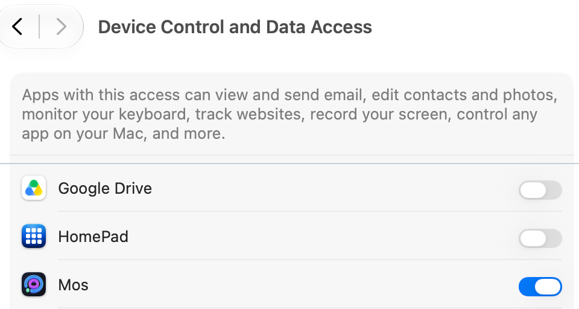

<!-- languages:start -->

<b>🌐 Language · Idioma · Langue · Sprache · Язык · 语言 · 言語 · 언어 · भाषा · لغة</b>

 

<table>
  <tr>
    <td align="center"><a href="../../README.md">English</a></td>
    <td align="center"><a href="README.ar.md">العربية</a></td>
    <td align="center"><a href="README.bn.md">বাংলা</a></td>
    <td align="center"><b>简体中文</b></td>
    <td align="center"><a href="README.fil.md">Filipino</a></td>
  </tr>
  <tr>
    <td align="center"><a href="README.fr.md">Français</a></td>
    <td align="center"><a href="README.de.md">Deutsch</a></td>
    <td align="center"><a href="README.hi.md">हिन्दी</a></td>
    <td align="center"><a href="README.id.md">Bahasa Indonesia</a></td>
    <td align="center"><a href="README.it.md">Italiano</a></td>
  </tr>
  <tr>
    <td align="center"><a href="README.ja.md">日本語</a></td>
    <td align="center"><a href="README.ko.md">한국어</a></td>
    <td align="center"><a href="README.fa.md">فارسی</a></td>
    <td align="center"><a href="README.pt-BR.md">Português (Brasil)</a></td>
    <td align="center"><a href="README.ru.md">Русский</a></td>
  </tr>
  <tr>
    <td align="center"><a href="README.es.md">Español</a></td>
    <td align="center"><a href="README.te.md">తెలుగు</a></td>
    <td align="center"><a href="README.th.md">ไทย</a></td>
    <td align="center"><a href="README.tr.md">Türkçe</a></td>
    <td align="center"><a href="README.vi.md">Tiếng Việt</a></td>
  </tr>
</table>

<!-- languages:end -->

# HomePad for macOS

> 本译文由 AI 撰写，尚未经母语者审校。HomePad 也提供这种语言；按钮和菜单的名称按应用显示的样子给出（可在设置 → 通用 → 语言中更改语言）。以[英文 README](../../README.md) 为准。

**你用到的一切，一键即达。** HomePad 是你的 Mac 一直缺少的启动器：把 App 分到类别里，收进文件夹，固定你的最爱，即时搜索一切，并让正在运行的 App 一目了然；如果你愿意，还可以配上 Windows 风格的任务栏。

一个 Windows 风格的启动器：按下快捷键，屏幕中央就会弹出一个面板，顶部是搜索栏（搜索的是 Spotlight 使用的同一个索引），下方是已固定 App 的网格。

HomePad 有三种模式。请在设置 → 模式中选择适合你的一种。

**任务栏。** 模仿 Windows 的任务栏和“开始”菜单。如果你在 macOS 上怀念 Windows 的使用体验，这里会让你有回家的感觉。

**Dock + HomePad。** 适合想保留 macOS 的“Dock”、但需要一个“开始”菜单式启动器的人。macOS 有“App”启动器，但它乏善可陈：它会自动把你的 App 分到类别里，你不能自己选择，不能把 App 归入文件夹，不能固定常用项，也不能按自己的方式排列。HomePad 把这些都解决了。

**独立。** 适合想让屏幕空间最大化的极简主义者，没有“Dock”或任务栏占据屏幕。需要时，用快捷键、连按或把鼠标甩向触发角来唤出 HomePad。它出现在屏幕中央，你可以完全掌控自己喜爱的 App、文件和文件夹、搜索，以及正在运行的 App 及其窗口。你不需要“Dock”，也不需要 Spotlight：你在一个地方就能掌控你的 Mac。一开始可能会觉得陌生，但习惯之后它强大得惊人。

## 安装

HomePad 是免费的，没有经过 Apple 签名，所以 macOS 会拦截它一次，并要求你确认它没有问题。整个过程大约五分钟，而且只需做一次。你需要 macOS 13 (Ventura) 或更高版本；Apple 芯片和 Intel 的 Mac 都可以。（[INSTALL.md](../../INSTALL.md) 用文字描述了同样的步骤，也涵盖 zip 和普通磁盘映像。）

**1. 打开安装器磁盘映像。** 连按 `HomePad-Installer.dmg`（来自把 HomePad 分享给你的人，或者自己构建：`tools/make_installer_dmg.sh`，参见 [Build and run](../../README.md#build-and-run)）。它的窗口列出了各个步骤。

**2. 连按 Install HomePad.pkg。** 你的 Mac 会说无法打开它。点按**完成**，不要点按“移到废纸篓”。

**3. 在“隐私与安全性”中允许它。** 连按磁盘映像窗口中蓝色的**打开“隐私与安全性”**图块（或自己打开系统设置 → 隐私与安全性），向下滚动到**安全性**，然后点按关于安装器的信息旁边的**仍要打开**。

**4. 确认。** 在随后出现的信息中点按**仍要打开**，然后使用触控 ID 或输入你的 Mac 密码。

<table align="center"><tr>
<td align="center"></td>
<td align="center"></td>
</tr></table>

> 在 macOS 13 Ventura 和 14 Sonoma 上有个捷径：右键点按安装器，选择**打开**，然后再次点按**打开**。

**5. 依次完成安装器的各个页面。** 在简介、“您需要了解”和目标位置（供这台电脑的所有用户使用）页面点按**继续**，然后点按**安装**。你的 Mac 会要求输入一次密码。当安装器提示 HomePad 已在“应用程序”文件夹中时，点按**关闭**。

<table align="center">
<tr>
<td align="center"></td>
<td align="center"></td>
</tr>
<tr>
<td align="center"></td>
<td align="center"></td>
</tr>
<tr>
<td align="center" colspan="2"></td>
</tr>
</table>

**6. 设置向导。** HomePad 会自动打开，并显示一个欢迎窗口。允许这三项权限，选择你想如何打开 HomePad（键盘快捷键、连按、触发角），然后点按**开始使用**。每项权限都是可选的，但三项都允许时 HomePad 效果最好。

**7. 权限。** 从上到下，依次点按每一项旁边的**允许…**。

- **录屏**（正在运行的 App 的窗口预览）。会出现一条带挂锁的信息：点按**打开“系统设置”**，打开 **HomePad** 旁边的开关，然后点按**退出并重新打开**。HomePad 会自动重新启动，欢迎窗口会回来。macOS 可能还会再问一次是否让 HomePad 直接访问你的屏幕：点按**允许**。

<table align="center">
<tr>
<td align="center" valign="top"></td>
<td align="center" valign="top"></td>
</tr>
<tr>
<td align="center" valign="top"></td>
<td align="center" valign="top"></td>
</tr>
</table>

- **辅助功能**（跳转到你选的窗口，以及连按快捷键）。点按**允许…**，然后点按信息中的**打开“系统设置”**，再打开 **HomePad** 旁边的开关（如果要求输入密码，请输入）。在较新的 macOS 上，这一页在英文界面中叫作 **Device Control and Data Access**。

- **完全磁盘访问权限**（在“文稿”、桌面和“下载”中查找文件）。点按**允许…**；系统设置会打开，旁边有一个小的 HomePad 窗口。打开 **HomePad** 旁边的开关。如果它不在列表中，把小窗口里的图标拖入列表。

**8. 开始使用。** 按 **Option-空格键**（或你选定的快捷键）。其余的一切，包括上面的三种模式，都在设置里：右键点按菜单栏中的网格图标，然后选择**设置…**。

## 使用方法

- **Option-空格键**打开和关闭面板（可在设置中更改），也可以连按 Control、Option 或 Command（设置 → 打开方式；需要“辅助功能”权限）。
- <strong>触发角</strong>：设置 → 打开方式 → 触发角。点按小屏幕的四个角中的任意一个（一个、几个或全部）。让指针在选定的角上停留片刻，面板就会在那个角打开；再做一次即可关闭。指针快速掠过角，或按住鼠标按钮拖移，都不会有反应。快捷键和连按仍会在屏幕中央打开它。设置向导的第二步里也有。如果 macOS 把同一个角用于它自己的操作，HomePad 会告诉你，并提供一个<strong>打开 macOS“触发角”…</strong>按钮，它会打开系统设置 → 桌面与程序坞，并直接显示“触发角”面板（点按该按钮需要“辅助功能”；没有它则只打开该页面）。
- **类别**：App 放在有名称的类别里。**常用**排在最前，首次启动时会根据你的 Dock 生成，另外还有一个**文件**类别，包含废纸篓和“下载”，就像 Dock 的右端（只在第一次运行时；删除之后就不会再出现）。用**添加类别**或在空白处右键点按来添加你自己的类别（浏览器、写作……）。新类别会显示一个灰色的“在这里添加你的 App”图块。在类别内右键点按可以重命名或删除它（其中的所有内容也会被取消固定；App 和文件本身不受影响）。
- **添加文件和文件夹**：**添加文件或文件夹**（顶部链接、右键菜单或设置），从访达拖入，或在搜索结果上右键点按 → 固定。点按即可打开；文件夹会在访达中打开。选取器是一个带侧边栏（个人、桌面、文稿、下载……、磁盘）的浏览窗口，还有一个**废纸篓**条目，用来固定你的废纸篓。点按侧边栏中的某个位置（文稿、下载、废纸篓……）会打开它并自己选中该文件夹，因此**添加**随时可用。这些窗口不会阻挡面板：把其中一个挪到一边，再把它里面的任意图块拖到面板中。在废纸篓图块上右键点按可选择**清倒“废纸篓”…**（会先询问；HomePad 像 Dock 一样让访达来清倒，所以第一次 macOS 会询问是否允许 HomePad 控制访达）。
- **类别顺序**：指向类别名称时它会变绿。按住它，整行就被选中（绿色填充和轮廓）；拖移时整行跟着移动，其他行滑开让出位置（面板保持不动）。松开后它就留在那里。或者在类别内右键点按并选择**上移** / **下移**。拖移期间，悬停效果和窗口预览会保持关闭。“常用”也可以移动；它仍然是新项目的默认位置，且不能删除。细灰线把各个类别隔开。
- **右键添加**：在类别内的空白处（它的标题，或图块之间和之后的空隙）右键点按，菜单会添加到*那个*类别：“添加 App 到文件…”“添加文件或文件夹到文件…”，另外还有该类别的添加类别、重命名和删除，以及**按字母顺序排序**（按图块显示的名称把该类别的图块按字母顺序排列；已经是这个顺序时为灰色；其文件夹内的图块保持原样）。最后一个部分下方的空白区域属于那个部分。
- **添加 App**：“添加 App”按钮（在选取器中连按某个 App 即可添加并关闭选取器）、在空白处右键点按、从访达拖入 App（拖移途中按下快捷键），或在搜索结果上右键点按 → 固定 App。
- **文件夹**（如同 Windows 的“开始”菜单）：把一个图块拖到另一个图块图标的中央，停留半秒，直到那个图标亮起，然后松开：这两个图块会在该处变成一个名为“文件夹”的文件夹，它的图块显示前四个项目。把更多图块放到文件夹上即可加入。点按文件夹可在面板上方打开它：点按它的名称可重命名，点按某个项目可打开它，拖移项目可重新排列或拖出文件夹（它会关闭，以便你把项目放在其他图块之间）。按 Esc 或点按外部可关闭它。只剩一个项目的文件夹会变回那个项目。在文件夹上右键点按可看到“重命名文件夹…”“移到”和“取消编组”；在已打开文件夹内的项目上右键点按可看到“从文件夹中移除”。拖到图块的边缘（而非中央）时仍只是重新排序。
- **移除 / 重新排序**：在图块上右键点按 → 取消固定 App / 移到，或者拖动图块，包括在类别之间拖动。
- **正在运行的 App**：图标正下方（名称上方）的红条表示该 App 正在运行。指向正在运行的 App，可看到它每个窗口的缩略图（最小化的窗口在关闭叉号旁有一个减号），覆盖每个桌面（Space），按“调度中心”的顺序排列，当某个 App 在多个桌面上都有窗口时标题会带有“Space N”，点按其中一个即可直接跳转（必要时会切换桌面），或点按它角上的叉号只关闭那个窗口（对其他桌面上的窗口也有效）（需要“录屏”和“辅助功能”；没有“录屏”时只得到一个普通列表）。点按正在运行的 App 会优先考虑当前桌面：那里显示着的窗口会把该 App 带到前面；如果它在那里的窗口都已最小化，则最近的一个会回来；只有那里完全没有窗口时，才会带你去它有窗口的另一个桌面。**正在运行**部分列出每个正在运行的 App（无论是否已固定，就像 Dock 的运行指示点）；不能向其中添加或移除任何内容，但它的图块可以**在其中拖移来重新排序**（在你移动某一个之前按字母顺序；顺序会被记住，已退出又重新启动的 App 也一样；图块不能放到其他任何地方，按 Esc 或在别处松开会让它回到原位；右键点按“正在运行” → **按字母顺序排序**会清除你的顺序），该部分本身不能重命名，但可以拖它的标题（或用它右键菜单中的**上移** / **下移**）移到类别之间的任意位置，也可以把它隐藏（在它上面右键点按 → 隐藏“正在运行”；用设置 → 面板 → 显示“正在运行”部分把它找回来）。每个正在运行的 App 的**最小化窗口**可以作为独立的图块跟在它的图块后面：一张窗口的图片，角上有该 App 的图标，并带有窗口的标题（就像 Dock 显示它们的方式）。点按其中一个可把该窗口带回来；右键点按可选择“恢复”或“关闭窗口”。它们默认关闭：打开设置 → 面板 → 在“正在运行”中显示最小化的窗口，或在“正在运行”上右键点按 → 显示最小化的窗口。每次打开面板时都会收集它们（需要“辅助功能”；图片需要“录屏”）。
- **正在运行的 App 的菜单**：在正在运行的 App 上右键点按，会出现类似 Dock 的菜单：它的窗口（最前面的带勾；选择一个即可把它带到前面）、它“文件”菜单中的“新建…”命令（浏览器里的新建标签页、新建窗口、新建隐私窗口），然后是**关闭窗口**（仅当它有打开的窗口时）、**隐藏**和**退出**（按住 Option 可强制退出；执行“退出”几秒后仍在运行的 App 会改为显示**强制退出**；访达没有“退出”，和 Dock 里一样，因为退出它会让桌面图标消失）。当指针到达图块时，会通过“辅助功能”读取窗口和命令。
- **查找文件**：“文稿”、桌面和“下载”中的文件，只有在 HomePad 获得**完全磁盘访问权限**（系统设置 → 隐私与安全性）后才会出现在搜索中。在此之前，结果中会显示一条带有开关链接的提示。
- **计算器**：输入一个算式，如 `7+3`、`(2+3)*4`、`2^10` 或 `15%`，答案会出现在最前面。按 ↩ 或拷贝按钮可拷贝它。
- **窗口**：拖移面板的任意边缘或角来调整大小（边缘有宽的抓取区域，并显示调整大小的光标），或拖移任意空白处来移动它（不包括图块网格本身，在那里拖移是重新排列图块）。每次打开面板时搜索栏都有焦点，所以可以立即输入；在别处点按之后，你输入的下一个键会回到搜索栏。设置 → 面板里有**记住窗口大小**（默认开启）和**记住窗口位置**（默认关闭）。设置齿轮旁边的 ↺ 按钮会让面板回到标准大小并居中。“添加 App”和“添加文件或文件夹”窗口也可以调整大小（它们每次都以标准大小打开）。
- 面板左下角的**你的名字**会在系统设置中打开你的 Apple 账户。
- **搜索**：直接开始输入。先是 App，然后是文稿和文件夹，最后是网页搜索。↑ ↓ 选择，↩ 打开，⌘↩ 在访达中显示，Esc 清除然后关闭。‹ 按钮或点按空白处也会回到你的 App。

## 首次运行

欢迎窗口会请你允许“录屏”“辅助功能”和“完全磁盘访问权限”，并选择如何打开 HomePad（参见安装）。随时可通过菜单栏图标 → 设置向导… 重新打开它。

## 设置

设置的工具栏上有六个标签页：**模式**、**通用**（语言、菜单栏图标、登录时打开、恢复默认设置、重新开始）、**任务栏**、**打开方式**（快捷键、连按、触发角）、**面板**（布局、窗口、项目）和**权限**。它会在你上次使用的标签页上打开。

- **快捷键**：点按按钮，然后按下新的组合键。要使用 ⌘空格键，请先在系统设置 → 键盘 → 键盘快捷键 → Spotlight 中关闭 Spotlight 的快捷键。
- **快捷键**：录制一个，如果你只想用连按就选择**无**，或者用**重置**把它恢复为 ⌥空格键。
- **菜单栏图标**：设置 → 通用可以将其隐藏。再次启动该 App 会打开面板。
- **恢复默认设置**：恢复快捷键、连按、布局、隐藏 Dock 和登录时打开（App 和类别会保留）。
- **连按**：连按两下 Control、Option 或 Command 来打开。
- **每行图标数**（默认 8，范围 4–10）、**行高**（图标行之间的距离，默认 101 pt，85–125）和**图标间距**（图标之间的水平间隙，默认 10 pt，0–40；当面板对于这个间隙太窄时，先缩小间隙，再缩小图标）：输入数字或点按 − / +，**显示正在运行的 App**，**从 Dock 重新导入**。
- **模式**（第一个标签页）：
  - <strong>独立</strong>（默认）：浮动面板，用快捷键、连按、触发角或菜单栏图标打开。切换到它会隐藏 Dock；下方的<strong>隐藏“Dock”</strong>可把它找回来。
  - **HomePad + “Dock”**：类似 Windows“开始”菜单的使用方式，把 Dock 当作任务栏。选择它会始终显示 Dock（它会关闭自动隐藏，无论是 HomePad 设置的还是系统设置里的），并在 Dock 里没有 HomePad 时把它加进去（Dock 会重新启动一次）；Dock 保持在你放置的位置。面板会直接在 HomePad 的图标旁打开（Dock 在底部时在图标上方，在侧边时在图标旁，并保持在屏幕内），无论你是点按图标还是使用快捷键或连按；再次点按图标会将其关闭。触发角仍会在它们各自的角打开。当 HomePad 不在 Dock 中、Dock 被隐藏或缺少“辅助功能”权限时，设置会说明面板为什么退回到屏幕中央打开。
  - **任务栏**：沿主屏幕底部的 Windows 风格任务栏：一个“开始”按钮（HomePad 的图标），然后是你固定在上面的内容和正在运行的 App，居中排列。这时正在运行的 App 会离开面板。在任务栏的空白处右键点按（**添加 App…**、**添加文件或文件夹…**）或在图块上右键点按（**固定到任务栏**；HomePad 的面板里也有）来固定 App、文件和文件夹。任务栏图标的菜单里还有**固定到 HomePad**（或从 HomePad 取消固定），用于 HomePad 自己的类别。也可以把 App、文件和文件夹从访达或 HomePad 的面板拖到任务栏上：它们会固定在你松开时所在图标的前面，或在空白处固定到末尾（已固定的会移到那里；面板保留它自己的那些）。任务栏的固定项是一个单独的列表，与 HomePad 的类别分开。沿着任务栏拖移图标可重新排序。**App 图标**放在**居中**或**靠左**；当它们居中时，**HomePad 图标**可以与它们一起居中，也可以靠左（App 图标靠左时它总在那里，所以这个选项为灰色）。在阿拉伯语和波斯语中，靠左就是靠右，和 Windows 一样镜像。HomePad 的图标靠左时，它的面板会在任务栏上方的左边缘打开。右侧有**网络**、**音量**、**电池**和**时钟**，每项都有一个开关：网络和电池在系统设置中打开它们的页面（在较新的 macOS 上，无法从外部打开 macOS 自己的状态菜单），音量打开一个滑块（在其上滚动可更改音量），时钟打开一个日历。点按某一项可打开它或把它带到前面（如果已经在前面则隐藏它）；指向正在运行的 App 可看到它的窗口；右键点按可打开它的菜单。设置 → 任务栏 → **正在运行的 App**（起初是折叠的）列出每个正在运行的 App，并带有**在任务栏中显示**开关；被关闭的 App 在运行期间不会出现在任务栏上（它的菜单里也有**从任务栏隐藏**）。已固定的项目始终显示。隐藏某个 App（Cmd-H）不会改变任务栏。面板在任务栏上方居中打开。这期间 Dock 是隐藏的。macOS 只允许 Dock 让窗口避开屏幕的一部分，所以借助“辅助功能”，当窗口在打开、调整大小、最大化或平铺后延伸到任务栏下方时，HomePad 会把它缩短（如果会太短则改为上移）。只是被拖到那里的窗口则保持不动，和 Windows 一样。（把真正的 Dock 留在任务栏下面行不通：指针经过它的图标时，它会显示名称标签。）**自动隐藏任务栏**会把它从屏幕底部滑出，直到指针在底边停留**显示前的延迟**那么久（0–1000 毫秒，默认 300，这样快速掠过底边不会把它显示出来）；当 HomePad 的面板、弹出窗口、窗口预览或菜单打开时，它会保持在上方，而此时窗口可以使用整个屏幕。**仅从“开始”按钮打开 HomePad** 会关闭快捷键、连按和触发角（菜单栏图标仍然可用）。
- **隐藏“Dock”**（仅限独立模式）：以 1000 秒的延迟打开 Dock 的自动隐藏，使它永远不会弹出。关闭它则恢复正常的 Dock。
- **登录时打开**。
- **语言**（设置 → 通用，或右键点按菜单栏图标 → 语言）：与 Mac 相同，或 20 种语言之一（阿拉伯语、孟加拉语、中文（简体）、英语、菲律宾语、法语、德语、印地语、印度尼西亚语、意大利语、日语、韩语、波斯语、葡萄牙语（巴西）、俄语、西班牙语、泰卢固语、泰语、土耳其语、越南语），按当前语言的字母顺序排列。HomePad 会以新语言重新启动；阿拉伯语和波斯语从右向左排版。App、文件夹和系统设置各部分的名称仍按 Mac 显示的样子。

## 设置权限

当你允许某项权限时（在设置向导、设置或窗口预览中），HomePad 会留意它是否已在系统设置中打开，一旦打开就立即回到前台。“录屏”和“完全磁盘访问权限”通常需要重新启动：当系统设置提示**退出并重新打开**时，HomePad 会退出，自行重新启动，并重新打开你刚才所在的窗口。

只有在缺少权限时，设置向导才会在首次启动时出现。要从头再走一遍，请使用**设置 → 通用 → 重新开始…**：macOS 会收回 HomePad 的权限，向导会再次出现，HomePad 会重新启动（勾选该复选框还会清除你的类别和设置，就像全新安装一样）。

## 开发

构建应用的说明、翻译的工作方式、文件列表和应用图标只在[英文 README](../../README.md#development) 中提供。

## 许可证

[MIT](../../LICENSE)。
